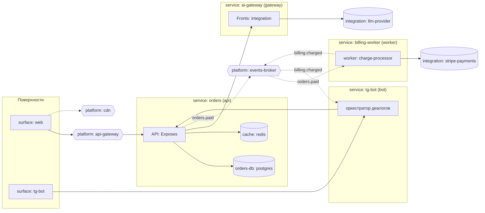

# architecture

> Архитектура (architecture) — **singleton** слоя сервисов: свод топологии
> проекта в одну картинку + авторские решения разбиения. Один файл на проект.
>
> Рёбра топологии здесь **не авторятся** — они уже записаны снизу-вверх:
> surface → service в `service.md` (колонка `surfaces`), sync — в
> `Dependencies` паспортов, async — в `Messaging`, платформа — в паспортах +
> `platform.md`, размещение — в `infrastructure/placement.md`. Диаграмма —
> свод; расхождение диаграммы с паспортами — находка `/service-audit`, канон —
> паспорта. Единственное, что авторится здесь, — **решения** (`Decisions`):
> целостный взгляд, которого нет ни в одном паспорте.

## Topology

> Одна **полная** mermaid-диаграмма `flowchart LR` — вся топология проекта на
> одной картинке. Каждый сервис — свой subgraph: внутри его воркеры
> (`Workers`) и собственные ресурсы (`Resources` — БД, кэши); поверхности —
> subgraph слева; платформа (входной api-gateway, брокер с подписями-topic'ами,
> CDN) — между ними; внешние интеграции — справа у gateway-сервисов. Узлы —
> только slug'и из `service.md` / `platform.md` / `surface.md` /
> `integration.md` / паспортов, ничего нового. Сплошная стрелка = sync
> (`Dependencies`/`Exposes`), пунктирная = async (`Messaging`). Диаграмма —
> свод полного состава: каждый сервис, каждый платформенный ресурс и каждая
> интеграция проекта присутствуют (выпавший узел — находка `/service-audit`).

> Шаблонная диаграмма выше — пример полноты и нотации; при заведении слоя
> заменяется на реальную и **растёт вместе с паспортами**: новый сервис /
> ресурс / topic — новое место на картинке. Размещение (какой сервис на
> каком сервере) сюда не рисуется — это свод периметра
> (`docs/projects/infrastructure/README.md § Topology`).

## Decisions

> Нумерованный список авторских решений разбиения — falsifiable-утверждения,
> по одному на решение: почему такие границы сервисов, что осталось монолитом
> и почему, что вынесено worker'ом, где осознанно допущена sync-связь и почему
> это не распределённый монолит, почему выбран свой/общий брокер. Это
> единственная prose-«голова» слоя.

1. **<Решение 1>.** <Обоснование: чем подтверждается, что станет сигналом
   пересмотра.>

## Flows

> Опционально: 3–7 ключевых сквозных потоков, по одной строке каждый —
> иллюстративный свод, не источник истины. Если не нужен — `_нет_`.

- <поток>: `web` → `api-gateway` → `orders` → topic `payments` →
  `billing-worker`

<!-- Или: -->
<!-- - _нет_ -->
