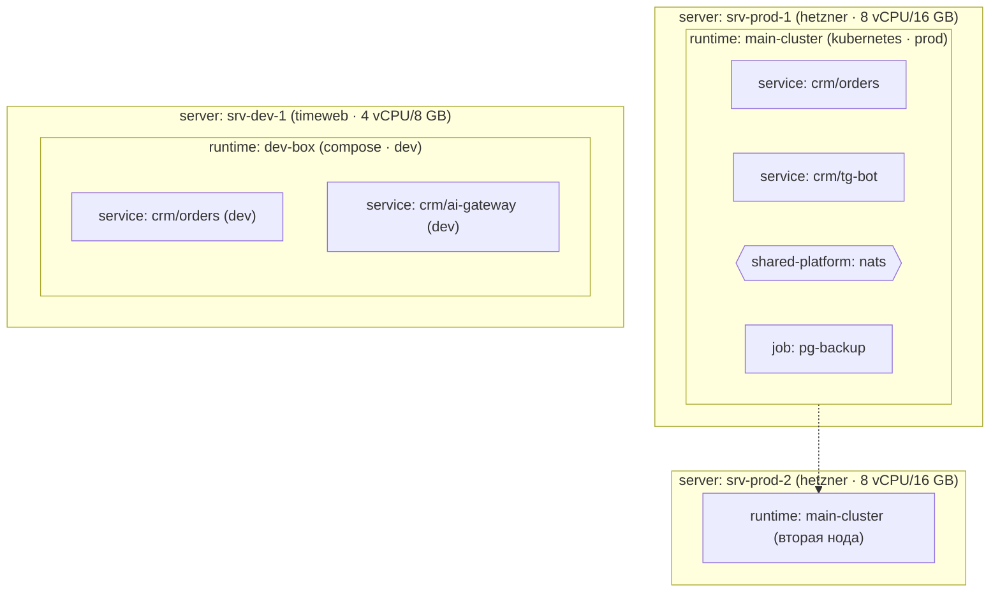

# ИТ-периметр бизнеса

Смысловое очертание **физической** стороны всех продуктов бизнеса — один слой
на бизнес (как `project-map.md`, межпроектный; в `_template/` не
шаблонируется — канон формы и данные живут здесь же): какие у бизнеса
**сервера**, какие на них развёрнуты **рантаймы** (kubernetes-кластер или
compose-хост), какие **общие платформенные ресурсы** обслуживают все проекты
(один брокер, один traefik, один registry) и **где живёт каждый юнит** —
размещение сервисов и ресурсов по рантаймам.

Слой замыкает e2e-цепочку проектирования: проектный слой `services/`
описывает, **что** мы строим (deployment-agnostic), периметр — **где** это
живёт. Инфра-репо `<org>/infra` читает оба и понимает, что билдить, что
провижинить и куда раскладывать; runtime-механика (реплики, размеры,
манифесты, версии) — его решение, не upstream'а.

## Структура

```
docs/projects/infrastructure/
├── README.md          ← этот файл: канон слоя
├── server.md          ← учёт серверов
├── runtime.md         ← среды исполнения (k8s-кластер / compose-хост)
├── shared-platform.md ← общие платформенные ресурсы бизнеса
├── job.md             ← реестр-хребет джоб периметра (бэкапы, ротация, сертификаты)
├── jobs/
│   └── <job-slug>.md  ← полное описание джобы (Does · Retention · Verify · On failure)
└── placement.md       ← размещение: какой юнит где живёт
```

Каждый файл — реестр в стиле слоя проектов: критерии + «Что НЕ» +
тест-критерий + колонки + таблица данных. Канон формы и данные — в одном
файле (слой не копируется, он один).

## Инварианты слоя

1. **Каждый сервис каждого проекта размещён.** По реестрам
   `projects/<slug>/services/service.md`: у каждого сервиса есть строка в
   `placement.md` хотя бы для одного prod-рантайма.
2. **Каждый размещаемый ресурс размещён.** Проектные платформенные ресурсы с
   `provided-by: own` и все записи `shared-platform.md`, которые потребляет
   хотя бы один проект, имеют placement.
3. **Рефы резолвятся.** `runtime.servers` → строки `server.md`;
   `placement.unit` → реестры сервисов/платформы проектов,
   `shared-platform.md` или `job.md`; `provided-by: shared:<slug>` проектов →
   `shared-platform.md`; `job.target` → учтённые сущности периметра/проектов.
4. **Единственное место «кто где».** Размещение не дублируется ни в
   паспортах сервисов, ни в реестрах проектов — только `placement.md`.
   Джобы периметра — тоже юниты: каждая имеет placement
   (`unit: job:<slug>`).
5. **Без runtime-механики и секретов.** Ни IP, ни hostname, ни доступов, ни
   реплик, ни версий — это `<org>/infra`. Здесь — смысл и ёмкость.

## Связи с остальными слоями

- `projects/<slug>/services/service.md` — реестр юнитов, которые периметр
  размещает (`placement.unit = service:<project>/<svc>`).
- `projects/<slug>/services/platform.md` — потребности проектов в платформе;
  `provided-by: shared:<slug>` дотягивается до `shared-platform.md`,
  `provided-by: own` — до собственного placement.
- `projects/<slug>/services/<svc>/README.md § Resources` — что провижинить
  на рантайме, куда сервис размещён (БД, кэши, бакеты).
- Сквозную сверку (полнота размещения, цепочка shared-ресурсов) ведут
  `/infrastructure-audit` (структура) и `/cross-audit` (углы
  `service-placement` · `platform-shared`).

## Topology

> Mermaid-свод периметра — вся физика бизнеса на одной картинке: каждый
> сервер — subgraph, внутри его рантаймы; внутри рантаймов — размещённые
> юниты (`placement.md`): сервисы проектов, платформенные ресурсы, общие
> ресурсы, джобы. Диаграмма — **свод**, размещение авторится в
> `placement.md`; расхождение — находка `/infrastructure-audit`. Полнота:
> каждый сервер, рантайм и размещённый юнит присутствуют.



> Шаблонная диаграмма — пример нотации (k8s-кластер на двух серверах,
> dev-compose на третьем); заменяется на реальную и растёт вместе с
> `placement.md`. Внутренние связи сервисов (кто кого зовёт, топики) сюда
> не рисуются — это `services/architecture.md § Topology` каждого проекта.

## Сводимость в C4

Периметр — источник Deployment-вида C4 (генерация — отдельным промптом,
когда понадобится): узлы — `server.md` и `runtime.md`, контейнеры на узлах —
`placement.md`, сами контейнеры — реестры `service.md` проектов и
платформенные ресурсы. Остальные высоты C4 выводятся из слоёв проекта — см.
`docs/projects/_template/services/README.md § Сводимость в C4`.

## Workflow

```
1. Завести сервера (server.md) — по мере появления железа/VPS.
2. Завести рантаймы (runtime.md) — что на серверах развёрнуто:
   k8s-кластер на нескольких, compose на одном; среда (prod/staging/dev).
3. Завести общие ресурсы (shared-platform.md) — когда ≥1 проект объявил
   потребность provided-by: shared:<slug> (или решением архитектора).
4. Завести джобы периметра — строка в реестре job.md + файл
   jobs/<slug>.md (шаги, retention, проверка успеха, поведение при провале).
5. Разместить юниты (placement.md) — каждый сервис, размещаемый ресурс и
   джоба получают рантайм; /infrastructure-deep-dive ведёт coverage-сводку
   «кто ещё не размещён».
6. Гейт: /infrastructure-audit + углы /cross-audit перед коммитом.
```

Вход в слой — `/infrastructure-deep-dive` (фазы: servers → runtimes →
shared-platform → jobs → placement → cohesion). Узкий аудит —
`/infrastructure-audit`.

## Anti-patterns

- ❌ **IP / hostname / ОС / доступы в `server.md`.** Чувствительное и
  летучее живёт в `<org>/infra`; здесь — провайдер, локация, ёмкость, смысл.
- ❌ **Размещение в паспорте сервиса или реестре проекта.** Проектный слой
  deployment-agnostic; «кто где» — только `placement.md`.
- ❌ **Shared-ресурс, который не потребляет ни один проект.** Общий брокер
  без единого `provided-by: shared:` — сирота.
- ❌ **Runtime без серверов.** Кластер или compose-хост обязан стоять на
  строках `server.md`.
- ❌ **Два проекта поднимают `own`-ресурс одной технологии**, когда
  напрашивается общий (две независимые NATS «потому что так вышло») —
  подозрение, не запрет: осознанная изоляция допустима.
- ❌ **Runtime-механика** (реплики, версии k8s, helm-values,
  cron-выражения, конфиги) в любом файле слоя. Retention **смыслом**
  («30 ночных копий») в файле джобы — легитимен; retention-конфиг — нет.
- ❌ **Продуктовый воркер как джоба периметра.** Фоновая работа продукта —
  файл `services/<svc>/workers/<slug>.md` или сервис `type: worker`;
  `job.md` — только уход за инфраструктурой.
