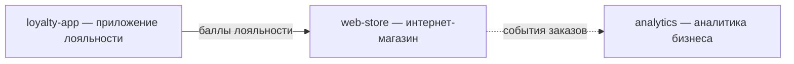

# project-map

> Карта проектов (project-map) — холистический граф **точек стыка между
> продуктами одного бизнеса**, на языке бизнеса. У бизнеса бывает несколько
> проектов (`docs/projects/<slug>/`); они взаимодействуют — обмениваются
> данными, зовут друг друга, делятся событиями. Каждое такое ребро здесь —
> отдельная строка.
>
> Это **singleton** (один на весь бизнес, копировать нечего): канон формы и
> данные живут в этом же файле — критерии сверху, таблица рёбер снизу.
>
> Карта **сводит** межпроектные интеграции в граф и даёт обзор «кто что
> делает» — **без технических подробностей**. Авторская сторона ребра —
> `integration` проекта-инициатора (`target: sibling-project` +
> `sibling-project` → slug соседа); техническое воплощение стыка (порт,
> функции клиента, события) живёт в `services/`, не здесь. Согласованность
> трёх сторон (integration ↔ project-map ↔ services) сверяет `/cross-audit`.

## Критерии project-map

1. **Ребро = реальный обмен между двумя продуктами.** Не «оба про лояльность»,
   а «приложение лояльности шлёт начисления в основной магазин». Если обмена
   нет — ребра нет.
2. **Направление с точки зрения `from-project`.** `out` — `from-project`
   пишет в `to-project`; `in` — получает; `duplex` — двунаправленно.
3. **Опирается на интеграцию.** У каждого ребра есть `via` — чем стык
   реализован: `` `integration:<slug>` `` (запись в `integration.md`
   проекта-инициатора с `target: sibling-project`), `` `event:<name>` ``
   (междоменное/межпроектное событие) или `` `domain-port:<ctx>.<Op>` ``
   (порт в use-case). Ребро без `via` — не доказано.
4. **Оба проекта существуют.** `from-project` и `to-project` — slug'и
   реальных папок `docs/projects/<slug>/` (не `_template`).
5. **Без циклов-самоссылок.** `from-project` ≠ `to-project`. Двусторонний
   обмен — это `direction: duplex`, не два встречных ребра.
6. **Только бизнес-язык.** `payload` описывает, **что течёт между
   продуктами**, словами бизнеса. Сигнатуры функций, endpoint'ы, имена
   портов — не сюда: техника живёт в `services/`, карта остаётся обзором.

## Что project-map НЕ

- ❌ Связь проекта с **внешней** системой (Stripe, CRM). Это обычная
  `integration` (`target: external`), в карту не попадает.
- ❌ Связь через общую проблему бизнеса (`business-problem`). Несколько
  проектов под одной проблемой — это `vision.addresses-problem` (M:N),
  не стык продуктов; ловит `/cross-audit` угол `addresses-problem`.
- ❌ Дублирование `integration`. Карта **ссылается** на интеграции через
  `via`, не переписывает их payload/owner.
- ❌ Технические подробности стыка (сигнатуры функций, endpoint'ы, имена
  use-case'ов). Это `services/` (клиент в `services/_shared/`, потребление в
  use-case); сверяет `/cross-audit`.
- ❌ Маршрутная схема внутри одного продукта (между его доменами). Это
  `relations`/`emits`/`consumes` доменов и `Dependencies`/`Messaging`
  паспортов в `services/`, в пределах проекта.

## Тест-критерий

«Если убрать `to-project` из бизнеса — что **сломается** в `from-project`?»

- Убрали приложение лояльности → в магазине пропали баллы при оплате →
  ✅ реальное ребро.
- Убрали соседний продукт, и ничего не изменилось → ❌ ребра нет (мнимый
  стык).

## Колонки

- `slug` — устойчивый идентификатор ребра · `kebab-case` · обяз.
- `from-project` — проект-инициатор обмена · `` `project-slug` `` · обяз.
- `to-project` — соседний проект · `` `project-slug` `` · обяз.
- `direction` — поток с точки зрения `from-project` · `in` \| `out` \| `duplex` · обяз.
- `payload` — что течёт между продуктами, в языке бизнеса · текст · обяз.
- `via` — чем реализован стык · `` `integration:<slug>` `` \| `` `event:<name>` `` \| `` `domain-port:<ctx>.<Op>` `` · обяз.
- `status` — зрелость записи · `draft` \| `stable` · обяз.

> Пока проектов нет или они не взаимодействуют — таблица пустая.

| slug | from-project | to-project | direction | payload | via | status |
|---|---|---|---|---|---|---|

> Заполняется под бизнес. Пример: `loyalty-to-store` · `` `loyalty-app` `` ·
> `` `web-store` `` · `out` · «Начисления и списания баллов лояльности» ·
> `` `integration:loyalty-sync` `` · `draft`.

## Topology

> Mermaid-свод графа продуктов — все проекты бизнеса на одной картинке.
> Узлы — проекты (`docs/projects/<slug>/`), рёбра — строки таблицы выше
> (подпись — `payload` коротко; пунктир — событийный `via`, сплошная —
> вызов). Диаграмма — **свод**, рёбра авторятся в таблице; расхождение —
> находка `/cross-audit` (угол `projectmap-reciprocity`). Держится в
> бизнес-языке: без сервисов, топиков и техники (это `services/` проектов
> и их `architecture.md`).

> Шаблонная диаграмма — пример нотации; пока проектов нет, блок остаётся
> с пустой диаграммой или удаляется до первого ребра.
