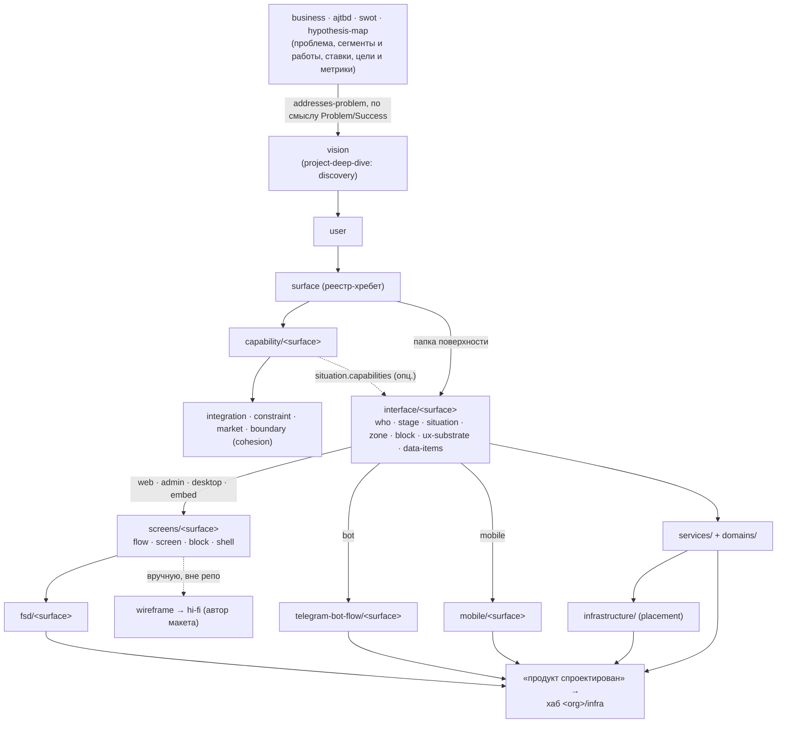

# 01. Устройство слоя проекта

Факты — с путями; собственные выводы помечены «(вывод)». Детальные правила каждого артефакта — в
`03-current-rules.md`, оценка — в `04-quality.md`.

## Коротко

- Слой проекта — `docs/projects/`: папка на продукт `docs/projects/<slug>/` плюс общие для бизнеса
  `project-map.md` (стыки продуктов) и `infrastructure/` (ИТ-периметр). Канон формы живёт один раз в
  `docs/projects/_template/`, в папках проектов — только данные. Заполненных проектов в шаблоне нет.
- Ось продукта — **поверхность** (`surface.md`): её slug партиционирует `capability/<surface>.md`,
  `interface/<surface>/` и слой композиции, который выбирается по `surface.type`: `screens/` (+
  `fsd/`) для web / admin / desktop / embed, `telegram-bot-flow/` для bot, `mobile/` для mobile.
- Цепочка: vision → surface → user → capability → interface → композиция (screens / бот / mobile) →
  FSD → код-репо; бэкенд — `services/` с доменами, размещение — `infrastructure/`. Макет в цепочку не
  входит: «wireframe и hi-fi автор макета собирает вручную» (`CLAUDE.md` §3).
- Каждый слой ведёт свой исполнитель `*-deep-dive` (пишет артефакты через `AskUserQuestion`) и
  проверяет свой узкий `*-audit` (только отчёт); сквозную сходимость — `/cross-audit` (рой агентов);
  вход «не думая, в какой слой» — оркестратор `/entrypoint` (аналитик) и `/entrypoint-for-business`
  (клиент).
- Всегда в контексте: `CLAUDE.md` (≈4,1 тыс. токенов) и описания 29 скиллов (≈9,5 тыс. токенов;
  в листинге этой сессии у 7 скиллов описание не показано). Скилл при вызове добавляет свой `SKILL.md`
  (≈1,6–8,1 тыс. токенов) и references по мере надобности.

## 1. Место слоя в репо и во флоу

Репозиторий — «**шаблон бизнес-стратегии**. Его форк `<org>/strategy` — design-time источник истины:
бизнес заказчика…, AJTBD, SWOT, Карта гипотез, а когда стратегия требует продукта — проектирование
продуктов… и ИТ-периметр бизнеса. Кода здесь нет: stable-артефакты read-only читают код-репо»
(`CLAUDE.md`, «Роль репо и флоу»). Экосистема — 7 шаблонов; форки одной организации лежат рядом
(`../<name>`):

| шаблон → форк | роль | что читает из слоя проекта (`docs/README.md:114-130`) |
|---|---|---|
| `business-strategy-template` → `<org>/strategy` | стратегия и проектирование продукта | — (источник) |
| `project-infra-template-compose` → `<org>/infra` | runtime и операционный хаб | `vision.md`, `surface.md`; контекст — `services/{service,platform}.md`, `Resources`/`Messaging` паспортов, `infrastructure/` |
| `go-backend-template` → `<org>/backend` | Go-сервис | `services/<svc>/domains/<ctx>/`, `services/_shared/`, паспорт сервиса |
| `spa-frontend-template` → `<org>/frontend` | React SPA (кабинет, всё за логином) | `fsd/<surface>/` (stable) + `{interface,screens}/<surface>/` + product-файлы + домены (контекст) |
| `ssr-frontend-template` → `<org>/site` | Astro SSR-сайт (индексируемый контент) | `fsd/<surface>/` (stable) + `{interface,screens}/<surface>/` — **без product-файлов** |
| `telegram-bot-template` → `<org>/<bot>` | Telegram-бот | `telegram-bot-flow/<surface>/` + `interface/<surface>/` + домены |
| `mobile-template` → `<org>/mobile` | KMP Android + iOS | `mobile/<surface>/` (stable, 12 kind) + `interface/<surface>/` + домены |

Контракт «**read-only и односторонний**: соседи **читают** stable-артефакты этого репо, сами в него
не пишут» (`docs/README.md:114-116`). Верхние слои (business, ajtbd, swot, hypothesis-map) не читает
ни один код-репо (вывод по таблице): всё, что стратегия хочет донести до кода и макета, должно быть
переписано в проектный слой.

Флоу (`CLAUDE.md`): старт — здесь (`/entrypoint` или `/entrypoint-for-business`; «до кода
проектируется всё, что можно»); продукт спроектирован → хаб `<org>/infra` (`/init-project` читает
strategy); «Дизайн меняется по ходу — агент из хаба приходит сюда (`../strategy`)… Прямой заход сюда
без хаба — такой же нормальный режим». «Продукт — опциональный исход»: проблему может закрыть задача
(`task`) без продукта (`README.md:56-58, 91-92`).

## 2. Структура `docs/projects/`

```
docs/projects/
├── README.md            корень слоя: форма vs данные, M:N с business-problem, project-map, пикеры, anti-patterns
├── project-map.md       singleton бизнеса: канон формы + данные стыков между продуктами (рёбра + mermaid)
├── infrastructure/      ИТ-периметр бизнеса (один на все проекты; канон и данные в одних файлах)
│   └── server.md · runtime.md · shared-platform.md · job.md (+ jobs/<slug>.md) · placement.md
├── _template/           КАНОН ФОРМЫ (образец, не данные; read-only)
│   ├── project/         README + vision · surface · user · capability · boundary · integration · constraint · market
│   ├── interface/       README + _template/ (7 файлов одной папки поверхности)
│   ├── screens/         README + _template/ (4 формы kind)
│   ├── fsd/             README + _template/ (8 файлов)
│   ├── telegram-bot-flow/  README + _template/ (command, notification, features/{README,dialog,window,use-case})
│   ├── mobile/          README + _template/ (12 файлов)
│   └── services/        README + service · platform · architecture + _shared/ + _templates/ (10 форм)
└── <project-slug>/      ДАННЫЕ одного продукта
    ├── vision.md · surface.md · user.md · integration.md · boundary.md · constraint.md · market.md
    ├── capability/<surface>.md
    ├── interface/<surface>/          who · stage · situation · zone · block · ux-substrate · data-items
    ├── screens/<surface>/            flows/ screens/ blocks/ shells/ (<slug>/index.md) + assets/<kind>/<slug>/
    ├── fsd/<surface>/                entities · features · pages · widgets · app · shared-ui · shared-api · shared-lib
    ├── telegram-bot-flow/<surface>/  command.md · notification.md · features/<feature>/{dialog,window,use-case}.md + assets/
    ├── mobile/<surface>/             12 kind
    └── services/                     service.md · platform.md · architecture.md · _shared/ · <svc>/ (паспорт, workers/, domains/<ctx>/)
```
(`docs/projects/README.md:27-65`; сверено с деревом файлов.)

Правила структуры (`docs/projects/README.md:57-135`): «Канон формы живёт **один раз** в
`_template/`; папки проектов держат только данные. Скилы читают форму из `_template/<слой>/`, пишут
данные в `<project-slug>/...`»; папки поверхностей «заводят их скилы… при первом заходе на
поверхность — каталоги руками не создаём»; «❌ Папка поверхности… для поверхности, которой нет в
реестре `surface.md`»; «❌ `screens/<surface>/` или `fsd/<surface>/` для мобильной поверхности»; «❌
Домены на корне проекта мимо сервиса»; «❌ Размещение (сервер/рантайм) в слоях проекта. "Кто где
живёт" — только `infrastructure/placement.md`». `docs/projects/README.md:43` упоминает `README.md` в
папке проекта («чем продукт, какие проблемы закрывает»), но канона для него нет и скаффолд его не
создаёт.

**Тип поверхности → какие слои она получает** (сведено из `surface.md:8-17`,
`_template/project/README.md:151-158`, пикеров исполнителей):

| `surface.type` | capability | interface | композиция | FSD | код-репо |
|---|---|---|---|---|---|
| `web` · `admin` · `desktop` · `embed` | `capability/<s>.md` | `interface/<s>/` | `screens/<s>/` | `fsd/<s>/` | `<org>/frontend` или `<org>/site` (выбирает код-репо) |
| `bot` | да | да | `telegram-bot-flow/<s>/` | нет | `<org>/<bot>` |
| `mobile` | да | да | `mobile/<s>/` (вместо screens и fsd) | нет | `<org>/mobile` |
| `api` | да | да | не определено (screens не исключён) | нет («UI отсутствует») | — |
| `other` | да | да | не определено | нет | — |

Рода продукта (сайт / лендинг / SaaS-кабинет / контентный сайт) в модели нет: «`type` поверхности
технологию не задаёт: какой из форков разворачивает карту поверхности, решает привязка в код-репо»
(`_template/fsd/README.md:24-26`).

## 3. Артефакты слоя

Все артефакты создаёт только исполнитель своего слоя (`CLAUDE.md` §6); узкий аудит только читает;
`/cross-audit` читает всё. Статусы — `draft` | `stable` у каждой записи (у vision ещё `lifecycle`).

| слой / артефакт | канон формы | данные | форма | нейминг | создаёт | читает (кроме своей пары) |
|---|---|---|---|---|---|---|
| **vision** | `_template/project/vision.md` | `<slug>/vision.md` | singleton: 3 H2 (Problem · Success · Non-goals) + bold-строки осей | — | `/project-deep-dive` (клиент — `/entrypoint-for-business`) | все проектные скиллы (пикер, контекст), рой research, `/cross-audit`, reconcile-up, `<org>/infra` |
| **surface** | `…/project/surface.md` | `<slug>/surface.md` | реестр-таблица (7 колонок) | slug = имя файлов/папок поверхности во всех слоях | `/project-deep-dive` | пикеры всех поверхностных скиллов, `service.md.surfaces`, `Exposes.audience`, `integration.surface`, `<org>/infra` |
| **user** | `…/project/user.md` | `<slug>/user.md` | таблица (9 колонок) | kebab slug | `/project-deep-dive` | `surface.user`, `capability.user`, `who.users`, `subject.users`, `/cross-audit` |
| **capability** | `…/project/capability.md` | `<slug>/capability/<surface>.md` | таблица на поверхность (8 колонок) | slug уникален в файле поверхности | `/project-deep-dive` | interface (`situation.capabilities`), screens/домены (только state), mobile, бот (контекст), `/cross-audit` |
| boundary · constraint · market | `…/project/{boundary,constraint,market}.md` | `<slug>/*.md` | таблицы | kebab slug | `/project-deep-dive` (market — в основном роем research) | `/cross-audit`, mobile (контекст) |
| integration | `…/project/integration.md` | `<slug>/integration.md` | 2 таблицы: Провайдеры + Функции | slug функции общий на трёх высотах | `/project-deep-dive` | services / домены (клиент `_shared/integrations/`, use-case `functions`), `/cross-audit` |
| project-map | `docs/projects/project-map.md` (канон + данные) | тот же файл | рёбра + mermaid `Topology` | slug ребра | авторская сторона — `integration` инициатора (явного исполнителя строк нет) | `/cross-audit` |
| **interface** (7 kind) | `_template/interface/README.md` + `_template/*.md` | `<slug>/interface/<surface>/<kind>.md` | 7 таблиц | slug в пределах поверхности | `/interface-deep-dive` | screens, fsd, бот, mobile, `/cross-audit`; код-репо — как контекст |
| **screens** (4 kind) | `_template/screens/README.md` + `_template/*.md` | `<slug>/screens/<surface>/<kinds>/<slug>/index.md` + `assets/` | файл на запись: YAML-frontmatter + дерево в yaml-блоке | slug = имя папки | `/screen-deep-dive` | fsd (`pages.screen`, `widgets.block`), `/cross-audit`, автор макета |
| **fsd** (8 kind) | `_template/fsd/README.md` + `_template/*.md` | `<slug>/fsd/<surface>/<kind>.md` | 8 таблиц | slug по источнику | `/fsd-deep-dive` | `<org>/frontend`, `<org>/site` (stable) |
| **mobile** (12 kind) | `_template/mobile/README.md` + `_template/*.md` | `<slug>/mobile/<surface>/<kind>.md` | 12 таблиц (shell, shared-lib — секции) | `key` PascalCase, slug kebab, push UPPER_SNAKE | `/mobile-deep-dive` | `<org>/mobile`, `/cross-audit` |
| **telegram-bot-flow** | `_template/telegram-bot-flow/README.md` + формы | `<slug>/telegram-bot-flow/<surface>/…` | реестры корня + папка фичи (dialog frontmatter, H2-секции окон и use-case) | `states-group`, `state`, `operation`, `id` | `/telegram-bot-flow-deep-dive` | `<org>/<bot>`, сервис `type: bot`, `/cross-audit` |
| **services** | `_template/services/README.md` + реестры + `_templates/` | `<slug>/services/…` | реестры + паспорт (9 H2) + доменные файлы | id домена `<ctx>.<Name>` | `/service-deep-dive`, `/domain-deep-dive` | `<org>/backend`, `<org>/infra`, фронты (контекст), `/cross-audit` |
| **infrastructure** | `docs/projects/infrastructure/*.md` (канон + данные) | те же файлы | 5 реестров + `jobs/<slug>.md` | `unit` в placement | `/infrastructure-deep-dive` | `<org>/infra`, `/cross-audit` |

## 4. Порядок работы: от бизнес-слоя до экранов и FSD



1. **Вход.** `/entrypoint` сегментирует сырьё на темы, относит каждый чанк к слою и kind по
   сигнальной таблице (`entrypoint/references/routing.md:48-82`) и по подтверждению активирует
   исполнителя; прямой вызов исполнителя тоже допустим. Проект оркестратор определяет «из сырья или
   вопросом»; завести новый проект может только `/project-deep-dive` (пикер «Завести новый» / `--new`).
   Порядок слоёв жёстко не задан: «сверху вниз» — подпись таблицы, не правило; ворота только
   структурные (нет проекта → нижние исполнители выходят; пустой `surface.md` → «сначала заведи
   поверхность»).
2. **Заведение проекта** (`project-deep-dive/SKILL.md:30-82`): имя по-человечески, slug выводит
   скилл; копия из `_template/project/` — `vision.md` + 6 плоских файлов (`surface`, `user`,
   `integration`, `boundary`, `constraint`, `market`) + пустая папка `capability/`; «Канон-README
   **не** копируется»; фаза `discovery`.
3. **Продуктовый слой — 8 фаз** (`project-deep-dive/references/phases.md`): `discovery` (vision) →
   `user` → `surface` → `capability` (по каждой поверхности; «Не стартует без `surface`») →
   `integration` → `constraint` → `market` (в основном роем web-research) → `cohesion` (boundary,
   повышение в stable, аудиты); boundary можно завести и сразу после `discovery`, если Non-goals
   выявил устойчивые границы (`phases.md:54-55`). «Порядок — рекомендация, не закон»; перепрыгивание фиксируется в
   `_phase-jump.md`. Вверх продукт опирается на `business-problem`, `goal`, `metric` («Продукт — **не
   корень всего**, а решение под уже формализованную бизнес-проблему»; без верхних слоёв «discovery
   идёт как обычно»).
4. **interface** (`/interface-deep-dive <slug> <surface>`): при первом заходе — scaffold 7 файлов;
   работа от сущности (режим A / C) или от сырья (B); связь с продуктом — раунды `who.users` и
   `situation.capabilities`. Порядка заполнения 7 таблиц нет (субстраты заводятся из ситуации, блоки —
   после субстратов).
5. **Композиция по типу поверхности**: screens (`/screen-deep-dive`: shell → screen → block, flow —
   в конце), бот (`/telegram-bot-flow-deep-dive`: dialog → window → use-case → command →
   notification), mobile (`/mobile-deep-dive`: inside-out по 12 kind + линза платформы).
6. **FSD** (`/fsd-deep-dive`, только web-подобные): inside-out entities → features → pages → widgets
   → app → shared-ui → shared-api → shared-lib; слайс без источника (ситуация / экран / блок / домен)
   не заводится.
7. **Бэкенд и периметр**: `/service-deep-dive` (7 фаз), `/domain-deep-dive` (12 волн),
   `/infrastructure-deep-dive` (6 фаз).
8. **Аудит и выход.** Перед коммитом — узкий аудит каждого тронутого слоя, при нескольких слоях —
   `/cross-audit` (`CLAUDE.md` §5). «Проектирование продукта здесь закончено, когда слои, которые
   читают код-репо (`services/` с доменами, FSD-карта, `telegram-bot-flow/`, `mobile/` — по типам
   поверхностей), и ИТ-периметр доведены до `stable`, а узкие аудиты и `/cross-audit` чистые»
   (`routing.md:165-176`). Макет в критерий не входит.
9. **Восходящий поток** — когда `vision.lifecycle → stable`, оркестратор ведёт reconcile-up: продукт
   как офер, правка профиля, новые baseline-метрики, `prospective → served` — все записи через
   исполнителей верхних слоёв с провенансом `from-project`, без авто-записи
   (`entrypoint/references/lifecycle-upstream.md`).

## 5. Что приходит сверху (входы в проект)

Верхние слои передают в проект смысл, а не поля: формальных связей пять, остальные рёбра — проза и
смысловые углы `/cross-audit`:

| верх: артефакт | что уходит в проект | поле проекта | автор ребра | проверка |
|---|---|---|---|---|
| `business/business-problem` (строка; `scope`, `guarantee`, `target`) | какую проблему бизнеса закрывает продукт, граница гарантии/таргета | `vision.addresses-problem` (M:N, обяз. для stable) | проект | cross-audit `addresses-problem-bizproblem` |
| `business-problem.served`, `ajtbd/segment.served` | зрелость рынка | `vision.market-maturity` | каждый у себя | `prospective-consistency` |
| `hypothesis-map/goal`, `metric` | во что целит успех (best-effort таргет) | `vision.Success` — текст | нет | `goal-vision` (E: метрика как гарантия) |
| `ajtbd/job` (Big / Core) | работа сегмента, в которую целит успех | `vision.Success` — текст | нет | `job-vision` |
| `ajtbd/segment-problem` | трение, которое снимает продукт | `vision.Problem` — текст | нет | `segmentproblem-vision` |
| `ajtbd/segment` | для кого продукт | `user.segments` (опц.) | проект | `segment-user` |
| `hypothesis-map/subject` | чьё поведение меняем | `subject.users` → `user` (опц., сверху) | hypothesis-map | `subject-user` |
| `ajtbd/job-graph.value-mechanics` (11 механик — кандидаты) | кандидаты в возможности | строки `capability` (поля нет; `value-mechanics` — свободная строка) | нет | `mechanic-capability` |
| `swot/bet`, `goal` | стратегический шаг | строки `capability` (поля нет) | нет | `bet-capability` |
| `ajtbd/job`, `hypothesis-map/hypothesis` | в какую работу целит / какую гипотезу реализует | `capability.jobs`, `capability.hypotheses`, `situation.jobs`, `situation.hypotheses` (опц.) | проект | `capability-job`, `capability-hypothesis`, `situation-*` |
| `business/competitor`, `profile`, `offering`, `channel`, `material` | — | поля нет; `/project-deep-dive` их не читает, фаза `market` ищет конкурентов своим роем | — | — |
| `business/stakeholder.manifests-as` | тот же человек как `user` / `who` | `user:<slug>` / `who:<slug>` в поле business (без проекта и поверхности) | business (сверху) | нет |

Верхние слои прямо запрещают описывать будущее решение («❌ Описание нашего будущего IT-решения.
Это слой `project` и ниже», `docs/business/profile.md:30`) и маркетинговую копию («❌ Маркетинговая
копия бизнеса», `profile.md:33-34`). Для дизайна наверху есть: наблюдаемое позиционирование
(`profile`, «как есть»), офер и каналы, конкуренты с URL и источниками, текущие KPI с датой и
источником, возражения (`segment-problem.barriers`), воронка (`job-graph.cpr`). Бренда, тона голоса,
материалов с правами использования нет (`business/material` — провенанс без места хранения).

## 6. Правила, действующие на слой (кратко)

Полный текст — `03-current-rules.md` §0. Главное: forward-only (без истории и дат в файлах);
экспертиза священна (формулировки — от владельца через `AskUserQuestion`; скилл предлагает опциями
только anti-patterns, enum, тест-критерий и существующих соседей); **облик (craft) в артефакты не
пишется**; slug выводит скилл, пикеры — по человекочитаемым именам; проза по-русски, handoff-
идентификаторы доменов, бота и mobile — английские и неизменяемые; канон формы один раз в
`_template/`; данные только в проектах; связи между слоями семантические, единственная структурная
ось — поверхность; поверхности изолированы; повышение в stable — только по подтверждению человека,
понижение — только руками.

## 7. State и проверки

- **Единый state** (`.claude/skills/entrypoint/state/`, создаётся по требованию): оркестратор владеет
  `index.md` (срез «где мы») и `threads/` (маршруты разбора сырья); каждый исполнитель пишет свою
  ветку `projects/<slug>/<слой>/[<surface>/]<kind>/<slug>.md` — per-kind заметку с открытыми
  вопросами (`**blocker**` блокирует stable), доменными решениями и «что копать дальше». Чужие ветки
  и клиентский дом `.claude/skills/entrypoint-for-business/state/` — только чтение. Часть связей
  живёт **только в state** (flow → capability, use-case → capability) — аудиты и код-репо их не видят.
- **Узкие аудиты** — детерминированные реестры правил (`R-STRUCT`, `R-SEM`, `R-COV` и др.; error /
  warning / hint), только отчёт, `audit-state/<project-slug>/last-report.md` рядом со скиллом
  (перезаписывается, «в git»), без suppressions. Число правил: telegram-bot-flow — 68, mobile — 54,
  screens — 48, services — 28, project — 25, interface — 25, infrastructure — 22; у `fsd-audit` id
  правил нет. Доменный уровень не проверяет ни один аудит.
- **`/cross-audit`** — рой агентов по 46 углам (15 верхнеуровневых, 7 пар «проект × угол», 23 тройки
  «проект × поверхность × угол», 1 на проект); решения аналитика по top-K, suppressions.
- **draft → stable** — 5 или 6 пунктов у каждого исполнителя: как правило, обязательные слоты,
  валидные ссылки, зеркала, явное подтверждение тест-критерия аналитиком, нет `**blocker**` [+ полнота
  дерева / инварианты платформы]. Свой состав у `fsd-deep-dive` (источники, согласованность слоя,
  покрытие `shared-api`; подтверждает архитектор) и `infrastructure-deep-dive` (колонки, ссылки,
  prod-размещение, нет IP и секретов, state без blocker; тест-критерий — отдельный шаг).
- **Валидаторов, скриптов и хуков в репо нет** — всё проверяется чтением LLM.

## 8. Что грузится в контекст всегда и при вызове

Оценка в токенах — эвристика: кириллица ≈ 2,7 символа на токен, прочие символы ≈ 3,5; точность
±25 % (точного токенайзера в окружении нет).

| что | когда | объём | ≈ токенов |
|---|---|---|---|
| `CLAUDE.md` | всегда (инструкции проекта) | 184 строки, 12,4 тыс. символов | ≈ 4,1 тыс. |
| описания скиллов (frontmatter `description` 29 скиллов) | всегда (листинг скиллов в системном промпте) | 28,4 тыс. символов (659–1234 на скилл) | ≈ 9,5 тыс. |
| `.claude/rules/forward-only.md` | при работе с любым `*.md` (`paths: "**/*.md"`) | 30 строк | ≈ 0,6 тыс. |
| `.claude/rules/naming.md` | при работе с `docs/**` и `.claude/skills/**` | 59 строк | ≈ 0,7 тыс. |
| `.claude/settings.json` | настройки (`autoMemoryEnabled: false`) | 4 строки | — |
| `SKILL.md` вызванного скилла | при вызове | 94–473 строки | ≈ 1,6–8,1 тыс. |
| references | по условию из `SKILL.md` (прогрессивная загрузка) | 0–15 файлов на скилл | до ≈ 38 тыс. на скилл целиком |

Наблюдение этой сессии: в листинге доступных скиллов у семи последних по алфавиту
(`segment-deep-dive`, `service-audit`, `service-deep-dive`, `swot-audit`, `swot-deep-dive`,
`telegram-bot-flow-audit`, `telegram-bot-flow-deep-dive`) описание не показано — только имя; у первых
22 (≈ 21,8 тыс. символов описаний) — показано. (вывод) Похоже на бюджет листинга: сумма описаний
его превышает, и хвостовые скиллы теряют текст, по которому модель выбирает скилл. Два новых скилла
(`design-*` идут по алфавиту рано) вытеснят описания ещё нескольких.

Объём репозитория целиком — ≈ 1,83 млн символов (≈ 600 тыс. токенов): скиллы ≈ 1,34 млн символов (≈
437 тыс. токенов), `docs/` ≈ 0,48 млн (≈ 156 тыс.), из них `docs/projects/` ≈ 0,34 млн (≈ 111 тыс.).
Самые тяжёлые единицы для контекста: `cross-audit` (SKILL + references ≈ 39 тыс. токенов;
`angles.md` один — 1772 строки), `entrypoint-for-business` (≈ 42 тыс.), `telegram-bot-flow-audit`
(`rules.md` — 1110 строк).

## 9. Устойчивые решения и прецеденты (по `git log`)

Раздел — исследовательский контекст для переписывания слоя: какие решения устойчивы и как в слой
уже подключались новые слои. В каноны репо он не переносится (forward-only, `.claude/rules/forward-only.md`).

50 коммитов; слой проекта трогал 41 из них. Ключевые шаги:

| шаг | коммиты | что сложилось |
|---|---|---|
| первичный импорт | `9eb93e8` | `docs/project/` (vision · persona · surface · capability · integration · boundary · constraint · market), `docs/interface/` (7 kind), `docs/screens/` (4 kind) — «слой композиции и облика» на компонентах `@stit-design/ui`; 6 канон-состояний экрана уже есть; cross-audit — 8 углов |
| стратегия → продукт | `8c65120`, `9abc492`, `028f783`, `5e003ff` | вышестоящий вход; `vision.addresses-problem` (M:N); оси vision `audience` / `intent` / `market-maturity` / `lifecycle`; авторские рёбра вверх `capability.{hypotheses,jobs}`, `user.segments`, `situation.{jobs,capabilities,hypotheses}`, `who.users`; восходящий поток `project → business` |
| мультипроект и единый канон | `9abc492`, `a80c8aa`, `55c0198`, `634c9c8` | данные `docs/projects/<slug>/`, канон один раз (`_canon` → `_template`), витрина-пример удалена, форма папки поверхности в `_template/<layer>/_template/`, формы по kind |
| `persona` → `user` | `4b7afe1` | kind `user` вместо `persona` |
| surface — ось | `b3735fc` | `surface.md` — реестр-хребет; `capability/<surface>.md`, `interface/<surface>/`, `screens/<surface>/`; фаза surface **перед** capability; `project-map.md`; тройки cross-audit |
| интеграции | `0629c95`, `2068835` | `integration.md` — две таблицы (Провайдеры + Функции); клиент в `_shared/integrations/` |
| бот | `6c1fc83`, `2d68780`, `f5503dc` | слой telegram-bot-flow вместо screens для `type: bot`; ось feature |
| бэкенд и периметр | `865aea8`, `634c9c8`, `e14770e`, `12c5db3` | `services/` + домены внутри сервисов; `docs/projects/infrastructure/`; строгость DDD |
| FSD | `707d627` | слой FSD-карты фронтовой поверхности; «cross-audit сознательно не расширен» |
| mobile | `6c26a07` | слой карты мобильного приложения вместо screens и FSD; «возможность платформы — не capability» |
| чистка обвязки | `1dd3a93` | `CLAUDE.md` 696 → 184 строки; лимиты description и SKILL.md; **контракт screens с `@stit/ui` снят** — `ui:<Name>` стал непроверяемым именем проектного примитива; «слой композиции и облика» → «слой композиции экранов»; FSD получил второго потребителя `<org>/site` |

Выводы (вывод):
1. Самые устойчивые решения — единый канон формы в `_template/` и поверхность как ось: новые виды
   поверхностей подключались как новые слои композиции (бот, FSD, mobile).
2. **Облик последовательно выводился из слоя**: screens начинались как «композиция и облик» на
   дизайн-системе, затем валидировали `ui:*` по манифесту библиотеки, последним коммитом контракт снят
   и craft запрещён. Места под визуал, токены и ассеты в текущем слое нет — дизайну нужен отдельный
   легальный слой, а не возврат облика в screens.
3. FSD — самый незрелый слой (один коммит, аудит без реестра правил, вне cross-audit); mobile пришёл
   одним коммитом, но сразу полным; бот — самый обкатанный.
4. Следы незавершённых переходов: правило нейминга (`7381073`) не дошло до references interface и
   screen (slug спрашивают у аналитика); `CLAUDE.md` §3 не получил строк для screens, fsd и бота;
   доменный слой без узкого аудита содержимого; `surface.md:16-17` приписывает `/project-audit`
   проверки чужих слоёв.

## Приложение. Размеры файлов `docs/projects/`

Эвристика токенов та же, что в § 8 (кириллица / 2,7 + прочее / 3,5; ±25 %). Пути — относительно
`docs/projects/`.

| файл | строк | символов | ≈ токенов |
|---|---|---|---|
| `README.md` | 135 | 8322 | ≈2.7k |
| `_template/fsd/README.md` | 133 | 6411 | ≈2.1k |
| `_template/fsd/_template/app.md` | 47 | 1846 | ≈0.6k |
| `_template/fsd/_template/entities.md` | 49 | 2209 | ≈0.7k |
| `_template/fsd/_template/features.md` | 50 | 2108 | ≈0.7k |
| `_template/fsd/_template/pages.md` | 49 | 2293 | ≈0.7k |
| `_template/fsd/_template/shared-api.md` | 41 | 1709 | ≈0.6k |
| `_template/fsd/_template/shared-lib.md` | 40 | 1350 | ≈0.4k |
| `_template/fsd/_template/shared-ui.md` | 37 | 1522 | ≈0.5k |
| `_template/fsd/_template/widgets.md` | 47 | 2100 | ≈0.7k |
| `_template/interface/README.md` | 201 | 9139 | ≈3.0k |
| `_template/interface/_template/block.md` | 77 | 3975 | ≈1.3k |
| `_template/interface/_template/data-items.md` | 82 | 3952 | ≈1.3k |
| `_template/interface/_template/situation.md` | 131 | 7764 | ≈2.5k |
| `_template/interface/_template/stage.md` | 58 | 2485 | ≈0.8k |
| `_template/interface/_template/ux-substrate.md` | 89 | 4265 | ≈1.4k |
| `_template/interface/_template/who.md` | 84 | 4054 | ≈1.4k |
| `_template/interface/_template/zone.md` | 68 | 3082 | ≈1.0k |
| `_template/mobile/README.md` | 200 | 13746 | ≈4.4k |
| `_template/mobile/_template/background-tasks.md` | 81 | 5423 | ≈1.8k |
| `_template/mobile/_template/entities.md` | 51 | 2433 | ≈0.8k |
| `_template/mobile/_template/entry-points.md` | 58 | 3361 | ≈1.1k |
| `_template/mobile/_template/features.md` | 56 | 2857 | ≈0.9k |
| `_template/mobile/_template/flows.md` | 46 | 2404 | ≈0.8k |
| `_template/mobile/_template/permissions.md` | 48 | 2856 | ≈0.9k |
| `_template/mobile/_template/screens.md` | 55 | 2852 | ≈0.9k |
| `_template/mobile/_template/shared-api.md` | 56 | 2890 | ≈0.9k |
| `_template/mobile/_template/shared-lib.md` | 60 | 2283 | ≈0.7k |
| `_template/mobile/_template/shell.md` | 76 | 2970 | ≈0.9k |
| `_template/mobile/_template/system-actions.md` | 77 | 4817 | ≈1.6k |
| `_template/mobile/_template/widgets.md` | 78 | 4999 | ≈1.6k |
| `_template/project/README.md` | 246 | 12604 | ≈4.1k |
| `_template/project/boundary.md` | 62 | 2847 | ≈1.0k |
| `_template/project/capability.md` | 90 | 4827 | ≈1.6k |
| `_template/project/constraint.md` | 77 | 3647 | ≈1.2k |
| `_template/project/integration.md` | 159 | 8762 | ≈2.9k |
| `_template/project/market.md` | 71 | 3364 | ≈1.1k |
| `_template/project/surface.md` | 87 | 4651 | ≈1.5k |
| `_template/project/user.md` | 81 | 4097 | ≈1.4k |
| `_template/project/vision.md` | 101 | 5020 | ≈1.6k |
| `_template/screens/README.md` | 282 | 11221 | ≈3.6k |
| `_template/screens/_template/block.md` | 168 | 6055 | ≈1.9k |
| `_template/screens/_template/flow.md` | 93 | 3756 | ≈1.2k |
| `_template/screens/_template/screen.md` | 170 | 6202 | ≈2.0k |
| `_template/screens/_template/shell.md` | 144 | 5156 | ≈1.6k |
| `_template/services/README.md` | 418 | 22732 | ≈7.3k |
| `_template/services/_shared/README.md` | 50 | 3040 | ≈1.0k |
| `_template/services/_templates/aggregate.md` | 156 | 4822 | ≈1.5k |
| `_template/services/_templates/context-readme.md` | 81 | 2634 | ≈0.8k |
| `_template/services/_templates/entity.md` | 68 | 1702 | ≈0.5k |
| `_template/services/_templates/event.md` | 52 | 1764 | ≈0.6k |
| `_template/services/_templates/integration-client.md` | 60 | 2653 | ≈0.9k |
| `_template/services/_templates/policy.md` | 53 | 1510 | ≈0.5k |
| `_template/services/_templates/service-readme.md` | 128 | 5123 | ≈1.6k |
| `_template/services/_templates/use-case.md` | 128 | 6529 | ≈2.1k |
| `_template/services/_templates/vo-shared.md` | 57 | 1145 | ≈0.4k |
| `_template/services/_templates/worker.md` | 64 | 2391 | ≈0.8k |
| `_template/services/architecture.md` | 108 | 3747 | ≈1.2k |
| `_template/services/platform.md` | 72 | 3833 | ≈1.2k |
| `_template/services/service.md` | 88 | 4627 | ≈1.5k |
| `_template/telegram-bot-flow/README.md` | 330 | 16717 | ≈5.4k |
| `_template/telegram-bot-flow/_template/command.md` | 72 | 3423 | ≈1.1k |
| `_template/telegram-bot-flow/_template/features/README.md` | 151 | 7815 | ≈2.5k |
| `_template/telegram-bot-flow/_template/features/dialog.md` | 65 | 3004 | ≈1.0k |
| `_template/telegram-bot-flow/_template/features/use-case.md` | 86 | 3109 | ≈1.0k |
| `_template/telegram-bot-flow/_template/features/window.md` | 93 | 3748 | ≈1.2k |
| `_template/telegram-bot-flow/_template/notification.md` | 87 | 4293 | ≈1.4k |
| `infrastructure/README.md` | 159 | 7427 | ≈2.4k |
| `infrastructure/job.md` | 125 | 4674 | ≈1.5k |
| `infrastructure/placement.md` | 56 | 2730 | ≈0.9k |
| `infrastructure/runtime.md` | 54 | 2379 | ≈0.8k |
| `infrastructure/server.md` | 50 | 2198 | ≈0.7k |
| `infrastructure/shared-platform.md` | 63 | 2900 | ≈0.9k |
| `project-map.md` | 104 | 4968 | ≈1.6k |