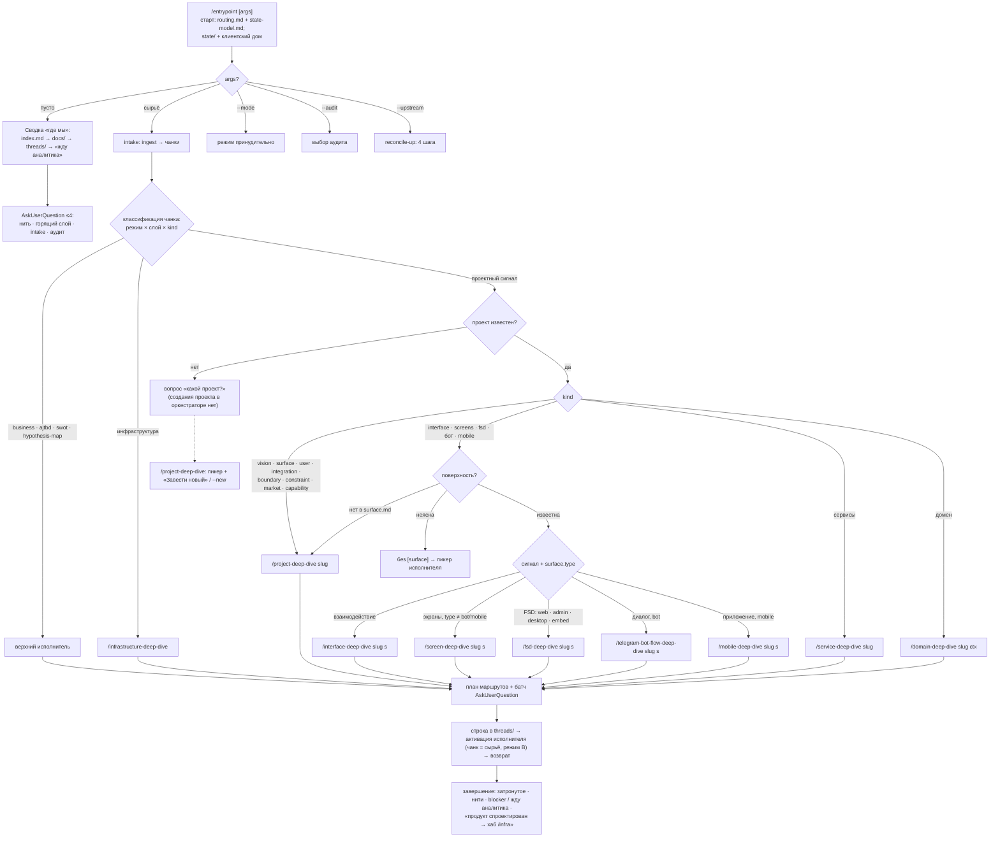
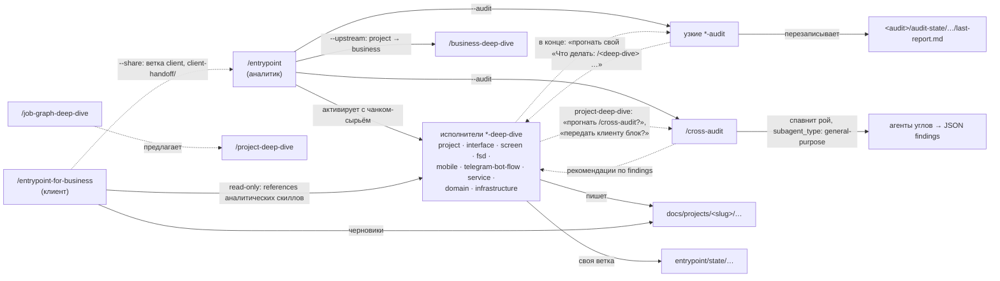

# 02. Скиллы слоя проекта

Скиллы, которые пишут, проверяют и маршрутизируют `docs/projects/`: 17 исполнителей и узких аудитов
продуктовых слоёв, сквозной `/cross-audit` и два оркестратора — 20 из 29 скиллов репо. Факты — с путями
(пути скиллов — от `.claude/skills/`); собственные выводы помечены «(вывод)». Правила артефактов,
которые скиллы ведут, выписаны в `03-current-rules.md`, оценка — в `04-quality.md`.

Размеры: строки — по файлам; токены — эвристика (кириллица / 2,7 + прочее / 3,5; ±25 %).

## Содержание

- [1. Карта скиллов слоя](#1-карта-скиллов-слоя)
- [2. Общий шаблон скиллов репо](#2-общий-шаблон-скиллов-репо)
- [3. Скиллы слоя подробно](#3-скиллы-слоя-подробно)
- [4. Оркестраторы и дерево маршрутизации «как есть»](#4-оркестраторы-и-дерево-маршрутизации-как-есть)
- [5. Кто кого вызывает](#5-кто-кого-вызывает)
- [6. Остальные скиллы — одной строкой](#6-остальные-скиллы--одной-строкой)
- [Приложение. Размеры файлов скиллов](#приложение-размеры-файлов-скиллов)

## 1. Карта скиллов слоя

### 1.1 Роли

| слой | исполнитель (пишет) | узкий аудит (только отчёт) | что пишет исполнитель |
|---|---|---|---|
| продуктовый | `project-deep-dive` | `project-audit` | `docs/projects/<slug>/`: `vision.md`, `surface.md`, `user.md`, `capability/<surface>.md`, `integration.md`, `boundary.md`, `constraint.md`, `market.md`; заведение проекта |
| interface | `interface-deep-dive` | `interface-audit` | `interface/<surface>/`: who · stage · situation · zone · block · ux-substrate · data-items |
| screens (`web` · `admin` · `desktop` · `embed`) | `screen-deep-dive` | `screen-audit` | `screens/<surface>/`: flow · screen · block · shell (файл на запись) и ассеты |
| FSD-карта (те же типы) | `fsd-deep-dive` | `fsd-audit` | `fsd/<surface>/`: app · pages · widgets · features · entities · shared-ui · shared-api · shared-lib |
| mobile (`type: mobile`) | `mobile-deep-dive` | `mobile-audit` | `mobile/<surface>/`: 12 kind карты приложения (shell, screens, flows, features, entities, entry-points, permissions, background-tasks, system-actions, widgets, shared-api, shared-lib) |
| telegram-bot-flow (`type: bot`) | `telegram-bot-flow-deep-dive` | `telegram-bot-flow-audit` | `telegram-bot-flow/<surface>/`: command, notification, фичи (window · use-case · dialog) |
| сервисы | `service-deep-dive` | `service-audit` | `services/`: архитектура, платформа, реестр сервисов, README сервисов |
| домены | `domain-deep-dive` | — (ни один аудит не читает содержимое доменов) | `services/<svc>/domains/<ctx>/`: aggregate, entity, value object, event, policy, use-case, worker, integration-client |
| ИТ-периметр (один на бизнес) | `infrastructure-deep-dive` | `infrastructure-audit` | `docs/projects/infrastructure/`: server, runtime, placement, shared-platform, job |
| сквозная сходимость | — | `cross-audit` (рой агентов, 46 углов) | только `audit-state/` отчёт и `suppressions.md` |
| вход аналитика | `entrypoint` — оркестратор, единственный, кому разрешено активировать других | — | только `state/index.md` и `state/threads/`; в `docs/` не пишет |
| вход клиента | `entrypoint-for-business` — ведёт все темы сам | — | черновики в `docs/` (в ветке `client`), свой state, `client-handoff/` |

### 1.2 Размеры

Всегда в контексте — только `description` (листинг скиллов); `SKILL.md` грузится при вызове,
references — по условию из `SKILL.md`.
| скилл | `SKILL.md`, строк | ≈ токенов | references: файлов | строк | ≈ токенов | description, символов |
|---|---|---|---|---|---|---|
| `project-deep-dive` | 467 | 7,8 тыс. | 5 | 1137 | 14,9 тыс. | 997 |
| `project-audit` | 188 | 2,9 тыс. | 1 | 431 | 5,1 тыс. | 1004 |
| `interface-deep-dive` | 268 | 4,3 тыс. | 4 | 675 | 9,0 тыс. | 952 |
| `interface-audit` | 205 | 3,1 тыс. | 1 | 327 | 4,1 тыс. | 827 |
| `screen-deep-dive` | 451 | 6,9 тыс. | 7 | 1189 | 15,9 тыс. | 941 |
| `screen-audit` | 255 | 3,9 тыс. | 1 | 616 | 8,4 тыс. | 859 |
| `fsd-deep-dive` | 224 | 3,8 тыс. | 2 | 123 | 1,6 тыс. | 995 |
| `fsd-audit` | 94 | 1,6 тыс. | 0 | 0 | 0,0 тыс. | 943 |
| `mobile-deep-dive` | 342 | 6,3 тыс. | 5 | 525 | 8,6 тыс. | 1234 |
| `mobile-audit` | 168 | 2,8 тыс. | 1 | 455 | 5,1 тыс. | 1138 |
| `telegram-bot-flow-deep-dive` | 473 | 8,1 тыс. | 6 | 1181 | 17,9 тыс. | 1075 |
| `telegram-bot-flow-audit` | 358 | 6,2 тыс. | 1 | 1110 | 16,9 тыс. | 1117 |
| `service-deep-dive` | 390 | 6,7 тыс. | 3 | 553 | 8,8 тыс. | 1000 |
| `service-audit` | 186 | 3,0 тыс. | 1 | 485 | 6,0 тыс. | 974 |
| `domain-deep-dive` | 404 | 7,1 тыс. | 4 | 1084 | 16,1 тыс. | 970 |
| `infrastructure-deep-dive` | 278 | 4,7 тыс. | 2 | 378 | 5,5 тыс. | 1064 |
| `infrastructure-audit` | 158 | 2,4 тыс. | 1 | 412 | 4,9 тыс. | 1104 |
| `cross-audit` | 253 | 4,8 тыс. | 3 | 2201 | 34,5 тыс. | 1151 |
| `entrypoint` | 292 | 5,2 тыс. | 5 | 721 | 12,6 тыс. | 975 |
| `entrypoint-for-business` | 210 | 3,7 тыс. | 15 | 2546 | 38,4 тыс. | 952 |
| **20 скиллов слоя** | 5664 | 95,2 тыс. | 68 | 16149 | 234,1 тыс. | 20272 |
| **все 29 скиллов репо** | 7807 | 131,2 тыс. | 112 | 21025 | 305,6 тыс. | 28393 |

## 2. Общий шаблон скиллов репо

### 2.1 Frontmatter

У **всех 29** `SKILL.md` frontmatter из ровно двух полей — `name` и `description` (значение в
двойных кавычках — фикс YAML из коммита `2bfb9c3`). Полей `argument-hint`, `allowed-tools`,
`model`, `disable-model-invocation`, `user-invocable` нет ни у одного: синтаксис аргументов живёт
только в теле, read-only аудитов обеспечивается прозой, любой скилл авто-вызываемый. Длина
description — 659–1234 символа (среднее ≈ 979, сумма ≈ 28,4 тыс.); ориентир проекта из сообщения
коммита `1dd3a93` — «описания ≤ 1536 символов, SKILL.md < 500 строк»; все 29 в него укладываются
(максимум SKILL.md — 473 строки у `telegram-bot-flow-deep-dive`).

**Формула description** (вывод): «<что делает> в `<путь слоя>` (<kind через ·>) — единственная точка
входа…; ведёт <фазы/вопросы> через `AskUserQuestion`; state — в ветке `../entrypoint/state/…`; <что
не выдумывает>. Использовать <триггеры>. <граница с соседним скиллом>». У аудитов: «Аудит
консистентности… Ловит <перечень>. Только отчёт; правки — через `<deep-dive>`. Использовать перед
коммитом…, по предложению `<deep-dive>`… Аргументы: …».

### 2.2 Скелет `*-deep-dive` (типовые разделы SKILL.md)

1. **Шапка**: слой, путь данных, «Канон формы — `docs/projects/_template/<layer>/README.md`»,
   «единственная точка входа», что скилл не выдумывает (домен / craft / тексты), ось
   партиционирования.
2. **Выбор контекста**: `<project-slug>` первым, `[<surface>]` вторым; без них — пикер
   `AskUserQuestion` **по именам** (имя из `vision`, `surface.name`); `_template` исключается;
   поверхность вне реестра не принимается; пустой реестр → «сначала заведи … через
   `/project-deep-dive`», выйти.
3. **Точки входа** — таблица `вызов | поведение`: пусто → сводка; `<kind>` → режим A;
   `<kind>:<slug>` → C; `<slug>` → поиск; свободный текст / приложение → B; опц. `--phase`,
   `--research`, `--lens`, `--new`.
4. **Что делать сразу при запуске**: контекст (+ scaffold папки из `_template/` при первом
   заходе); канон-README слоя; соседи-источники + reference контекста (`project-context.md` /
   `interface-context.md`); без args → сводка; с args → режим.
5. **Сводка состояния**: `draft`/`stable` по kind, открытые вопросы и `**blocker**` из своей ветки
   state; «текущая фаза» (стратегические, project, infrastructure) либо «топ-3 горячих кандидата»
   (interface, screen, fsd, mobile, telegram, domain, service).
6. **Фазы / порядок**: «Порядок — рекомендация, не закон»; у поверхностных слоёв — «inside-out»
   приоритет kind.
7. **Три режима**: A. Новая сущность (батч `AskUserQuestion`; опции — anti-patterns из `Что <kind>
   НЕ`; значения — через Other); B. Сырьё («извлечённое — кандидаты, не факты»; stub'ы → C); C.
   Углубление (точечные вопросы по дырам; чек-лист `draft → stable` после каждой правки).
8. **Стиль вопросов**: «Всегда через `AskUserQuestion`, до 4 вопросов в раунде»; **опции** — только
   anti-patterns, тест-критерий ✅/❌, enum канона, выбор существующего соседа (+ «нужен новый»);
   **Other** — значения (`name`, `description`, доменные тексты); ссылка на `CLAUDE.md` §3.
9. **Память (state)**: «Скилл не держит своего `state/`»; ветка `../entrypoint/state/<…>/<kind>/<slug>.md`;
   формат — `../entrypoint/references/state-model.md`; `### Единый контекст` — всё дерево и
   клиентский дом read-only, проектные ветки — только текущего проекта.
10. **Зеркала** (проектные): какое поле производное, какое каноническое; пересчёт «автоматически»
    (interface, fsd, mobile) либо «канонического источника нет — не править молча, спросить»
    (screen, telegram).
11. **Контракт `draft → stable`**: 5 пунктов (6 у screen, mobile, telegram) — обязательные слоты ·
    ссылки валидны · зеркала · тест-критерий подтверждён в этой сессии · нет `**blocker**` [· полнота
    дерева / инварианты Telegram / нет платформенной механики]; свой состав пунктов — у `fsd-deep-dive` и
    `infrastructure-deep-dive` (§ 3.7, § 3.16). «Скилл **не повышает сам**; понижение — только человек
    руками».
12. **Stub**: ссылка на несуществующий slug своего слоя → строка `draft` + заметка «Заведён как stub в
    контексте <откуда> — докопать»; ссылка в чужой слой — stub не заводится, `**blocker**` +
    предложение соседнего скилла.
13. **Удаление (каскад)**: показать «ссылаются X, Y, Z — вот что сломается» → по каждому месту
    «заменить / `—` / удалить ссылающуюся» → одним пакетом → пересчитать зеркала.
14. **Завершение сессии**: затронутое, нерешённые вопросы; предложить свой аудит; «сам не вызываю,
    это другой скилл».
15. **Границы** + «Итог ключевого».

### 2.3 Две семьи аудитов

- **Структурные** (project, interface, screen, mobile, telegram-bot-flow, service, infrastructure):
  реестр правил `references/rules.md` с id `R-<КАТЕГОРИЯ>-NNN` (`R-SURF`, `R-XSURF`, `R-STRUCT`,
  `R-MIRROR`, `R-SEM`, `R-COV`; у mobile ещё `R-SRC`, `R-REF`, `R-REACH`, `R-INV`, `R-MAT`; у
  telegram — `R-XFEAT`, `R-GRAPH`, `R-DATA`, `R-TG`); severity `error` («Структурное нарушение,
  ломает модель») / `warning` («Семантическое подозрение») / `hint` («Coverage / стиль, не
  ломает»); отчёт `[severity] <surface> / <kind>:<slug> → суть` + «Что делать: /<deep-dive> …»;
  `audit-state/<project-slug>/last-report.md` («не журнал, следующий прогон перезатирает», «в git»);
  **без suppressions** («структурные правила детерминированы»; у `mobile-audit` о suppressions не
  сказано ничего); вердиктного раунда нет.
- **Роевые** (ajtbd, swot, hypothesis-map, cross): лучи/углы в `rays.md` / `angles.md`; «Спавнить
  агентов параллельно — все вызовы в одном message-блоке», `subagent_type: general-purpose`; JSON
  findings; `AskUserQuestion` по top-K («принять» / «нужна правка» / «false positive» → suppressions /
  «обсудить позже»); `audit-state/last-report.md` + `suppressions.md`.
- Особые позиции: `infrastructure-audit` — «Suppressions — только через state»; `fsd-audit` — **нет
  references, id правил и `audit-state`**, 17 проверок в 5 категориях перечислены прямо в `SKILL.md` (94 строки; § 3.8); о suppressions не
  сказано ничего.

Ни одна модель аудита не работает с изображениями: единственное касание визуала — проверка
существования файлов ассетов (screen-audit, telegram R-COV-005).

### 2.4 Типовые references

| reference | у кого | содержание |
|---|---|---|
| `draft-stable.md` | все 14 deep-dive | «Запись становится `stable`, когда **все N пунктов одновременно** ✅. Скилл проверяет, аналитик подтверждает, скилл применяет»; алгоритм проверки; «Что НЕ делать» |
| `field-checklists.md` | 12 deep-dive (нет у fsd, infrastructure) | по `## <kind>`: поля (обяз./опц.), «Ссылается на», «Кто ссылается», anti-patterns, «Порядок копания» |
| `workflow-patterns.md` | 11 deep-dive | режимы A/B/C пошагово, «Стиль вопросов: правила» (когда опции, когда только Other, чего не делать) |
| `phases.md` | 9 (стратегические, project, service, infrastructure, jtbd) | «N фаз»: триггер, цель, что копать, anti-patterns, переходы; «Сводка фаз для UI»; «Перепрыгивание» |
| `project-context.md` / `interface-context.md` / `domain-bridge.md` | interface, screen, domain / mobile, telegram / telegram | маппинг на соседний слой, когда показывать связь, что делать, если сосед пуст |
| `rules.md` | 7 структурных аудитов | правило: id, severity, scope, что проверяет, как, рекомендация; 327–1110 строк |
| `findings-format.md` | 4 роевых аудита | JSON-схема finding, пустой результат `[]`, требования к findings, suppressions |
| прочие | — | `research-rays.md` / `research-waves.md`, `methodology.md`, `intake.md`, `raw-input.md`, `assets-policy.md`, `tree-notation.md`, `platform-lens.md`, `stubs-and-cascade.md`, `metric-spine.md`, `examples.md`, `output-formats.md` |

### 2.5 Прогрессивная загрузка, скрипты, субагенты

- **Загрузка**: жадно при старте — 1–3 файла (README-канон слоя + `phases.md` или
  `project-context.md` / `interface-context.md` или `rules.md` / `rays.md` / `angles.md`); остальное —
  по условию. Образцовые указания «когда читать»: telegram — «`references/domain-bridge.md` (читать
  перед заведением use-case бота или уведомления)»; cross-audit — «`references/output-formats.md`;
  прочитай его перед шагами 9–11»; screen — «`references/tree-notation.md` (читать перед углублением
  дерева)». Несвязанные из своего SKILL.md: `interface-deep-dive/references/field-checklists.md` (271
  строка), `entrypoint-for-business/references/anti-patterns-real.md`. Формат state все исполнители
  берут из чужого reference — `../entrypoint/references/state-model.md`.
- **Скриптов в репо нет** (`git ls-files` без `.md`: только `.claude/settings.json`, `.gitignore`,
  `LICENSE`, `docs/projects/infrastructure/jobs/.gitkeep`). Канон: «Committed-скрипта-валидатора и
  git-хуков в этом репо нет (markdown-only design-SoT). Промоушн `draft → stable` — **ручной review**»
  (`docs/projects/_template/services/README.md:351-353`). Хуков нет (`settings.json` — только
  `autoMemoryEnabled: false`). Все проверки — чтение LLM по реестру правил или рой агентов.
- **Субагенты / рои** есть только в стратегических скиллах, `project-deep-dive` (web-research
  `market`/`constraint`, «дефолт — 5 агентов»), `cross-audit` и клиентском входе. UX-цепочка
  «interface → screens → fsd» роёв не использует; референсы — только точечный `WebSearch` /
  `WebFetch` в screens и telegram по явной просьбе аналитика. Мудборда, анализа референсов роем,
  генерации ассетов нет нигде.

## 3. Скиллы слоя подробно

Карточки дополняют общий шаблон (§ 2): в них только то, что у скилла своё. Пути в карточке — от
каталога скилла, если не сказано иное; «(вывод)» — оценка исследования, «заметки X §N» — ссылка на
рабочие заметки, по которым собран отчёт (сами заметки в репо не входят).

### 3.1 `project-deep-dive`

- **Назначение.** Исполнитель продуктового слоя проекта `docs/projects/<project-slug>/` (`vision` · реестр `surface` · `user` · `capability/<surface>` · `boundary` · `integration` · `constraint` · `market`) и заведение нового проекта; 8 фаз вижн-мейкинга, по решению аналитика — рой web-research (`project-deep-dive/SKILL.md:3`).
- **Размер.** `SKILL.md` 467 строк (≈7,8 тыс. токенов, самый длинный из десяти); references: 5 файлов, 1137 строк (≈14,9 тыс.); description — 997 символов.
- **Аргументы** (`SKILL.md:124-158`): первым всегда `<project-slug>`; без него — пикер по именам проектов + «Завести новый проект» → сводка по фазам. Дальше `<kind>` → A, `<kind>:<entity>` → C, `capability:<surface>:<entity>`, `<entity>` → поиск, свободный текст → B; флаги `--phase <name>`, `--research <kind>:<query>`, `--new`.
- **Читает.** Старт — `_template/project/README.md` + `phases.md` (`:166-169`); сводка — все файлы проекта и state (`:186-199`); на `discovery` — `docs/business/business-problem.md`, `hypothesis-map/goal.md`, `metric.md` как якоря vision (`:103-105`); опции `addresses-problem` — только строки реестра проблем (`:117-122`).
- **Пишет.** 7 корневых файлов (`integration.md` — `## Провайдеры` + `## Функции`) и `capability/<surface>.md` (`:245-254`). Скаффолд `--new` (`:54-82`): slug выводит скилл из имени; копируются `vision.md` + «6 плоских» kind-файлов, создаётся пустая `capability/`; «Канон-README **не** копируется»; соседние слои скилл не создаёт.
- **State.** `.claude/skills/entrypoint/state/projects/<slug>/project/`: `<kind>/<slug>.md`, `vision.md`, `capability/<surface>/<slug>.md`, `research/<query-slug>-<UTC-ts>.md` (`SKILL.md:319-332`), `_phase-jump.md` — ответ «почему сейчас?» при перепрыгивании (`phases.md:307-319`).
- **Фазы / режимы.** `discovery → user → surface → capability → integration → constraint → market → cohesion`; текущая — первое пустое звено (поверхность без файла возможностей → `capability`), при заполненном, но незрелом слое — `cohesion` (`SKILL.md:200-213`). `surface` строго до `capability` («хребет вперёд»); у `boundary` своей фазы нет — записи заводятся из Non-goals сразу после `discovery` или в `cohesion` (`phases.md:54-55`, `:268-269`); «Порядок — рекомендация, не закон»; карта фаз ✅/🔄/⏳ (`phases.md:286-305`). Режимы A/B/C «зеркалят interface-deep-dive» (`SKILL.md:269`). Рой (`research-rays.md:17-55`): 3 / 5 (дефолт) / 10 / 15 агентов `general-purpose` одним message-блоком → сводка с `## Кандидаты` → по каждому «Принять / Отбросить / Доработать»; «Research и режим B … в одном заходе не смешиваются» (`:138-140`).
- **References**:

| файл (строк) | что внутри | когда грузится |
|---|---|---|
| `phases.md` (319) | 8 фаз: триггер, цель, что копать, anti-patterns, переходы; карта фаз; перепрыгивание | каждый старт, `--phase` (`SKILL.md:169`, `:177`) |
| `workflow-patterns.md` (268) | режимы A/B/C, стиль вопросов, stub, каскад удаления | args указывают на сущность (`:175`); stub и каскад — «когда до них дошло» (`:285-290`) |
| `field-checklists.md` (268) | по kind: обязательное / «для stable» / опц., порядок копания | явного шага нет; ссылки из `SKILL.md:118`, `phases.md:33`, `workflow-patterns.md:51` |
| `draft-stable.md` (127) | 5 пунктов, понижение, «когда чек-лист нельзя пройти» | после каждой правки (`:402`) |
| `research-rays.md` (155) | запуск роя, углы market/constraint, промпт агента («3-7 кандидатов», «2-3 sources») | `--research` (`:176`) |

- **Связи.** `/entrypoint` (`entrypoint/references/routing.md:19-20`; авторская сторона `project-map` — `:29`). Сюда отсылают проектные deep-dive при пустом реестре или продукте (`interface-deep-dive/references/project-context.md:99-112`, `screen-deep-dive/references/project-context.md:111-122`), линза mobile (`mobile-deep-dive/SKILL.md:182-186`), `job-graph-deep-dive/SKILL.md:298` (механики ценности → `capability`), R-SURF-правила узких аудитов. В конце сам предлагает `/project-audit`, `/cross-audit` и передачу блока клиенту через `/entrypoint-for-business` (`SKILL.md:440-447`).
- **Особенности.** Единственный из десяти заводит проект, ведёт фазы, запускает субагентов и связывает продукт с верхними слоями; в сводке — «Готов клиент-черновик в ветке: client» (`SKILL.md:231`). slug не спрашивается ни опцией, ни через Other (`workflow-patterns.md:216-217`) — в отличие от interface и screen (вывод). Разнобои (вывод, заметки A §5.3): «5 плоских» (`SKILL.md:167`) против «6 плоских» (`:67`); агентов 3/5/10/15 (`research-rays.md:21-23`) против 5/10/15/«не запускать» (`workflow-patterns.md:202`); для рёбер `project-map` — только «напомнить» (`workflow-patterns.md:67-69`).

### 3.2 `project-audit`

- **Назначение.** Узкий аудит продуктового слоя одного проекта (vision, `surface`, `user`, `integration`, `boundary`, `constraint`, `market`, `capability/<surface>.md`): структура, семантические подозрения, coverage; сквозная сверка и привязка к проблемам бизнеса — у `/cross-audit` (`project-audit/SKILL.md:3`, `:24-26`).
- **Размер.** `SKILL.md` 188 строк (≈2,9 тыс.); references: 1 файл (`rules.md`, 431 строка, ≈5,1 тыс.); description — 1004 символа.
- **Аргументы** (`SKILL.md:36-58`): без аргументов — пикер по именам проектов → полный прогон; `<slug>`; `<slug> <kind>` (+ ссылающиеся соседи); `<slug> capability` — все `capability/*.md`; `<slug> capability:<surface>` — один файл; `<slug> <kind>:<slug>` — запись + «1-shell соседи». Аргумента поверхности нет — папок поверхностей в слое нет (вывод).
- **Шаги прогона** (`SKILL.md:60-83`): канон `_template/project/README.md` → `rules.md` → 7 корневых файлов + `capability/*.md` «листингом каталога …, не угадывай имена» → state проекта → правила → группировка по сущности, `error → warning → hint` → отчёт → перезапись `last-report.md`.
- **Правила** (`rules.md`): 25 — `R-STRUCT` 8, `R-SEM` 12, `R-COV` 5; `error` 9, `warning` 4, `hint` 6, двухуровневых 6 (R-SEM-001, 002, 004, 005, 009 — `warning` у draft / `error` у stable; R-SEM-011 — `error`/`warning`). Показательные:
  - R-STRUCT-007 — файл `capability/<surface>.md` для поверхности вне реестра (`rules.md:140-153`);
  - R-STRUCT-006 — stable при `**blocker**` или `**жду аналитика**` в state (`:125-138`);
  - R-SEM-003 — backlog в `boundary.why` по словарю «нет времени», «не хватает ресурсов», «потом сделаем», «v2»… (`:196-208`);
  - R-SEM-008 — маркетинг в Problem/Success: «революционн», «уникальн», «next-gen» (`:258-269`);
  - R-SEM-009 — нет `addresses-problem`; только наличие, резолв — `/cross-audit` (`:271-288`).
- **Отчёт и audit-state.** `=== /project-audit <slug> ===`, «Прочитано: 7 корневых + M файлов capability/»; строка `[error] capability/web-partner.md:send-referral → status: stable, но user = —` + «Что делать: … /project-deep-dive <slug> capability:send-referral»; «Сводка: X error / Y warning / Z hint» (`SKILL.md:95-130`). `.claude/skills/project-audit/audit-state/<project-slug>/last-report.md`: frontmatter `project`, `ran-on`, `files-read`, `records-checked`, `totals`; `# Reasoning trace` по R-STRUCT / R-SEM / R-COV; «не журнал», «В git» (`:132-168`).
- **Связи.** Предлагают `project-deep-dive` (конец сессии, фаза `cohesion`), `/entrypoint` (`routing.md:116`), `CLAUDE.md` §5; `/cross-audit` числит его узким аудитом (`cross-audit/SKILL.md:232`). Рекомендации ведут в `/project-deep-dive <slug> …`, кросс-слой — `/cross-audit` (`SKILL.md:180-182`).
- **Особенности.** Роя и suppressions нет: «находка повторяется, пока запись не поправлена» (`SKILL.md:183-186`); «Finding — только по сработавшему правилу» (`:178-179`); в клиент-режиме не предлагается (`:187-188`). (вывод, заметки A §3.5) Не проверяются: существование slug'ов `surface.user` / `capability.user` в `user.md`, «Критерии» и «Что НЕ» kind'ов, `hypotheses` / `jobs`, `project-map` целиком. R-COV-002 («vision stable при пустой user-таблице … рано закрыли») спорит с триггером фазы `user` «vision стабилен, user.md пуст» (`project-deep-dive/references/phases.md:60`); словарь R-SEM-003 не ловит «нет ресурсов» из собственного примера отчёта (`SKILL.md:117`).

### 3.3 `interface-deep-dive`

- **Назначение.** Исполнитель UX-слоя одной поверхности `docs/projects/<project-slug>/interface/<surface>/` — 7 таблиц `who · stage · situation · zone · block · ux-substrate · data-items`; «не выдумывает домен и craft»; единственная точка входа в слой (`interface-deep-dive/SKILL.md:3`, `:8-18`).
- **Размер.** `SKILL.md` 268 строк (≈4,3 тыс.); references: 4 файла, 675 строк (≈9,0 тыс.); description — 952 символа.
- **Аргументы** (`SKILL.md:28-78`): `/interface-deep-dive <project-slug> <surface> [<kind> | <kind>:<slug> | <slug> | <текст / приложение>]`. Без `<surface>` — пикер по `surface.name` (slug и `type` — в описании опции), без проекта — сначала пикер проектов; пусто → сводка + топ-3; `<kind>` → A; `<kind>:<slug>` → C; `<slug>` → поиск; текст → B. Флагов нет; поверхность принимается любого `type` (вывод: у screen, fsd, mobile — фильтр по `type`).
- **Читает.** Канон `_template/interface/README.md`; продуктовый слой того же проекта — `vision.md`, `surface.md`, `capability/<surface>.md`, корневой `user.md` + `project-context.md` (`SKILL.md:84-92`); для сводки — 7 файлов и своя ветка state (`:100-105`).
- **Пишет.** Только 7 файлов `interface/<surface>/`. Первый заход — скаффолд: копия 7 форм из `_template/interface/_template/`, «очистив таблицы от строк-образцов (остаётся канон-проза + пустой заголовок таблицы)» (`:55-60`). Авторские рёбра наверх: `who.users` → `user`, `situation.capabilities` → `capability/<surface>`, `situation.jobs`, `situation.hypotheses` (`project-context.md:21-37`).
- **State.** `.claude/skills/entrypoint/state/projects/<slug>/interface/<surface>/<kind>/<slug>.md` — ветка по проекту и поверхности (`SKILL.md:146-155`); особых файлов нет.
- **Фазы / режимы.** Фаз и приоритета kind нет — работа от сущности или сырья (вывод, заметки B §3.3). Топ-3 сводки: draft с `**blocker**` → draft с пустыми обязательными слотами → draft, на которые ссылаются stable (`:106-110`). В режиме B — «Не угадывать `goal`, `action`, `using-what` по сырью» (`workflow-patterns.md:81-88`); своей процедуры для скриншота UI нет (вывод). Зеркала `situation.ux-substrate` и `situation.block` пересчитываются «автоматически после любой правки без подтверждения» (`SKILL.md:184-193`). Роя и web нет.
- **References**:

| файл (строк) | что внутри | когда грузится |
|---|---|---|
| `project-context.md` (133) | маппинг на продукт (`who.users`, `situation.capabilities/jobs/hypotheses`, зона ↔ поверхность структурно), раунды связи, пустой продукт | на старте (`SKILL.md:89`) |
| `workflow-patterns.md` (163) | режимы A/B/C, пример раунда situation, правила стиля вопросов | выбор режима (`:96`, `:115`, `:131`) |
| `field-checklists.md` (271) | по 7 kind: поля, ссылки, обратные ссылки, anti-patterns, порядок копания | из `SKILL.md` не связан; ссылки из `workflow-patterns.md:25`, `draft-stable.md:13`; на него опирается `interface-audit` |
| `draft-stable.md` (108) | 5 пунктов, 12 ссылочных полей, формулы зеркал, алгоритм | после каждой правки (`:197`) |

- **Связи.** `/entrypoint` (`routing.md:21`); сюда ведут рекомендации всех правил `interface-audit`, `screen-deep-dive` (расхождение `ux-substrates`, битая ссылка — `screen-deep-dive/SKILL.md:349-353`, `:388-394`), `fsd-deep-dive` (слайс без источника — `fsd-deep-dive/SKILL.md:134-137`), `mobile-deep-dive` (нет ситуации — `mobile-deep-dive/SKILL.md:251-255`), `telegram-bot-flow-deep-dive` (его `interface-context.md:86`). В конце — `/interface-audit <slug> <surface>` (`SKILL.md:249-253`), `/cross-audit --quick` (`project-context.md:127-133`), при пустом продукте — `/project-deep-dive` (`:99-112`).
- **Особенности.** Центральный UX-источник: его slug'и (`situation`, `block`, `ux-substrate`, `who`, `data-items`) держат ссылки screens, fsd, mobile и бота (вывод, заметки B §4.3); образец формы для остальных проектных слоёв. (вывод, заметки B §5) slug новой записи называет аналитик через Other («аналитик называет, не скилл», `workflow-patterns.md:151`) — против `.claude/rules/naming.md` §1; скаффолд переносит канон-прозу в папку проекта — против `CLAUDE.md` §6; stub «остальные ячейки `—`» сам даёт `error` аудита (R-STRUCT-005/006/008); каскад удаления — только в 7 файлах поверхности, процедуры переименования нет.

### 3.4 `interface-audit`

- **Назначение.** Аудит 7 файлов interface по папке на поверхность: битые slug-рефы и циклы `parent-zone`, рассинхрон зеркал ситуации, тупики навигации, пустые слоты stable, семантические подозрения, coverage, выход ссылки за границу поверхности; «Только отчёт» (`interface-audit/SKILL.md:3`).
- **Размер.** `SKILL.md` 205 строк (≈3,1 тыс.); references: 1 файл (`rules.md`, 327 строк, ≈4,1 тыс.); description — 827 символов.
- **Аргументы** (`SKILL.md:25-62`): без slug — пикер по именам проектов, затем все поверхности; `<slug>` — все папки; `<slug> <surface>`; `<slug> <surface> <kind>` — «один файл поверхности + перекрёстные ссылки внутри неё»; `<slug> <surface> <kind>:<slug>` — «одна запись + 1-shell соседи»; `<kind>` требует `<surface>`.
- **Шаги прогона** (`SKILL.md:64-84`): канон → `rules.md` → `surface.md` против подпапок `interface/` (R-SURF-001/002) → по каждой папке 7 файлов, правила «в пределах этой поверхности» → группировка поверхность → сущность → severity → отчёт → `last-report.md`.
- **Правила** (`rules.md`): 25 — `R-SURF` 2, `R-XSURF` 1, `R-STRUCT` 8, `R-MIRROR` 2, `R-SEM` 5, `R-COV` 7; `error` 12 (R-SURF-001, R-XSURF-001, все R-STRUCT и R-MIRROR), `warning` 4, `hint` 8, R-SEM-003 — `warning`/`error` по статусу. Показательные:
  - R-MIRROR-001/002 — зеркала ситуации как равенство множеств (`rules.md:171-189`);
  - R-STRUCT-004 — явный `transition-to-block` внутри одной зоны = `error` (`:123-132`);
  - R-SEM-001 — `goal` похож на предусловие: «чтобы продолжить», «чтобы войти»… (`:195-205`);
  - R-SEM-002 — облик в `using-what`: «primary», «md», «цвет», «hex», `ui:*` (`:207-216`);
  - R-SEM-005 — «block без входа» (`:239-251`); R-COV-007 — «один датум — один slug» внутри поверхности (`:317-327`).
- **Отчёт и audit-state.** `=== /interface-audit <slug> ===`, «Поверхностей в scope: K (…). Прочитано: 7 файлов × K, N записей.»; строка `[error] web-clinic / situation:submit-referral → невалидная ссылка situation.who = doctor …` + «Что делать: … /interface-deep-dive <slug> web-clinic who …» (`SKILL.md:96-127`). `.claude/skills/interface-audit/audit-state/<project-slug>/last-report.md`: frontmatter `project`, `ran-on`, `surfaces`, `files-read`, `records-checked`, `totals`; `# Reasoning trace` по категориям и поверхностям (`:129-185`).
- **Связи.** Предлагают `interface-deep-dive` (`interface-deep-dive/SKILL.md:249-253`), `/entrypoint` (`routing.md:117`), `CLAUDE.md` §5. Рекомендации — `/interface-deep-dive <slug> <surface> <kind>:<slug>`, папка вне реестра — `/project-deep-dive` (`rules.md:44`); кросс-поверхностную сверку (один датум на web и в боте) отдаёт `/cross-audit` (`rules.md:26-29`).
- **Особенности.** Однопоточный, `AskUserQuestion` — только пикер. «Без suppressions»: объяснение аналитика снимает R-SEM «в этом прогоне», но следующий прогон «вправе сработать снова» (`SKILL.md:195-200`). Обязательные слоты для R-SEM-003 берёт из чужого reference — `interface-deep-dive/references/field-checklists.md` (`rules.md:222-223`). (вывод, заметки B §3.5, §5) Условие R-SEM-005 «…И в `block.zone` есть другие блоки» противоречит собственной скобке про «≥2 блоков»; глобальной достижимости, проверок «есть хотя бы один `entrypoint`» и «блок без выхода» нет, хотя description обещает «тупики навигации»; stable-ситуация без субстратов не ловится (канон — обяз., field-checklists — опц.); пустой обязательный слот — `warning` в таблице `SKILL.md:91`, но `error` у stable в `rules.md:220-221`; R-STRUCT-004 бьёт и «нестандартные внутризонные» переходы, которые канон допускает (`_template/interface/_template/block.md:9-10`).

### 3.5 `screen-deep-dive`

- **Назначение.** Исполнитель композиции одной поверхности `docs/projects/<project-slug>/screens/<surface>/` (`flow · screen · block · shell`): семантическое дерево `ui:` · `layout:` · `icon:` · `block:` · `data:`, зеркала с interface той же поверхности, референсы в `assets/`; «облик (craft) и тексты не выдумывает» (`screen-deep-dive/SKILL.md:3`).
- **Размер.** `SKILL.md` 451 строка (≈6,9 тыс.); references: 7 файлов, 1189 строк (≈15,9 тыс., больше всех из десяти); description — 941 символ.
- **Аргументы** (`SKILL.md:34-124`): `/screen-deep-dive <project-slug> [<surface>] [<kind> | <kind>:<slug> | <slug> | <текст / картинка / URL>]`. Одна поверхность — без вопроса; `type: bot` и `mobile` «в пикер не попадают, а переданные аргументом — отклоняются с подсказкой нужного скилла» (`:80-85`), `api` и `other` проходят (вывод); `<kind>:<slug>` — «завести … либо углубить» (`:111`).
- **Читает.** Канон `_template/screens/README.md` + 4 формы; `vision.md`, `surface.md`, `capability/<surface>.md` + `project-context.md` (`SKILL.md:130-139`); interface той же поверхности — `situation`, `who`, `block`, `ux-substrate` (`workflow-patterns.md:158-168`) и `data-items` для `data:` (`field-checklists.md:188-193`); URL из сырья — через `WebFetch` (`raw-input.md:30-31`).
- **Пишет.** Файл на запись `screens/<surface>/{flows,screens,blocks,shells}/<slug>/index.md` (YAML-frontmatter + H1 + дерево в fenced-`yaml`) и ассеты `assets/<kind>/<slug>/<file>` + поле `assets` (`SKILL.md:115-119`, `:248-268`). Скаффолда из `_template/` нет: папка «появится при заведении первой сущности» (`:95-97`). В interface не пишет и stub'ов там не заводит (`:359-360`, `:385-387`).
- **State.** `.claude/skills/entrypoint/state/projects/<slug>/screens/<surface>/<kind>/<slug>.md`, kind в ед. числе (`SKILL.md:115-119`). Привязка flow/screen к `capability` живёт только здесь: «Реализует capability (поверхность <surface>): send-referral» (`project-context.md:74-81`).
- **Фазы / режимы.** Фаз нет. Топ-3 сводки — blocker → пустые слоты или дыры в `tree`/`slot-fills` → draft под stable-соседями (`SKILL.md:154-159`). B — по `raw-input.md` с фильтром «вижу → kind» и порядком «shell → screen → block …, flow … в самом конце» (`raw-input.md:123-134`). Опции — enum'ы `viewport` / `accepts` / `behaviour` / `entrypoint`, уже использованные `ui:*`, `block:<slug>` для слота (`SKILL.md:189-201`). Stable — 6 пунктов, шестой — «Дерево в теле полное»: `required`-слоты, 6 канон-состояний, `block-body`, `(fills: $<slot>)` (`:312-322`). Роя нет; web — только по явной просьбе (`WebSearch` → выбор → `WebFetch`, `assets-policy.md:90-117`).
- **References**:

| файл (строк) | что внутри | когда грузится |
|---|---|---|
| `project-context.md` (128) | поверхность — ось; flow/screen ↔ `capability/<surface>`; пустой продукт | на старте (`SKILL.md:137`) |
| `workflow-patterns.md` (250) | режимы A/B/C, примеры раундов, опции / только Other | выбор режима (`:143`, `:165`, `:185`) |
| `field-checklists.md` (304) | по 4 kind: поля, ссылки, anti-patterns, порядок вопросов | режим A (`:170`) |
| `raw-input.md` (148) | режим B за 6 шагов, порядок углубления, anti-patterns | режим B (`:177`) |
| `assets-policy.md` (144) | имена и папки ассетов, входящая картинка (копия через `Bash`), web-поиск, каскад | картинка или просьба о референсах (`:250`) |
| `tree-notation.md` (67) | узлы, имена `ui:*` в пределах поверхности, опции по месту в дереве | «читать перед углублением дерева» (`:273`) |
| `draft-stable.md` (148) | 6 пунктов, алгоритм, «Что НЕ делать» | после каждой правки (`:291`) |

- **Связи.** `/entrypoint` (`routing.md:25`); сюда ведут рекомендации `screen-audit`, `fsd-deep-dive` при слайсе без экрана или блока (`fsd-deep-dive/SKILL.md:134-137`), `telegram-bot-flow-deep-dive` для фронтовой поверхности (`telegram-bot-flow-deep-dive/SKILL.md:96-100`). Сам предлагает `/screen-audit` (`SKILL.md:430-434`), `/interface-deep-dive … <kind>:<slug>` (`:349-353`, `:388-394`), `/project-deep-dive` при пустых capability и `/cross-audit` с углом `surface-screen` (`project-context.md:111-128`). Вниз — FSD `pages.screen`, `widgets.block`, `ui:<Name>` ↔ `shared-ui` (заметки C §4).
- **Особенности.** Единственный из десяти пишет файл на запись с деревом, хранит картинки в git и принимает картинки и URL как сырьё. Зеркало `block.ux-substrates` — «Канонического источника нет … скилл не правит молча»: diff → «screens-вариант» / «interface-вариант» / «оба нужны» → `**blocker**` (`SKILL.md:331-360`). Тексты-дети дерева допустимы, но формулирует их аналитик (`:205-208`). (вывод, заметки C §5) slug называет аналитик через Other (`workflow-patterns.md:235`) — против `naming.md` §1; `transitions` обязательны для stable при mobile-серии ≥2 (`SKILL.md:320-322`), но опциональны в форме и аудитом не проверяются.

### 3.6 `screen-audit`

- **Назначение.** Аудит 4 kind экранов по папке на поверхность: битые slug-рефы (внутри screens и в interface той же поверхности), зеркала, `slot-fills` и `accepts`, `viewport` ↔ flow, канон-состояния, anti-patterns (облик, оси контекста, breakpoints, FSD-имена, inline-состояния в блоке), coverage, выход за поверхность (`screen-audit/SKILL.md:3`).
- **Размер.** `SKILL.md` 255 строк (≈3,9 тыс.); references: 1 файл (`rules.md`, 616 строк, ≈8,4 тыс.); description — 859 символов.
- **Аргументы** (`SKILL.md:26-64`) — как у `interface-audit`: пикер → все поверхности; `<slug>`; `<slug> <surface>`; `<slug> <surface> <kind>`; `<slug> <surface> <kind>:<slug>`; `kind` ∈ `flow · screen · block · shell`.
- **Шаги прогона** (`SKILL.md:95-116`): канон + 4 формы → `rules.md` → `surface.md` против подпапок `screens/` (R-SURF) → по каждой поверхности: `index.md` 4 kind, `assets/`, interface `{who,situation,block,ux-substrate,data-items}.md` (`:66-79`) → группировка → отчёт → `last-report.md`. Не читает другие проекты и поверхности, `_template/` как данные и state `screen-deep-dive` (`:81-93`).
- **Правила** (`rules.md`): 48 — `R-SURF` 2, `R-XSURF` 1, `R-STRUCT` 19, `R-MIRROR` 5, `R-SEM` 13, `R-COV` 8; `error` 25, `warning` 12, `hint` 7, зависят от статуса 4. «Stable как ужесточение» (`SKILL.md:128-139`): пустой обязательный слот `warning → error` (R-SEM-008; так же R-STRUCT-013 для `required`-слота экрана), нет 6 канон-состояний `hint → error` (R-SEM-011), субстрат без узла в `block.tree` `hint → warning` (R-COV-007). Показательные:
  - R-STRUCT-012 — нарушение `accepts` в `slot-fills` и `states` (`rules.md:223-236`);
  - R-MIRROR-001 / 004 — `block.ux-substrates` screens ↔ interface; `screen.viewport` против участия во flow (`:313-323`, `:346-356`);
  - R-SEM-001 / 003 — облик в дереве (hex, `bg-`, `px`, `font-size`, `style=`) и FSD-имена (`widget:`, `pages/`, суффикс `Widget`) (`:376-418`);
  - R-COV-006 — файл из `assets: [...]` не существует, `error` (`:587-595`).
- **Отчёт и audit-state.** `=== /screen-audit <slug> ===`, «Прочитано: 4 kind × K, N записей.»; строки `[severity] <surface> / <kind>:<slug> → суть` + «Что делать: /screen-deep-dive …»; «Сводка: X error / Y warning / Z hint» (`SKILL.md:141-178`). `.claude/skills/screen-audit/audit-state/<project-slug>/last-report.md`: frontmatter `project`, `ran-on`, `surfaces`, `kinds-read`, `records-checked`, `totals`; trace — R-SURF, затем по поверхностям (`:180-236`).
- **Связи.** Предлагают `screen-deep-dive` (`screen-deep-dive/SKILL.md:430-434`), `/entrypoint` (`routing.md:118`); `/cross-audit` числит его узким аудитом (`cross-audit/SKILL.md:234`). Рекомендации — `/screen-deep-dive …`; битая interface-ссылка — `/interface-deep-dive` (`rules.md:128`); папка вне реестра — `/project-deep-dive` (`rules.md:50`); «Interface-слой — только читать» (`SKILL.md:246-249`).
- **Особенности.** Самый объёмный `rules.md` из пяти аудитов (по числу правил уступает только `mobile-audit`) и единственный со stable-ужесточением severity; визуала касается только проверкой существования ассетов, а `ui:*`, `icon:*` и атрибуты «по какому-либо словарю аудит их не сверяет» (`SKILL.md:77-79`). Без suppressions (`:250-255`). (вывод, заметки C §3.5) Не проверяются: inline-логика `if`/`then`, «`block` 1:1 экрану», блок из одного примитива, словарь `layout:`, `(fills: $slot)` на каждый слот, `transitions` при серии ≥2, существование поля в `data:<slug>.<field>`, уникальность `route`, согласованность `screen.who` с interface. R-STRUCT-019 (`[]` без `—` в опциональном ссылочном поле — `error`) опоры в формах не имеет, а режим A скилла сам велит «`—` или пустые массивы» (`screen-deep-dive/references/workflow-patterns.md:25-27`); R-SURF-002 даёт hint на каждую `bot`/`mobile`/`api`-поверхность, а `screens/` у мобильной ловит только `/cross-audit`.

### 3.7 `fsd-deep-dive`

- **Назначение.** Проектирование FSD-карты фронтовой поверхности (`type: web|admin|desktop|embed`) в `docs/projects/<project-slug>/fsd/<surface>/` — `entities · features · pages · widgets · app · shared-ui · shared-api · shared-lib`; «Мост «аналитика → фронт-код»»: `src/`-пути и библиотеки выводит `/scaffold` фронт-форка `<org>/frontend` или `<org>/site` (`fsd-deep-dive/SKILL.md:3`, `:15-24`).
- **Размер.** `SKILL.md` 224 строки (≈3,8 тыс.); references: 2 файла, 123 строки (≈1,6 тыс., меньше всех из пяти исполнителей); description — 995 символов.
- **Аргументы** (`SKILL.md:29-78`): `/fsd-deep-dive <project-slug> [<surface>] [<kind> | <kind>:<slug> | <slug> | <текст / приложение>]`; пикер — «только строки с `type: web | admin | desktop | embed`», поверхность вне реестра не принимается; флагов нет.
- **Читает.** Канон `_template/fsd/README.md`; источники той же поверхности — `interface/<surface>/situation.md` + `data-items.md`, `screens/<surface>/screens/*/index.md` + `blocks/*/index.md`, `services/service.md` и `services/<svc>/domains/`; «Пустота источников — не ошибка, а сигнал режима» (`SKILL.md:84-90`). `vision`, `capability`, `user` и `who` (нужен для `pages.guard`) не читает (заметки D §2.1).
- **Пишет.** 8 таблиц `fsd/<surface>/`; первый заход — копия 8 форм из `_template/fsd/_template/` без строк-образцов («остаётся канон-проза + пустой заголовок таблицы», `:56-60`).
- **State.** `.claude/skills/entrypoint/state/projects/<slug>/fsd/<surface>/<kind>/<slug>.md`; для секционных `app` / `shared-api` / `shared-lib` «slug = slug строки» (`:141-147`).
- **Фазы / порядок / режимы.** Inside-out `entities → features → pages → widgets → app → shared-ui → shared-api → shared-lib` — «Не догма обхода, а приоритет при пустом слое» (`:107-111`); топ-3 сводки добавляет «слои без единой записи» в этом порядке (`:101-104`). В SKILL — режимы A/B/C (новая / сырьё / углубление), в `workflow-patterns.md` — вторая таксономия по состоянию источников: «A. С аналитикой» (агрегат или data-item → entity, ситуация → feature, экран → page, блок на ≥2 экранах → widget), «B. С эскизом» («Stable требует источников»), «C. С нуля» (3–4 базовых вопроса, карта «останется в `draft`»). Зеркало `widgets.pages` ← `pages.widgets` — автоматически; pages-first: widget с <2 page-референсами — blocker для stable (`SKILL.md:155-161`). Stable подтверждает **архитектор** (`:173-177`). Роя и web нет.
- **References**:

| файл (строк) | что внутри | когда грузится |
|---|---|---|
| `workflow-patterns.md` (76) | 3 режима по состоянию источников, каскады удаления entity / feature / page / widget, стиль («Не предлагать «оптимизации» нарезки») | при чтении источников и выборе режима (`SKILL.md:90`, `:93`, `:115`) |
| `draft-stable.md` (47) | 5 пунктов (источники, внутрислойная согласованность, покрытие `shared-api`), эскалация `- <falsifiable-вопрос>? (**blocker**)` | после правки (`:165`) |

- **Связи.** `/entrypoint` (`routing.md:26`). Слайс без источника — вопрос, вести ли аналитика в `/interface-deep-dive` / `/screen-deep-dive` / `/domain-deep-dive` (`SKILL.md:134-137`); stub'ы в слоях-источниках не заводит — blocker (`:185-186`). В конце — `/fsd-audit <slug> <surface>` (`:203-205`). Вниз — `/scaffold` и `/de-template` фронт-форка читают stable-записи cross-repo (`:20-24`).
- **Особенности.** Единственный исполнитель без `field-checklists.md` — вопросы строятся из `Критерии` / `Что НЕ` канона (`SKILL.md:117-120`) — и с подтверждением stable архитектором, а не аналитиком. Имена слайсов — «только из источника» (`situation.name`, агрегат, `screen.name`), slug транслитом выводит скилл (`workflow-patterns.md:72-73`). (вывод, заметки D §5) Две таксономии A/B/C с одинаковыми буквами; тест-критерий как условие stable неприменим к `app` и `shared-*` (секции нет); скаффолд копирует канон-прозу вопреки `CLAUDE.md` §6; `capability` и `vision` скиллу не видны, угла FSD у `/cross-audit` нет — трасса «возможность → слайс» не сверяется никем.

### 3.8 `fsd-audit`

- **Назначение.** Аудит 8 файлов FSD-карты по папке на фронтовую поверхность: ссылки на источники и внутри слоя, зеркало `widgets.pages ↔ pages.widgets`, pages-first, cross-feature, `src/`-пути и библиотеки, покрытие `shared-api`, пустые слоты stable, папка вне реестра; «Не правит артефакты, только указывает» (`fsd-audit/SKILL.md:3`).
- **Размер.** `SKILL.md` 94 строки (≈1,6 тыс.) — самый короткий `SKILL.md` репо и единственный скилл без references; description — 943 символа.
- **Аргументы** (`SKILL.md:18-34`): `<project-slug>` первым (иначе пикер по именам); `<surface>` — одна фронтовая поверхность, без неё — «все папки `fsd/<surface>/` проекта»; узкий scope `<kind>` (файл + перекрёстные ссылки) или `<kind>:<slug>` (запись + «1-shell соседи»).
- **Шаги прогона.** Нумерованных шагов нет (вывод): выбор проекта и поверхности (`:22-29`) → проверки по 5 категориям (`:36-75`) → отчёт (`:77-87`); шага «прочитать канон» нет, канон лишь назван (`:10`).
- **Правила.** Без id — 17 проверок прямо в `SKILL.md:36-75`:
  - `structure` (2): папка ↔ реестр и фронтовый `type` (папка у `bot` / `mobile` / `api` / `other` — «сама по себе находка», `:28-29`); 8 файлов, H1, колонки канона;
  - `source-refs` (4): резолв `features.situation`, `pages.screen` / `widgets.block`, `entities.source`; ссылка в другую поверхность — `error`;
  - `layer-refs` (4): внутрислойные рефы, зеркало; widget с <2 page-референсами без пометки каркаса — `warning`; feature → feature — `error`;
  - `semantics` (4): `src/`-пути, файлы, импорты, библиотеки — `warning`; имя слайса не из источника — `hint`; entity без сценариев `shared-api` — `warning`; init-шаг `app` без `при падении` — `warning`;
  - `maturity` (3): stable с пустым обязательным слотом — `error`; stable → draft — `hint`; `**blocker**` в state у stable — `error`.

  Итог (вывод): `error` 4, `warning` 4, `hint` 2, без severity 7.
- **Отчёт и audit-state.** «поверхность → категория (`structure` / `source-refs` / `layer-refs` / `semantics` / `maturity`) → находки»; находка — файл, slug, severity, «одна строка сути», рекомендация через `/fsd-deep-dive`; в конце — счётчик и «вердикт: чисто / есть warnings / есть errors» (`:77-87`). `audit-state/` и `last-report.md` нет — отчёт только в чат.
- **Связи.** Предлагают `fsd-deep-dive` (`fsd-deep-dive/SKILL.md:203-205`) и `/entrypoint` (`routing.md:119`); рекомендации — только `/fsd-deep-dive`. Читает ветку state `fsd-deep-dive` ради проверки blocker'ов (`:73-75`). В перечне узких аудитов `/cross-audit` его нет, своего угла FSD там тоже нет (`cross-audit/SKILL.md:231-237`, вывод).
- **Особенности.** Мотив строгости — «errors в stable материализуются в код» фронт-форка (`:85-87`); запреты — не править артефакты и state, «Не выдумывать «правильные» значения», не расширять scope (`:89-94`); о suppressions не сказано ничего (вывод). (вывод, заметки D §3.5) Не проверяются: `pages.guard` → `who.md`, «entity нужна поверхности», `shared-ui` ≥2 мест, минимум `empty` + `populated`, уникальность `path`, `ui:<Name>` ↔ `shared-ui`, облик в ячейках, coverage (экран без page, ситуация без feature). Severity расходится с исполнителем: widget <2 рефов и непокрытая entity — «blocker для stable» (`fsd-deep-dive/SKILL.md:159-161`, `_template/fsd/_template/shared-api.md:11-12`) против `warning`.

### 3.9 `mobile-deep-dive`

- **Назначение.** Проектирование карты мобильного приложения поверхности `type: mobile` в `docs/projects/<project-slug>/mobile/<surface>/` — 12 kind (`entities · screens · flows · features · shell · entry-points · permissions · system-actions · widgets · background-tasks · shared-api · shared-lib`); слой «на месте `screens/`», FSD-карты нет; синтез из interface и доменов + «линза возможностей платформы» (`mobile-deep-dive/SKILL.md:3`, `:16-27`).
- **Размер.** `SKILL.md` 342 строки (≈6,3 тыс.); references: 5 файлов, 525 строк (≈8,6 тыс.); description — 1234 символа (самый длинный в репо).
- **Аргументы** (`SKILL.md:32-108`): `/mobile-deep-dive <project-slug> [<surface>] [<kind> | <kind>:<slug> | <slug> | <текст / приложение> | --lens]`; экран — `screens:<Key>`; пикер — только `type: mobile`; поверхность другого типа → «сказать, какой слой для неё работает», выйти (`:50-59`).
- **Читает.** Канон и формы; `vision.md`, строку `surface.md`, `capability/<surface>.md`, «весь `interface/<surface>/`» + `interface-context.md`, домены сервисов; для границ — `integration.md` и `constraint.md` (`SKILL.md:113-122`).
- **Пишет.** 12 файлов `mobile/<surface>/`. Скаффолд (`:65-88`): до 3 вопросов «рамки приложения» — есть ли вход (`login`, `Auth-gate`), идёт ли в магазины (`demo`, правовые документы), платформы `all | android | ios`; копия 12 форм без образцов, но «обязательные заготовки оставить» как `draft` (`app-start`, `login` при входе, `demo` при магазинах, секции `shell.md`, локаль `ru`); reference-строки канона — только если требует рамка. В `interface/` и `services/` не пишет (`:249-263`).
- **State.** `.claude/skills/entrypoint/state/projects/<slug>/mobile/<surface>/<kind>/<slug>.md` (экран — по `key`, `shell` / `shared-lib` — по секции); `_frame.md` — рамка и пройденные разделы линзы; в `## Доменные решения` — «требования к соседним слоям» (`SKILL.md:225-233`).
- **Фазы / порядок / режимы.** Inside-out 12 kind: «сначала данные и экраны, потом действия и каркас, потом всё, что живёт вне экранов, в конце — контракт и сквозное» (`:144-150`). Топ-3 сводки включает нарушения инвариантов и «дыры синтеза», отдельной строкой — непройденные разделы линзы (`:133-140`). Режимы A/B/C и вторая таксономия в `workflow-patterns.md` (с аналитикой / с эскизом — «Скриншот аналога — референс, не источник» / с нуля). `--lens` (`:170-186`): 8 разделов — «Как попадают внутрь», «Уведомления», «Без открытия приложения», «Видно на лету», «Когда приложение закрыто», «Без сети», «Возможности устройства», «Соседние устройства»; «один раздел — один раунд», первым — «нужно ли это продукту» с опцией «не нужно» (`platform-lens.md:8-19`). Stable — 6 пунктов, шестой — «Нет платформенной механики и кода в ячейках» (`SKILL.md:265-285`). Зеркало `widgets.actions` ← `system-actions.channels ∋ widget:<slug>` (`:241-247`). Web — «только по явной просьбе» (`:337`).
- **References**:

| файл (строк) | что внутри | когда грузится |
|---|---|---|
| `interface-context.md` (44) | карта синтеза interface / домены → 12 kind, «дыры синтеза» | при чтении источников (`SKILL.md:118`) |
| `workflow-patterns.md` (105) | 3 режима по источникам, каскады удаления по 9 kind, стиль вопросов | режим (`:122`, `:154`), каскад (`:300`) |
| `field-checklists.md` (133) | по 12 kind: «для stable», порядок копания, опции, дыры | порядок копания (`:125`, `:155`) |
| `platform-lens.md` (174) | 6 «неснимаемых» свойств платформ, 8 разделов линзы | `--lens` или из сводки (`:172-180`) |
| `draft-stable.md` (69) | 6 пунктов с инвариантами, эскалация | после правки (`:267`) |

- **Связи.** `/entrypoint` (`routing.md:28`); сюда отсылают `screen-deep-dive` и `telegram-bot-flow-deep-dive` при `type: mobile` (`screen-deep-dive/SKILL.md:80-85`, `telegram-bot-flow-deep-dive/SKILL.md:96-100`). Только предлагает: `/interface-deep-dive … situation:<slug>`, `/domain-deep-dive <slug> <ctx>` при отсутствующем агрегате или событии, `/project-deep-dive` за `integration` / `constraint` / `capability` / `boundary` (`SKILL.md:182-186`, `:249-263`, `platform-lens.md:12-14`); в конце — `/mobile-audit` и требования к соседям (`:309-316`). Вниз — `/scaffold` и `/de-template` форка `<org>/mobile` (`:25-27`).
- **Особенности.** Единственный с рамкой первого захода, обязательными заготовками и `--lens`; сам выводит `key` экрана (PascalCase) и push-категорию (UPPER_SNAKE) и объявляет их, `slug`, имена файлов и колонок, enum'ы и словари состояний handoff-контрактом с `<org>/mobile` (`:207-221`, `:329-331`). Нет агрегата или события — требование в state, stable не блокируется; нет ситуации — блокируется (`draft-stable.md:12-25`). (вывод, заметки D §5) «идентификаторы … — английские» (`_template/mobile/README.md:96`), но колонки русские (`ключевые поля`, `требует сессии`); `permissions.android` / `ios` требуют платформенных id при запрете «имён платформенных API» (`README.md:185-186`).

### 3.10 `mobile-audit`

- **Назначение.** Аудит 12 файлов карты мобильного приложения по папке на поверхность `type: mobile`: источники (ситуации interface, агрегаты и события доменов) и внутрислойные ссылки, enum / словари / регистр идентификаторов, достижимость и носители, зеркала, инварианты вне экранов, покрытие и обязательные заготовки, платформенная механика и код, пустые слоты stable; «Только отчёт» (`mobile-audit/SKILL.md:3`).
- **Размер.** `SKILL.md` 168 строк (≈2,8 тыс.); references: 1 файл (`rules.md`, 455 строк, ≈5,1 тыс.); description — 1138 символов.
- **Аргументы** (`SKILL.md:22-44`): пикер по именам → все мобильные поверхности; без `<surface>` — все строки `type: mobile` «плюс каждая существующая папка `mobile/<X>/` … ради R-SURF»; `<kind>` и `<kind>:<slug>` требуют `<surface>`, у экрана `<slug>` — его `key`.
- **Шаги прогона** (`SKILL.md:70-82`): канон + формы → `rules.md` → рабочая зона и источники → правила → «поверхность → запись → `error → warning → hint`» → отчёт → `last-report.md`. Читает (`:46-62`): 12 файлов; `surface.md` + листинг `screens/`, `fsd/`; interface `{situation,block,zone,who,data-items}`; read-only домены («Домена может ещё не быть — это подозрение, не ошибка модели»); state — ради blocker'ов и `_frame.md`; advisory `../backend/api/openapi.yaml` («недоступен — правило пропускается без находки»).
- **Правила** (`rules.md`): 54 в 11 категориях — `R-SURF` 4, `R-XSURF` 1, `R-STRUCT` 6, `R-SRC` 5, `R-REF` 2, `R-MIRROR` 2, `R-REACH` 4, `R-INV` 12, `R-SEM` 10, `R-MAT` 3, `R-COV` 5; `error` 30, `warning` 14, `hint` 8, двухуровневых 2 (R-SRC-002, R-COV-002). R-SEM — «Смысловой разбор ячеек, не grep» (`rules.md:326`). Показательные:
  - R-REACH-001 «экран-сирота» — нет в `shell.md`, `flows.шаги`, `entry-points.target`, `system-actions.target` (`:226-231`);
  - R-INV-006 «`exact` без уведомления», R-INV-007 «`continuous` без разрешения и видимости» (`:282-294`);
  - R-STRUCT-003 — регистр `key` / `slug` / push-категории: «Это handoff-контракт» (`:104-109`);
  - R-COV-003 — `app-start` всегда, `login` — если Auth-gate объявляет экраны под сессией (`:427-431`);
  - R-SRC-005 — операции вне `openapi.yaml`, advisory `hint` (`:170-176`).
- **Отчёт и audit-state.** `=== /mobile-audit <slug> [<surface>] ===`, «Прочитано: 12 файлов × N поверхностей, M записей», блоки по поверхностям; в каждом finding — id правила: `[error] screens:TodoDetail → экран недостижим … (R-REACH-001). Что делать: /mobile-deep-dive …`; итог «Сводка: … Вердикт: есть errors.» (`SKILL.md:94-126`). `.claude/skills/mobile-audit/audit-state/<project-slug>/last-report.md`: frontmatter `project`, `surfaces`, `ran-on`, `records-checked`, `totals`; trace по группам правил; «Не журнал» (`:128-154`).
- **Связи.** Предлагают `mobile-deep-dive` (`mobile-deep-dive/SKILL.md:315-316`), `/entrypoint` (`routing.md:121`); узкий аудит в перечне `/cross-audit` (`cross-audit/SKILL.md:236`). Рекомендации — `/mobile-deep-dive`, битая ситуация — `/interface-deep-dive` (`rules.md:146-147`), папка вне реестра — `/project-deep-dive` (`rules.md:44`). Payload событий, брокер, сервис-владельца и общие пути ссылок с web отдаёт `/cross-audit` (углы `surface-mobile` · `mobile-domain` · `mobile-service` · `mobile-web`, `SKILL.md:66-68`, `rules.md:448-455`).
- **Особенности.** Самый дробный по категориям из пяти аудитов и единственный с внешним advisory-источником и рамкой `_frame.md`; как `fsd-audit`, выносит вердикт; мотив — «errors в stable материализуются в код на двух платформах» (`SKILL.md:167-168`); о suppressions не сказано (вывод). (вывод, заметки D §3.5, §5) README слоя обещает проверку «deep-link `pattern` совпадает с `pages.path` web-поверхности … — hint» силами `/mobile-audit` (`_template/mobile/README.md:152`, `:162`), а реестр отдаёт её `/cross-audit`; не проверяются `permission-denied` / `offline` у экранов с разрешениями или офлайн-политикой `blocked` / `read-only`, плюрализация, `platforms` против `_frame.md`; R-STRUCT-006 «`platforms` шире рамки поверхности» на деле сверяет `platforms` с `permissions.android` / `ios` (`rules.md:130-135`).

### 3.11 `telegram-bot-flow-deep-dive`

*Пути — от `.claude/skills/telegram-bot-flow-deep-dive/`.*

- **Назначение.** Композиция телеграм-бота в `docs/projects/<project-slug>/telegram-bot-flow/<surface>/` для
  поверхностей `type: bot`: фичи `features/<feature>/` (диалог · окна · use-case'ы бота) и реестры корня
  `command` · `notification`; слой стоит на месте `screens/<surface>/` (`SKILL.md:3, 27-35`).
- **Размер.** `SKILL.md` 473 строки (≈8,1 тыс. токенов, самый длинный в репо); references: 6 файлов, 1181
  строка (≈17,9 тыс.); description — 1075 символов.
- **Аргументы.** `[<project-slug>] [<surface>] [<kind> | <kind>:<slug> | <slug> | <сырьё>]`, `kind` ∈
  {`dialog`, `window`, `use-case`, `command`, `notification`}, `feature:<slug>` = `dialog:<slug>`; флагов
  нет. Без аргументов — пикеры по именам проекта и bot-поверхности, затем сводка + топ-3; поверхность другого
  `type` — отказ с отсылкой к `/screen-deep-dive` / `/mobile-deep-dive` (`SKILL.md:54-57, 84-108, 132-152`).
- **Читает (вход).** Канон `docs/projects/_template/telegram-bot-flow/` (README и 6 файлов `_template/`);
  `vision.md`, `surface.md`, `capability/<surface>.md`, `interface/<surface>/`; домены `services/*/domains/`
  (`use-cases/`, `events/`) — только чтение (`SKILL.md:73-77, 162-176`).
- **Пишет (выход).** `command.md`, `notification.md`, `features/<feature>/{dialog,window,use-case}.md` (окно и
  bot UC — H2-секции), `assets/<slug>/`. Scaffold первого захода — реестры корня без строк-образцов и пустая
  `features/`; папка фичи — с первым диалогом (`SKILL.md:116-125`).
- **State.** `../entrypoint/state/projects/<project-slug>/telegram-bot-flow/<surface>/[<feature>/]<kind>/<slug>.md`;
  в `## Доменные решения` копятся требования «нужен `use-case:<ctx>.<Operation>` в `Dependencies` bot UC»
  (`SKILL.md:286-311`).
- **Фазы / порядок / режимы.** Фаз нет; в топ-3 сводки — окна-тупики, плейсхолдеры без `getter`, UC без
  `Outputs`, блоки interface без окон (`SKILL.md:183-205`). Режим A открывается синтезом из interface (зона →
  фича, блок → окно, атомы → виджеты); bot UC заводится, «когда виджету окна нужен `action`»
  (`SKILL.md:211-222`). Порядок: dialog → window → use-case → command → notification
  (`references/raw-input.md:147-159`). Инварианты Telegram — «при каждой правке, а не только на гейте
  stable» (`SKILL.md:376-394`).
- **References.**

| файл | что внутри | когда грузится |
|---|---|---|
| `interface-context.md` (172) | синтез из interface, атомы → виджеты, зеркало `ux-substrates` | старт, режим A, сводка (`SKILL.md:170-171, 213`) |
| `domain-bridge.md` (153) | мост окно → bot UC → домен, `when`, `trigger` | старт; «перед заведением use-case бота или уведомления» (`SKILL.md:413-415`) |
| `field-checklists.md` (388) | по 5 kind: поля, ссылки, anti-patterns, порядок копания | выбор kind и режима (`SKILL.md:179-181`) |
| `draft-stable.md` (203) | 6 пунктов по kind, алгоритм | после каждой правки (`SKILL.md:350-351`) |
| `raw-input.md` (189) | режим B в 6 шагов | режим B (`SKILL.md:226`) |
| `stubs-and-cascade.md` (76) | stub, битый interface-slug, каскад | ссылка в пустоту, удаление (`SKILL.md:440-441`) |

- **Связи.** Вызывают `/entrypoint` (`entrypoint/SKILL.md:29`), агент хаба `<org>/infra`, прямой вызов; на него
  ведут рекомендации `/telegram-bot-flow-audit`; в конце предлагает этот аудит и упоминает `/cross-audit`
  (`SKILL.md:452-457`, `references/interface-context.md:167-172`). Мост к доменам: окно → bot UC
  slug-валидируемо внутри фичи (`use-case:<uc-slug>`, без точки), bot UC → домен семантически
  (`use-case:<ctx>.<Operation>`, с точкой), уведомление → `event:<ctx>.<Event>` напрямую; домена нет —
  требование в state, stable не блокируется, отсылка к `/domain-deep-dive` (`SKILL.md:410-431`). Битый
  interface-slug — не stub, а `/interface-deep-dive`; пустой interface — синтез невозможен (`SKILL.md:435-438`,
  `references/interface-context.md:152-165`). Capability — только транзитивно: `window.situations` →
  `situation.capabilities` (вывод, заметки E §4). Ниже — `<org>/<bot>` (`/dialog-deep-dive`, `/scaffold`;
  `SKILL.md:20-25`).
- **Особенности.** Изоляция двухуровневая: между фичами — только `start:<feature>` и реестры корня
  (`SKILL.md:41-46`). Идентификаторы handoff-контракта (`states-group`, `state`, `operation`, `id` виджета)
  выводит скилл; они «неизменяемы после заведения — их читает код-репо бота» (`SKILL.md:263-284`). Stable — 6
  пунктов, шестой — инварианты Telegram (`SKILL.md:348-374`); зеркало `ux-substrates` без канонического
  источника — спросить, `dialog.transitions` пересчитывается явно (`SKILL.md:396-408`). Роя нет; URL —
  `WebFetch`, «В живой бот скилл не ходит» (`references/raw-input.md:38-39`). (вывод) Stub bot UC заводится
  без обязательного `who` и сразу даёт error R-STRUCT-004 (`references/stubs-and-cascade.md:22-24`,
  `telegram-bot-flow-audit/references/rules.md:225-231`).

### 3.12 `telegram-bot-flow-audit`

*Пути — от `.claude/skills/telegram-bot-flow-audit/`.*

- **Назначение.** Узкий аудит композиции бота по каждой bot-поверхности, внутри — по фичам (dialog · window ·
  use-case бота) и реестрам корня; «читает и сообщает, ничего не правит» (`SKILL.md:8-29`).
- **Размер.** `SKILL.md` 358 строк (≈6,2 тыс. токенов); `references/rules.md` 1110 строк (≈16,9 тыс.) —
  крупнейший реестр правил и второй reference-файл репо после `cross-audit/references/angles.md`;
  description — 1117 символов.
- **Аргументы.** `[<project-slug>] [<surface>] [<kind> | <kind>:<slug>]`; без slug — пикер по именам; без
  surface — все `type: bot` «плюс каждая существующая папка `telegram-bot-flow/<X>/`» (ради R-SURF-001/002);
  `<kind>` требует `<surface>` (`SKILL.md:40-80`).
- **Шаги прогона** (`SKILL.md:132-162`): проект и поверхности → канон и формы → `rules.md` → `surface.md`
  против подпапок (R-SURF) → структура и зеркала в пределах поверхности, внутрифичевое — в пределах фичи →
  R-SEM / R-COV — «чтение и смысловой разбор, не grep», спорное — «подозрение, не приговор» → группировка
  поверхность → фича → сущность → чат → перезапись `last-report.md`.
- **Правила.** 68: `R-SURF` 3 · `R-XSURF` 1 · `R-XFEAT` 1 · `R-STRUCT` 22 · `R-MIRROR` 2 · `R-GRAPH` 9 ·
  `R-DATA` 5 · `R-TG` 5 · `R-SEM` 12 · `R-COV` 8; базово 39 error / 21 warning / 8 hint (подсчёт по
  `rules.md`). Stable ужесточает R-SEM-007 и R-GRAPH-004 (warning → error) и R-COV-006 (hint → warning); «Битые
  рефы и рассинхрон зеркал — `error` независимо от `status`» (`SKILL.md:174-188`). Показательные:
  - `R-XFEAT-001` — ссылка в окно или UC чужой фичи мимо `start:` и реестров корня, error (`rules.md:129`);
  - `R-MIRROR-002` — `window.ux-substrates` ≠ `block.ux-substrates`, error (в `/cross-audit` — warning)
    (`rules.md:517-535`);
  - `R-DATA-002` — ключ `getter` без `fallback`, error (`rules.md:676`);
  - `R-TG-001` — `/start` без `stack: reset`, error (`rules.md:728`);
  - `R-TG-003` — уведомление без `idempotency`, error (`rules.md:755`);
  - `R-SEM-002` — бизнес-правило в `when`, warning (`rules.md:827`).
- **Отчёт и audit-state.** `[error] tg-client-bot / booking / window:services → …` + «Что делать: …», для
  таблиц — `файл:строка` (`SKILL.md:213-272`); `audit-state/<project-slug>/last-report.md` с frontmatter
  `project` · `ran-on` · `surfaces` · `features` · `kinds-read` · `records-checked` · `totals` и
  reasoning-trace по поверхностям → фичам → категориям (`SKILL.md:274-341`); каталога в шаблоне нет (вывод).
  Suppressions нет — «следующий прогон вправе сработать снова» (`SKILL.md:355-358`).
- **Связи.** Предлагают deep-dive пары (`telegram-bot-flow-deep-dive/SKILL.md:452-457`) и `/entrypoint`
  (`entrypoint/references/routing.md:27, 120`); рекомендации ведут в `/telegram-bot-flow-deep-dive …
  <kind>:<slug>`, `/interface-deep-dive`, `/domain-deep-dive`, `/project-deep-dive`. Домены читает только как
  «существует ли адресат рефа», сверку payload отдаёт `/cross-audit` (`botflow-domain` · `botflow-service`)
  (`SKILL.md:121-125`).
- **Особенности.** Не читает другие проекты, чужие поверхности и фичи при резолве, код-репо и state deep-dive
  (`SKILL.md:105-130`); stable ужесточён, потому что «дыра в stable уезжает в код» `<org>/<bot>`
  (`SKILL.md:185-187`). (вывод, заметки E §3.5) Не проверяются: `payload` deep-link ↔ `start-data`; `when` ↔
  `### Outputs` / `### Errors` bot UC (для stable в deep-dive обязательно); `dialog-data` ↔ потребители;
  единственность `launch-mode: root`. Severity расходится: нет доменного UC или события — warning здесь
  (R-SEM-011 / R-SEM-003), error в `botflow-domain`; регистр идентификаторов handoff — hint (R-STRUCT-019);
  единственный числовой порог — `description` < 10 символов (R-COV-007) — без опоры в каноне.

### 3.13 `service-deep-dive`

*Пути — от `.claude/skills/service-deep-dive/`.*

- **Назначение.** Сервисный уровень бэкенда одного проекта в `docs/projects/<project-slug>/services/`:
  реестр-хребет `service.md`, `platform.md`, свод `architecture.md`, паспорта `services/<svc>/README.md`;
  домены — у `/domain-deep-dive` (`SKILL.md:3, 28-35`). Слой deployment-agnostic, «Монолит — частный
  случай» (`SKILL.md:24-26, 41-46`).
- **Размер.** `SKILL.md` 390 строк (≈6,7 тыс. токенов); references: 3 файла, 553 строки (≈8,8 тыс.);
  description — 1000 символов.
- **Аргументы.** `[<slug>] [<service-slug> | architecture | platform | <сырьё>]`, флагов нет
  (`SKILL.md:89-95`). Без slug — пикер по именам проектов «кроме `_template` и `infrastructure`»; один
  `<slug>` — сводка + топ-3; `<service-slug>` — режим C, несуществующий — A; нет `services/` — любой вызов
  начинается с bootstrap (`SKILL.md:75-79, 97-98`).
- **Читает (вход).** Канон `docs/projects/_template/services/README.md`, формы реестров и шаблон паспорта;
  `surface.md`, `integration.md` проекта; `docs/projects/infrastructure/shared-platform.md`
  (`SKILL.md:103-111`); паспорта — листингом, «не угадывать» (`SKILL.md:121-124`); домены читает (например,
  для `backed-by` и `produces`), но не правит (`SKILL.md:349-354`).
- **Пишет (выход).** `service.md`, `platform.md`, `architecture.md`, паспорта, `workers/<slug>.md`
  (`SKILL.md:184-192`); bootstrap копирует три формы из канона (`references/phases.md:10-21`); миграция
  переносит папку `domains/<ctx>/` между сервисами (`SKILL.md:199-202`).
- **State.** `../entrypoint/state/projects/<project-slug>/services/<kind>/<slug>.md`, `<kind>` ∈ {`service`,
  `platform`, `architecture`}, у singleton'а — `architecture/architecture.md`; ветка коммитится
  (`SKILL.md:243-272`).
- **Фазы / порядок / режимы.** 7 фаз: bootstrap («монолит или несколько сервисов?»; есть домены →
  partition) → registry → passports (Purpose → Exposes → Owned Contexts → Dependencies → Resources →
  Messaging → Workers → Fronts) → platform («только то, что требуют паспорта») → partition (раздача
  контекстов, миграция) → architecture (Topology выводится, авторятся только `Decisions`) → cohesion; «Фазы —
  не воронка» (`SKILL.md:170-212`). Сводка — `| юнит | type | status | H2 заполнено | дыры |`
  (`SKILL.md:136-147`). Ответ пишется сразу: «отложенное «до конца фазы» теряется при `/clear`»
  (`SKILL.md:59-60`).
- **References.**

| файл | что внутри | когда грузится |
|---|---|---|
| `phases.md` (293) | маршруты 7 фаз и режимов A/B/C, миграция с каскадом, вывод Topology | bootstrap, выбор маршрута (`SKILL.md:112-117, 173`) |
| `field-checklists.md` (109) | обязательные слоты реестров, паспорта (9 H2), воркера, `architecture.md` | счёт «H2 заполнено», п. 1 stable (`SKILL.md:125-127, 291-293`) |
| `draft-stable.md` (151) | 5 пунктов, «пустота, уместная типу», тест-критерии по kind | после каждой правки (`SKILL.md:288-289`) |

- **Связи.** Вызывают `/entrypoint` (`entrypoint/references/routing.md:22`) и прямой вызов; на него ведут
  рекомендации `/service-audit`, `/infrastructure-audit` и blocker'ы `domain-deep-dive`. Stub — только
  для своих юнитов (сервис, ресурс); на `integration.md`, `shared-platform.md`, поверхность — `**blocker**` и
  отсылка к `/project-deep-dive` / `/infrastructure-deep-dive` (`SKILL.md:315-330`); потребность в общем
  ресурсе эскалируется в `/infrastructure-deep-dive` (`SKILL.md:196-198`). В конце — `/service-audit
  <slug>`, `/cross-audit` (если тронуты контексты, интеграции, размещение), `/domain-deep-dive`,
  `/infrastructure-deep-dive`; вниз — `<org>/backend` (`/init-service`, `/scaffold`) (`SKILL.md:380-390`).
  Миграция: доменные рефы «сервисо-агностичны» и правок не требуют, in-process reader через границу сервиса —
  `**blocker**` для `/domain-deep-dive` (`references/phases.md:176-198`).
- **Особенности.** Партнёр — архитектор, экспертиза «Архитектурная» (`SKILL.md:50-54`). Можно спросить с
  anti-pattern'ом («два сервиса делят `orders-db` — это shared database?»), нельзя подсказать решение
  («может, вынести notifications в worker?») (`SKILL.md:236-241`). Порты, реплики, версии, image, env,
  hostname не пишутся; «порт» — только порт зависимости, не TCP (`SKILL.md:355-360`). Stable-пункт 3 —
  «Messaging парный и доказанный»: у `consumes` есть `produces` владельца, у `produces`-события — файл в
  `domains/<ctx>/events/` (`SKILL.md:299-302`); тест-критерий сервиса — «Можно ли задеплоить и сломать его,
  не трогая соседей?» (`references/draft-stable.md:79-87`). (вывод, заметки F §4.2) Миграция «без правок»
  ломает `source` у FSD и mobile, где агрегат адресован как `<svc>/<ctx>/<slug>`.

### 3.14 `service-audit`

*Пути — от `.claude/skills/service-audit/`.*

- **Назначение.** Узкий аудит сервисного слоя проекта: реестры `service.md` · `platform.md`,
  `architecture.md`, паспорта и владение доменами — «только структура владения и события; содержимое
  контекстов — не сюда» (`SKILL.md:8-18`).
- **Размер.** `SKILL.md` 186 строк (≈3,0 тыс. токенов); `references/rules.md` 485 строк (≈6,0 тыс.);
  description — 974 символа.
- **Аргументы.** `[<project-slug>] [<service-slug> | platform | architecture]`; без slug — пикер по именам
  (без `_template` и `infrastructure`); `<service-slug>` — паспорт + строка реестра + «1-shell соседи по
  рёбрам»; нет `services/` — предложить `/service-deep-dive` (bootstrap), прогона нет (`SKILL.md:44-61`).
- **Шаги прогона** (`SKILL.md:55-84`): проект → канон → `rules.md` → реестры и `architecture.md`, паспорта
  листингом, домены листингом `services/*/domains/*/` и `events/*.md` «без чтения доменного содержимого»,
  опоры `surface.md` · `integration.md` · `shared-platform.md`, листинг `<P>/domains/` на корне → ветка state
  (stable с blocker) → правила → группировка по сущности (сервис / ресурс / architecture) → чат → перезапись
  `last-report.md`.
- **Правила.** 28: `R-STRUCT` 18 — error (R-STRUCT-018 на draft-строке — warning; обратная сторона
  R-STRUCT-011, полнота свода, — warning) · `R-SEM` 7 — warning · `R-COV` 3 — hint
  (`references/rules.md:26-465`). Показательные:
  - `R-STRUCT-004` — контекст в двух сервисах (`rules.md:76`);
  - `R-STRUCT-007` — `consumes` без парного `produces` (`rules.md:125`);
  - `R-STRUCT-009` — ресурс с одним именем у двух сервисов, shared database (`rules.md:155`);
  - `R-STRUCT-011` — узел или ребро `Topology` вне паспортов: «диаграмма — свод, рёбра в ней не авторятся»
    (`rules.md:184-200`);
  - `R-SEM-003` — runtime-механика: «нужен postgres под заказы», а не «postgres 16, 2 vCPU»
    (`rules.md:340-354`);
  - `R-COV-002` — поверхность без сервиса — hint: «может жить и без бэкенда — статический лендинг»
    (`rules.md:435-446`).
- **Отчёт и audit-state.** `[error] orders → Messaging: consumes (…), но ни один сервис не publishes эту
  пару.` + «Что делать: … /service-deep-dive <project-slug> orders», итог `Сводка: N error / N warning / N
  hint` (`SKILL.md:96-130`); `audit-state/<project-slug>/last-report.md` с frontmatter `project` · `ran-on`
  (`all | <service-slug> | platform | architecture`) · `files-read` · `records-checked` · `totals`
  (`SKILL.md:132-168`). «**Без suppressions.** … Ложных срабатываний не бывает» (`SKILL.md:182-184`).
- **Связи.** Предлагают `service-deep-dive` (cohesion и конец сессии, `service-deep-dive/SKILL.md:206-209,
  381`), `domain-deep-dive` при изменении событий или `service:`-портов (`domain-deep-dive/SKILL.md:379-381`),
  `/entrypoint` (`entrypoint/references/routing.md:22-23, 122`). Рекомендует `/service-deep-dive`, для
  R-STRUCT-018 — `/domain-deep-dive`; сверку с interface/screens/placement отдаёт `/cross-audit` и
  `/infrastructure-audit` (`SKILL.md:26-32`). В клиент-режиме не предлагается (`SKILL.md:185-186`).
- **Особенности.** «Не читает содержимое доменных артефактов (секции агрегатов, use-case'ов, политик)»
  (`rules.md:469-473`), поэтому **доменный уровень `services/<svc>/domains/<ctx>/` по содержанию не
  проверяет ни один узкий аудит**, хотя `CLAUDE.md:78` и `routing.md:23` назначают узким аудитом доменов
  именно `/service-audit` (вывод; заметки F §3.5, §5.6). Обязательные слоты для R-STRUCT-014 берёт из чужого
  reference `../service-deep-dive/references/field-checklists.md` (`rules.md:239-251`). Не ловятся (вывод):
  распределённый монолит, api-gateway как сервис, «микросервис на контекст», транспорт в `Exposes`,
  falsifiability `Decisions`; shared database — только по совпадению имени. Severity расходится (вывод):
  stable при blocker — warning здесь (R-SEM-004), error в `infrastructure-audit` (R-STRUCT-009); поверхность
  без сервиса — hint здесь, error в `/cross-audit` `surface-service`.

### 3.15 `domain-deep-dive`

*Пути — от `.claude/skills/domain-deep-dive/`.*

- **Назначение.** DDD-артефакты в `docs/projects/<project-slug>/services/<svc>/domains/<context>/` (aggregate
  · entity · vo · event · use-case · policy · context-README) — «единственная точка входа для проектирования
  домена»; контекст уникален в проекте, сервис выводится из пути, домены «surface-агностичны»
  (`SKILL.md:3, 20-28`); плюс `_shared/` — общие VO и клиенты интеграций (`service-deep-dive/SKILL.md:33-35`).
- **Размер.** `SKILL.md` 404 строки (≈7,1 тыс. токенов); references: 4 файла, 1084 строки (≈16,1 тыс.);
  description — 970 символов.
- **Аргументы.** `[<slug>] [<ctx> | <ctx>:<kind> | <ctx>:<kind>:<Name> | <сырьё>]`, `kind` ∈ {`aggregate`,
  `entity`, `event`, `use-case`, `policy`, `vo`}, `vo` — только `_shared/` (`SKILL.md:102-112`). Без slug —
  пикер по именам (исключён только `_template`); `<slug>` — сводка всех контекстов + топ-3; `<slug> <ctx>` —
  сводка контекста. Сервиса в аргументах нет: существующий контекст ищется сканом `services/*/domains/<ctx>/`,
  для нового — «обязательный» пикер сервиса (`api` · `worker`) (`SKILL.md:68-90`).
- **Читает (вход).** Каноны `docs/projects/_template/{services,project}/README.md`; `capability/*.md`,
  `integration.md`, `project-map.md` (через `references/project-context.md`); реестр `service.md` и паспорт
  владельца — только чтение (`SKILL.md:92-96, 117-128`).
- **Пишет (выход).** `…/domains/<ctx>/{README.md, <Aggregate>.md, events/, use-cases/, policies/}`,
  `services/_shared/<Name>.md`, `_shared/integrations/<slug>/README.md` (заметки F §1) — копией шаблона
  `docs/projects/_template/services/_templates/<kind>.md` (`SKILL.md:171-175`); без `services/` — сначала
  `/service-deep-dive` (`SKILL.md:89-90`).
- **State.** `../entrypoint/state/projects/<project-slug>/domains/<ctx>/<kind>/<slug>.md`, `slug` = basename
  (`User`, `RegisterUser`); «Ключ ветки — **контекст, не сервис**» — миграция не теряет заметки
  (`SKILL.md:246-261`). Связь use-case → capability — строкой в `## Доменные решения`
  (`references/project-context.md:64-85`).
- **Фазы / порядок / режимы.** Вместо фаз — 12 inside-out волн, «порядок запомнен, у архитектора не
  спрашивается»: Properties → Methods → Invariants → Lifecycle → Identity → Boundary / VOs / Contained /
  Spanning → Events → Use Cases → Integration clients → Policies → Relations → Context README / Ubiquitous
  Language (`SKILL.md:184-217`). Всё stable без дыр — «спроектировано, делать нечего» (`SKILL.md:143-144`).
- **References.**

| файл | что внутри | когда грузится |
|---|---|---|
| `project-context.md` (189) | маппинг домен ↔ capability / integration / sibling-порт, пустой продуктовый слой, исчезнувшая capability | шаг 3 старта (`SKILL.md:119-126`) |
| `workflow-patterns.md` (249) | режимы A/B/C, примеры раундов, правила опций и Other | выбор режима, стиль вопросов (`SKILL.md:131-132, 221`) |
| `field-checklists.md` (399) | по 6 kind + context-README: обязательные H2, ссылки, anti-patterns | сводка, п. 1 и 3 stable (`SKILL.md:139-140, 300, 317`) |
| `draft-stable.md` (247) | 5 пунктов, тест-критерии по 8 видам, алгоритм | после каждой правки (`SKILL.md:297, 318-319`) |

- **Связи.** Вызывают `/entrypoint` (`entrypoint/references/routing.md:23`) и прямой вызов; предлагают
  `service-deep-dive` (`service-deep-dive/SKILL.md:383`) и `telegram-bot-flow-deep-dive`, когда домена нет;
  миграцию контекста ведёт `/service-deep-dive` (`SKILL.md:394-398`). Паспорт не правит: рассинхрон порта или
  события — blocker «обновить паспорт через /service-deep-dive»; нужен новый сервис — blocker и отсылка
  (`SKILL.md:84-88, 204-206`). Домен ↔ capability — без slug-ссылки: опц. `## Capabilities` в README контекста
  (свободный текст) и строка state у use-case; исчезнувшую capability «не молча удаляет»
  (`references/project-context.md:42-85, 167-177`). Цепочка интеграции: `integration` + `functions` в use-case ↔
  клиент `_shared/integrations/<slug>/` ↔ `integration.md` ↔ ребро `project-map.md` (`SKILL.md:119-126`). В
  конце — `/domain-deep-dive <slug> <ctx>`, `/service-audit`, `/cross-audit` (`capability-domain`,
  `integration-domain`); вниз — `<org>/backend` (`/scaffold` domain) (`SKILL.md:377-392`). Своего узкого аудита
  нет (см. 3.14).
- **Особенности.** Вопросы — «главная дисциплина скилла»: falsifiable («Может ли существовать `User` с
  `Status=blocked` и `EmailVerified=false`?» — да; «Какие инварианты у `User`?» — нет), «Не предлагать
  «образцы»» (`SKILL.md:219-244`, `references/workflow-patterns.md:239-240`). Stable сверяет DDD-форму
  вручную: `id` = `<context>.<Name>` с одной точкой, basename = `name`; enum-статус без полного `Lifecycle`
  блокирует stable; мутирующий use-case с повторяемым каналом несёт `## Idempotency`; один агрегат на
  транзакцию (❌ `PlaceOrder` мутирует `Order` и `Inventory`) (`references/draft-stable.md:22-36, 67-90,
  148-173`). (вывод, заметки F §5.12) Пикер не исключает `infrastructure`, а `integration-client` (волна 9)
  в `kind` аргументов нет.

### 3.16 `infrastructure-deep-dive`

*Пути — от `.claude/skills/infrastructure-deep-dive/`.*

- **Назначение.** ИТ-периметр бизнеса в `docs/projects/infrastructure/` (`server.md` · `runtime.md` ·
  `shared-platform.md` · `job.md` · `placement.md`) — «единственная точка входа в слой; слой один на бизнес и
  межпроектный»: проектные слои — что строим, периметр — «где это живёт» (`SKILL.md:3`). Канон и данные — в
  одних файлах, в `_template/` слой не шаблонируется (`SKILL.md:15-17`).
- **Размер.** `SKILL.md` 278 строк (≈4,7 тыс. токенов); references: 2 файла, 378 строк (≈5,5 тыс.);
  description — 1064 символа.
- **Аргументы.** `[<kind> | <kind>:<slug> | <сырьё> | --phase <name>]`, аргумента проекта нет; `kind` ∈
  {`server`, `runtime`, `shared-platform`, `job`, `placement`}, `phase` ∈ {`servers`, `runtimes`,
  `shared-platform`, `jobs`, `placement`, `cohesion`}; `placement` адресуется по `unit`
  (`service:<project>/<svc>` | `platform:<project>/<slug>` | `shared-platform:<slug>` | `job:<slug>`). Без
  аргументов — сводка по фазам + coverage + следующий шаг (`SKILL.md:56-73`).
- **Читает (вход).** Канон `docs/projects/infrastructure/README.md`, `references/phases.md`, 5 реестров;
  межпроектно, только чтение: `docs/projects/*/services/service.md` (юниты), `platform.md` (`provided-by:
  shared:<slug>` / `own`), для фазы `jobs` — из паспортов «только» `## Resources` и `## Messaging`
  (`SKILL.md:77-93`).
- **Пишет (выход).** 5 реестров и файлы `jobs/<slug>.md` (`SKILL.md:134-141`); проектные `platform.md` не
  трогает — при удалении общего ресурса только state-заметка «потребность проекта осталась без ответа»
  (`SKILL.md:242-245`).
- **State.** `../entrypoint/state/infrastructure/<kind>/<slug>.md`; у `placement` ключ — нормализованный
  `unit` (`service--crm--orders.md`) (`SKILL.md:192-198`); прыжок через фазу — `…/placement/_phase-jump.md`
  (`references/phases.md:204-213`). Проектные ветки читает «по тем проектам, чьи сервисы размещает»
  (`SKILL.md:206-212`).
- **Фазы / порядок / режимы.** 6 фаз: servers → runtimes → shared-platform → jobs → placement → cohesion;
  текущая — по триггерам (нет серверов → `servers`, неотвеченные `shared:` → `shared-platform`, дыры
  coverage → `placement`); «Порядок — рекомендация, не закон», «набегающей волной» (`SKILL.md:121-145`).
  Сводка — coverage-таблица `| юнит | тип | placement (prod) | placement (прочие) |` + «Потребности без
  ответа периметра» (`SKILL.md:102-119`) и карта фаз ✅ / 🔄 / ⏳ (`references/phases.md:188-202`). Режим A
  для `placement` — выбор `unit` из непокрытых; в режиме B IP, hostname, ключи «в реестры не переносить»
  (`SKILL.md:149-161`).
- **References.**

| файл | что внутри | когда грузится |
|---|---|---|
| `phases.md` (213) | 6 фаз: триггер, цель, что копать, anti-patterns, переходы; сводка фаз для UI; перепрыгивание | шаг 2 старта, определение фазы (`SKILL.md:79, 121-125`) |
| `draft-stable.md` (165) | 5 пунктов, блок `job`, тест-критерии server / runtime / shared-platform / placement, алгоритм | после каждой правки, опции тест-критериев (`SKILL.md:179-180, 216`) |

- **Связи.** На него ведут `/entrypoint` (`entrypoint/references/routing.md:24`), рекомендации
  `/infrastructure-audit` и `/service-deep-dive`, который эскалирует сюда общий ресурс и предлагает разместить
  новые юниты (`service-deep-dive/SKILL.md:196-198, 383-384`). В конце — `/infrastructure-audit` и, если
  трогались проектные слои, `/cross-audit` (`service-placement` · `platform-shared`); «сам не вызывает»
  (`SKILL.md:248-259`). Проектную топологию только читает как intake (`SKILL.md:263-267`); вниз — `<org>/infra`:
  провижининг, манифесты, helm, compose-файлы (`SKILL.md:29-32`).
- **Особенности.** Единственный исполнитель в `docs/projects/` без аргумента проекта; партнёр — «архитектор
  или бизнес (тот, кто платит за сервера)» (`SKILL.md:15-16, 36-41`). IP, hostname, ОС, SSH, пароли, токены
  «не пишутся ни в реестры, ни в state, даже временно» — всё уезжает в git-историю (`SKILL.md:271-274`).
  Stable иной по составу: колонки · рефы · prod-размещение · нет IP / секретов / механики · state без
  blocker; тест-критерий — отдельный шаг алгоритма, а не пункт (`SKILL.md:219-229`,
  `references/draft-stable.md:141-154`); у джобы «никак» в `Verify` блокирует stable, триггер — не cron
  (`references/draft-stable.md:81-95`). Нет `field-checklists.md` и `workflow-patterns.md` — форма живёт в
  самих реестрах. (вывод, заметки F §5.14) Фронтовые юниты (SSR-сайт, SPA) не размещаются: `unit` — только
  service / platform / shared-platform / job.

### 3.17 `infrastructure-audit`

*Пути — от `.claude/skills/infrastructure-audit/`.*

- **Назначение.** Узкий аудит ИТ-периметра `docs/projects/infrastructure/` — «слой один на бизнес,
  аргументов нет, один прогон = весь периметр» (`SKILL.md:3`).
- **Размер.** `SKILL.md` 158 строк (≈2,4 тыс. токенов); `references/rules.md` 412 строк (≈4,9 тыс.);
  description — 1104 символа.
- **Аргументы.** Только `/infrastructure-audit` — полный прогон 5 реестров (`SKILL.md:33-37`); единственный
  аудит репо без аргументов (вывод по таблицам точек входа остальных аудитов).
- **Шаги прогона** (`SKILL.md:39-60`): канон README → `rules.md` → 5 реестров + `jobs/*.md` листингом →
  только чтение: все `docs/projects/*/services/{service,platform}.md`, из паспортов — лишь `## Resources`
  (для R-COV-006) и `## Messaging` (для R-SEM-005) → ветка `../entrypoint/state/infrastructure/` → правила →
  группировка по сущности и severity → чат → перезапись `audit-state/last-report.md`.
- **Правила.** 22: `R-STRUCT` 11 — error · `R-SEM` 5 — warning · `R-COV` 6 — hint
  (`references/rules.md:34-396`). Показательные:
  - `R-STRUCT-004` — `placement.runtime` вне `runtime.md` (`rules.md:84`);
  - `R-STRUCT-008` — потребность `shared:<slug>` без записи в `shared-platform.md` (`rules.md:146`);
  - `R-STRUCT-009` — stable со state-blocker — error (`rules.md:161`);
  - `R-STRUCT-011` — рассинхрон `job.md` ↔ `jobs/*.md` (`rules.md:192`);
  - `R-SEM-001` — IP, hostname, ОС, секреты, runtime-механика; секрет — «отметить **первой строкой отчёта**:
    он уже в git-истории» (`rules.md:211-230`);
  - `R-COV-006` — stateful-ресурс без бэкап-джобы; кэш и чистый pub/sub не считаются (`rules.md:375-392`).
- **Отчёт и audit-state.** `[error] placement:service:crm/orders → runtime main-cluster отсутствует в
  runtime.md.` + «Что делать: … /infrastructure-deep-dive placement» (`SKILL.md:76-101`);
  `.claude/skills/infrastructure-audit/audit-state/last-report.md` — «слой один — без под-папок»,
  frontmatter `ran-on: all` · `files-read` · `records-checked` · `totals` (`SKILL.md:105-139`).
  «**Suppressions — только через state**»: решение в state-заметке понижает семантический warning до hint с
  цитатой (`SKILL.md:152-156`) — так у R-SEM-002 («заведён на вырост») и R-SEM-003 («осознанная изоляция»); у
  R-COV-006 решение «не бэкапим, потому что …» снимает finding (`rules.md:242-243, 261-262, 389-391`).
- **Связи.** Предлагают `infrastructure-deep-dive` (конец сессии, фаза cohesion;
  `infrastructure-deep-dive/SKILL.md:254-257`) и `/entrypoint` (`entrypoint/references/routing.md:24, 123`).
  Рекомендует `/infrastructure-deep-dive <kind>:<slug>` и `/service-deep-dive <project>`; сквозную сверку
  отдаёт `/cross-audit` (`service-placement` · `platform-shared`) (`SKILL.md:28-31`). В клиент-режиме не
  предлагается (`SKILL.md:157-158`).
- **Особенности.** Межпроектный: резолвит `placement.unit` по реестрам всех проектов, но паспорта по
  существу, домены, interface и screens не сверяет (`SKILL.md:24-31`, `rules.md:398-406`). Severity расходится
  (вывод, заметки F §5.8): «Каждый сервис каждого проекта размещён» — инвариант канона
  (`docs/projects/infrastructure/README.md:37-39`), но сервис без prod здесь — hint (R-COV-001), а в
  `/cross-audit` `service-placement` — error; stable при blocker — error здесь и warning в `service-audit`
  (R-SEM-004).

### 3.18 `cross-audit`

*Пути — от `.claude/skills/cross-audit/`; перечень углов и их правила — `03-current-rules.md § 9`.*

- **Назначение.** «Сквозной семантический аудит консистентности между слоями документации роем агентов»:
  общие слои (business, ajtbd, swot, hypothesis-map) против каждого проекта, внутри проекта — продукт,
  interface, композиция поверхностей, сервисы и домены, плюс `project-map.md` и ИТ-периметр; «Артефакты не
  правит» (`SKILL.md:3`); «Аудит не валидирует slug между слоями: связи семантические» (`SKILL.md:53-55`).
- **Размер.** `SKILL.md` 253 строки (≈4,8 тыс. токенов); references: 3 файла, 2201 строка (≈34,5 тыс.), из
  них `angles.md` — 1772 строки (≈28,7 тыс.), самый большой reference-файл репо; по суммарному объёму —
  второй скилл после `entrypoint-for-business`; description — 1151 символ (длиннее только у
  `mobile-deep-dive`).
- **Аргументы.** `/cross-audit` — полный прогон; `<slug>` — один проект + верхнеуровневые углы; `<lens>` —
  один угол по всем проектам (сужение — `<slug> <lens>`); `--quick` — 6 углов: тройки `user-who`,
  `capability-situation`, `surface-zone`, пары `goal-vision`, `subject-user`, верхний
  `addresses-problem-bizproblem` (`SKILL.md:57-64`). (вывод, заметки G §2.3) Пикера нет — без аргументов
  сразу полный прогон; `--quick` + `<slug>` и различение `<slug>` / `<lens>` не описаны.
- **Шаги** (`SKILL.md:92-131`): 1) каноны слоёв; 2) `angles.md`; 3–5) проекты (без `_template` и
  `infrastructure/`), их поверхности по `surface.md`, наличие слоёв; 6) раскрыть углы — единица без слоя или
  не по `type` «пропускается с пометкой в отчёте»; 7) спавн всех агентов одним сообщением; 8) собрать
  JSON-findings; 9) группировка `(проект, поверхность, угол)`; 10) top-K с аналитиком; 11) перезапись
  `last-report.md`.
- **Углы.** 46: 15 верхнеуровневых (агент на прогон), 7 пар `проект × lens`, 23 тройки `проект × поверхность
  × lens` (3 только для `type: bot`, 4 только для `type: mobile`, `surface-screen` — не для них), 1 агент на
  проект — `dataitems-crosssurface` при ≥2 поверхностях с `data-items.md` (`SKILL.md:66-90`,
  `references/angles.md:27-79`). Рой (вывод, заметки G §5.5): `15 + Σ_проекты (пары ≤ 7 + Σ_поверхности
  тройки + 1)`, троек на поверхность ≤ 16 (web-подобная), 18 (bot), 19 (mobile); пример отчёта — 75 агентов на
  два проекта (`references/output-formats.md:17-21`), проект с web + admin + bot + mobile и `services/` — 92.
- **Рой.** `Agent`, `subagent_type: general-purpose`, инструменты `Read`, `Grep`, при нужде `WebSearch`
  (`SKILL.md:135-138`). Агент получает проект, поверхность, пути к двум слоям, угол с промпт-добавкой, схему
  findings, проблемы проекта (для углов business-problem ↔ продукт) и свои suppressions (`SKILL.md:140-188`).
  Ответ — только JSON-массив: `lens`, `project`, `surface`, `business-problem`, `severity`, `title`,
  `evidence`, `suggestion`, `source-refs`, `destination-refs`; `[]` — «нормальный результат»
  (`references/findings-format.md:9-24, 185-194`). По top-K — `AskUserQuestion` до 4 в раунде: «Принять как
  корректное» / «Действительно нужно править» (next-actions — текст команды) / «False positive» (→
  suppressions) / «Обсудить позже» (`SKILL.md:198-209`); число K не задано (вывод). Suppressions несут
  `project` и `surface` и применяются «по смыслу, не строковым совпадением» (`SKILL.md:217-227`).
- **Выход.** Чат: шапка (слои, число агентов, «Пропущено: …»), группа «Общие слои» первой, блоки `[error]
  <lens> → …` / «Доказательство» / «Что делать» (`references/output-formats.md:8-102`).
  `audit-state/last-report.md` перезаписывается: frontmatter со счётчиками прогонов по единицам,
  `per-project-layers`, `findings`, `verdicts`; trace по углам (`references/output-formats.md:104-184`).
  `audit-state/suppressions.md` дописывается: `lens; project; surface; pattern; reason; suppressed-since`
  (`references/output-formats.md:186-196`). (вывод) Каталога в шаблоне нет; это отдельный дом state вне
  дерева `entrypoint/state/`.
- **References.**

| файл | что | когда |
|---|---|---|
| `angles.md` (1772) | карта 46 углов + карточка угла: Source / Destination / Скоуп / Применим если / Что искать / Промпт-добавка | шаг 2; добавка — каждому агенту (`SKILL.md:101, 148`) |
| `findings-format.md` (233) | JSON-схема, правила полей, 8 примеров, требования, блок suppressions | уходит агентам (`SKILL.md:121-122, 149`) |
| `output-formats.md` (196) | чат-отчёт, шаблоны `last-report.md` и `suppressions.md` | «перед шагами 9–11» (`SKILL.md:129-131`) |

- **Связи.** Упоминается в 26 из 28 остальных скиллов — нет только в `fsd-audit` и `jtbd-interview` (grep).
  Предлагают `/entrypoint` («Тронули несколько слоёв → в конце предложить `/cross-audit`»,
  `entrypoint/references/routing.md:126-128`) и deep-dive в конце сессии (например,
  `project-deep-dive/SKILL.md:443-445`). Для `docs/business/` и стейкхолдеров — единственный аудит
  (`routing.md:12-13`); чистый прогон входит в условие «Проектирование продукта здесь закончено»
  (`routing.md:165-170`). Сам ничего не запускает (`SKILL.md:247-249`); клиенту не предлагается
  (`SKILL.md:252-253`).
- **Особенности.** Отсутствие слоя — пропуск единицы, а не finding (`SKILL.md:113-117`); ветки state
  `services/` и `domains/` агентам не передаются (`SKILL.md:175-177`). Слоя `fsd/` нет ни в перечне слоёв, ни
  в шагах 1 и 5, ни в ветках state, ни в `per-project-layers`, `/fsd-audit` не назван в «Границах» (вывод,
  заметки G §5.2); содержимое `fsd/` читает только `mobile-web` (`pages.md` → `path`)
  (`references/angles.md:78, 1674-1678`). Kind `boundary` не участвует ни в одном угле (grep). Пример error «user
  без покрытия в `who.md`» (`SKILL.md:194`) расходится с warning в карточке `user-who`
  (`references/angles.md:521-528`). (вывод, заметки G §5.5) До спавна оркестратор читает ≈ 277 тыс. символов,
  все промпты уходят одним сообщением; ограничитель — только «Один рой за сессию» (`SKILL.md:250-251`).

## 4. Оркестраторы и дерево маршрутизации «как есть»

### 4.1 `entrypoint` (аналитик)

**Роль.** «Не новый слой и не новый артефакт — **оркестратор-фасад** над существующими
скиллами-исполнителями» (`.claude/skills/entrypoint/SKILL.md:8-12`). «Это **единственный** скилл,
которому **разрешено активировать другие**. Исполнители (`*-deep-dive`/`*-audit`) друг друга не
зовут» (`:49-53`). «Прямой вызов исполнителя из чата допустим» (`:55-57`). Пишет только
`state/index.md` и `state/threads/`; в `docs/` не пишет (`:217-219`, `:278-280`).

**Точки входа** (`SKILL.md:78-87`): `/entrypoint` — сводка «где мы» + `AskUserQuestion`;
`/entrypoint <сырьё>` — конвейер intake; `--mode <name>` (`наполнить` · `актуализировать` ·
`рефакторить` · `чистить` · `аудитить`); `--audit [<scope>]`; `--upstream [<slug>]` — восходящий
поток `project → business`.

**Прогрессивная загрузка**: `routing.md` и `state-model.md` — всегда на старте; `cross-read.md` —
при чтении state; `intake.md` — только при сырье; `lifecycle-upstream.md` — только при
`--upstream` или замеченном `vision.lifecycle → stable`.

**Конвейер intake** (`references/intake.md`): ingest (`Read` · `WebFetch` · текст; ПДн не
переносятся) → сегментация («один чанк = одна тема»; «слой под вопрос» не терять) →
классификация (режим × слой × kind по сигнальной таблице) → план маршрутов + батч
`AskUserQuestion` (≤4 вопроса в раунде: «принять маршрут / поправить слой / уточнить проект /
уточнить поверхность / отложить чанк») → делегирование (строка в `threads/<slug>.md` →
активация исполнителя «с аргументами и чанком как сырьём» → «вернуться, убрать закрытый чанк,
предложить следующий»).

Формат плана (дословно, `intake.md:91-100`):

```
Из сырья вижу (5 тем):
  1. «сеть клиник, выручка ОМС + платные»        → business / profile        · наполнить
  2. «платные пациенты не возвращаются»          → business / business-problem · наполнить
  3. «отток платных 8% за Q1»                    → hypothesis-map / metric (baseline ← current-metric) · наполнить
  4. «хотим, чтобы пациенты возвращались сами»   → hypothesis-map / goal      · наполнить
  5. «запись и напоминания в приложении»         → projects/<?> / capability[поверхность?] · наполнить (какой проект? какая поверхность?)
```

**Проектные сигналы** (`references/routing.md:69-82`, дословно):

| сигнал в чанке / намерении | слой → kind |
|---|---|
| «зачем продукт и для кого, что НЕ делаем» | `projects/<slug>` / `vision` (`addresses-problem`) |
| «через какие поверхности продукт встречает пользователя (web, бот, API …)» | `projects/<slug>` / `surface` |
| «кто пользователь продукта» | `projects/<slug>` / `user` |
| «что продукт умеет на этой поверхности (бизнес-возможность)» | `projects/<slug>` / `capability` («на какой поверхности?») |
| «где торчит наружу / с чем интегрируется внешняя система / какие правила-SLA / аналоги» | `surface` · `integration` · `constraint` · `market` |
| «продукт обменивается с **соседним продуктом** того же бизнеса» | `integration` (`target: sibling-project`) → ребро в `project-map` |
| «как пользователь взаимодействует, ситуации, зоны, блоки» (на какой поверхности?) | `interface/<surface>` |
| «как это выглядит, экраны, композиция» (на какой поверхности?) | `screens/<surface>` |
| «как фронт нарезан по слоям FSD: страницы, фичи, сущности, виджеты» | `fsd/<surface>` |
| «как бот ведёт диалог: окна, кнопки, команды, уведомления, оркестрация действий» | `telegram-bot-flow/<surface>` |
| «мобильное приложение: экраны и переходы, push и напоминания, ссылки в приложение, разрешения, голосовая команда, виджет, что делает в фоне, работа без сети» | `mobile/<surface>` |
| «бизнес-код бэкенда, агрегаты, инварианты» | `services/<svc>/domains/<ctx>` |
| «архитектура приложения: из каких сервисов состоит…» | `services` |
| «сервера, хостинг, кубер vs compose…» | `projects/infrastructure` |

Граничные пары: «трение клиента (`ajtbd/segment-problem`) ≠ проблема бизнеса»; «четвёрка
адресатов: `who` ≠ `user` ≠ `segment` ≠ `subject`… `stakeholder` — пятый, смотрит **внутрь**
заказчика» (`routing.md:84-96`). Многослойный чанк — «вести в **первичный** слой… смежные связи
исполнитель заводит **авторски снизу-вверх**» (`routing.md:130-137`); критерия первичного слоя нет.

**Сигналов «сайт / лендинг / страница / SaaS / кабинет / дизайн / макет / визуал / бренд» нет** —
ни у аналитика, ни у клиента; ближайший — «как это выглядит» → `screens`, где облик запрещён.

**Дерево маршрутизации** (свод по `SKILL.md`, `routing.md`, `intake.md`; пунктир — то, что делает
не оркестратор, а исполнитель):



**Тип поверхности → слой композиции** (сведено из `routing.md:139-163`, пикеров исполнителей и
`surface.md:76`):

| `surface.type` | capability | interface | композиция | FSD-карта |
|---|---|---|---|---|
| `web` · `admin` · `desktop` · `embed` | `capability/<s>.md` | `interface/<s>/` | `screens/<s>/` | `fsd/<s>/` |
| `bot` | да | да | `telegram-bot-flow/<s>/` (вместо screens) | нет |
| `mobile` | да | да | `mobile/<s>/` (вместо screens и FSD) | нет |
| `api` | да | да | не определено (пикер screens его не исключает) | «для `api` слоя нет» |
| `other` | да | да | не определено | нет |

Сайт и кабинет — один `type: web`: «`type` поверхности технологию не задаёт: какой из форков
разворачивает карту поверхности, решает привязка в код-репо (поле `surface` его
`docs/stack/service.md`)» (`docs/projects/_template/fsd/README.md:20-26`).

**«Продукт спроектирован»** (`routing.md:165-176`): «когда слои, которые читают код-репо
(`services/` с доменами, FSD-карта, `telegram-bot-flow/`, `mobile/` — по типам поверхностей), и
ИТ-периметр доведены до `stable`, а узкие аудиты и `/cross-audit` чистые. Дальше маршрут уходит
из этого репо в операционный хаб `<org>/infra`… Изменение дизайна по ходу возвращается сюда тем
же входом `/entrypoint`». Визуального слоя в критерии нет.

**Порядок слоёв.** Жёсткого правила «сначала верх» нет: «сверху вниз» — подпись таблицы
(`SKILL.md:14`); прямой вход в любой слой разрешён. Реальные ворота только структурные: нет
проекта → нижние исполнители выходят («сначала заведи проект через `/project-deep-dive`»); пустой
`surface.md` → «сначала заведи поверхность». Единственный легальный механизм пропуска фазы —
`_phase-jump.md` в state (`state-model.md:197-201`).

### 4.2 Единый state

```
.claude/skills/entrypoint/state/
├── index.md                 ← оркестратор: срез «где мы» по слоям
├── threads/<slug>.md        ← оркестратор: открытая нить (маршрут разбора)
├── business/ · ajtbd/ · swot/ · hypothesis-map/ · infrastructure/   ← исполнители верхних слоёв и периметра
└── projects/<project-slug>/
    ├── project/                               ← project-deep-dive (vision.md, <kind>/<slug>.md; capability/<surface>/<slug>.md)
    ├── interface/<surface>/<kind>/<slug>.md   ← interface-deep-dive
    ├── screens/<surface>/<kind>/<slug>.md     ← screen-deep-dive
    ├── fsd/<surface>/<kind>/<slug>.md         ← fsd-deep-dive
    ├── telegram-bot-flow/<surface>/...        ← telegram-bot-flow-deep-dive
    ├── mobile/<surface>/<kind>/<slug>.md      ← mobile-deep-dive (рамка — _frame.md)
    ├── services/<kind>/<slug>.md              ← service-deep-dive
    └── domains/<context>/...                  ← domain-deep-dive
```
(`.claude/skills/entrypoint/references/state-model.md:17-45`)

Per-kind заметка исполнителя: frontmatter `kind` · `slug` · `ref` (путь к строке артефакта);
секции `## Открытые вопросы` (`**blocker**` «блокирует переход `draft → stable`»), `## Доменные
решения` («⟨что выбрано⟩ — ⟨почему⟩»), `## Что копать дальше`; файл существует, пока есть
непустая секция; «не журнал, forward-only». Правило видимости: «Своя ветка дерева — rw. Любая
чужая ветка — read-only» (`cross-read.md:6`); клиентский дом `../entrypoint-for-business/state/` —
read-only; маркер клиента `**жду аналитика**` = «blocker-кандидат». Узкие аудиты держат
собственный `audit-state/` рядом со скиллом (вне единого дерева).

### 4.3 `entrypoint-for-business` (клиент)

«Клиентский оркестратор, зеркало аналитического `entrypoint` в **бизнес-языке**… Тот же канон,
что у аналитика, но **другой фасад**» (`.claude/skills/entrypoint-for-business/SKILL.md:8-16`).
Главное отличие: **ведёт все темы сам и пишет черновики в `docs/`** (в ветке `client`), никого не
активирует, read-only сверяется со «строгой подложкой» — references аналитических скиллов
(`SKILL.md:32-51`). Шесть тем → призмы: бизнес, люди, типы клиентов, работы клиентов, «стороны →
идеи → цель → число», **продукт** (`references/routing-business.md:16-23`). Interface, экраны,
домены, сервисы, аудиты — «это аналитик» (`routing-business.md:70`).

**Призма «продукт»** (`references/product.md`, 349 строк): пикер продукта (+ «Это новый продукт,
расскажу с нуля» → копия формы `_template/project/`); **пикер мест = реестр поверхностей** — «после
"зачем и для кого", **перед** разбором умений и экранов»: опции «web-сайт; мобильное приложение;
админка / личный кабинет для своих; бот в мессенджере; публичное API; Other» (`:57-81`); 8 шагов
`vision → user → surface → capability → integration → constraint → market → boundary`. Избегаем:
«**"красивый дизайн" как успех** (не наблюдаемо)» (`:102-112`); «Продукт ≠ список фич и ≠ слоган…
не маркетинговая фраза для лендинга» (`:307-334`); тексты — «**только от клиента**». Клиент может
перевести запись в `stable` репликой «Закроем эту тему?» (`:268, 273`), при этом
`addresses-problem`, регуляторику и глубокий рынок откладывает аналитику (`**жду аналитика**`).
Передача — `--share` в единую ветку `client` с `client-handoff/summary.md` и transcripts
(`references/escalation.md`).

## 5. Кто кого вызывает

Правило репо: «Это **единственный** скилл, которому **разрешено активировать другие**. Исполнители
(`*-deep-dive`/`*-audit`) друг друга не зовут» (`entrypoint/SKILL.md:49-53`); исполнители в конце
сессии только **предлагают** следующий шаг («сам не вызываю, это другой скилл»). Сплошная стрелка —
активация или запуск, пунктир — предложение человеку.



Замечания (вывод):

- Цепочку слоёв «vision → capability → interface → screens → FSD» вниз держит только `/entrypoint`:
  исполнители поверхностных слоёв в конце предлагают лишь свой аудит, `project-deep-dive` не предлагает
  перейти к interface (`project-deep-dive/SKILL.md:440-447`).
- Stub-и и каскады между слоями не вызывают соседа: ссылка в чужой слой даёт `**blocker**` в своей
  ветке state и предложение соседнего скилла.
- `entrypoint-for-business` никого не активирует; аналитические скиллы в клиент-режиме не работают, но
  клиентский оркестратор сверяется с их references как со «строгой подложкой».

## 6. Остальные скиллы — одной строкой

| скилл | место в цепочке |
|---|---|
| `business-deep-dive` | верхний слой `docs/business/` (профиль, реестр проблем, стейкхолдеры); первая точка входа при онбординге; принимающая сторона восходящего потока `project → business` (`from-project`) |
| `segment-deep-dive` | сегменты AJTBD в `docs/ajtbd/segment.md` со Score; многоволновой рой research; `segment` ≠ `user` продукта |
| `job-graph-deep-dive` | граф работ сегмента (`job` · `job-graph` · `solution` · `segment-problem`); фаза `value` — 11 механик ценности как **кандидаты в `capability`**; единственный стратегический скилл, который в конце прямо предлагает `/project-deep-dive` |
| `jtbd-interview` | живые JTBD-интервью по явному запросу; в `docs/` не пишет — только сырьё в state |
| `swot-deep-dive` | LinkedSWOT (`factor` · `bet`) по проблемам бизнеса; в проект прямо не передаёт |
| `swot-audit` | роевой аудит SWOT по проблемам |
| `hypothesis-map-deep-dive` | Карта гипотез (`goal` · `metric` · `subject` · `hypothesis` · `task`); цель/метрика — то, во что целит `vision.Success`; `subject.users` — опц. связь с `user` |
| `hypothesis-map-audit` | роевой аудит Карты гипотез |
| `ajtbd-audit` | роевой аудит AJTBD по сегментам |

## Приложение. Размеры файлов скиллов

Все файлы 20 скиллов слоя; эвристика токенов — как в § 1.2.

| скилл | файл | строк | символов | ≈ токенов |
|---|---|---|---|---|
| `project-deep-dive` | `SKILL.md` | 467 | 23836 | ≈ 7,8 тыс. |
| `project-deep-dive` | `references/draft-stable.md` | 127 | 4778 | ≈ 1,6 тыс. |
| `project-deep-dive` | `references/field-checklists.md` | 268 | 10171 | ≈ 3,3 тыс. |
| `project-deep-dive` | `references/phases.md` | 319 | 11607 | ≈ 3,8 тыс. |
| `project-deep-dive` | `references/research-rays.md` | 155 | 5860 | ≈ 1,9 тыс. |
| `project-deep-dive` | `references/workflow-patterns.md` | 268 | 13115 | ≈ 4,3 тыс. |
| `project-audit` | `SKILL.md` | 188 | 9121 | ≈ 2,9 тыс. |
| `project-audit` | `references/rules.md` | 431 | 15820 | ≈ 5,1 тыс. |
| `interface-deep-dive` | `SKILL.md` | 268 | 13168 | ≈ 4,3 тыс. |
| `interface-deep-dive` | `references/draft-stable.md` | 108 | 4061 | ≈ 1,3 тыс. |
| `interface-deep-dive` | `references/field-checklists.md` | 271 | 10619 | ≈ 3,4 тыс. |
| `interface-deep-dive` | `references/project-context.md` | 133 | 6241 | ≈ 2,0 тыс. |
| `interface-deep-dive` | `references/workflow-patterns.md` | 163 | 6724 | ≈ 2,2 тыс. |
| `interface-audit` | `SKILL.md` | 205 | 9506 | ≈ 3,1 тыс. |
| `interface-audit` | `references/rules.md` | 327 | 12988 | ≈ 4,1 тыс. |
| `screen-deep-dive` | `SKILL.md` | 451 | 21301 | ≈ 6,9 тыс. |
| `screen-deep-dive` | `references/assets-policy.md` | 144 | 5344 | ≈ 1,8 тыс. |
| `screen-deep-dive` | `references/draft-stable.md` | 148 | 5824 | ≈ 1,9 тыс. |
| `screen-deep-dive` | `references/field-checklists.md` | 304 | 12705 | ≈ 4,0 тыс. |
| `screen-deep-dive` | `references/project-context.md` | 128 | 5156 | ≈ 1,7 тыс. |
| `screen-deep-dive` | `references/raw-input.md` | 148 | 5334 | ≈ 1,7 тыс. |
| `screen-deep-dive` | `references/tree-notation.md` | 67 | 3398 | ≈ 1,1 тыс. |
| `screen-deep-dive` | `references/workflow-patterns.md` | 250 | 11597 | ≈ 3,8 тыс. |
| `screen-audit` | `SKILL.md` | 255 | 12286 | ≈ 3,9 тыс. |
| `screen-audit` | `references/rules.md` | 616 | 26658 | ≈ 8,4 тыс. |
| `fsd-deep-dive` | `SKILL.md` | 224 | 11662 | ≈ 3,8 тыс. |
| `fsd-deep-dive` | `references/draft-stable.md` | 47 | 1785 | ≈ 0,6 тыс. |
| `fsd-deep-dive` | `references/workflow-patterns.md` | 76 | 3084 | ≈ 1,0 тыс. |
| `fsd-audit` | `SKILL.md` | 94 | 4864 | ≈ 1,6 тыс. |
| `mobile-deep-dive` | `SKILL.md` | 342 | 19042 | ≈ 6,3 тыс. |
| `mobile-deep-dive` | `references/draft-stable.md` | 69 | 3095 | ≈ 1,0 тыс. |
| `mobile-deep-dive` | `references/field-checklists.md` | 133 | 6015 | ≈ 1,9 тыс. |
| `mobile-deep-dive` | `references/interface-context.md` | 44 | 3732 | ≈ 1,2 тыс. |
| `mobile-deep-dive` | `references/platform-lens.md` | 174 | 8054 | ≈ 2,7 тыс. |
| `mobile-deep-dive` | `references/workflow-patterns.md` | 105 | 5013 | ≈ 1,6 тыс. |
| `mobile-audit` | `SKILL.md` | 168 | 8638 | ≈ 2,8 тыс. |
| `mobile-audit` | `references/rules.md` | 455 | 16143 | ≈ 5,1 тыс. |
| `telegram-bot-flow-deep-dive` | `SKILL.md` | 473 | 24761 | ≈ 8,1 тыс. |
| `telegram-bot-flow-deep-dive` | `references/domain-bridge.md` | 153 | 8008 | ≈ 2,6 тыс. |
| `telegram-bot-flow-deep-dive` | `references/draft-stable.md` | 203 | 9149 | ≈ 3,0 тыс. |
| `telegram-bot-flow-deep-dive` | `references/field-checklists.md` | 388 | 17789 | ≈ 5,7 тыс. |
| `telegram-bot-flow-deep-dive` | `references/interface-context.md` | 172 | 7997 | ≈ 2,6 тыс. |
| `telegram-bot-flow-deep-dive` | `references/raw-input.md` | 189 | 8236 | ≈ 2,7 тыс. |
| `telegram-bot-flow-deep-dive` | `references/stubs-and-cascade.md` | 76 | 3853 | ≈ 1,2 тыс. |
| `telegram-bot-flow-audit` | `SKILL.md` | 358 | 19296 | ≈ 6,2 тыс. |
| `telegram-bot-flow-audit` | `references/rules.md` | 1110 | 52935 | ≈ 16,9 тыс. |
| `service-deep-dive` | `SKILL.md` | 390 | 20591 | ≈ 6,7 тыс. |
| `service-deep-dive` | `references/draft-stable.md` | 151 | 6576 | ≈ 2,1 тыс. |
| `service-deep-dive` | `references/field-checklists.md` | 109 | 6483 | ≈ 2,1 тыс. |
| `service-deep-dive` | `references/phases.md` | 293 | 14147 | ≈ 4,6 тыс. |
| `service-audit` | `SKILL.md` | 186 | 9242 | ≈ 3,0 тыс. |
| `service-audit` | `references/rules.md` | 485 | 18695 | ≈ 6,0 тыс. |
| `domain-deep-dive` | `SKILL.md` | 404 | 21959 | ≈ 7,1 тыс. |
| `domain-deep-dive` | `references/draft-stable.md` | 247 | 11006 | ≈ 3,6 тыс. |
| `domain-deep-dive` | `references/field-checklists.md` | 399 | 17580 | ≈ 5,5 тыс. |
| `domain-deep-dive` | `references/project-context.md` | 189 | 9216 | ≈ 3,0 тыс. |
| `domain-deep-dive` | `references/workflow-patterns.md` | 249 | 12637 | ≈ 4,1 тыс. |
| `infrastructure-deep-dive` | `SKILL.md` | 278 | 14430 | ≈ 4,7 тыс. |
| `infrastructure-deep-dive` | `references/draft-stable.md` | 165 | 6833 | ≈ 2,2 тыс. |
| `infrastructure-deep-dive` | `references/phases.md` | 213 | 9721 | ≈ 3,2 тыс. |
| `infrastructure-audit` | `SKILL.md` | 158 | 7276 | ≈ 2,4 тыс. |
| `infrastructure-audit` | `references/rules.md` | 412 | 15261 | ≈ 4,9 тыс. |
| `cross-audit` | `SKILL.md` | 253 | 14771 | ≈ 4,8 тыс. |
| `cross-audit` | `references/angles.md` | 1772 | 88581 | ≈ 28,7 тыс. |
| `cross-audit` | `references/findings-format.md` | 233 | 10655 | ≈ 3,3 тыс. |
| `cross-audit` | `references/output-formats.md` | 196 | 7726 | ≈ 2,4 тыс. |
| `entrypoint` | `SKILL.md` | 292 | 15876 | ≈ 5,2 тыс. |
| `entrypoint` | `references/cross-read.md` | 52 | 2231 | ≈ 0,8 тыс. |
| `entrypoint` | `references/intake.md` | 132 | 6432 | ≈ 2,1 тыс. |
| `entrypoint` | `references/lifecycle-upstream.md` | 134 | 6034 | ≈ 2,0 тыс. |
| `entrypoint` | `references/routing.md` | 184 | 14829 | ≈ 4,8 тыс. |
| `entrypoint` | `references/state-model.md` | 219 | 9269 | ≈ 3,0 тыс. |
| `entrypoint-for-business` | `SKILL.md` | 210 | 11152 | ≈ 3,7 тыс. |
| `entrypoint-for-business` | `references/anti-patterns-real.md` | 201 | 8256 | ≈ 2,8 тыс. |
| `entrypoint-for-business` | `references/business-language.md` | 79 | 3535 | ≈ 1,2 тыс. |
| `entrypoint-for-business` | `references/business-profile.md` | 233 | 10227 | ≈ 3,5 тыс. |
| `entrypoint-for-business` | `references/clients-jobs.md` | 265 | 12853 | ≈ 4,4 тыс. |
| `entrypoint-for-business` | `references/clients-segments.md` | 261 | 11639 | ≈ 4,0 тыс. |
| `entrypoint-for-business` | `references/escalation.md` | 248 | 9338 | ≈ 3,1 тыс. |
| `entrypoint-for-business` | `references/intake-business.md` | 67 | 2438 | ≈ 0,8 тыс. |
| `entrypoint-for-business` | `references/newcomer-onboarding.md` | 90 | 4151 | ≈ 1,4 тыс. |
| `entrypoint-for-business` | `references/presentation.md` | 68 | 3520 | ≈ 1,2 тыс. |
| `entrypoint-for-business` | `references/product.md` | 349 | 16871 | ≈ 5,8 тыс. |
| `entrypoint-for-business` | `references/research-business.md` | 89 | 4008 | ≈ 1,4 тыс. |
| `entrypoint-for-business` | `references/routing-business.md` | 70 | 4121 | ≈ 1,4 тыс. |
| `entrypoint-for-business` | `references/stakeholders.md` | 212 | 9349 | ≈ 3,2 тыс. |
| `entrypoint-for-business` | `references/state-format-business.md` | 152 | 5566 | ≈ 1,9 тыс. |
| `entrypoint-for-business` | `references/swot-hypothesis-map.md` | 162 | 6862 | ≈ 2,3 тыс. |
