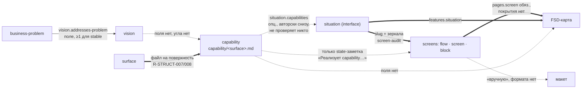

# 04. Качество слоя проекта

Оценка «как есть» по критериям задания: структура и понятность, строгость, полнота,
информативность, согласованность (дубли и противоречия), разрывы цепочки «vision → capabilities →
интерфейсы → экраны → макет». Capabilities и vision разобраны отдельно (§ 4, § 5). Оценки — вывод
исследования, каждая находка опирается на путь и пример; правила, на которые ссылаются находки,
выписаны в `03-current-rules.md`. Пути скиллов даны от `.claude/skills/`, пути канонов — от корня
репо; сокращения вводятся в начале раздела и действуют только внутри него.

Заполненных проектов в шаблоне нет: оцениваются канон формы, образцы внутри шаблонов и скиллы, а не
данные реального продукта.

## Содержание

- [Коротко](#коротко)
- [1. Сводная оценка по слоям](#1-сводная-оценка-по-слоям)
- [2. Системные проблемы (повторяются в нескольких слоях)](#2-системные-проблемы-повторяются-в-нескольких-слоях)
- [3. Разрывы цепочки vision → capabilities → интерфейсы → экраны → макет](#3-разрывы-цепочки-vision--capabilities--интерфейсы--экраны--макет)
- [4. capabilities — насколько чётко и строго описываются](#4-capabilities--насколько-чётко-и-строго-описываются-сейчас)
- [5. vision — чего не хватает, чтобы он стал опорой проектирования и дизайна](#5-vision--что-входит-и-чего-не-хватает-чтобы-он-стал-опорой-для-проектирования-и-дизайна)
- [6. Находки по слоям](#6-находки-по-слоям)
- [7. Контекст и экономия](#7-контекст-и-экономия)
- [8. Что это значит для переписывания](#8-что-это-значит-для-переписывания-вывод)

## Коротко

(вывод)

1. **Каркас сильный, смысл держится на честном слове.** Форма описана один раз
   (`docs/projects/_template/`), ось продукта — поверхность, у каждого слоя пара «исполнитель +
   аудит» одного шаблона. Но почти все критерии качественные («устойчивый», «наблюдаемо», «одно
   предложение»), а узкие аудиты проверяют форму: из пяти критериев и шести «НЕ» capability аудит
   не проверяет ни одного (§ 4).
2. **Строгость растёт сверху вниз.** Самые строгие слои — telegram-bot-flow (68 правил, закрытые
   словари, графовые проверки) и mobile (54 правила, импликации полей); самые слабые — FSD (проверки
   без id и без покрытия) и верх цепочки: vision и capability.
3. **Цепочка рвётся там, где встанет дизайн.** Звено vision → capability не записано нигде;
   capability → ситуация — опциональное поле, которое никто не проверяет; capability → экран / FSD
   живёт только в state-заметках; экраны → макет — «вручную», без формата передачи (§ 3).
4. **Облик выведен из слоя сознательно**: craft-запрет в `CLAUDE.md` §3, у screens снят контракт с
   библиотекой компонентов. Дизайну нужен отдельный легальный слой, а не возврат облика в screens
   (подробнее — `05-gaps-and-insertion.md`).
5. **Системные несогласованности**: восемь проверок обещаны в каноне или скилле и отсутствуют в
   аудите; девять фактов разные аудиты оценивают с разной тяжестью; обязательность полей
   расходится между каноном и чек-листами; образцы нарушают собственный канон; процедуры stub
   порождают error своего же аудита (§ 2).
6. **У продукта нет рода.** Сайт, лендинг и SaaS-кабинет — один `surface.type: web`; vision не знает
   типа продукта, позиционирования и принципов опыта; маршрутизаторы не знают слов «сайт»,
   «лендинг», «дизайн», «макет» (§ 5, § 6.9).
7. **Низкая машиночитаемость там, где нужна генерация**: деревья screens — псевдо-YAML, который не
   парсится; словаря примитивов нет; breakpoints без ширин; `data:<slug>.<field>` ссылается на поля,
   которых у `data-items` нет (§ 2.9, § 6.3).
8. **Контекст**: всегда загружено ≈ 15 тыс. токенов (`CLAUDE.md`, описания скиллов, rules); в листинге
   сессии у семи скиллов не показано описание; `/cross-audit` на крупный проект — 92 агента (§ 7).

## 1. Сводная оценка по слоям

Шкала «сильная / средняя / слабая» — вывод по совокупности находок § 2 и § 6. «Правил» — число
правил с id в реестре узкого аудита.

| слой | узкий аудит | числовые пороги (примеры) | структура | строгость | согласованность | главное для дизайна (вывод) |
|---|---|---|---|---|---|---|
| продуктовый (`project/`) | 25 правил | user «минимум 1, обычно 2-5»; зонтик «3-5 capability»; `description` ≥ 10 символов; slug «1-3 слова» | сильная | слабая | средняя | нет рода продукта, брифа, позиционирования; у capability нет трассы вниз |
| interface | 25 правил | `< 10 символов` (R-COV-005); «≥2 блоков» (R-SEM-005) | сильная | средняя | средняя | лучшая опора UX (ситуация; `action` / `using-what` / craft разведены), но без состояний, сценариев, прав и контента |
| screens | 48 правил | 6 канон-состояний; серия ≥ 2 экранов → `transitions`; breakpoints `xs…xl` без ширин | сильная | средняя | слабая | хватает на каркасный wireframe; облик запрещён; нотация не парсится; макета нет |
| FSD | проверки в `fsd-audit/SKILL.md`, без id и реестра | widget ≥ 2 рефов | средняя | слабая | слабая | `shared-ui` — инвентарь без токенов; у SSR-сайта нет сайтовых понятий |
| mobile | 54 правила | словари состояний: 9 экранных, 5 виджетных, 4 оверлея | сильная | сильная | средняя | нет уровня композиции и макета |
| telegram-bot-flow | 68 правил | ≤ 1 действия в уведомлении; 6 закрытых enum; 6 типов виджетов; `description` < 10 | сильная | сильная | средняя (канон продублирован 3–5 раз) | образец приёмов строгости для design-слоя |
| services, домены | 28 правил у `service-audit`; доменный уровень не проверяет никто | — | сильная | средняя | средняя | фронтовые деплой-юниты (SPA, SSR-сайт) вне периметра |
| infrastructure | 22 правила | «хотя бы в одном prod-рантайме» (угол `/cross-audit`) | сильная | средняя | средняя | — |
| `/cross-audit` | 46 углов | «≥2 поверхностях», «ровно один `type: bot`», «обычно 3-5 ситуаций» | сильная (карточки углов) | слабая по построению: семантика, недетерминизм | средняя | 92 агента на крупный проект; угла под визуал нет |
| оркестраторы | — | «до 4 вопросов в раунде», «трижды Other», «3+ `**жду аналитика**`» | средняя | слабая: классификация по фразам-примерам | средняя | нет сигналов «сайт / лендинг / дизайн / макет» |

## 2. Системные проблемы (повторяются в нескольких слоях)

### 2.1 Структура и понятность

- **Сильное.** Табличные слои держат одну форму: «Критерии → Что НЕ → Тест-критерий ✅/❌ → Колонки →
  образец»; interface — эталон, на который ссылаются остальные
  (`docs/projects/_template/project/README.md:120`, `docs/projects/_template/screens/README.md:113`,
  `docs/projects/_template/fsd/README.md:67-72`). Единая форма ячеек
  (`docs/projects/_template/interface/README.md:97-106`), канон один раз, одна структурная ось.
- **Тяжёлые строки.** Ситуация interface — 17 колонок в одной markdown-таблице
  (`docs/projects/_template/interface/_template/situation.md`); «свободный текст — … одна строка»
  (`docs/projects/_template/interface/README.md:106`) не оставляет места обоснованиям, и они уходят в
  state `## Доменные решения`, которые код-репо не читают.
- **Одно имя — разный смысл.** `shared-api`: FSD запрещает эндпоинты, mobile требует `<METHOD>
  <path>`; `widget`: блок FSD против системного виджета mobile; `flow`: в screens — декомпозиция по
  вьюпортам (desktop ↔ mobile), в mobile — навигационный сценарий.
- **Перегрузка прозы**: «перевод + slug в скобках при каждом вхождении»
  (`docs/projects/_template/interface/README.md:92-95`) даёт «субстрат (ux-substrate)… субстратов
  (ux-substrate)».

### 2.2 Строгость: критерии качественные, аудит проверяет форму

- Критерии канона почти везде словесные; аудиты проверяют дубли, enum, обязательные слоты, ссылки и
  зеркала. Примеры: у capability ни один из пяти критериев и шести «НЕ» не проверяется (§ 4.2); ядро
  критериев interface (who без ситуации — «не участник», «одна цель», «action без инструмента») — hint
  только для нулевых значений или не проверяется вовсе (§ 6.2).
- Смысловые правила узких аудитов — лексические списки: interface R-SEM-001/002 ищут слова-маркеры
  без опоры в каноне (ложное срабатывание — «sm» в «SMS»; обход — синоним).
- Подтверждение тест-критерия при `draft → stable` — «аналитик нажал ✅»
  (`project-deep-dive/references/draft-stable.md:40-63`); факт подтверждения нигде не пишется,
  stable-запись задним числом не проверить.
- Единственный повторяющийся числовой порог узких аудитов — `description` короче 10 символов; в
  каноне у него опоры нет.
- `/cross-audit` недетерминирован по построению: suppressions применяются «по семантике»,
  `last-report` перезаписывается, прогоны не сравнимы; вся смысловая цепочка ajtbd / swot → vision /
  capability, кроме битых ссылок, — максимум warning.
- Контрпример внутри репо — бот и mobile: закрытые словари, regex для slug, области уникальности,
  импликации полей (`voice ⇒ phrases`, `exact ⇒ notification`), графовые проверки достижимости
  (§ 6.5, § 6.6).

### 2.3 Обещанные проверки, которых нет

| обещание | где | фактически |
|---|---|---|
| `/project-audit` ловит файлы и папки всех слоёв для поверхностей вне реестра | `docs/projects/_template/project/surface.md:16-17` | проверяет только `capability/` (R-STRUCT-007/008) |
| угол `surface-screen` покажет «экраны без привязки к возможностям» | `screen-deep-dive/references/project-context.md:126-128` | угол capability не читает |
| `/cross-audit` сверит «покрытие возможностей поверхности диалогами» | `telegram-bot-flow-deep-dive/references/interface-context.md:169-171` | угла capability ↔ бот нет |
| сверка deep-link ↔ `pages.path` | `docs/projects/_template/mobile/README.md:152,162` | правила нет |
| строка карты `integration-domain` проверяет `fronted-by` | `cross-audit/references/angles.md:70` | в карточке угла проверки нет |
| interface-audit ловит «тупики навигации» | `interface-audit/SKILL.md:3` | нет глобальной достижимости от `entrypoint` и правила «блок без выхода» |
| `/service-audit` — узкий аудит доменов | `CLAUDE.md` §2 (таблица слоёв) | «Не читает содержимое доменных артефактов» (`service-audit/references/rules.md:469`) |
| удаление в interface каскадно удаляет ссылки в screens | `docs/projects/_template/screens/README.md:274-275` | исполнителя каскада нет: удаление interface затрагивает только 7 файлов поверхности |

### 2.4 Один факт — разная тяжесть

| факт | оценки |
|---|---|
| для бота нет доменного use-case или события | warning (узкий аудит, R-SEM-011 / R-SEM-003) · **error** (`/cross-audit`, `botflow-domain`) · «не блокирует stable» (deep-dive) |
| окно бота без `errors` | блокирует stable (deep-dive) · hint / warning (аудит) |
| stable-запись при открытом `**blocker**` | warning (service-audit R-SEM-004) · error (infrastructure-audit R-STRUCT-009) |
| поверхность без сервиса | hint (service-audit R-COV-002, «статический лендинг») · error (`/cross-audit`, `surface-service`) |
| сервис без prod-размещения | инвариант (`docs/projects/infrastructure/README.md:37-39`) · hint (infrastructure-audit R-COV-001) · error (`service-placement`) |
| user без покрытия в `who` | error (`cross-audit/SKILL.md:194`, `cross-audit/references/output-formats.md:68,166`) · warning (карточка угла, `cross-audit/references/angles.md:525-529`) |
| нет сервиса для поверхности `type: bot` | error (`surface-service`) · warning (`botflow-service`) — одно условие, два finding |
| widget FSD ссылается меньше чем на 2 блока | «blocker для его stable» (`fsd-deep-dive/SKILL.md:159-161`) · warning (fsd-audit) |
| `shared-api` FSD без покрытия | «blocker» (`docs/projects/_template/fsd/_template/shared-api.md:11-12`) · warning (fsd-audit) |

### 2.5 Обязательность полей расходится

- `situation.ux-substrate`: «обяз.» в каноне (`docs/projects/_template/interface/_template/situation.md:114`),
  «опционально» в чек-листе (`interface-deep-dive/references/field-checklists.md:85-86`); аудит берёт
  обязательность из чек-листа — stable-ситуация без единого UI-воплощения не ловится.
- `flow.transitions` обязательны для stable при серии из двух и более экранов
  (`screen-deep-dive/SKILL.md:320-322`), но опциональны в форме и чек-листах
  (`docs/projects/_template/screens/_template/flow.md:57`) и не проверяются.
- Продуктовый слой пишет «обяз.» в `## Колонки` без разделения draft / stable, а чек-листы
  `project-deep-dive` это разделяют.
- Stable при открытых вопросах — три формулировки в interface: «открытых вопросов нет»
  (`docs/projects/_template/interface/README.md:120`), «не-blocker открытые вопросы при stable
  допустимы» (`interface-deep-dive/references/draft-stable.md:79-80`), «закрыты или явно отмечены как
  "не блокирует"» (`interface-deep-dive/SKILL.md:204-206`).

### 2.6 Процедуры скиллов против правил репо

- **Slug спрашивают у аналитика** (`interface-deep-dive/references/field-checklists.md:38,66`,
  `interface-deep-dive/references/workflow-patterns.md:151`,
  `screen-deep-dive/references/workflow-patterns.md:235` — «аналитик называет, не скилл») — против
  `.claude/rules/naming.md` §1 «Slug выводит скилл, не аналитик».
- **Scaffold копирует канон-прозу в папку проекта** (`interface-deep-dive/SKILL.md:55-60`,
  `fsd-deep-dive/SKILL.md:56-60`) — против `CLAUDE.md` §6 «канон не копируется в папки проектов».
- **Stub порождает error своего аудита**: stub-блок interface с «остальные ячейки `—`» → R-STRUCT-005/006,
  stub-субстрат → R-STRUCT-008 (`type` = `—` вне enum); stub use-case бота без обязательного `who`
  (`telegram-bot-flow-deep-dive/references/stubs-and-cascade.md:22-24`) → R-STRUCT-004.
- **Даты против forward-only**: slug нити `sozvon-2026-06-06`
  (`entrypoint/references/state-model.md:126-127`), «Обновлено: <YYYY-MM-DD>» в клиентской сводке
  (`entrypoint-for-business/references/escalation.md:196`) — при запрете дат (`CLAUDE.md` §1).
- **Нет пикера без аргументов** у `/cross-audit` — против `.claude/rules/naming.md` §2 («Путь "без
  аргумента → пикер по именам" есть всегда»).

### 2.7 Образцы нарушают собственный канон

(вывод) Для будущей генерации это критично: модель копирует образец точнее, чем правило.

- interface: `birth-date` — «Дата в формате YYYY-MM-DD»
  (`docs/projects/_template/interface/_template/data-items.md:79`) — формат реализации, который канон
  же запрещает; субстрат `referral-form` (`…/situation.md:130`) — «составная форма целиком»
  (`…/ux-substrate.md:52-53`); блок `studies.list` (`…/block.md:77`) — не kebab-case и расходится со
  `studies-list` в образце screens, где slug блока обязан совпадать (screen-audit R-STRUCT-014).
- screens: `detail: [ui:Spinner size=lg]` (`docs/projects/_template/screens/_template/screen.md:138`)
  при `detail: { accepts: 'block' }` (`…/shell.md:101`) — error по R-STRUCT-012; `columns: { field,
  label: 'Имя' }` — текст атрибутом вопреки «текст — children-узел»
  (`docs/projects/_template/screens/README.md:138-139`); триггеры переходов по-английски (`'tap
  row'`) при прозе по-русски (`CLAUDE.md` §8).
- продуктовый слой ↔ interface: capability `send-referral` (user `nurse-partner`) и ситуация
  `submit-referral` с `capabilities: [send-referral]` (who `doctor`) — адресаты образца расходятся
  (`docs/projects/_template/interface/_template/situation.md:124-131`).
- mobile: `entities.source` описан тремя способами — интро допускает data-item
  (`docs/projects/_template/mobile/_template/entities.md:4-5`), колонка — «ресурс из `shared-api.md` |
  `local`» (`:41`), аудит — «`local` либо ресурс».

### 2.8 Дубли

- Бот: виджет-язык, инварианты и язык контракта повторены 3–5 раз
  (`docs/projects/_template/telegram-bot-flow/README.md:161-168` ≡
  `…/_template/features/README.md:97-104` + `…/features/window.md:65-76`); списки anti-patterns уже
  расходятся («Окно-сирота» есть в README слоя и нет в `features/README.md`).
- interface: перечень 12 ссылочных полей — в `interface-deep-dive/references/draft-stable.md:27-38` и
  `interface-audit/references/rules.md:86-97`; обязательность полей — в формах и в
  `field-checklists.md`, и она уже расходится (§ 2.5).
- mobile: копия канона живёт ещё и в `mobile-template` (`docs/projects/_template/mobile/README.md:15-16`)
  — риск рассинхрона.
- Рынок: три реестра без сверки — `docs/projects/<slug>/market.md`, `docs/business/competitor.md`,
  `docs/ajtbd/solution.md`; угла `/cross-audit` между ними нет.

### 2.9 Полнота и информативность: чего нет ни в одном слое

| аспект | ближе всего | чего нет |
|---|---|---|
| состояния интерфейса | screens — 6 канон-состояний; mobile — 9 экранных, 5 виджетных, 4 оверлея; бот — беднее | частичного, лимита, «нет прав» (кроме mobile `permission-denied`), единого словаря на слои; в interface состояние как ситуация прямо запрещено (`docs/projects/_template/interface/_template/situation.md:75-77`) |
| сценарии | `flow` screens (декомпозиция по вьюпортам); `flows` mobile (ветки ошибок) | «happy path → ветвления → ошибки → пустые»; `goal` / `action` / `when` ситуации в screens не используются |
| права и роли | `who` — «не ACL» (`…/interface/_template/who.md:45-46`), но `pages.guard` FSD берёт who как роль доступа (`docs/projects/_template/fsd/_template/pages.md:41`) | модели прав |
| приоритет | — | приоритета и частоты ситуаций, главного действия экрана, иерархии важности |
| контент и тексты | тексты-дети в дереве screens; микрокопия mobile (`rationale`, `phrases`, `fallback`); тексты бота от аналитика | copy deck, фактов, объёмов и крайних случаев контента, тона |
| поля данных | `data-items` — датум без полей | полевого контракта для `data:<slug>.<field>` (screens, бот); связи с агрегатом домена |
| ИА | `zone` / `parent-zone`, межзонные переходы interface | доведения до screens: shell «не sitemap», карты сайта нет |
| машиночитаемость | реестры-таблицы | валидного YAML деревьев screens (канонические примеры дают `ScannerError` / `ParserError`), словаря примитивов (`docs/projects/_template/screens/README.md:135-136` — «словаря примитивов и их атрибутов у слоя нет»), ширин breakpoints |
| a11y, i18n | i18n в FSD (форма нарушена: нет `slug` / `name` / `description`) | правил доступности |
| визуал | — (`CLAUDE.md` §3 — craft не пишется) | направления, токенов, ассетов, макета |

## 3. Разрывы цепочки vision → capabilities → интерфейсы → экраны → макет

Полная трасса звеньев (поле, обязательность, узкий аудит, угол `/cross-audit`) — `03-current-rules.md`
§ 2. Здесь — оценка.

Жирная стрелка — связь записана полем и проверяется по slug; пунктир — связи нет, она опциональна
или живёт вне артефакта.

- **vision → capability — связь только в порядке фаз.** Ни поля, ни угла: `/project-deep-dive` ведёт
  фазы vision → user → surface → capability, но capability не ссылается на vision, `Success` или
  `Non-goals`, а `boundary` не участвует ни в одном угле `/cross-audit`.
- **capability → ситуация — опциональное поле без проверки.** `situation.capabilities` авторится снизу;
  interface-audit отдаёт его `/cross-audit` (`interface-deep-dive/references/draft-stable.md:21-25`), а
  углы `capability-situation` и `user-who` сверяют по смыслу и эти поля не читают (поиск
  `who.users|situation.capabilities` по `.claude/skills/cross-audit/` — 0 совпадений).
- **capability → экран / FSD / бот / mobile — поля нет.** Связь flow → capability и use-case →
  capability живёт только в state-заметках («Реализует capability (поверхность <surface>):
  send-referral», `screen-deep-dive/references/project-context.md:78-81`;
  `domain-deep-dive/references/project-context.md:78-85`); у FSD-фич, мобильных фич и фич бота ссылки
  на capability нет; углов capability ↔ screens / FSD / бот нет, есть только `surface-mobile`
  (warning: ценность «вне экранов» без воплощения).
- **interface → screens — самое сильное звено**: `screen.situations`, `screen.blocks`, `screen.who`,
  `block.interface-block` (slug совпадает), зеркало `block.ux-substrates`, `data:<slug>`. Но каскада
  удаления и процедуры переименования вниз нет (§ 2.3), ИА (`zone`, `parent-zone`, межзонные
  переходы) и `stage` в screens не доходят.
- **screens → FSD** — `pages.screen` обязателен и резолвится, но покрытия («экран без страницы»,
  «ситуация без фичи») нет ни в fsd-audit, ни в `/cross-audit`: FSD там читает только угол `mobile-web`
  (`pages.path` для сверки с мобильными ссылками).
- **screens → макет — звена нет.** «Wireframe и hi-fi автор макета собирает вручную» (`CLAUDE.md` §3);
  нет формата передачи, критериев приёмки, ширин вьюпортов и места для результата.
- **data-items → поля экрана и агрегаты** — `data:<slug>.<field>` проверяется только по `<slug>`; связи
  `data-items` с агрегатом домена нет ни полем, ни углом.
- **Порядок цепочки держит только `/entrypoint`.** interface-, screen-, fsd-, mobile- и
  telegram-deep-dive в конце предлагают лишь свой аудит; `project-deep-dive` не предлагает перейти к
  interface (`project-deep-dive/SKILL.md:440-447`).

(вывод) Строгая, проверяемая по slug часть цепочки начинается с interface и идёт вниз. Верх — vision →
capability → ситуация — держится на опциональных полях и смысловых углах, а три звена, на которых
будет стоять дизайн (vision → capability, capability → экран / страница, экран → макет), не записаны и
не проверяются.

## 4. capabilities — насколько чётко и строго описываются сейчас

Пути: `capability.md`, `vision.md`, `boundary.md` — `docs/projects/_template/project/`; `situation.md` —
`docs/projects/_template/interface/_template/`; `angles.md` — `cross-audit/references/`; `draft-stable.md` —
`project-deep-dive/references/`.

### 4.1 Что есть

- **Состав записи** — 8 колонок: `slug` · `name` («глагол + объект в языке user») · `description`
  («одно предложение, что продукт умеет») · `value` («ценность для user, в его языке») · `user` (≥1
  для stable) · `hypotheses` (опц.) · `jobs` (опц.) · `status` (`capability.md:72-81`).
- **Критерии** — пять качественных (глагол + объект, кому ценность, самодостаточность, «что, не как»,
  сквозные рёбра) и шесть «НЕ» (эпик, технология, зонтик, без user, UI-элемент, возможность
  платформы) с тест-критерием «одно предложение ценности для конкретного user, без слов о технологии»
  (`capability.md:22-70`).
- **Структурная привязка к поверхности** — файл `capability/<surface>.md`; «одна ценность на двух
  поверхностях = две записи, у каждой своё воплощение».

### 4.2 Чего не хватает для строгости (с примерами)

1. **Гранулярность не измерима.** Чисел два: зонтик «разложится на 3-5 capability»
   (`capability.md:70`) и ожидание cross-audit «обычно 3-5 ситуаций» на сложную capability
   (`angles.md:572-574`). Нет ориентира «сколько capability на поверхность», нет критерия, отделяющего
   capability от ситуации. В каноническом примере они совпадают 1:1: capability `send-referral`
   «Передать направление» ↔ ситуация `submit-referral` «Подача направления» с `capabilities:
   [send-referral]` (`situation.md:124-131`) — при этом адресаты расходятся: у capability медсестра
   (`nurse-partner`), у ситуации врач (`doctor`).
2. **Противоречие «воплощения».** «Одна ценность на двух поверхностях = две записи…, у каждой своё
   воплощение» (`capability.md:11-12`), но критерий 4 запрещает «как» (`:35-38`), а колонки под
   воплощение нет. Чем различаются две записи, кроме файла, канон не говорит; клиентская призма
   описывает это как «на сайте экран, в боте — пара сообщений» (`entrypoint-for-business/references/product.md:22-26`).
3. **Нет полей**, без которых capability не становится проверяемым контрактом: объект предметной
   области (отдельно от глагола — сейчас оба внутри `name`), триггер / ситуация использования,
   критерий приёмки или наблюдаемый результат («как поймём, что умение есть»), приоритет / объём MVP /
   горизонт, метрика или связь с метрикой проблемы, роли с правами (кто может), зависимость от
   интеграций и ограничений, ссылки вниз.
4. **Проверяемость почти нулевая.** `/project-audit` видит только форму (дубли, обязательные слоты,
   enum, файл ↔ поверхность, «без user», `description` = `name`, `< 10 символов`). **Ни один из пяти
   критериев и шести «НЕ» не проверяется**, существование `capability.user` в `user.md` — тоже.
   Подтверждение критериев — «аналитик нажал ✅» (`draft-stable.md:40-63`), но нигде не фиксируется:
   stable-запись задним числом не проверить. Смысловые проверки — эвристики `/cross-audit`.
5. **Связи вверх — мягкие.** Авторские `hypotheses` и `jobs` опциональны (прочерк допустим);
   `job-graph.value-mechanics` — свободная строка без id механики, без ранга и без ссылки на работу;
   ставки и цели — только семантический угол `bet-capability` (максимум warning). С `vision` и
   `business-problem` прямой связи нет.
6. **Связи вниз — самые слабые в цепочке.** В артефактах записано только опц. ребро ситуации
   `situation.capabilities` (авторски снизу); его резолв не проверяет никто. flow → capability и
   use-case → capability живут **только в state-заметках** («Реализует capability (поверхность
   <surface>): send-referral», `screen-deep-dive/references/project-context.md:78-81`;
   `domain-deep-dive/references/project-context.md:78-85`), у контекста домена — опц. свободный текст.
   У FSD-фич, мобильных фич и фич бота ссылки на capability нет. Углов cross-audit capability ↔
   screens / FSD / бот нет.
7. **Нет жизненного цикла умения** (он есть только у продукта в целом — `vision.lifecycle`).

### 4.3 Ориентиры для строгой capability (для сравнения с базой; не готовое решение)

| аспект | сейчас | направление (гипотеза) |
|---|---|---|
| состав | глагол + объект внутри `name`, `value`, `user` | отдельные поля: действие, объект (из глоссария объектов), роль(и), триггер, результат / критерий приёмки, приоритет / объём (MVP / later), зависимость (integration / constraint) |
| гранулярность | качественные критерии + «3-5» в двух местах | проверяемое правило разбиения (например, «один объект × одно действие × один результат»; зонтик → группа; ситуация ≠ capability — capability «переживает» смену UX) и ориентиры количества на поверхность |
| проверяемость | подтверждения не фиксируются | фиксировать подтверждённые критерии (например, в state или в колонке) так, чтобы аудит мог проверить stable задним числом |
| связи вверх | опц. `jobs`, `hypotheses`; механики — свободный текст | обязательная трасса хотя бы к одному источнику (работа / механика / ставка / проблема) или явное «обосновано иначе: …» |
| связи вниз | только `situation.capabilities` (опц., не проверяется) | обязательное покрытие: capability → ≥1 ситуация → ≥1 экран / страница / фича; проверка в узком или сквозном аудите |
| воплощение по поверхности | «две записи, у каждой своё воплощение» без поля | явная колонка / ссылка «как проявляется на этой поверхности» либо отказ от дублирования (общая capability + воплощения по поверхностям) |

## 5. vision — что входит и чего не хватает, чтобы он стал опорой для проектирования и дизайна

### 5.1 Что есть

`Problem` (1–2 предложения, чья боль), `Success` (метрика или наблюдаемый сдвиг), `Non-goals` («не
делаем X, потому что Y»), оси `audience` (5 значений), `intent` (4), `market-maturity` (2),
`lifecycle` (7), `addresses-problem` (≥1 для stable), `status` (`vision.md:60-101`). Роль задана
узко: «внутренний документ аналитика, не сейлз-материал»; тест — «к какой проблеме и для кого… и
какие границы».

### 5.2 Чего не хватает (ориентиры → что есть сейчас)

| ориентир | в vision | где ещё в слое | оценка |
|---|---|---|---|
| имя продукта | нет (H1 = `vision`), хотя пикеры строятся по «заголовку из vision» (`docs/projects/README.md:92-93`) | `<slug>/README.md` упомянут (`docs/projects/README.md:43`), но канона нет и скаффолд его не создаёт | разрыв |
| тип продукта (сайт, лендинг, SaaS-кабинет, мобильное, бот, контентный / SEO) | нет | `surface.type` без различения сайт / кабинет; SPA vs SSR — в код-репо; «SEO» — 0 вхождений в репо | нет |
| аудитория | enum `audience` + адресат в Problem | `user.md` (context · jobs · pains · success) | есть, раздельно |
| позиционирование / ценностное предложение | нет (маркетинг запрещён, R-SEM-008) | `market.description` «чем мы отличаемся» по каждому аналогу; `business/profile` «Позиционирование» (как есть) | нет сводного |
| принципы опыта, характер, тон | нет | нет нигде; облик запрещён (`CLAUDE.md` §3) | нет |
| метрики успеха | `Success` — текст; метрики — в `hypothesis-map/metric`, связь только семантическая (`goal-vision`) | — | без ссылок |
| ограничения | нет | `constraint.md` | есть отдельно |
| что не делаем | `Non-goals` | `boundary.md` — с противоречием, где «развёрнуто», а где «кратко» | есть |
| где живёт продукт | нет | `surface.md` | есть отдельно |
| ключевые сценарии / главный путь пользователя | нет | перечень capability, ситуации interface | нет сводного |
| объём MVP, горизонт, приоритеты | только `lifecycle` (стадия) | нет | нет |
| уровень амбиций / глубина исполнения | нет | ближайшее — `lifecycle` | нет |
| риски, допущения | нет | открытые вопросы в state | нет |
| бренд, материалы клиента для дизайна | нет | `business/material` — провенанс без места хранения и прав | нет |

Поля `audience` и `intent` не использует ни один слой ниже (только enum-проверка и клиентская
призма), `Non-goals` — только внутри слоя (cohesion → boundary). Широкая продуктовая картина
собирается чтением 6–7 файлов; сводного продуктового брифа нет.

### 5.3 Что мешает «расширить vision» (вывод)

- Канон прямо сужает роль: «Маркетинговая копия для лендинга» — anti-pattern (`vision.md:46`),
  R-SEM-008 ловит маркетинговую лексику, тест-критерий — только «проблема, для кого, границы».
  Позиционирование и принципы опыта придётся явно легализовать (и отделить от «маркетинговой
  копии»).
- Экспертиза священна: формулировки vision даёт бизнес / аналитик через `AskUserQuestion`
  (`CLAUDE.md` §3, строка «Продуктовая»). Новые поля (позиционирование, принципы опыта, тон) тоже
  потребуют владельца в таблице §3.
- Часть широкой картины уже живёт в соседних kind (user, surface, market, constraint, boundary) —
  расширение vision должно решить, что сводится в vision ссылками, а что дублируется.

## 6. Находки по слоям

Детализация § 2 по слоям. Сокращения путей вводятся в начале каждого подраздела.

### 6.1 Продуктовый слой

Сокращения: `PR` — `docs/projects/_template/project/README.md`; `vision.md`, `boundary.md`, `surface.md`,
`capability.md` — `docs/projects/_template/project/`; `phases.md`, `workflow-patterns.md` —
`project-deep-dive/references/`.

(вывод, с путями)

**Сильное.** Форма описана один раз, данные — в проектах; одна структурная ось с механическими
проверками хребта; единый формат «Критерии / НЕ / Тест-критерий» с ✅/❌-примерами; запрет выдумывать
(Other для доменных полей, находки роя — только через подтверждение); явное разведение «четвёрки
адресатов» `who ≠ user ≠ segment ≠ subject` (`entrypoint/references/routing.md:90-96`).

**Противоречия.**
- **Non-goals ↔ boundary**: «Сюда падают boundary-записи в развёрнутом виде; в `boundary.md` их slug
  + краткое why» (`vision.md:87-89`) против «Vision.non-goals — короткий обзор; здесь — реестр»
  (`boundary.md:4-5`).
- **R-COV-002 против фаз**: хинт «vision закрыт как stable, но ни одного user… Возможно, рано
  закрыли» (`project-audit/references/rules.md:358-370`), а фаза `user` стартует, когда «vision
  стабилен, user.md пуст» (`phases.md:60`).
- **Лексикон R-SEM-003** не ловит собственный анти-пример «нет ресурсов» (`boundary.md:44`).
- **Enum против лимита опций**: «по одной опции на каждое значение enum» (`workflow-patterns.md:196`)
  при `AskUserQuestion` «до 4 опций»; у `surface.type` 8 значений, у `lifecycle` 7, у `audience` 5.
- **Счётчики**: «5 плоских» (`PR:17`) против «6 плоских» (`project-deep-dive/SKILL.md:67`) таблиц.
- **«обяз.»** в `## Колонки` без разделения draft/stable — при делении в field-checklists.
- **Автор project-map не назначен явно**: routing отдаёт ребро `/project-deep-dive`, а скилл пишет
  только в папку проекта; шагов, чек-листа и stable-контракта для строк project-map нет;
  `/project-audit` его не проверяет.
- **Два (три) реестра рынка без сверки**: `project/market.md` (позиция `direct/indirect/manual/legacy`
  в тексте), `business/competitor.md` (колонка `position`: `direct/indirect/substitute/new-entrant`),
  `ajtbd/solution.md`; угла cross-audit между ними нет.
- **`surface.md:16-17`** обещает, что `/project-audit` ловит файлы/папки всех слоёв для поверхностей
  вне реестра, а фактически он проверяет только `capability/` (R-STRUCT-007/008).
- **Самодостаточность surface** требует «явно зафиксировать зависимость» — колонки нет.

**Строгость.** Почти все критерии качественные («устойчивый», «наблюдаемо», «одно предложение»).
Числа: user «минимум 1, обычно 2-5»; зонтик «3-5 capability»; «3-5 ситуаций» (cross-audit);
`description` ≥ 10 символов (без опоры в каноне); slug «1-3 слова»; рой — «3-7 кандидатов», «2-3
sources».

**Входы сверху.** `/project-deep-dive` на discovery читает только `business-problem`, `goal`,
`metric`; `segment-problem`, `job-graph`, `competitor`, `profile`, `offering`, `channel`, `material`
не читаются — фаза `market` ищет конкурентов своим роем с нуля.

**Цепочка до макета не доходит**: vision → capability (без трассы вниз) → situation → screens (облик
запрещён) → FSD. Брифа, референсов, токенов, ассетов, copy и уровня «страница сайта» нет, а тип
продукта на маршрут не влияет.

### 6.2 interface

Сокращения: `T/` — `docs/projects/_template/interface/_template/`; `IR` —
`docs/projects/_template/interface/README.md`; `DD` — `interface-deep-dive/` (`DD:N` — строка его
`SKILL.md`); `AU` — `interface-audit/` (`AU:N` — строка его `SKILL.md`); `project/`, `screens/`, `fsd/` —
от `docs/projects/_template/`.

(вывод, с путями)

**Сильное.**
- Чёткая концептуальная модель: ситуация в центре; «описывают» (who/stage/data-items) против
  «реализуют» (ux-substrate/block) (`T/situation.md:6-8`); разделение `action` (как) /
  `using-what` (чем) / craft (как выглядит) (`T/situation.md:54-56`) — готовая опора, чтобы
  отделить UX от визуала.
- Единообразная форма канонов (Критерии → Что НЕ → Тест ✅/❌ → Колонки) и единая форма ячеек;
  interface — образец для остальных проектных слоёв (`project/README.md:120`,
  `screens/README.md:113`, `fsd/README.md:67-72`).
- Детерминированные структурные проверки: зеркала как равенства множеств (R-MIRROR-001/002),
  циклы, enum, изоляция поверхностей (R-XSURF-001).
- Жёсткая защита экспертизы: доменные поля — только Other, опции — только anti-patterns / enum /
  тест (`DD/workflow-patterns.md:131-160`).

**Противоречия (канон ↔ скилл ↔ аудит).**
- `situation.ux-substrate`: «обяз.» в каноне (`T/situation.md:114`) против «опционально»
  (`DD/field-checklists.md:85-86`); аудит берёт обязательность из field-checklists
  (`AU/rules.md:222-223`) → stable-ситуация без единого субстрата (без UI-воплощения) не ловится.
- Stable и открытые вопросы — три формулировки: «открытых вопросов нет» (`IR:120`); «Не-blocker
  открытые вопросы при stable допустимы» (`DD/draft-stable.md:79-80`); «закрыты или явно
  отмечены как "не блокирует"» (`DD:204-206`).
- Внутризонный явный переход: разрешены «нестандартные внутризонные» (`T/block.md:9-10,66`,
  `IR:152-153`) — и запрещены: «❌ Явный `transition-to-block` внутри одной зоны» (`IR:192-193`),
  R-STRUCT-004 = error. «Нестандартный» нигде не определён.
- R-SEM-005 «блок без входа»: условие «…И в `block.zone` есть другие блоки» противоречит
  собственной оговорке «связность спасает только тогда, когда в зоне ≥2 блоков»
  (`AU/rules.md:243-247`). Глобальной достижимости от `entrypoint`, проверки «есть хотя бы один
  вход» и «блок без выхода» нет, хотя описание аудита обещает «тупики навигации» (`AU:3`).
- Нейминг: `slug` спрашивают у аналитика через Other (`DD/field-checklists.md:38,66`;
  `DD/workflow-patterns.md:151` «аналитик называет, не скилл») — против
  `.claude/rules/naming.md` §1 «Slug выводит скилл, не аналитик».
- Scaffold копирует «канон-прозу» в папку проекта (`DD:55-60`) — против «папки проектов держат
  только данные» (`docs/projects/README.md:56-58`) и `CLAUDE.md` §6 «канон не копируется в папки
  проектов».
- Stub-процедура («остальные ячейки `—`», `DD:215-225`) сама порождает error аудита: stub-блок →
  R-STRUCT-005/006, stub-субстрат → R-STRUCT-008 (`type` = `—` вне enum).
- Образцы противоречат канону: `birth-date` — «Дата в формате YYYY-MM-DD» (`T/data-items.md:79`)
  — формат реализации и «атрибут "дата"» из собственного «Что НЕ»; субстрат `referral-form`
  (`T/situation.md:130`) — «составная форма целиком» (`T/ux-substrate.md:52-53`); блок
  `studies.list` с точкой (`T/block.md:77`) не kebab-case и расходится со `studies-list` в
  образце screens, где slug блока обязан совпадать (screen-audit R-STRUCT-014).
- `who` «не ACL» (`T/who.md:45-46`), но ниже `fsd pages.guard` использует who как роль доступа
  (`fsd/_template/pages.md:41`) — модели прав нет ни там, ни там.

**Строгость.**
- Семантика аудита — лексические списки маркеров (R-SEM-001/002) без опоры в каноне: ложные
  срабатывания («sm» в «SMS»), лёгкий обход. Числовых порогов два: `< 10 символов` (R-COV-005) и
  «≥2 блоков» (R-SEM-005); нет лимитов глубины зон, числа входов, субстратов на блок, ситуаций на
  этап. Мягкие слова: «обычно нескольких блоков», «нестандартные внутризонные», «проверять
  связность» (`DD/field-checklists.md:55-56`).
- Ядро критериев (who без ситуации — «не участник», stage «вмещает несколько ситуаций», «одна
  цель», «action без инструмента») в аудите — hint только для нуля или не проверяется: stable-запись
  может нарушать собственный критерий без error.

**Полнота и разрывы.**
- vision → interface: связи нет; ни одно поле interface не ссылается на vision (`DD:86-92`).
- capability → situation: авторское ребро `situation.capabilities` (и `who.users`) **не проверяет
  никто** — interface-audit отдаёт их cross-audit'у (`DD/draft-stable.md:21-25`), а углы
  `user-who` / `capability-situation` сверяют по смыслу и эти поля не читают (grep
  `who.users|situation.capabilities` по `.claude/skills/cross-audit/` — 0 совпадений).
- interface → screens: связь сильная (slug'и, зеркала), но каскада удаления/переименования вниз
  нет: удаление затрагивает только 7 файлов поверхности (`DD:229-232`), процедуры rename нет
  вообще (при том что `entrypoint/references/routing.md:104` делегирует «рефакторить» в
  `*-deep-dive` «его процедурой каскад-правки»).
- Нет на уровне interface: контракта состояний (состояние интерфейса как ситуация — прямо
  запрещено, `T/situation.md:75-77`), сценариев с ветвлениями/ошибками/пустыми, прав, постур,
  приоритета/частоты ситуаций, контента/текстов/фактов. `data-items` без полей, а screens и бот
  биндят `data:<slug>.<field>` — полевой контракт не определён нигде; связи data-items ↔ агрегат
  домена нет ни полем, ни углом cross-audit.
- Слепота к типу поверхности: одни и те же 7 файлов для web, бота, мобайла, сайта/лендинга и
  `api` (у api «UI отсутствует» — `fsd/README.md:10-11`, но R-SURF-002 ждёт папку interface); для
  сайта нет понятий страницы, секции, контента.
- Приём скриншота UI — только общий режим B, без правил извлечения (`DD/workflow-patterns.md:52-88`).

**Информативность.**
- 17-колоночная строка ситуации в одной markdown-таблице тяжело читается и правится;
  «свободный текст — … одна строка» (`IR:106`) не оставляет места обоснованиям — они уходят в
  state-заметки `## Доменные решения`, которые код-репо не читают.
- Правило «перевод + slug в скобках при каждом вхождении» (`IR:92-95`) перегружает прозу
  («субстрат (ux-substrate)… субстратов (ux-substrate)»).
- Дубли: перечень 12 ссылочных полей — в `DD/draft-stable.md:27-38` и `AU/rules.md:86-97`;
  обязательность полей — в `T/*.md § Колонки` и в `DD/field-checklists.md` (расходится); аудит
  зависит от reference чужого скилла.

### 6.3 screens

Сокращения: `SR` — `docs/projects/_template/screens/README.md`; `screen.md`, `shell.md`, `block.md`,
`flow.md` — `docs/projects/_template/screens/_template/`; `SDD` — `screen-deep-dive/` (`SDD:N` — строка
его `SKILL.md`); `draft-stable.md`, `field-checklists.md`, `raw-input.md`, `assets-policy.md`,
`project-context.md`, `workflow-patterns.md` — `screen-deep-dive/references/`; `fsd/_template/` — от
`docs/projects/_template/`.

(вывод, с путями)

**Сильное.** Роли kind разведены чётко (shell — слоты, screen — заполнение + состояния, block —
дерево, flow — viewport-декомпозиция); механика слотов (`accepts`, `required`, delta-override
состояний) и 5 зеркал с детерминированной проверкой; 6 канон-состояний обязательны для stable.

**Нотация не машиночитаема.** При заявленной «детерминированной карте экранов» (`SR:6`) деревья —
отступная псевдо-YAML: канонические примеры не парсятся YAML-парсером (`block.tree` → `ScannerError`,
`shell.tree` → `ParserError`, в `states` дети склеиваются в строку). Генерация экранов и строгий
автоаудит дерева невозможны.

**Словарей нет.** «Словаря примитивов и их атрибутов у слоя нет» (`SR:135-136`): `ui:`, `icon:` и
атрибуты — свободные пометки; фиксированы только 4 `layout:`-узла с 7 атрибутами (без правила
аудита), `viewport`, `accepts`, `behaviour`, breakpoints `xs…xl` **без ширин**.

**Образцы нарушают собственный канон**: `detail: [ui:Spinner size=lg]` (`screen.md:138`) при
`detail: { accepts: 'block' }` (`shell.md:101`) — error по R-STRUCT-012; `columns: { field, label:
'Имя' }` — текст атрибутом вопреки «текст — children-узел» (`SR:138-139`); субстрат `study-row-menu`
без узла в дереве (`block.md:110-115`); триггеры переходов по-английски (`'tap row'`) при прозе
по-русски (`CLAUDE.md` §8); `data:study.name/.date/.status` — поля, которых `data-items` не допускает.

**Рассогласования SKILL ↔ references ↔ README ↔ аудит.**
- `transitions` обязательны для stable при серии ≥2 (`SDD:320-322`) — но опциональны в форме и
  чек-листах (`flow.md:57`, `SDD/references/field-checklists.md:33`, `draft-stable.md:91-92`) и не
  проверяются.
- «здесь не применимо» для состояния — комментарий в теле (`draft-stable.md:99-100`, R-SEM-011)
  против «пометки в state-заметке» (`field-checklists.md:157`).
- Пустое значение: `[]` / `—` / «поля нет» — три нормы (R-STRUCT-019; `raw-input.md:107`;
  `assets-policy.md:55-56`).
- slug «аналитик называет, не скилл» (`SDD/references/workflow-patterns.md:235`) против
  `naming.md` §1.
- `project-context.md:126-128` обещает, что `surface-screen` покажет «экраны без привязки к
  возможностям» — угол capability не читает.
- Каскад из interface (`SR:274-275` «каскадно удаляются ссылки в screens») без исполнителя.
- Tailwind в каноне аналитики (`SR:145`, `shell.md:88`) при «выбор библиотек — `docs/stack/`
  фронт-форка» (`fsd/_template/shared-ui.md:20-21`).
- Пикер отсеивает только `bot`/`mobile`, `api` проходит; аудит тип поверхности не учитывает.

**Разрывы цепочки.** (а) capability ↔ flow/screen — только в state-заметках, не в артефакте и не в
аудите; (б) ИА (`zone`, `parent-zone`, межзонные переходы) и `stage` interface в screens не доходят,
shell «не sitemap»; (в) flow — не пользовательский сценарий; `goal / action / when` ситуации не
используются; (г) `data:<slug>.<field>` без определения полей; (д) макет — «вручную», без формата
передачи, критериев приёмки, ширин вьюпортов и места для результата; (е) `ui:` ↔ `shared-ui`,
`route` ↔ `pages.path`, `who` ↔ `pages.guard` не сверяются.

**Информативность для дизайнера.** Артефакт даёт слоты, блоки, порядок примитивов, тексты-дети, 6
состояний и ссылки на данные — хватает на каркасный wireframe. Нет: цели и приоритета экрана (кроме
одной фразы `description`), иерархии важности и главного действия, объёмов и крайних случаев
контента, поведения взаимодействий (валидация, подтверждение, обратная связь), частичных состояний и
лимитов, a11y, i18n, copy deck / тона; визуальное направление в репо не живёт вообще.

**Референсы и лицензии.** Скрины конкурентов по умолчанию идут в git; источник, лицензия и дата не
фиксируются (`assets-policy.md:119-128`).

### 6.4 FSD

Сокращения: `SKILL.md` — `fsd-deep-dive/SKILL.md`; `references/` — `fsd-deep-dive/references/`;
`shared-api.md` — `docs/projects/_template/fsd/_template/`.

(вывод, с путями)

- **Самый незрелый слой** (один коммит `707d627`): аудит без id правил, без `rules.md` и
  `audit-state`; у половины проверок нет severity; **проверок покрытия нет совсем** (экран без page,
  ситуация без feature, агрегат без entity).
- **Severity не согласована**: widget <2 рефов — «blocker для его stable» (`fsd-deep-dive/SKILL.md:159-161`)
  против warning в аудите; `shared-api` без покрытия — «blocker» (`shared-api.md:11-12`) против warning.
- **Две таксономии режимов A/B/C** с одинаковыми буквами (`SKILL.md:113-125` — новая / сырьё /
  углубление; `references/workflow-patterns.md:7-52` — с аналитикой / с эскизом / с нуля).
- **Тест-критерий как условие stable** неприменим к app / shared-ui / shared-api / shared-lib.
- **Нарушения собственной формы**: i18n `locale | роль | status` без `slug`/`name`/`description`;
  критерий app про несуществующую колонку `назначение`.
- **Scaffold копирует канон-прозу** в папку проекта (`SKILL.md:56-60`) — против `CLAUDE.md` §6.
- **capability / vision / user не видны** FSD; угла cross-audit для FSD нет (содержимое `fsd/` читает
  только `mobile-web`); «возможность → слайс» никем не сверяется.
- **Дизайн-системы нет по замыслу**: `shared-ui` — инвентарь примитивов (имя + `семантика`), «токены и
  облик — craft… живёт в коде фронт-форка»; связь `ui:<Name>` ↔ `shared-ui` только прозой.
- **SSR-сайт на той же карте** («в страницы и коллекции», `docs/README.md:122`), но ничего сайтового:
  SEO и мета, коллекции, секции страницы, тексты.
- **Одинаковые имена kind, разный смысл**: FSD `shared-api` запрещает эндпоинты, mobile требует
  `<METHOD> <path>`; `widget` (FSD-блок) vs системный виджет; `flow` (screens: desktop↔mobile) vs
  навигационный сценарий mobile. FSD не упомянут в `CLAUDE.md` §8 среди handoff-идентификаторов, хотя
  код выводит `src/<layer>/<slice>/` из kind + slug.

### 6.5 mobile

Сокращения: `MR` — `docs/projects/_template/mobile/README.md`; `entities.md`, `flows.md`, `shell.md` —
`docs/projects/_template/mobile/_template/`.

(вывод, с путями)

- **Самый строгий слой зоны D**: 54 правила с id и severity, импликации (`voice ⇒ phrases`, `exact ⇒
  notification`, `continuous ⇒ permission`), словари состояний (9 экранных, 5 виджетных, 4
  оверлея), field-checklists, линза с «не нужно», сквозной todo-пример под каждой таблицей.
- **`entities.source` противоречив**: интро допускает data-item (`entities.md:4-5`), колонка — «ресурс
  из `shared-api.md` \| `local`» (`:41`), аудит — «`local` либо ресурс».
- **У `entry-points` (и `flows`) нет `situation`**, хотя `docs/README.md:110` декларирует связь.
- **Платформенные имена обязательны** (`permissions.android` / `ios`: `POST_NOTIFICATIONS`) — при
  anti-pattern «имена платформенных API».
- **`preset ≠ enterprise`** (понятие stack) в каноне против рамки «в магазины» у скилла; README
  «обязателен» против warning аудита для `demo`.
- **Язык контракта противоречив**: идентификаторы «английские», а колонки русские (`ключевые поля`,
  `шаги`, `ветки ошибок`, `требует сессии`, `когда`…), при этом имена колонок объявлены
  handoff-контрактом.
- **Порядок старта расходится**: «requirements → session → route» (`flows.md:14-15`) против «demo →
  кэши → session → route» (`shell.md:5-6`).
- **README обещает проверку, которой нет** (deep-link ↔ `pages.path`, `MR:152,162`).
- **Тексты**: «тексты состояний» объявлены контентом, но у `screens` колонки текстов нет; есть только
  микрокопия (`rationale`, `phrases`, `response`, `freshness`, `fallback`, тексты ошибок).
- **Нет уровня композиции / макета**: прыжок interface → код; визуальная проверка — «превью/скриншот
  в коде» и Maestro.
- **Состояния**: хорошая база, но `empty` не обязателен для списков, `permission-denied` не связан с
  `permissions`, `offline` не требуется при `Offline: blocked/read-only`; нет «частичного» и «лимита».
- **Сценарии и роли**: flows без ветвлений кроме ошибок; ролей у экранов и фич нет (только сессия и
  Auth-gate).
- **Копия канона в `mobile-template`** (`MR:15-16`) — риск рассинхрона.

### 6.6 telegram-bot-flow

Сокращения: `TBF` — `docs/projects/_template/telegram-bot-flow/`; `features/README.md`, `window.md` —
`TBF/_template/features/`; `DD` — `telegram-bot-flow-deep-dive/`; `stubs-and-cascade.md`,
`interface-context.md` — `DD/references/`; `rules.md` — `telegram-bot-flow-audit/references/rules.md`.

(вывод, с путями)

**Сильное.** Самый строгий слой репо: 6 закрытых enum, закрытый виджет-язык из 6 типов, regex
для slug, области уникальности каждого идентификатора, графовые проверки (сирота / тупик /
достижимость / матрёшка), «`fallback` обязателен», «`idempotency` обязательна», «≤1 действия в
уведомлении»; для зеркал назван источник правды и механизм пересчёта («механический пересчёт, но
запись делается явно, не молча», `DD/SKILL.md:405-408`). Жёсткая граница «представление ↔
бизнес-правило» (`when` = исход use-case бота; «точка различает уровни»). Дисциплина текстов:
структура — скилл, тексты — аналитик.

**Дубли.** Канон повторён 3–5 раз: виджет-язык — `TBF/README.md:161-168` ≡
`features/README.md:97-104` (+ `window.md:65-76`); инварианты — `TBF/README.md:221-238` ≈
`features/README.md:114-128` ≈ `DD/SKILL.md:376-394`; язык контракта — `TBF/README.md:140-157` ≡
`features/README.md:77-93`. Списки anti-patterns уже расходятся («Окно-сирота» есть в
`TBF/README.md:317`, нет в `features/README.md:130-151`).

**Противоречия.**
- Stub use-case'а создаётся без обязательного `who` (`stubs-and-cascade.md:22-24`) → только что
  заведённый stub сразу даёт `error` R-STRUCT-004 (`rules.md:225-231`).
- Stub окна: «`—` ни в одном не допускается», «с минимально осмысленными значениями»
  (`stubs-and-cascade.md:16-21`) — строже канона и аудита и в напряжении с «не выдумывать».
- Severity одного факта различается: отсутствующий доменный UC/событие — W (узкий аудит R-SEM-011 /
  R-SEM-003) / **E** (`/cross-audit botflow-domain`) / «не блокирует stable» (deep-dive); окно без
  `errors` — блокирует stable в deep-dive, но H/W в аудите; `when` ≠ исходам UC — блокер stable, но
  аудитом не проверяется; блок без окна — H (узкий) / W (сквозной).
- `interface-context.md:169-171` обещает сверку `/cross-audit` «покрытие возможностей поверхности
  диалогами» — угла capability ↔ botflow нет, только транзитивно.
- `CLAUDE.md:176-181` отсылает к «полному перечню» handoff-идентификаторов в README, а README
  перечисляет 5 классов значений; имена полей, H3, ключи `errors`, имена виджетов контрактом не
  объявлены, а регистр идентификаторов аудит проверяет лишь как `hint` (R-STRUCT-019).

**Разрывы и расплывчатость.**
- На capability не ссылается ни одно поле слоя; трасса — только `situation.capabilities` ←
  `window.situations`.
- `data:<slug>.<поле>` (`TBF/README.md:209-210`) — «поле» нигде не определено (у `data-items` полей
  нет); R-STRUCT-017 проверяет только базовый slug.
- Не определены `launch-mode: single-top` и `exclusive`; «видимость в меню» и «статичный ответ»
  команды живут в прозе `description` — код-репо должен парсить прозу.
- Контракт накопления (`dialog-data`, `start-data`) не сверяется с потребителями (getter, Inputs,
  Dependencies); обратное зеркало входов (`command.starts` ↔ `started-by`) проверяется только для
  `feature:`.
- Навигация interface (`block.entrypoint`, `transition-to-block`) не сверяется с графом диалогов и
  `/start` — два независимых графа одной поверхности.
- Состояния окна бедны против screens: нет загрузки/ожидания, «нет прав», лимита, «не найдено»,
  недоставки уведомления.
- Числовых порогов почти нет: «большая коллекция» (R-TG-005) без числа; единственный порог —
  `description` < 10 символов (R-COV-007, без опоры на канон).

### 6.7 services, домены, ИТ-периметр

Сокращения: `S` — `docs/projects/_template/services/`; `architecture.md`, `service.md` — `S/`;
`vo-shared.md`, `aggregate.md`, `context-readme.md` — `S/_templates/`; `placement.md`,
`infrastructure/README.md` — `docs/projects/infrastructure/`; `mobile/_template/` — от
`docs/projects/_template/`.

(вывод, с путями)

- **Сильное**: типизированные рёбра с одним авторским местом → своды и C4 выводятся, расхождение
  свода — находка (`S/README.md:291-296`, `architecture.md:6-12`, service-audit R-STRUCT-011);
  инварианты «гарантируется <кем>», Decisions с «сигналом пересмотра»; явная легальная пустота по
  типу (`S/README.md:186-187`); falsifiable-вопросы в domain-deep-dive.
- **Нет аудита доменного уровня**: `/service-audit` «Не читает содержимое доменных артефактов»
  (`service-audit/references/rules.md:469`), отдельного domain-audit нет, а `CLAUDE.md` §2 назначает
  `/service-audit` узким аудитом доменов.
- **Формат рефа на агрегат** во фронтах ≠ `<ctx>.<Name>`; у mobile три формата в одной строке
  (`mobile/_template/entities.md:48-51`); миграция контекста, которая по скиллу «правок не требует»
  (`service-deep-dive/references/phases.md:180-183`), ломает поле `source` у FSD и mobile.
- **У web нет привязки к операциям бэкенда** (FSD `features` → только `situation`; `shared-api` без
  операций); `data-items` ↔ агрегаты — ни поля, ни угла аудита.
- **Severity одного и того же расходится**: stable при открытом blocker — warning (service-audit
  R-SEM-004) против error (infrastructure-audit R-STRUCT-009); поверхность без сервиса — hint
  (service-audit R-COV-002 «статический лендинг») против error (cross-audit `surface-service`);
  сервис без prod-размещения — инвариант (`infrastructure/README.md:37-39`), но hint в
  infrastructure-audit R-COV-001 и error в cross-audit `service-placement`.
- **Транспорт в «transport-agnostic» домене**: `Channel` = `HTTP API (<METHOD> <path>) | NATS
  subscriber` (технология брокера в enum), обязательная колонка `HTTP status` в Errors.
- **Дрифт enum шаблон ↔ чек-лист** (event Delivery / Ordering), битые относительные ссылки в
  шаблонах (`vo-shared.md:45`, `aggregate.md:138`, `context-readme.md:45`), Go-путь в шаблоне
  (`vo-shared.md:53`).
- **Фронтовые деплой-юниты вне периметра**: «деплой-юнит **бэкенда**» (`service.md:3`); `unit` —
  только service/platform/shared-platform/job (`placement.md:45`) — SSR-сайт/SPA не размещаются.

### 6.8 `/cross-audit`

Сокращения: `SK` — `cross-audit/SKILL.md`; `AN` — `cross-audit/references/angles.md`;
`output-formats.md` — `cross-audit/references/`.

(вывод, с путями)

**Сильное.** Каждая карточка угла задаёт обе стороны связи, severity и явные «норма, не флагай»
(DIY-решения, проспективные сущности, технические домены, системные акторы, surface-локальные дубли
data-items) — это снижает шум. Модель раскрытия по поверхностям согласована с осью продукта.

**Противоречия.**
- Severity `user-who`: `SK:194` и примеры отчёта (`output-formats.md:68,166`) — «user без покрытия в
  who» = **error**; карточка агента (`AN:525-529, 546-547`) — **warning**. Это флагманский пример из
  description скилла («пользователь без UX-покрытия поверхности»).
- Нет сервиса `type: bot`: `surface-service` — error (`AN:1429-1430`), `botflow-service` — warning
  (`AN:1493-1494`): одно условие → два finding разной тяжести.
- Строка карты `integration-domain` обещает проверку `fronted-by` (`AN:70`), в карточке её нет.
- `mechanic-capability` / `bet-capability`: warning «ни на одной поверхности», но агент тройки видит
  одну поверхность (`AN:473-476, 490-492`).
- «top-K» (`SK:125, 200`) числом не задан; пикера без аргументов нет — вопреки
  `.claude/rules/naming.md` §2 («Путь "без аргумента → пикер по именам" есть всегда»).

**Разрывы покрытия** (см. `03-current-rules.md` § 9.2): vision → capability, boundary, capability → screens,
interface/screens → fsd, fsd → домены, резолв авторских рёбер `situation.capabilities` / `who.users`
/ `user.segments` / `subject.users`, отсутствие композиционного слоя у stable-поверхности. Кроме
того: constraint → UX (есть лишь упоминание связи в description), integration → interface, data-items
↔ агрегаты, «ценность вне экранов» для web (есть только для mobile).

**Строгость.** Числовые критерии редки: «≥2 поверхностях с `data-items.md`», «ровно один `type: bot`»,
«хотя бы в одном prod-рантайме», «обычно 3-5 ситуаций» (без опоры в каноне: единственное «3-5» в
каноне — про декомпозицию зонтичной capability, `capability.md:70`). Остальное — «по смыслу»,
«целостный UX», «ключевые ситуации», «сильное трение». Прогон недетерминирован по построению
(suppressions применяются «по семантике»; `last-report` перезаписывается, сравнимости прогонов нет).
Вся верхняя смысловая цепочка ajtbd/swot → vision/capability (кроме битых рефов) — максимум warning.

**Стоимость и контекст.** Формула роя: `15 (★) + Σ_проекты [пары ≤7 + Σ_поверхности тройки + 1]`;
максимум троек на поверхность: web-подобная — 16, bot — 18, mobile — 19. Один проект с web + admin +
bot + mobile и services — **92 агента**; три таких проекта — **246**. До спавна оркестратор читает ≈
277 тыс. символов (16 канонов ≈ 155 тыс. + скилл ≈ 122 тыс.), затем все промпты генерируются **одним
сообщением** — при 92 агентах это ~0,5–1,3 млн символов вывода в одном ходе; батчей, лимитов и
приоритизации нет, кроме `--quick` и «Один рой за сессию» (`SK:250-251`).

### 6.9 Оркестраторы

Сокращения: `EP` — `entrypoint/`; `routing.md`, `intake.md`, `state-model.md` — `entrypoint/references/`;
`EB/r/` — `entrypoint-for-business/references/`; `clients-segments.md` — там же.

(вывод, с путями)

- **Классификация — по фразам-примерам, без критериев и приоритетов.** `routing.md:50-82` даёт 31
  сигнал, правил разрешения конфликтов нет (чанк «запись и напоминания в приложении» подходит и под
  `capability`, и под `mobile`, и под `interface`); «первичный слой» многослойного чанка не определён
  (`routing.md:130-137`). Единственные числа зоны — «до 4 опций / вопросов в раунде», «трижды
  Other», «3+ `**жду аналитика**`».
- **Заведения проекта в аналитическом оркестраторе нет**: нить хранит `projects/?`
  (`state-model.md:133`), заведение делает пикер `/project-deep-dive` («Завести новый» / `--new`);
  у клиента заведение описано явно (`EB/r/product.md:45-50`) — асимметрия.
- **Противоречие о поверхности**: «неясная поверхность — тоже вопрос, не догадка», «обязательно
  через вопрос» (`intake.md:81-84, 105-106`) против «Если поверхность неясна — передать без второго
  аргумента, исполнитель сам предложит пикер» (`routing.md:155-158`).
- **Тип поверхности → слой** оркестратор не проверяет — фильтруют пикеры исполнителей; для `api` и
  `other` композиционный слой не определён.
- **Порядок слоёв декларативный**: порядок строк в `EP/SKILL.md:16-32` (interface → services →
  domains → infrastructure → screens → fsd …) расходится с `routing.md:10-30` и `CLAUDE.md` §2.
- **Механика «вернуться после исполнителя»** (`EP/SKILL.md:190-191`) не описана: как оркестратор
  узнаёт, что чанк закрыт.
- **Forward-only против дат**: slug нити `sozvon-2026-06-06`, `opened-from: … 2026-06-06`
  (`state-model.md:126-127`), «Обновлено: <YYYY-MM-DD>» в `summary.md` (`EB/r/escalation.md:196`),
  имена transcripts с датой — при запрете дат (`state-model.md:208`, `CLAUDE.md` §1).
- **Формат `index.md`** (`state-model.md:75-99`) не имеет строк для fsd, бота, mobile, сервисов,
  доменов, периметра, хотя дерево state их содержит.
- **Клиент может выставить `stable`** («Закроем эту тему?», `EB/r/product.md:273`) на записях
  продукта, чьи обязательные для stable поля (например, `addresses-problem`) он же откладывает
  аналитику; «закрыто ≠ готово» оговорено только у сегментов (`clients-segments.md:209-216`).
  Аудиты клиентский дом не читают — запись, «закрытая» при открытом `**жду аналитика**`, ловит
  только сводка `/entrypoint`.
- **Призма «продукт» обещает «умения и экраны»** по каждому месту (`EB/r/product.md:23-28, 59-60,
  77-80, 262-263`), но шага про экраны среди 8 нет, а экраны объявлены кухней аналитика
  (`:321-323`).
- **Клиентский пикер мест** сливает «сайт» и «веб-сервис / кабинет для клиентов» в «web-сайт», а
  «личный кабинет» привязывает к «для своих» = `admin` (`EB/r/product.md:69-74`).

### 6.10 Обвязка скиллов

Пути скиллов — от `.claude/skills/`.

(вывод, с путями)

- **Скелет выдержан сильно**: 14 deep-dive и 12 аудитов собраны из одних блоков; повторяемые нормы
  («до 4 вопросов в раунде», опции — только anti-patterns / enum / тест / соседи, «не повышает сам»,
  «сам не вызывает») сформулированы почти дословно одинаково. Хорошая база для
  `design-deep-dive` / `design-audit` по тому же шаблону.
- **Frontmatter минимален** (только `name` + `description`), описания длинные (≈1 тыс. символов). В
  листинге скиллов этой сессии у семи скиллов в конце алфавита (`segment-deep-dive`,
  `service-audit`, `service-deep-dive`, `swot-audit`, `swot-deep-dive`, `telegram-bot-flow-audit`,
  `telegram-bot-flow-deep-dive`) описание не показано — только имя (наблюдение сессии). Похоже, сумма
  описаний (≈28,4 тыс. символов) превышает бюджет листинга, и хвостовые скиллы теряют текст для
  авто-выбора; два новых скилла с длинными описаниями усугубят срез.
- **Две несовместимые культуры аудита** (структурная и роевая) плюс особые позиции infrastructure
  («Suppressions — только через state») и fsd (ничего). Для `design-audit` (скриншоты, визуальные
  проверки) модель придётся выбрать явно — ни одна текущая не работает с изображениями.
- **Цепочка вниз не подсказывается**: interface-, screen-, fsd-, mobile-, telegram-deep-dive в конце
  предлагают только свой аудит; `project-deep-dive` не предлагает перейти к interface
  (`project-deep-dive/SKILL.md:440-447`); переход «vision → capability → interface → screens → fsd»
  держит лишь `/entrypoint`.
- **Research-рои есть только в стратегии и продукте**; в UX-цепочке — лишь точечный web-поиск
  референсов по явной просьбе. Мудборда, анализа референсов роем, генерации ассетов нет.
- **Скриптов нет вообще** — все проверки ручные или LLM-чтение («markdown-only design-SoT»). Для
  цикла «сборка → скриншоты → проверки» это новая категория инструментов в репо.
- Прогрессивная загрузка местами образцовая, но есть несвязанные references
  (`interface-deep-dive/references/field-checklists.md`,
  `entrypoint-for-business/references/anti-patterns-real.md`), а формат state все берут из чужого
  reference.

## 7. Контекст и экономия

Оценка токенов — эвристика (кириллица / 2,7 + прочее / 3,5; ±25 %), подробно — `01-project-layer.md` § 8
и `02-skills.md` (приложение).

- **Всегда в контексте ≈ 15 тыс. токенов**: `CLAUDE.md` ≈ 4,1 тыс., описания 29 скиллов ≈ 9,5 тыс.
  (28,4 тыс. символов, 659–1234 на скилл), `.claude/rules/*` ≈ 1,3 тыс. при работе с markdown.
- **Листинг скиллов уже на пределе** (наблюдение сессии): у семи скиллов в конце алфавита
  (`segment-deep-dive`, `service-audit`, `service-deep-dive`, `swot-audit`, `swot-deep-dive`,
  `telegram-bot-flow-audit`, `telegram-bot-flow-deep-dive`) описание не показано — только имя.
  (вывод) Описания длиннее бюджета листинга; хвостовые скиллы теряют текст, по которому модель их
  выбирает, и два новых скилла с описаниями того же размера вытеснят ещё несколько.
- **При вызове**: `SKILL.md` 94–473 строки (≈ 1,6–8,1 тыс. токенов) плюс references по условию. Самые
  тяжёлые единицы целиком: `entrypoint-for-business` ≈ 42 тыс. токенов, `cross-audit` ≈ 39 тыс.
  (`references/angles.md` — 1772 строки), `telegram-bot-flow-deep-dive` ≈ 26 тыс.,
  `telegram-bot-flow-audit` ≈ 23 тыс. (`references/rules.md` — 1110 строк), `domain-deep-dive`,
  `screen-deep-dive` и `project-deep-dive` ≈ 23 тыс.
- **Прогрессивная загрузка** местами образцовая («`references/domain-bridge.md` (читать перед
  заведением use-case бота или уведомления)»), но есть references, на которые `SKILL.md` не ссылается
  (`interface-deep-dive/references/field-checklists.md`,
  `entrypoint-for-business/references/anti-patterns-real.md`), а формат state каждый исполнитель берёт
  из чужого reference (`entrypoint/references/state-model.md`).
- **`/cross-audit` — главный потребитель.** Рой: `15 + Σ по проектам [пары ≤ 7 + Σ по поверхностям
  тройки + 1]`, до 16 троек на web-подобную поверхность, 18 — на бот, 19 — на mobile. Проект с web,
  admin, ботом, mobile и сервисами — 92 агента, три таких проекта — 246. До спавна оркестратор читает ≈
  277 тыс. символов (16 канонов ≈ 155 тыс. + скилл ≈ 122 тыс.), затем генерирует все промпты одним
  сообщением (при 92 агентах — ≈ 0,5–1,3 млн символов вывода за ход); батчей и прогона «по
  изменённому» нет, есть только `--quick` и «Один рой за сессию» (`cross-audit/SKILL.md:250-251`).
- **Скриптов нет — всё проверяет чтение LLM.** (вывод) Большая часть структурных правил (дубли slug,
  enum, резолв ссылок, зеркала как равенства множеств, валидность YAML) механическая; каждый прогон
  узкого аудита перечитывает слой целиком, без детерминизма и без кэша.
- **Внешняя база знаний (≈ 14 млн токенов, ≈ 40 МБ текста)** на порядки больше всего репо (≈ 0,6 млн
  токенов): текущая механика — README-канон слоя плюс references — не рассчитана на выборочную
  загрузку корпуса такого размера. Нужны индекс и маршрутизация по нему (направления — `05` § 6).

## 8. Что это значит для переписывания (вывод)

Направления и гипотезы — не решения; финальные правила проектируются вместе с базой знаний.

**Что сохранить**: канон формы один раз в `_template/`; поверхность как ось; пара «исполнитель +
узкий аудит» одного шаблона; «экспертиза священна» (значения — только через Other, опции — только
anti-patterns / enum / тест / соседи); единый state с `**blocker**`; forward-only; приёмы строгости
бота и mobile (закрытые словари, regex slug, области уникальности, импликации полей, графовые
проверки, «источник правды» для каждого зеркала).

**Что менять, по убыванию влияния на будущий дизайн-слой:**

1. **Легализовать визуальную область в каноне проекта.** Сейчас `CLAUDE.md` §3 запрещает писать
   craft в артефакты, а таблица владельцев не знает визуальной области; `design-deep-dive` в таком
   каноне — нарушение. Нужны строка владельца (кто принимает визуальные решения, что модель может
   предлагать) и граница «где craft живёт легально».
2. **Сделать род продукта явным входом** (сайт / лендинг / SaaS-кабинет / …): поле с закрытым enum и
   маршрут в оркестраторах; без него «хочу просто сайт → сразу в дизайн» не выразить.
3. **Сделать capability контрактом**: отдельные поля действия, объекта, роли, триггера, результата
   (критерия приёмки), приоритета; обязательная трасса вниз (capability → ≥ 1 ситуация → ≥ 1 экран /
   страница / фича) с проверкой в узком аудите, а не только смысловым углом роя (§ 4.3).
4. **Расширить vision до продуктового брифа** (тип продукта, позиционирование, принципы опыта, тон,
   уровень амбиций, объём MVP), сохранив узкий тест vision и явно отделив позиционирование от
   запрещённой «маркетинговой копии»; решить, что сводится ссылками на соседние kind (§ 5.3).
5. **Поднять машиночитаемость нижних слоёв**: валидный YAML деревьев screens, словарь примитивов и
   слотов, ширины breakpoints, полевой контракт `data-items`. Без этого генерация экранов и макета
   опирается на свободные пометки.
6. **Свести состояния в единый контракт** для screens, mobile и бота — и сопоставить с контрактом
   состояний базы (S01–S22).
7. **Дешёвая чистка доверия к аудитам**: выровнять тяжесть одного факта (§ 2.4) и обязательность
   (§ 2.5), убрать обещания несуществующих проверок (§ 2.3), починить образцы (§ 2.7) и stub-процедуры
   (§ 2.6).
8. **Экономия контекста**: механические проверки — скриптами (новая для репо категория); `/cross-audit`
   — батчами и по изменённому; короче описания скиллов, чтобы новые скиллы не вытесняли соседей из
   листинга.
