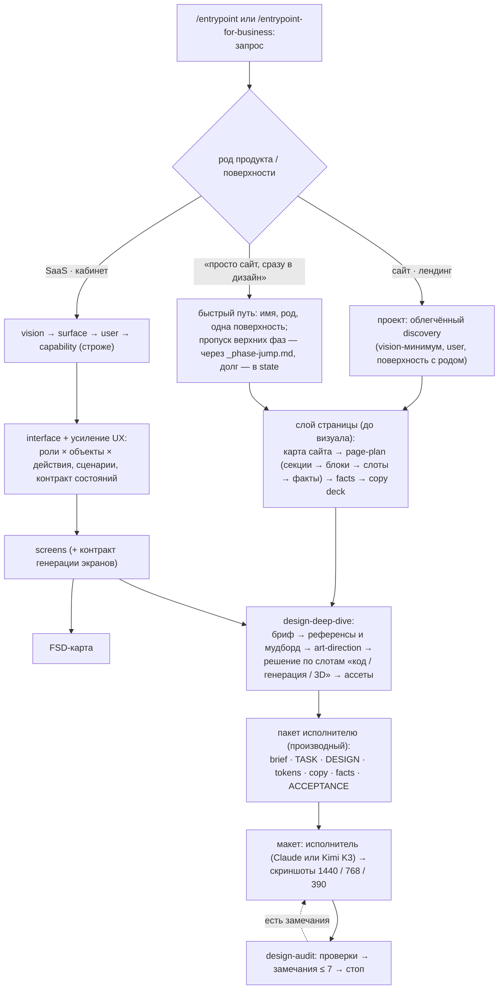

# 05. Разрывы и встраивание дизайна

Сопоставление слоя проекта со словарём целевых артефактов внешней базы знаний (UX для SaaS; сайт и
лендинг; визуал; ассеты; макет — словарь из задания, самой базы в репо нет) и варианты встраивания
`design-deep-dive` / `design-audit`. Факты — с путями; оценки — «(вывод)»; предложения — направления и
гипотезы: финальные правила проектируются вместе с базой знаний. Правила, на которые опирается
сопоставление, выписаны в `03-current-rules.md`, оценка качества — в `04-quality.md`.

## Содержание

- [Коротко](#коротко)
- [1. Целевые артефакты → аналоги в репо](#1-целевые-артефакты--аналоги-в-репо)
- [2. Что мешает сценарию «хочу просто сайт → сразу в дизайн»](#2-что-мешает-сценарию-хочу-просто-сайт--сразу-в-дизайн)
- [3. Род продукта: где его хранить](#3-род-продукта-где-его-хранить)
- [4. Встраивание `design-deep-dive` и `design-audit`](#4-встраивание-design-deep-dive-и-design-audit)
- [5. Риски](#5-риски)
- [6. База знаний и экономия контекста](#6-база-знаний-и-экономия-контекста)
- [7. Вопросы к заказчику](#7-вопросы-к-заказчику)

## Коротко

(вывод)

1. **SaaS: основа UX есть, связок и сводов нет.** По slug проверяемо всё от interface вниз: роль
   (`who`), объект (`data-items`), ситуация, зона, блок, экран, 6 канон-состояний. Не хватает прав,
   полей у объектов, ветвлений сценариев, порога глубины ИА и сводов поверх них — матрицы «роль ×
   объект × действие», сценариев, реестра экранов web. Контракты генерации экранов и состояний
   требуют ревизии канона screens: машиночитаемой нотации, словаря `ui:`, единого словаря состояний
   для web, mobile и бота.
2. **Сайт и лендинг: слоя страницы нет.** Ближайшие формы — слоты screens (каркас приложения) и окно
   бота «слот → ключ → источник → `fallback`» с правилами R-DATA. Сырья для брифа и фактов наверху
   много (`profile`, `offering`, `current-metric`, `material`), но оно разнесено по файлам и до
   `<org>/site` не доходит.
3. **Визуал, ассеты, макет: слоя нет по замыслу.** Всё визуальное запрещено каноном (`CLAUDE.md` §3,
   его копии в пяти композиционных слоях, скиллах и трёх правилах аудита) или отдано коду форков.
   Единственный рабочий механизм — политика ассетов screens, и она про референсы, а не про результат.
4. **Тексты упираются в три нормы сразу**: запрет маркетинговой копии (vision, market, profile,
   competitor, R-SEM-008), «формулировки не из головы» (`CLAUDE.md` §3) и отсутствие в таблице
   владельцев строки для текстов интерфейса и сайта.
5. **Встраивание** — по прецеденту слоёв mobile и FSD плюс правка канона проекта: без
   переформулировки запрета craft дизайн-скилл нелегален. Маршрут — по роду продукта (гипотеза:
   колонка рода у поверхности); «просто сайт → дизайн» — через существующий `_phase-jump.md`;
   структура — слой страницы `site/<surface>/` и слой `design/` (вариант 1) или один `design/`
   (вариант 2).
6. **Главные риски**: база ≈ 40 МБ и бинарники в каждом форке, права на референсы, два источника
   истины токенов, внешний исполнитель, бюджет листинга скиллов и рост `/cross-audit`.
7. **Решить с заказчиком в первую очередь**: владелец визуальных решений и текстов; где живут база,
   код макета и бинарники; слой страницы — отдельный или внутри дизайна.

## 1. Целевые артефакты → аналоги в репо

Пути — от корня репо; `_template/` = `docs/projects/_template/`, `skills/` = `.claude/skills/`. В
колонке «аналог» — оценка «да / частично / нет» и имя ближайшего аналога.

### А. UX для SaaS

| целевой артефакт | аналог в репо | где | чего не хватает |
|---|---|---|---|
| Постуры ролей | **частично** — `who` (роль/тип, не лицо; `users` → user) + `user` (`context` «где живёт, в каком процессе, под каким давлением», `jobs`, `pains`, `success`); у mobile — только `требует сессии` и Auth-gate | `_template/interface/_template/who.md:3-13`, `:69-73`; `_template/project/user.md:62-70` | полей постуры нет (частота, экспертиза, устройство и контекст, основная или эпизодическая роль): у `who` — `slug · name · description · users · status`, `user.context` — одна строка прозы; ребро `who.users` не проверяет ни узкий аудит, ни `/cross-audit` (угол `user-who` поле не читает); до экранов постура не доходит (`screen.who` — только ссылка). Сильнее целевого (вывод): разведение адресатов `who ≠ user ≠ segment ≠ subject`, `stakeholder` — пятый (`skills/entrypoint/references/routing.md:90-96`) |
| Глоссарий объектов | **частично** — `data-items` interface («в языке участника»); `## Ubiquitous Language` домена (`Бизнес-термин \| В коде \| Синонимы \| Не путать с`); `entities` FSD (`source`, `поля`, `связи`) и mobile (`ключевые поля`, `source`, `cache`) | `_template/interface/_template/data-items.md:3-11`, `:66-69`; `_template/services/_templates/context-readme.md:62-66`; `_template/fsd/_template/entities.md:39-45` | у `data-items` только `slug · name · description · status` — нет атрибутов, жизненного цикла, связей, синонимов; «❌ Атрибут вместо сущности» (`data-items.md:47-48`), но screens и бот адресуют `data:<slug>.<field>` (`_template/screens/README.md:210-220`) — полевой контракт не определён нигде; связи `data-items` ↔ агрегат нет ни полем, ни углом; словарь локален для поверхности. Сильнее целевого (вывод): `Синонимы` / `Не путать с` у домена |
| Матрица «роль × объект × действие» | **частично (выводимо)** — `situation.who` × `action` × `entry-data`/`exit-data`; `block.who`; `pages.guard` (`public \| authenticated \| who`); доменная `policy` типа `authorization` (`Subject` / `Resource` / `Action`), `use-case.Role` (`anonymous \| admin \| client \| system`) | `_template/interface/_template/situation.md:103-119`; `_template/fsd/_template/pages.md:41`; `_template/services/_templates/policy.md:19-28`, `use-case.md:18` | матрицы и прав (CRUD, разрешения) нет: `who` — «❌ Уровень прав / ACL-флаг» (`who.md:45-46`), а `pages.guard` берёт who как роль доступа; доменный `Role` не связан с `who`/`user`; в screens — только состояние `permission-denied`; ни аудит, ни угол `/cross-audit` матрицу не строят |
| Сценарии (happy path → ветвления → ошибки → пустые) | **частично** — interface: `stage` (порядок строк = порядок этапов) + `situation` (`when`, `action`, `goal`, `exit-data → entry-data`); mobile `flows` (`триггер`, `шаги`, `выход`, `ветки ошибок`; `app-start` и `login` обязательны для поверхности с входом); бот: `transitions` + `when` = исход use-case + `errors`/`fallback`; домен: use-case `Steps` / `Errors` / `Idempotency` | `_template/interface/_template/stage.md:3-6`, `situation.md:12-26`; `_template/mobile/_template/flows.md:4`, `:14`, `:36-39` | у web сценария нет: `screens/flow` — «viewport-вариативность», «❌ Не situation interface» (`_template/screens/_template/flow.md:32-33`); в interface нет порядка ситуаций внутри этапа, ветвлений, ошибок, пустых путей, а состояния интерфейса на уровне ситуации запрещены (`situation.md:75-77`); у mobile — только ветки ошибок; нет разметки happy path и маппинга «исход домена → UX». Сильнее целевого (вывод): у бота исход операции отделён от бизнес-правила (`when` = исход UC) |
| ИА (≤ 3 уровней) | **частично** — `zone` + `parent-zone`, `block` как узел навигации (`entrypoint`, `transition-to-block`, `transition-from-zone`); mobile `shell#Root` (`tabs \| stack \| drawer`, «корневые зоны — кандидаты в табы»); FSD `pages.path`; бот — `command` + `start:` | `_template/interface/_template/zone.md:3-8`, `block.md:8-13`; `skills/mobile-deep-dive/references/interface-context.md:9-26` | порога глубины нет (только запрет цикла `parent-zone`); глобальной достижимости нет — R-SEM-005 interface-аудита локальна (`skills/interface-audit/references/rules.md:239-247`); screens зоны не использует, shell — «❌ Не контракт навигации (sitemap)» (`_template/screens/_template/shell.md:31-32`), `route` — свободная строка; зона «задаётся смыслом, не URL» (`zone.md:32`), мост «зона → раздел / маршрут» не описан |
| Инвентарь экранов | **частично (web) / да (mobile)** — web: папка на экран (`route`, `viewport`, `who`, `situations`, `states`), сводка draft/stable при старте скилла, R-COV-003 «screen недостижим»; mobile: таблица `screens.md` (`key`, `entry`, `states`, `platforms`, `situation-ref`); FSD `pages.md`; бот `dialog.windows` | `_template/screens/_template/screen.md:49-65`; `skills/screen-deep-dive/SKILL.md:145-161`; `skills/screen-audit/references/rules.md:558-567`; `_template/mobile/_template/screens.md:3-16` | у web нет реестра-таблицы; связь экран → capability есть только в state-заметке «Реализует capability…» (`skills/screen-deep-dive/references/project-context.md:75-84`), угла нет, хотя `:126-128` его обещает; неадресуемые экраны в FSD не попадают. Сильнее целевого (вывод): mobile требует достижимости (R-REACH-001, error) |
| Контракт состояний S01–S22 | **частично** — screens: 6 канон-состояний (`loading`, `empty`, `error`, `permission-denied`, `offline`, `not-found`) как delta-override по слотам, для stable нужны все 6 (override или «здесь не применимо» с пояснением); mobile: 9 экранных (+ `populated`, `update-required`, `maintenance`), `states ⊇ {loading, error}` при сети, 5 виджетных, 4 оверлея; бот: `fallback` ключа, `errors.backend-unavailable`, `errors.invalid-input`; FSD `shared-api`: `empty` / `populated` | `_template/screens/README.md:227-232`; `skills/screen-deep-dive/references/draft-stable.md:97-100`; `skills/screen-audit/references/rules.md:496-506`; `_template/mobile/_template/screens.md:14-16`; `_template/telegram-bot-flow/README.md:211`, `:218-219` | нет частичного, лимита, успеха / сохранения, валидации, первого запуска и условий входа в состояние; нет состояний блока и сценария (`_template/screens/_template/block.md:168`); у бота нет загрузки, «нет прав», «не найдено»; interface состояния запрещает, поэтому 6 состояний screens ни из чего не выводятся; словари web (6) и mobile (9) не согласованы. Сильнее целевого (вывод): «явное N/A с пояснением» и stable-ужесточение hint → error |
| Контракт генерации экранов | **частично** — синтез interface → screens (slug блока = slug interface-block, зеркало `ux-substrates`, «по узлу на каждый объявленный субстрат», покрытие `screen.situations`); карты синтеза бота (атом → виджет) и mobile (ситуация → фича + экран); прецедент «выводится из артефактов без догадок (генерация — отдельным промптом)» — C4 | `skills/screen-deep-dive/references/tree-notation.md:42-57`; `_template/telegram-bot-flow/README.md:170-172`; `skills/mobile-deep-dive/references/interface-context.md:9-26`; `_template/services/README.md:279-286` | машиночитаемой нотации нет: деревья канона не парсятся как YAML (PyYAML: `ScannerError` / `ParserError` на примерах `_template/screens/_template/{block,shell,screen}.md`), хотя README обещает «детерминированную карту экранов» (`_template/screens/README.md:6`); закрытого словаря `ui:` нет (`README.md:133-136`); маппинга `ux-substrate.type` → `ui:` для web нет; критериев приёмки нет; у mobile слоя композиции нет («композиция элементов — craft и код-репо», `interface-context.md:40-41`). Сильнее целевого (вывод): закрытый виджет-язык бота (R-STRUCT-008, error) |
| Мастер-чек-лист UX (434 пункта) | **нет по содержанию, частично по механике** — «Критерии / Что НЕ / Тест-критерий ✅/❌» на каждый kind; гейты `draft → stable`; правила аудитов: interface 25, screens 48, mobile 54, бот 68, у FSD — без id; 46 углов `/cross-audit`; линза платформы mobile (8 разделов) — единственный содержательный чек-лист | `skills/*-audit/references/rules.md`; `skills/mobile-deep-dive/references/platform-lens.md`; `skills/cross-audit/references/angles.md` | UX-эвристик (обратная связь, ошибки, формы, нагрузка) нет; `a11y` — только термин (`CLAUDE.md:177`); проверки структурные и лексические, порогов почти нет (`description` < 10 символов, «≥2 блоков», «≥2 pages»); нет места для результата прохода и осознанных исключений (screen-audit работает «Без suppressions») |

**Главное (вывод)**

1. Кости UX для SaaS есть и проверяются по slug от interface вниз: роль, объект, ситуация, зона, блок, экран, 6 состояний. Не хватает связок (права, поля объектов, ветвления, глубина ИА) и сводов поверх них (матрица, сценарий, реестр экранов web).
2. Разрыв неоднородный. Постура, глоссарий и ИА — это новые поля и пороги в существующих kind (`who`/`user`, `data-items`, `zone`). Матрица, сценарии и инвентарь web — новые своды. Контракты генерации и состояний требуют ревизии канона screens: машиночитаемая нотация, словарь `ui:`, единый словарь состояний для web, mobile и бота.
3. Образец для усиления UX SaaS — mobile-слой: инвентарь с достижимостью, импликации состояний, линза как чек-лист. Кое в чём репо сильнее целевого словаря: разведение адресатов, «N/A с пояснением», исход отдельно от правила и закрытый каталог у бота. Направление: сохранить эти механизмы при переносе.
4. Любой инвентарь экранов SaaS первым упрётся в разрыв «capability → экран»: ни поля, ни угла, только state-заметка.

### Б. Сайт и лендинг

| целевой артефакт | аналог в репо | где | чего не хватает |
|---|---|---|---|
| site-brief | **частично (разнесено)** — `vision` (`Problem`, `Success`, `Non-goals`, оси), `user`, `surface` (`type`, `lives-at`), `market`, `constraint`, `boundary`; наверху — `profile.Позиционирование`, `offering`, `channel`, `current-metric`, `goal` / `metric`; клиентская призма «продукт» (8 шагов) | `_template/project/vision.md:60-101`; `docs/business/profile.md:53`; `skills/entrypoint-for-business/references/product.md:83-233` | единого документа нет — бриф собирается из 6–7 файлов. Нет рода продукта, цели страницы и целевого действия («CTA» — 0 вхождений), SEO-намерения («SEO» — 0), тона (intake извлекает «позиционирование, тон, аудитория», `skills/business-deep-dive/references/intake.md:14`, но поля нет), УТП (vision — «не сейлз-материал»), уровня амбиций. `<org>/site` не читает product-файлы (`docs/README.md:122`). Лендинг как инструмент нужен рекруту JTBD («Реклама / тест через лендинг», `skills/jtbd-interview/references/recruit-channels.md:34`), но проектировать его негде (вывод) |
| site-map | **нет** — ближайшее: реестр `surface`, `screen.route` (свободная строка), FSD `pages.path`, бот `command.md`; наверху `job-graph.cpr` («предыдущие работы = маркетинговая воронка») | `_template/fsd/_template/pages.md:40`; `skills/job-graph-deep-dive/references/methodology.md:114` | дерева страниц, иерархии, типов страниц; shell — «не sitemap» (`shell.md:31-32`), зона — «смыслом, не URL» (`zone.md:32`); ребра «`cpr` → структура сайта» нет |
| page-plan (секции → блоки → слоты → факты) | **частично по форме** — screens: `shell.slots` (`required`, `accepts`) → `slot-fills` → `block` → `tree` + `data:`; бот: окно → виджеты и текстовые слоты → ключ getter (`source` + обязательный `fallback`) | `_template/screens/_template/shell.md:48-71`, `screen.md:100-103`; `_template/telegram-bot-flow/README.md:211-219`; `skills/telegram-bot-flow-audit/references/rules.md:662-710` | секции и порядка повествования (screens — каркас приложения со слотами, а не длинная страница, вывод); факта на слот, мета / SEO, объёмов; у web нет правила «каждый плейсхолдер обеспечен источником», которое у бота есть (R-DATA-001, R-DATA-002) |
| каталог 84 блоков | **нет** — блоки screens проектные и выводятся 1:1 из interface-block; закрытый каталог есть только у бота (6 виджетов, R-STRUCT-008, error); `ux-substrate.type` (5 атомов); каталог `@stit/ui` был и снят | `_template/screens/_template/block.md:11-48`; `_template/telegram-bot-flow/README.md:159-168`; `_template/interface/_template/ux-substrate.md:12-22`; коммит `1dd3a93` | типовых секций с вариантами, слотами и правилами применения; проверки «блок вне каталога» для web; модель screens идёт «от аналитики», а не «от каталога» (вывод) |
| facts.yaml | **частично** — `current-metric` (`value`, `as-of`, `source`), `material` (`kind`, `uri`), `sources` у `competitor` и `market`, `constraint.source`; бот: getter `source` + `fallback`, R-DATA-005; угол `currentmetric-metric` («baseline выдуман») | `docs/business/current-metric.md:44-51`; `docs/business/material.md:42`; `_template/project/market.md:57-62` | реестра публикуемых фактов со ссылкой на источник и слот; признака «можно публиковать»; соцдоказательств (в `material.kind` только `site \| pdf \| deck \| social \| interview \| report \| other`); сверки «утверждение ↔ источник» |
| copy deck (тексты по слотам) | **нет для сайта, частично — микрокопия**: children-строки деревьев screens, тексты окон и уведомлений бота, микрокопия mobile (`rationale`, `phrases`, `response`, `freshness`, `fallback`, `shared-lib#i18n`); автор — аналитик | `_template/screens/README.md:138-139`; `skills/screen-deep-dive/references/workflow-patterns.md:233`; `_template/telegram-bot-flow/README.md:155-157` | документа текстов по слотам, тона, лимитов длины, локали, статуса утверждения; маркетинговая копия запрещена в четырёх kind (см. Г); владельца текстов интерфейса и сайта в `CLAUDE.md` §3 нет |
| уровни амбиций L0/L1/L2 | **нет** — ближайшее: `vision.lifecycle` (`draft … updating` — стадия продукта), `goal.deadline` | `_template/project/vision.md:96-101`; `docs/hypothesis-map/goal.md:51` | оси «амбиция исполнения», ветвления маршрута и проверок по ней |
| art-direction → treatment → motion-spec | **нет (запрещено)**: craft — «цвет, типографика, пространство, движение»; «ховер по кнопке» и «анимация кнопки» — craft компонента | `CLAUDE.md:115-117`; `_template/fsd/_template/features.md:25`; `_template/mobile/_template/features.md:25` | слоя, формы, владельца решения; «вкусовой» анализ запрещён даже в `market` («Анализ фактический, не вкусовой», `_template/project/market.md:34-35`) |
| каталог эффектов | **нет (запрещено)** — то же основание | то же | всё |
| род продукта (сайт / лендинг / SaaS) как вход маршрута | **нет** — `surface.type` различает только композиционный слой (`web` один для сайта, лендинга и кабинета); оси vision — не род продукта; в клиентском пикере — «web-сайт» и «админка / личный кабинет для своих»; SPA или SSR решает код-репо; у `/service-audit` hint «статический лендинг»; луч роя `surface` — «какие форматы поверхностей принято в нише» | `_template/project/surface.md:76`; `skills/entrypoint-for-business/references/product.md:67-74`; `_template/fsd/README.md:20-27`; `skills/entrypoint/references/routing.md:48-82`, `:76`; `skills/service-audit/references/rules.md:441-443`; `skills/project-deep-dive/references/research-rays.md:15` | поля рода; сигналов «сайт / лендинг / дизайн / макет» (запрос «как это выглядит» ведёт в screens, где облик запрещён); веток «сайт → слой страницы → дизайн» и «SaaS → interface → screens → FSD → дизайн»; облегчённой траектории (любая `web` проходит 7 + 4 + 8 kind); фиксации «бэкенда нет» и размещения фронтового юнита (`placement.unit` — `service` / `platform` / `shared-platform` / `job`, `docs/projects/infrastructure/placement.md:45`) |

**Главное (вывод)**

1. Слоя страницы нет. Ближайшие формы — слотовая модель screens (каркас приложения) и окно бота «слот → ключ → источник → `fallback`» с правилами R-DATA. Вторая ближе к связке page-plan + facts.
2. Сырья для site-brief и facts наверху много: позиционирование, оферы, каналы, числа с источником, барьеры, воронка `cpr`. Но оно разнесено, связано прозой и не доходит до `<org>/site`.
3. Главный конфликт слоя — тексты. Copy deck упирается сразу в три нормы: запрет маркетинговой копии, «тексты только от владельца» (`CLAUDE.md` §3) и отсутствие владельца текстов в §3. Направление: назначить владельца и форму утверждения текстов, не снимая запрет на выдумывание.
4. Роду продукта негде жить. Направление: поле рода на уровне поверхности и ветка в `skills/entrypoint/references/routing.md` (сигналы, раздел «Выбор поверхности»). У art-direction, motion и эффектов прообраза в репо нет, они целиком упираются в запрет craft.

### В. Визуал, ассеты, макет (общие для SaaS и сайта)

| целевой артефакт | аналог в репо | где | чего не хватает | SaaS / сайт — различие |
|---|---|---|---|---|
| Дизайн-токены (DTCG) | **нет (запрещено)**; ближайшее — «токены намерения» `xs \| sm \| md \| lg` для `gap` / `size`, свободные `variant=` без словаря, breakpoints `xs…xl` без ширин, политика темы mobile `system \| light \| dark` | `CLAUDE.md:115-117`; `_template/screens/README.md:150-156`; `_template/screens/_template/shell.md:64`; `_template/fsd/_template/shared-ui.md:24-25`; `_template/mobile/_template/shell.md:21`, `:65-68` | места и формата для значений, соответствия «токен намерения → значение», владельца в §3; по канону значения живут «в коде фронт-форка» и в `styling.md` код-репо | в репо не различается: токены держат оба получателя (`<org>/frontend`, `<org>/site`); (вывод) SaaS нужнее токены состояний и плотности компонентов `ui:`, сайту — выразительные (типографика, ритм секций, движение) |
| Пресеты A–D | **нет**; оси «тема, бренд, плотность, направление письма» запрещены как поля; до `1dd3a93` оси `data-brand` / `data-scheme` отдавались манифесту `@stit/ui`; слово `preset` в mobile занято пресетом стека (`preset ≠ enterprise`, `preset: consumer`) | `_template/screens/README.md:238-240`; `skills/screen-audit/references/rules.md:394-406`; `_template/mobile/_template/entry-points.md:15`, `shared-lib.md:50` | всего; есть риск коллизии имени `preset` (вывод) | (вывод) пресет — решение уровня продукта, общее для поверхностей; в репо не различается |
| DESIGN.md + tokens.css | **нет**; ближайшее — FSD `shared-ui` (`slug · name · description · семантика · status`: инвентарь примитивов без вариантов, состояний, a11y); имена `ui:<Name>` выводятся по поверхности; канон screens уже называет технологию сборки — «Tailwind-утилитами» | `_template/fsd/_template/shared-ui.md:3-8`, `:27-33`; `skills/screen-deep-dive/references/tree-notation.md:32-40`; `_template/screens/README.md:143-145`, `_template/screens/_template/shell.md:88` | файла, места в дереве, владельца; сверки `ui:<Name>` ↔ `shared-ui` (fsd-audit её не делает); Tailwind в каноне расходится с «выбор библиотек — `docs/stack/` фронт-форка» (`shared-ui.md:22-23`, `_template/fsd/README.md:26-27`); `tokens.css` — код, а в репо «Кода здесь нет» (`CLAUDE.md:15`) | SaaS: ядро — каталог компонентов (`ui:` → `shared-ui` → `<org>/frontend`); сайт: каталог секций; `<org>/site` читает только `fsd` и `{interface,screens}` (`docs/README.md:121-122`) |
| План ассетов по слотам | **частично (только референсы)** — screens: `assets/<kind>/<slug>/` + поле `assets` на сущность (скриншоты, мокапы, скрины конкурентов, вдохновение); бот: `message.media` — единственный типизированный слот под ассет (`type ∈ photo \| video \| document \| animation` + `source`: путь `assets/<window-slug>/…` или `data:`), хотя папка ассетов описана как «референсы»; mobile: ассетов нет | `skills/screen-deep-dive/references/assets-policy.md:3-8`, `:44-58`; `_template/telegram-bot-flow/README.md:108`, `:179-182`; `skills/mobile-deep-dive/references/workflow-patterns.md:46-48` | ассетов-результатов, привязки к слоту, статуса «нужен / готов»; аудит проверяет только существование файла (R-COV-006) | (вывод) у SaaS ассетов мало (иконки `icon:<name>`, иллюстрации пустых состояний; в screens пустое состояние — текст + кнопка); у сайта ассеты несущие (hero, фото, видео) |
| Паспорт визуала | **нет**; ближайшее — `material.kind` без брендбука, логотипа, фото; intake извлекает «позиционирование, тон, аудитория», но полей для этого нет | `docs/business/material.md:42`; `skills/business-deep-dive/references/intake.md:14` | всего; где хранить брендовые материалы клиента — не определено (см. Г) | (вывод) сайт сильнее зависит от бренда; в репо не различается |
| asset-spec | **нет**; есть только правила имени (kebab-case, расширение, осмысленные слова) и поле «имя файла» | `assets-policy.md:31-40`, `:52-56` | источника / URL, лицензии, размеров, назначения / alt, требований к формату; скачанное из web по умолчанию уходит в git (`:109-113`), исключение — только если аналитик скажет «это чужое» (`:126-128`) | — |
| Решение «кодом / генерация / 3D» | **нет**; «кодом» подразумевается (`ui:` / `icon:` реализуют проектные компоненты); генерации изображений нет, слово «генерация» — только о C4-диаграммах «отдельным промптом» | `_template/screens/README.md:126-128`; `_template/services/README.md:281-282`; `docs/projects/infrastructure/README.md:108` | поля решения, критериев выбора, связи с планом ассетов | (вывод) SaaS — почти всё кодом; сайт — генерация, фото, 3D |
| Пакет исполнителю (brief.yaml, TASK.md, DESIGN.md, tokens.css, copy.md, facts.md, ACCEPTANCE.md) | **частично (куски)** — `screens/<surface>/` + `assets/` как вход «автору макета»; stable-карты → `/scaffold` форков; `vision.md` + `surface.md` → хаб `<org>/infra`; приёмка есть только у метрики (`metric.acceptance`) и тест-критерий у записи | `_template/screens/README.md:37-39`, `:279-282`; `docs/README.md:118-125`; `skills/entrypoint/references/routing.md:165-170` | всех семи файлов как пакета, формата передачи и приёмки макета; критерий «продукт спроектирован» перечисляет services, FSD, бот, mobile и периметр — без screens и визуала | SaaS: пакет дополняет FSD-карту для `<org>/frontend`; сайт: `<org>/site` не читает vision / user / capability, поэтому бриф, факты и тексты должны ехать в самом пакете (вывод) |
| Цикл «сборка → скриншоты 1440/768/390 → проверки → замечания ≤ 7 пунктов → стоп» | **нет**; ближайшее — `viewport: desktop \| mobile \| any` (планшета нет), breakpoints без ширин, `px` в дереве — warning R-SEM-001; у mobile «Каждое состояние — превью/скриншот в коде»; аудиты дают только отчёт без лимита замечаний, `last-report` перезаписывается; `/cross-audit` — решения по top-K «до 4 в раунде» | `_template/screens/_template/screen.md:59`, `shell.md:64`; `skills/screen-audit/references/rules.md:376-392`; `_template/mobile/_template/screens.md:16` | места сборки (кода в репо нет), ширин в пикселях, проверок по изображению (с картинками не работает ни один аудит, кроме проверки существования файла), лимита замечаний и условия остановки | (вывод) у SaaS — экраны × состояния; у сайта — секции страницы на трёх ширинах; значения для 768 в модели web нет |

**Главное (вывод)**

1. Визуального слоя нет по замыслу. Всё визуальное либо запрещено (`CLAUDE.md:115-117` и копии, раздел Г), либо отдано коду форков. Встраивание design-* начинается с переформулировки §3 и копий запрета, а не с новых форм.
2. Единственный рабочий механизм — политика ассетов screens: папка на сущность, поле `assets`, R-COV-006, web только по просьбе. Это база для плана ассетов, но «референс» и «ассет-результат» надо развести. У бота они уже смешаны: `media.source` указывает в папку «референсов».
3. Различие SaaS и сайта в репо выражено только получателем handoff (`<org>/frontend` или `<org>/site`), причём сайтовый видит меньше контекста. Направление: оформить пакет макета тем же видом handoff (read-only, гейт stable) и добавить визуал в критерий «продукт спроектирован».
4. Для цикла проверки макета нужен аудит, который работает с изображениями и лимитом замечаний. В репо такого нет: из двух культур аудита (роевые с suppressions и структурные без них) ни одна не смотрит на картинки.

### Г. Правила репо, которые прямо конфликтуют с целевыми артефактами

| правило (дословно или близко) | где (путь:строка) | с чем конфликтует | насколько жёстко |
|---|---|---|---|
| «Облик (craft: цвет, типографика, пространство, движение) в артефакты не пишется: wireframe и hi-fi автор макета собирает вручную, модель craft не выдумывает» | `CLAUDE.md:115-117`; кратко — `README.md:207`, `docs/getting-started.md:189-190` | токены DTCG, пресеты A–D, DESIGN.md + tokens.css, art-direction → treatment → motion-spec, каталог эффектов, паспорт визуала, сборка макета моделью | **запрет канона** (грузится в каждую сессию) |
| Копии запрета во всех пяти композиционных слоях: «❌ Облик в артефакте: цвета, типографика, пиксели, `style=`» (screens); «❌ Код / FSD / компонент / облик в артефактах» (interface); «❌ Облик, цвет, размеры — craft» (FSD); «Облик … — забота кода» (бот); «размеры, раскладка и облик — craft и платформа код-репо» (mobile); «ховер по кнопке», «анимация кнопки» — craft компонента | `_template/screens/README.md:17-19`, `:118-120`, `:236-237`; `_template/interface/README.md:195-198`; `_template/interface/_template/block.md:43-44`, `zone.md:38`, `ux-substrate.md:47-48`; `_template/fsd/README.md:130-131`; `_template/fsd/_template/features.md:25`; `_template/telegram-bot-flow/README.md:173-174`; `_template/mobile/_template/widgets.md:7`, `:41`, `features.md:25` | те же артефакты и любые визуальные решения внутри существующих слоёв; motion-spec и эффекты — через «ховер» и «анимацию» | **anti-pattern канона слоя** |
| Те же запреты в скиллах: «не выдумывает craft»; у interface запрет шире канона — «Облик (craft: цвет, типографика, пространство, движение, **варианты компонентов**)» | `skills/interface-deep-dive/SKILL.md:257-260`; `skills/screen-deep-dive/SKILL.md:14-16`, `:285-287`, `references/tree-notation.md:29-30`; `skills/fsd-deep-dive/SKILL.md:13`; `skills/mobile-deep-dive/SKILL.md:334`, `references/interface-context.md:40-41`; `skills/telegram-bot-flow-deep-dive/references/raw-input.md:59` | те же; «варианты компонентов» — это прямо варианты `ui:` в DESIGN.md | **формулировка скилла** |
| Проверки облика в аудитах: screens R-SEM-001 (hex, `color:`, `bg-`, число + `px`, `font…`, `style=`); interface R-SEM-002 (`using-what` с «primary», «md», «цвет», «#», `ui:*`); бот R-SEM-005 (разметка и эмодзи как требование) | `skills/screen-audit/references/rules.md:376-392`; `skills/interface-audit/references/rules.md:207-216`; `skills/telegram-bot-flow-audit/references/rules.md:876-890` | значения токенов, ширины в px и типографика, если попадут в деревья и ячейки этих слоёв | **правило аудита, warning** (снимается объяснением аналитика) |
| «Превращение `screens/` в макет — ручная работа автора, не отдельный артефакт»; воркфлоу `screens → wireframe → hi-fi (вручную, автор макета)` | `README.md:59-60`; `docs/README.md:9-10`; `_template/screens/README.md:21-26`, `:37-39`, `:279-282`; `docs/getting-started.md:161-164`; `skills/screen-deep-dive/references/assets-policy.md:138-144` | макет как артефакт, пакет исполнителю, цикл «сборка → скриншоты → проверки» | **канон роли слоя** |
| «❌ Оси контекста приложения (тема, бренд, плотность, направление письма) как атрибуты узлов или поля артефактов — их задаёт корень приложения в коде»; маркеры `scheme=` / `brand=` / `density=` / `dir=` | `_template/screens/README.md:238-240`; `skills/screen-deep-dive/SKILL.md:443-444`; `skills/screen-audit/references/rules.md:394-406` | пресеты A–D; тема, бренд и плотность в DESIGN.md и tokens.css | **anti-pattern канона + warning аудита** |
| «❌ Дизайн-токены и облик — craft: в артефакты не пишется, живёт в коде фронт-форка»; «выбор библиотек — `docs/stack/` фронт-форка»; «❌ Значения токенов темы — код-репо (`styling.md`)»; «❌ Переиспользуемый UI-блок экрана — компонент дизайн-системы код-репо» | `_template/fsd/_template/shared-ui.md:22-25`; `_template/fsd/README.md:24-27`, `:122-123`; `_template/mobile/_template/shell.md:21`, `screens.md:24-25`, `widgets.md:38-39` | DTCG-токены, tokens.css, каталог компонентов в DESIGN.md: канон прямо отводит им другой дом — код-репо | **запрет канона слоя** («Что НЕ») |
| «Кода здесь нет: stable-артефакты read-only читают код-репо»; «Здесь нет кода: артефакты — чистая язык-агностичная аналитика» | `CLAUDE.md:15-16`; `docs/README.md:4-5`; `README.md:53` | tokens.css, сборка макета (HTML / CSS), скриншоты сборки внутри strategy | **канон роли репо**: явного запрета на файлы нет, конфликт — с назначением репо |
| Снятый контракт с библиотекой: «…словаря примитивов и их атрибутов у слоя нет»; имена `ui:*` / `icon:*` аудит «по какому-либо словарю» не сверяет; коммит `1dd3a93`: «контракт с @stit/ui снят» (удалены `ui-inventory.md` и R-COV-006 «`ui:*` против манифеста `@stit/ui`») | `_template/screens/README.md:133-136`; `skills/screen-audit/SKILL.md:77-79`, `references/rules.md:32-35`; `skills/screen-deep-dive/references/tree-notation.md:22-24`, `:32-40` | каталог компонентов в DESIGN.md, контракт генерации экранов, каталог 84 блоков: закрытый словарь противоречит последнему решению об открытых именах | **формулировка канона + решение по истории**; возврат словаря = пересмотр этого решения (вывод) |
| «Размеры — токенами намерения (`xs`, `sm`, `md`, `lg`), не пикселями»; «❌ Breakpoints в `shell.tree` или в `screen.slot-fills`»; `viewport: desktop \| mobile \| any`; breakpoints `xs…xl` без ширин | `_template/screens/README.md:155-156`, `:253-255`; `_template/screens/_template/screen.md:59`, `shell.md:64` | ширины 1440 / 768 / 390, адаптив в DESIGN.md | **anti-pattern канона + warning R-SEM-001** на `px` в дереве; ширины в ACCEPTANCE вне дерева текст формально не нарушат — конфликт с моделью, в которой нет планшета (вывод) |
| «не пишет маркетинговую копию» (`/project-deep-dive`); «❌ Маркетинговая копия для лендинга. Vision — … не сейлз-материал»; R-SEM-008 (маркеры «революционн», «уникальн», «лучш в мире»…); «❌ Маркетинговая копия (своя или их)» (`market`, `competitor`); «❌ Маркетинговая копия бизнеса» (`profile`); клиенту — «не маркетинговая фраза для лендинга» | `skills/project-deep-dive/SKILL.md:3`, `:15`, `references/phases.md:46`, `:253`; `_template/project/vision.md:46-47`; `skills/project-audit/references/rules.md:258-269`; `_template/project/market.md:36-37`; `docs/business/profile.md:33-34`; `docs/business/competitor.md:32`; `skills/entrypoint-for-business/references/product.md:111-112`, `:309-311` | copy deck; УТП и позиционирование в site-brief; заголовки секций page-plan | **anti-pattern канона kind + warning аудита + формулировки скиллов**; запреты привязаны к kind, поэтому отдельный слой текстов их формально не нарушит, но упрётся в следующую строку (вывод) |
| «Содержательные формулировки артефактов агент не пишет из своей головы … сами тексты — нет»; «Тексты … — **только от клиента**»; «Тексты доменных значений (label кнопки, route, описание блока) формулирует аналитик»; «копирайтинг — выбор аналитика»; «Текст с чужого скрина — референс, не контент» | `CLAUDE.md:92-99`; `skills/entrypoint-for-business/references/product.md:331-334`; `skills/screen-deep-dive/SKILL.md:202-208`, `references/workflow-patterns.md:233`, `:240-244`; `skills/telegram-bot-flow-deep-dive/SKILL.md:258-261`, `references/raw-input.md:170-172` | copy deck, тексты состояний S01–S22 и микрокопия, написанные моделью; facts.yaml совместим (факты — только из материалов и research) | **запрет канона** (`CLAUDE.md` §3) **+ формулировки скиллов**; в таблице владельцев (`CLAUDE.md:101-111`) нет строки ни для текстов интерфейса и сайта, ни для визуала |
| «"Нужен красивый сайт" — нет» (это не проблема); «Успех: «красивый дизайн» (не наблюдаемо)»; «Сделаем редизайн сайта» → «чтобы что?»; «Расскажу, какое приложение хотим сделать» — «это будущее решение»; «Не упоминать клиенту внутренние слои интерфейса, доменов и экранов — это кухня аналитика» | `_template/project/vision.md:13-16`; `skills/entrypoint-for-business/references/anti-patterns-real.md:62-66`, `:119-121`, `:194`; `skills/entrypoint-for-business/references/product.md:321-323` | вход «хочу сайт → сразу бриф и дизайн»; уровни амбиций как цель; показ клиенту мудборда и макетов на утверждение | **критерий канона vision + anti-patterns и anti-leak клиентской призмы**; сам дизайн не запрещён — запрещены «красивый дизайн» как мера успеха и решение вместо проблемы (вывод) |
| Политика ассетов **разрешает** только референсы (скриншоты, мокапы Figma, скрины конкурентов, вдохновение): файлом `.png / .jpg / .svg / .webp` в `screens/<surface>/assets/<kind>/<slug>/` под git, в поле `assets` — имя файла, по согласию аналитика. **Запрещает**: web «без явной просьбы аналитика», скачивание «на всякий случай», «URL как «ассет» — ассет это файл в репо»; чужую картинку не кладут, лишь когда аналитик скажет «это чужое» | `skills/screen-deep-dive/references/assets-policy.md:3-8`, `:28-29`, `:34`, `:52-58`, `:94`, `:121-128`; `skills/screen-deep-dive/SKILL.md:263-268` | план ассетов по слотам (привязка к сущности, ассет — всегда референс); asset-spec (нет источника и лицензии); мудборд (web-рой, ссылки как элементы); генерация (понятия нет) | **формулировка скилла**; действует только в screens — у бота своя папка, у mobile ассетов нет |
| «Скриншот аналога — референс, не источник: его экраны не становятся нашими без ситуации»; «❌ Угадывать `route`, текст label, точное число слотов по скриншоту»; «у них хуже UX» → ❌ «слух»; «Анализ фактический, не вкусовой»; «Авто-залив из веба … запрещён» | `skills/mobile-deep-dive/references/workflow-patterns.md:46-48`; `skills/screen-deep-dive/references/raw-input.md:140-141`; `_template/project/market.md:34-35`, `:53`; `docs/ajtbd/README.md:158` | мудборд и art-direction (вкусовой отбор референсов, «что берём / избегаем») | **anti-pattern канона + формулировки скиллов**; совместимо, если мудборд — отдельный артефакт с подтверждением человеком, а не поле `market` (вывод) |
| Forward-only: «без журналов прошлого, «было/стало», дат и следов отменённых решений»; `last-report` аудитов перезаписывается, «не журнал» | `CLAUDE.md:48-51`; `.claude/rules/forward-only.md:12-14` | цикл «сборка → замечания → стоп»: история итераций, скриншоты прошлых сборок | **принцип канона**, прямого запрета нет; даты как данные в репо есть (`current-metric.as-of`), так что конфликт — только с журналом итераций (вывод) |
| «# Данные заказчика и секреты в репо не хранятся» (исключены только `.env`, `credentials*`, `*.pem`, `*.key`); «Не вписывай … приватные материалы или контакты заказчика в каноны и примеры» | `.gitignore:5-10`; `SECURITY.md:24-30` | хранение брендовых материалов клиента (логотипы, фото) в git форка — для паспорта визуала и плана ассетов | **декларация, неоднозначно**: форк по назначению хранит данные заказчика, а `SECURITY.md` говорит о шаблоне (вывод) |

## 2. Что мешает сценарию «хочу просто сайт → сразу в дизайн»

Факты:

1. **Нет сигнала и нет адресата.** В сигнальных таблицах обоих оркестраторов нет слов «сайт»,
   «лендинг», «страница», «дизайн», «макет», «стиль», «референсы»
   (`entrypoint/references/routing.md:50-82`,
   `entrypoint-for-business/references/routing-business.md:16-23`); исполнителя дизайна нет. Ближайший
   сигнал — «как это выглядит, экраны, композиция» → `screens` (`routing.md:76`), где облик запрещён
   (`CLAUDE.md` §3).
2. **Нет оси «род продукта».** `surface.type` — `web` | `mobile` | `api` | `admin` | `bot` | `desktop` |
   `embed` | `other` (`docs/projects/_template/project/surface.md:76`) — не различает сайт, лендинг и
   SaaS-кабинет; SPA или SSR решает код-репо (`docs/projects/_template/fsd/README.md:20-26`);
   клиентский пикер мест сливает «сайт» и «веб-сервис» в «web-сайт»
   (`entrypoint-for-business/references/product.md:69-74`). Оси vision (`audience`, `intent`,
   `market-maturity`, `lifecycle`) описывают инициативу, а не форму продукта
   (`docs/projects/_template/project/vision.md:30-34`).
3. **Цепочка для `web` одна и длинная**: проект → vision → surface → capability → interface (7 kind) →
   screens (4 kind) → FSD (8 kind). Облегчённой траектории для страницы нет, как нет и слоя «страница →
   секции → блоки → слоты → факты → тексты».
4. **Клиентский вход разворачивает запрос назад к бизнесу**: anti-patterns «Расскажу, какое
   приложение хотим сделать», «Сделаем редизайн сайта» (ставка без «зачем»), «красивый дизайн» как
   успех (`entrypoint-for-business/references/anti-patterns-real.md:62-66, 119-121, 194`).
5. **Критерий «продукт спроектирован»** (`routing.md:165-176`) визуального слоя не содержит; после него
   маршрут уходит в хаб `<org>/infra`.
6. **Лендинг без бэкенда не предусмотрен до конца.** Слой services лендингу не нужен, но решение
   «бэкенда нет» нигде не фиксируется; у SSR-сайта и статики нет места в периметре (`unit` —
   только service / platform / shared-platform / job, `docs/projects/infrastructure/placement.md:45`);
   формы и заявки без бэкенда идут во внешние системы через `integration.md`, а потребитель функции
   интеграции существует только в services; в смешанном проекте `/cross-audit` даёт error
   `surface-service` на лендинг без сервиса, тогда как `service-audit` R-COV-002 считает «статический
   лендинг» нормой (hint).
7. **Единственный легальный пропуск фаз — `_phase-jump.md`** в state: «фиксирует решение перепрыгнуть
   фазу» (`entrypoint/references/state-model.md:197-201`). Структурные ворота жёсткие: без проекта
   нижние исполнители выходят («сначала заведи проект через `/project-deep-dive`»), без поверхности в
   `surface.md` — тоже.

## 3. Род продукта: где его хранить

(вывод) Маршрут «сайт / лендинг / SaaS» требует, чтобы род был известен до выбора слоя композиции.
Варианты — гипотезы для обсуждения вместе с базой знаний.

| вариант | как | плюсы | минусы |
|---|---|---|---|
| **А. Поле продукта** | новая ось vision (например, `product-kind`: сайт / лендинг / SaaS / …) | один вопрос на старте проекта; маршрут известен уже на discovery | продукт часто смешанный (лендинг + кабинет + бот), род продукта ≠ род поверхности; vision — «внутренний документ аналитика», его оси сейчас ни один слой ниже не читает |
| **Б. Уточнение поверхности** | колонка рода в `surface.md` при `type: web` (сайт / лендинг / кабинет / …) либо новые значения `type` | ось репо — поверхность; механизм «тип → слой композиции» уже работает (`bot` → telegram-bot-flow, `mobile` → mobile); смешанные продукты выражаются естественно | новые значения `type` каскадят в пикеры, routing, `/cross-audit` и в код-репо (поле `surface` в `docs/stack/service.md` форка) — это handoff-контракт; колонка каскадит меньше |
| **В. Только в брифе дизайна** | род — поле `design/brief.md` | минимум правок канона | маршрут до брифа рода не знает — «просто сайт → дизайн» не решается |

Направление (гипотеза): вариант Б колонкой (без смены enum `type`) плюс производная сводка на уровне
проекта («продукт = поверхности с их родами»); вопрос о роде — первый при заведении проекта и
поверхности; быстрый путь — проект из одной поверхности рода «лендинг».

## 4. Встраивание `design-deep-dive` и `design-audit`

Всё в этом разделе — направления и гипотезы; опора — прецеденты подключения слоёв бота, FSD и mobile
(`01-project-layer.md` § 9) и общий шаблон скиллов (`02-skills.md` § 2).

### 4.1 Маршруты по роду продукта



- **Сайт и лендинг**: главный артефакт до визуала — page-plan; визуал опирается на слоты страницы,
  а не на экраны screens. Интерфейсный слой для лендинга — вопрос к заказчику (§ 7): 7 kind interface
  рассчитаны на интерактивный продукт.
- **SaaS**: цепочка остаётся прежней, UX усиливается внутри interface и screens (контракт состояний,
  сценарии с ветвлениями, матрица «роль × объект × действие», ИА до screens); дизайн начинается, когда
  у экранов есть стабильные деревья.
- **Быстрый путь** не обходит ворота, а проходит их минимально: проект и поверхность заводятся (иначе
  исполнители выходят), пропуск фаз фиксируется существующим `_phase-jump.md`, недостающее верхнее
  остаётся открытыми вопросами в state.

### 4.2 Изменения оркестраторов

| место | что сейчас | что можно добавить (гипотеза) |
|---|---|---|
| таблица слоёв `entrypoint/SKILL.md:16-32`, `entrypoint/references/routing.md:10-30`, `CLAUDE.md` §2 | строки дизайна нет | строка слоя дизайна (и слоя страницы, если выбран вариант отдельного слоя) с исполнителем и аудитом |
| сигналы `routing.md:48-82`, эвристики `entrypoint/references/intake.md:48-79` | «как это выглядит» → screens | «хочу сайт / лендинг / страницу / визитку» → проект + поверхность рода «сайт» + слой страницы; «хочу сервис / кабинет / SaaS» → interface → screens; «макет / визуал / стиль / референсы / мудборд / ассеты» → `design-deep-dive` |
| «Выбор поверхности» `routing.md:139-163` | тип поверхности → слой композиции | после поверхности — род (если его не несёт `surface`) → ветка: сайт / лендинг → слой страницы → дизайн; SaaS → interface → screens → FSD → дизайн |
| заведение проекта (`/project-deep-dive --new`, клиентский «новый продукт») | всегда фаза `discovery` | первый вопрос «что делаем: сайт / лендинг / сервис» → траектория фаз (для лендинга — облегчённый discovery → поверхность → страница) |
| точки входа `entrypoint/SKILL.md:78-87` | `--mode`, `--audit`, `--upstream` | быстрый путь (флаг или режим) и правило, когда можно пропустить верхние слои; опора — `_phase-jump.md` |
| выбор аудита `routing.md:108-128`, список при завершении `entrypoint/SKILL.md:269-274` | 12 аудитов | `/design-audit` |
| дерево state `entrypoint/references/state-model.md:35-44`, формат `index.md` (`:91-99`) | ветки дизайна нет; в `index.md` нет строк и для fsd, бота, mobile, сервисов | ветка `projects/<slug>/design/…` и строки среза для всех проектных слоёв |
| «продукт спроектирован» `routing.md:165-176` | визуала нет | дизайн — в критерии готовности (для сайта — главный артефакт); отдельный критерий для лендинга без бэкенда |
| клиентская призма `entrypoint-for-business/references/product.md`, `routing-business.md:70` | экраны — «кухня аналитика» | шаг «как должно выглядеть» в бизнес-языке: цель страницы, тон, референсы, что нравится и не нравится, материалы (клиент — владелец этих формулировок); пикер мест с родом (сайт ≠ кабинет) |
| `CLAUDE.md` §3 (craft не пишется), §6, таблица владельцев экспертизы | облик не пишется | вынести craft в отдельный легальный слой с владельцем — по образцу «FSD-имена легальны только в FSD» — вместо общего запрета |

### 4.3 Структура в стиле репо

Конвенции, которым следует предложение: канон формы — один раз в `docs/projects/_template/<слой>/`,
данные — в `docs/projects/<slug>/<слой>/`; ось — поверхность; «один файл — одна таблица сущностей
одного типа» или «файл на запись» (как `screens/<surface>/<slug>/index.md`); `status` `draft` / `stable`
на запись; производные своды не авторятся; state — в ветке единого дерева.

**Вариант 1 (гипотеза): два слоя — страница и дизайн.**

```
docs/projects/_template/
├── site/                         ← канон слоя страницы (для поверхностей рода «сайт» / «лендинг»)
│   ├── README.md                 ← вопрос слоя, kind, форма ячеек, draft → stable, handoff в <org>/site
│   └── _template/
│       ├── page.md               ← реестр страниц = карта сайта (slug · name · цель · путь · status)
│       ├── page-plan.md          ← форма файла на страницу: секции → блоки (из каталога) → слоты → факты
│       ├── fact.md               ← реестр фактов: slug · утверждение · источник (слой / материал клиента) · status
│       └── copy.md               ← copy deck: слот → текст → владелец формулировки → status
└── design/                       ← канон слоя дизайна
    ├── README.md
    └── _template/
        ├── brief.md              ← бриф: цель, род, аудитория (ссылки на vision / user), уровень амбиций L0/L1/L2, ограничения, материалы
        ├── reference.md          ← реестр референсов: slug · источник · что берём · чего не берём · права · status
        ├── direction.md          ← art-direction → treatment → motion-spec; решения с «сигналом пересмотра»
        ├── token.md              ← токены (DTCG) или ссылка на источник истины токенов
        ├── asset.md              ← план ассетов по слотам: слот · решение «код / генерация / 3D» · asset-spec · status
        └── mockup.md             ← реестр макетов: экран / страница · вьюпорты · файлы · вердикт аудита · status

docs/projects/<slug>/
├── site/<surface>/               ← page.md · <page-slug>/index.md · fact.md · copy.md
└── design/
    ├── brief.md · reference.md · direction.md · token.md · asset.md     ← уровень проекта (один бренд)
    ├── references/<reference-slug>.<ext>                                ← файлы референсов — с согласия и правами
    ├── assets/<asset-slug>/…                                            ← готовые ассеты (и исходники 3D, если решат хранить)
    └── <surface>/
        ├── mockup.md
        ├── mockups/<screen-or-page-slug>/{1440,768,390}.png
        └── handoff/              ← пакет исполнителю — собирается из артефактов, не авторится
```

State: `.claude/skills/entrypoint/state/projects/<slug>/site/<surface>/<kind>/<slug>.md` и
`…/projects/<slug>/design/[<surface>/]<kind>/<slug>.md`; отчёт аудита —
`.claude/skills/design-audit/audit-state/<slug>/last-report.md`.

**Вариант 2: один слой `design/`**, где page-plan, facts и copy — kind внутри `design/<surface>/`.
Проще (один исполнитель), но смешивает структуру контента «до визуала» с визуалом и ломает принцип
репо «тип поверхности → свой слой композиции».

(вывод) Вариант 1 ближе к устройству репо: слой страницы занимает для сайта место screens (как бот и
mobile занимают его для своих типов), а дизайн — общий слой над композицией для всех типов
поверхностей. Пакет исполнителю как производный свод повторяет приём «свод выводится, не авторится»
(`docs/projects/_template/services/README.md:291-296`) и не создаёт второго источника истины.

### 4.4 Какие файлы менять и как

Прецеденты: слой mobile подключался правкой 47 файлов, из них 26 общих (`git show --stat 6c26a07`);
слой FSD — 23 файлов, из них 10 общих (`707d627`); остальное — собственный канон и пара скиллов. Оба
трогали один и тот же круг общих файлов. Для дизайна он шире — около 35 файлов по таблице ниже, не
считая копий запрета craft и текстов в канонах и скиллах (перечень — § 1.Г).

| файл | что поменять (направление) | было в прецеденте |
|---|---|---|
| `CLAUDE.md` | «Роль репо и флоу» — уточнить «кода здесь нет» относительно макета и скриптов; §2 — строки слоёв страницы и дизайна; §3 — строки владельцев визуальной и контентной области, граница легального craft; §6 — зоны правок для ассетов и макетов; §8 — handoff-идентификаторы (id секций и слотов, имена токенов) | mobile, FSD |
| `README.md`, `docs/README.md`, `docs/getting-started.md` | карта документации, «Связи между слоями», «Что docs отдаёт соседям» (дизайн → `<org>/frontend`, `<org>/site`, `<org>/mobile`), путь форка | mobile, FSD |
| `docs/projects/README.md` | структура папки проекта, тип и род поверхности → слои | mobile, FSD |
| `docs/projects/_template/project/surface.md`, `README.md` | род поверхности, маршрут «род → слой композиции» | mobile |
| `docs/projects/_template/project/vision.md`, `capability.md` | расширение vision (бриф, позиционирование — § 5 отчёта `04`), строгая capability и трасса вниз | mobile (`capability.md`) |
| `docs/projects/_template/interface/README.md`, `screens/README.md`, `fsd/README.md` | связи с дизайном (слоты, состояния, `ui:` ↔ `shared-ui` ↔ токены); в screens — ссылка на макет вместо «собирает вручную»; усиление UX для SaaS | mobile, FSD |
| `docs/projects/_template/site/…`, `docs/projects/_template/design/…` | новые каноны (README + формы kind) | новый слой в обоих |
| `.claude/skills/design-deep-dive/`, `.claude/skills/design-audit/` (+ пара слоя страницы при варианте 1) | новые скиллы с references | новая пара в обоих |
| `.claude/skills/entrypoint/SKILL.md`, `references/routing.md`, `intake.md`, `state-model.md` | § 4.2 | mobile, FSD |
| `.claude/skills/entrypoint-for-business/SKILL.md`, `references/product.md`, `routing-business.md`, `anti-patterns-real.md` | клиентская призма «как должно выглядеть», пикер мест с родом, согласование anti-pattern «красивый дизайн как успех» с участием клиента в дизайне | — (прецедентов не трогал) |
| `.claude/skills/cross-audit/SKILL.md`, `references/angles.md`, `output-formats.md` | § 4.7 | mobile |
| `.claude/skills/project-deep-dive/SKILL.md`, `references/phases.md`, `field-checklists.md` | вопрос о роде на discovery / surface; быстрый путь; строгая capability | mobile |
| `.claude/skills/screen-deep-dive/SKILL.md`, `references/assets-policy.md` | граница со слоем дизайна: скриншоты-референсы и ассеты — в дизайн; источник и права референса | mobile (`SKILL.md`) |
| `.claude/skills/fsd-deep-dive/SKILL.md` | `shared-ui` ↔ токены и примитивы дизайна | mobile |
| `.claude/skills/service-audit/references/rules.md` | R-COV-002 «статический лендинг» ↔ род поверхности | mobile |
| `docs/projects/infrastructure/placement.md` | размещение фронтовых юнитов (SSR-сайт, статика) или явное N/A | — |
| `.claude/rules/naming.md` | `kind:slug` для новых kind | — |
| `.gitattributes` / `.gitignore` | LFS или исключения для бинарных ассетов и скриншотов, если их решат хранить в git | — |

### 4.5 Конвенции новых скиллов

Из общего шаблона (`02-skills.md` § 2), который выдерживают 14 исполнителей и 12 аудитов репо:

- **frontmatter** — `name` и `description` в двойных кавычках; формула description «что делает в
  `<путь>` (kind) — единственная точка входа…; ведёт … через `AskUserQuestion`; state — в ветке …; что
  не выдумывает. Использовать … Граница с соседом»; ориентир — `description` ≤ 1536 символов, `SKILL.md`
  < 500 строк; с учётом бюджета листинга — короче среднего (≈ 979 символов);
- **вызов** — `/design-deep-dive <project-slug> [<surface>] [<kind> | <kind>:<slug> | <сырьё>]`, без
  аргументов — пикеры по именам (проект — по имени из vision, поверхность — `surface.name`); slug
  выводит скилл (`.claude/rules/naming.md` §1);
- **ход сессии** — сводка состояния и топ-3 кандидата; режимы A (новая сущность) / B (сырьё: скриншоты,
  ссылки, материалы клиента → кандидаты, не факты) / C (углубление); `AskUserQuestion` ≤ 4 вопросов,
  опции — anti-patterns / enum / тест-критерий / соседи, значения — через Other;
- **память** — своей `state/` нет, ветка единого дерева; `**blocker**` блокирует stable; формат —
  `entrypoint/references/state-model.md`;
- **`draft → stable`** — пять-шесть проверяемых пунктов плюс явное подтверждение тест-критерия;
  «скилл не повышает сам»;
- **границы** — сам другие скиллы не вызывает; в конце предлагает свой аудит; ссылки в чужой слой —
  не stub, а `**blocker**` и предложение соседнего скилла;
- **references** (прогрессивная загрузка) — типовые `draft-stable.md`, `field-checklists.md`,
  `workflow-patterns.md`, контекст соседа (`interface-context.md` / `page-context.md`) и новые:
  маршрутизация по базе знаний (§ 6), политика референсов и ассетов, контракт пакета исполнителю;
  у каждого — явное «когда читать».

Решения, которых шаблон не даёт (вывод):

- **Семья аудита.** Ни одна из двух семей не работает с изображениями (`02-skills.md` § 2.3).
  `design-audit`, вероятно, — третья: структурная часть по реестру правил (пакет полон, слоты
  покрыты, у ассета есть решение и права) плюс визуальная проверка скриншотов с фиксированными
  вьюпортами и лимитом «≤ 7 замечаний → стоп».
- **Скрипты.** Сборка пакета, скриншоты 1440 / 768 / 390, валидация токенов DTCG и YAML — первые
  скрипты в репо; нужно правило, где они живут и кто их запускает.
- **Владелец формулировок.** Для copy deck, брифа и art-direction — строка в таблице §3 `CLAUDE.md`.

### 4.6 Приёмы строгости, которые стоит перенести

Из самых строгих слоёв репо — бота (`telegram-bot-flow`) и сервисов / доменов (вывод):

| приём | где в репо | во что в дизайне |
|---|---|---|
| закрытый словарь компонентов с ключевыми полями; «вне словаря» — error | виджет-язык бота из 6 типов, R-STRUCT-008 | каталог блоков сайта / UI-кит SaaS с обязательными полями на тип и проверкой «блок вне каталога» |
| каждый плейсхолдер обеспечен источником, у ключа обязателен `fallback` | R-DATA-001…003 бота | каждый слот текста или цифры — запись facts с источником; у слота — пустое или запасное состояние |
| handoff-идентификаторы: английские, выводятся скиллом, неизменяемы, переименование — каскадом | бот, `CLAUDE.md` §8 | id секций и слотов, ключи состояний, имена токенов |
| производный свод с явным источником правды; пересчёт «явно, не молча» | `transitions` бота; своды services (`docs/projects/_template/services/README.md:291-296`) | карта сайта из page-plan, инвентарь экранов из сценариев, пакет исполнителю |
| обязательные слоты с легальной пустотой «`_N/A (почему)_`» | `docs/projects/_template/services/README.md:186-187` | контракт состояний: каждое состояние описано или «не применимо — почему» |
| falsifiable-инварианты с владельцем гарантии | домены | UX-инварианты страницы с блоком-гарантом («следующее действие всегда видно — держит блок X») |
| coverage «каждый X покрыт Y» | service-audit, mobile R-COV | capability → ≥ 1 ситуация → ≥ 1 экран / секция; слот → факт / текст / ассет; ассет → решение «код / генерация / 3D» |
| «смысл против механики» | аудит периметра ловит порты и версии | «смысл против облика» там, где облик не легален; числа приёмки (1440 / 768 / 390) — в acceptance, не в структуре |
| решения с «сигналом пересмотра»; осознанное отклонение через state с причиной | Decisions доменов; infrastructure-audit | решения art-direction и уровня амбиций; исключения из UX-чек-листа |
| авторство: структура — скилл, формулировки — человек; тексты с чужих референсов — не контент | бот, `CLAUDE.md` §3 | дисциплина copy deck и мудборда |
| маппинг UX-атомов в компоненты; «атом без воплощения» | 5 атомов interface → 6 виджетов, R-SEM-009 бота | связь UX-проектирования SaaS с каталогом компонентов и генерацией экранов |

Не переносить как есть: бедный контракт состояний бота, расхождение тяжести одного факта между
deep-dive, узким аудитом и `/cross-audit`, неопределённые поля (`data:<slug>.<поле>`), смысловые флаги в
свободной прозе.

### 4.7 Встраивание в `/cross-audit`

Рамка (вывод): `/cross-audit` сверяет **прослеживаемость** решений дизайна к верхним слоям, а не
эстетику; пакет исполнителю, ACCEPTANCE, цикл скриншотов и лимит замечаний — территория узкого
`design-audit` (cross-audit читает только `docs/` и ничего не рендерит).

| угол-кандидат | единица | сверяет | что ловить (набросок тяжести) |
|---|---|---|---|
| `vision-brief` | пара | `vision.md` (Problem / Success / Non-goals), `user.md`, `boundary.md`, `market.md` ↔ бриф и art-direction | E: обещание результата (метрика как гарантия — та же рамка, что в `goal-vision`); W: аудитория брифа ≠ `user`; W: промо возможности, закрытой `boundary`; H: отличие из `market` не отражено в позиционировании |
| `surface-design` | тройка | `surface.md` + `interface/<surface>/` + `screens/<surface>/` (или `mobile/<surface>/screens.md`) ↔ `design/<surface>/` | E: stable-поверхность с наполненным screens и пустым дизайном; W: экран без макета; W: состояние из контракта не спроектировано; H: макет без экрана-источника |
| `pageplan-capability` | тройка (сайт / лендинг) | page-plan ↔ `capability/<surface>.md`, `user.pains` | W: слот текста обещает ценность, которой нет в `capability.value`; H: сильная боль без секции |
| `facts-business` | тройка (сайт / лендинг) | facts ↔ `business/profile`, `current-metric`, `competitor`, `material`, `market` | E: факт без источника в верхних слоях («экспертиза священна», `CLAUDE.md` §3) |
| `design-assets` | тройка | план ассетов ↔ слоты screens / page-plan | E: слот, требующий ассета, без asset-spec; H: ассет без слота |
| `design-crosssurface` | 1 агент на проект | токены и пресет одного бренда на web и mobile | всё — hint (по образцу `dataitems-crosssurface`) |
| `screen-fsd`, `fsd-domain` | тройки | screens / interface ↔ `fsd/<surface>/`; FSD ↔ домены | закрыть существующую дыру: экран без страницы, блок без виджета, ситуация без фичи |

Технические правки при встраивании: слой — в перечень (`cross-audit/SKILL.md:12-31`), канон — в шаг 1
(`:94-100`), папка — в шаг 5 (`:107-109`), ветка state — в промпт агента (`:175-177`), `/design-audit` — в
«Границы» (`:231-241`), ключ `design` — в `per-project-layers` отчёта
(`cross-audit/references/output-formats.md:121-122`), примеры тяжести (`SKILL.md:190-196`). Рой обязательно
ограничить (батчи, приоритет, подмножество `--quick`): уже сейчас крупный проект даёт 92 агента.

## 5. Риски

(вывод)

| риск | в чём | что снижает (направление) |
|---|---|---|
| **Конфликт с каноном проекта** | craft не пишется (`CLAUDE.md` §3); исполнители «не выдумывают craft»; тексты — только от владельца; «маркетинговую копию не пишет» (`project-deep-dive`), «маркетинговая копия для лендинга» — anti-pattern vision (§ 1.Г) | переписать запрет как границу: craft легален только в слое дизайна и только из подтверждённых решений; строки владельцев в §3 |
| **Генерация против «экспертизы»** | опциями `AskUserQuestion` сейчас можно предлагать только anti-patterns / enum / тест / соседей; предложить вариант текста или визуального решения нельзя | явное правило: модель предлагает варианты (референсы, тексты, стили) как кандидаты, человек выбирает; статус «кандидат» не становится stable без подтверждения |
| **«Кода здесь нет»** | макет — HTML / CSS; скриншоты и валидации — скрипты; в репо нет ни кода, ни скриптов, ни хуков | решить, где живёт код макета (здесь, в `<org>/site` / `<org>/frontend` или вне git) и допускаются ли скрипты |
| **Два источника истины токенов** | FSD `shared-ui`: «токены и облик — craft… живёт в коде фронт-форка»; дизайн-слой заведёт свои токены | один источник и односторонний handoff strategy → код-репо, как у остальных stable-артефактов |
| **Объём базы знаний** | ≈ 40 МБ текста (≈ 14 млн токенов) плюс ассеты — в 23 раза больше всего репо (≈ 0,6 млн токенов); в шаблоне его получит каждый форк | § 6: индекс, маршрутизация, выборочная загрузка; решение о месте хранения базы |
| **Вес бинарников** | скриншоты 3 вьюпортов × экраны × итерации, ассеты, исходники 3D (Blender) в git | LFS или хранение вне git со ссылками; в git — только утверждённое |
| **Права и лицензии** | скриншоты конкурентов по умолчанию идут в git, источник, лицензия и условия не фиксируются (`screen-deep-dive/references/assets-policy.md:119-128`); права на сгенерированные ассеты | поля источника и прав в реестре референсов и ассетов; референс ≠ контент |
| **Forward-only против итераций** | история версий макета и замечаний не может жить в тексте артефактов | как у аудитов: `last-report` перезаписывается; история — в `git log` |
| **Внешний исполнитель (Kimi K3)** | передача материалов во внешний сервис — публикация; клиентские материалы, персональные данные (intake оркестратора ПДн не переносит) | пакет исполнителю без ПДн и с согласия; пакет не зависит от исполнителя |
| **Клиент-режим** | клиент может «закрыть» тему; anti-pattern «красивый дизайн как успех» против участия клиента в дизайне | роль клиента в брифе и утверждении макета; что клиент закрывает сам, а что — «жду аналитика» |
| **Бюджет листинга скиллов** | у семи скиллов описание уже не показано; `design-*` по алфавиту встанут после `cross-audit` и сдвинут хвост | короче описания всех скиллов или объединение пары в один скилл с режимами |
| **Недетерминизм визуального аудита** | оценка скриншотов моделью меняется от прогона к прогону | фиксированные вьюпорты и чек-лист, структурная часть — скриптом, лимит замечаний и стоп |
| **Рост `/cross-audit`** | каждый новый угол-тройка умножается на поверхности (сейчас до 92 агентов на крупный проект) | батчи, прогон по изменённому, приоритет углов |

## 6. База знаний и экономия контекста

Факты: всегда загружено ≈ 15 тыс. токенов (`CLAUDE.md`, описания скиллов, rules); `SKILL.md` при
вызове — 1,6–8,1 тыс.; references самого тяжёлого скилла — ≈ 38 тыс.; скриптов и индексов в репо нет;
рои есть только у стратегических скиллов, `project-deep-dive` (research) и `/cross-audit`
(`01-project-layer.md` § 8, `04-quality.md` § 7).

Направления (гипотезы):

1. **Индекс базы — единственный всегда доступный вход** design-скилла: каталог разделов с аннотацией,
   размером и тегами (род продукта × этап × вопрос); сами разделы грузятся по маршруту.
2. **Маршрут по этапам**: бриф → разделы о брифе и уровнях амбиций; референсы → каталоги блоков и
   эффектов; ассеты → ai-media и Blender; макет → контракт пакета и приёмки. Остальное не читается.
3. **Субагенты-читатели**: большой раздел читает субагент и возвращает выжимку по фиксированному
   контракту (как findings у `/cross-audit`, но с лимитом объёма) — основной контекст не видит сырья.
4. **Скрипты вместо чтения**: поиск по базе, сборка пакета исполнителю, валидация YAML и токенов,
   скриншоты, проверка ссылок и покрытия — детерминированно и без токенов.
5. **Канон слоя компактный, база — справочник**: в `docs/projects/_template/design/` — только форма и
   правила проверки; знания и примеры — в базе, по ссылке из правила.
6. **Экономия листинга**: короткие описания, минимум новых скиллов (пара на слой — как везде).
7. **Место базы**: внутри шаблона (каждый форк несёт ≈ 40 МБ) или отдельным репо экосистемы рядом
   (sibling-checkout, как `golibinfra` и `pylibinfra`) — вопрос к заказчику (§ 7).

## 7. Вопросы к заказчику

**Канон и владельцы**

1. Craft-запрет (`CLAUDE.md` §3): переписываем как «craft легален только в слое дизайна»? Кто
   владелец визуальных решений — дизайнер, аналитик, клиент?
2. Может ли модель предлагать варианты — тексты, стили, референсы — как кандидаты на выбор? Сейчас
   опциями разрешены только anti-patterns, enum, тест-критерий и соседи.
3. Кто владелец формулировок copy deck и фактов для сайта: клиент, аналитик, копирайтер? Допустим ли
   черновик от модели на подтверждение?

**Маршрут и структура**

4. Род продукта — на уровне продукта, поверхности или обоих? Нужны ли отдельно «сайт» и «лендинг»?
   Контентный (SEO) сайт — отдельный род?
5. Слой страницы для сайта и лендинга — отдельный слой композиции (вариант 1, § 4.3) или kind внутри
   дизайна (вариант 2)?
6. «Хочу просто сайт → сразу в дизайн»: какие верхние слои допустимо пропустить; остаются ли они долгом
   в state или для лендинга не нужны вовсе? Нужен ли interface для лендинга?
7. UX для SaaS: усиливаем interface и screens (контракт состояний S01–S22, матрица «роль × объект ×
   действие», сценарии, ИА) внутри существующих слоёв или заводим новый UX-слой? Мастер-чек-лист (434
   пункта) — правила аудита или справочник?
8. Уровни амбиций L0 / L1 / L2 — поле брифа, продукта или поверхности?

**Макет, ассеты, исполнитель**

9. Где живёт код макета: в этом репо (нарушает «кода здесь нет»), в `<org>/site` / `<org>/frontend` или
   вне git (в репо — только скриншоты и пакет)? Допускаются ли скрипты в этом репо?
10. Храним ли бинарники (референсы, ассеты, скриншоты, исходники Blender) в git, через LFS или
    ссылками? Какая политика прав и лицензий для референсов и сгенерированных ассетов?
11. Источник истины токенов — этот репо (`design/`) или код-репо? Handoff односторонний, как у
    остальных слоёв?
12. Kimi K3: допустима ли передача клиентских материалов во внешний сервис? Пакет исполнителю — один
    для Claude и Kimi?
13. `design-audit`: принимаем недетерминизм визуальной проверки? «≤ 7 замечаний → стоп» — жёсткое
    правило или ориентир?

**Клиент и контекст**

14. Участвует ли клиент в дизайне через `/entrypoint-for-business` (бриф, референсы, утверждение
    макета)? Может ли сам закрыть макет?
15. Где лежит база знаний (≈ 40 МБ): внутри шаблона или отдельным репо экосистемы рядом? Можно ли
    сократить описания существующих скиллов, чтобы новые поместились в листинг?
