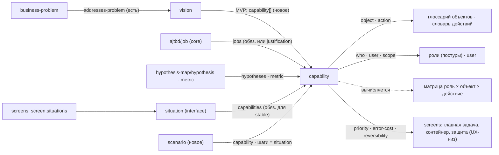

# UX-верх: дельта «как сейчас → что говорит база» (фаза 2)

Зона: vision (шире), роли и постуры, глоссарий объектов, матрица «роль × объект × действие», **capabilities**, сценарии,
ИА. Бриф — `_skill-build/phase-2/BRIEF-ux.md`. Решения заказчика — `_skill-build/DECISIONS.md`. Слой не переписывается:
ниже направления и гипотезы с доказательствами. Факты — с путями; собственные выводы — «(вывод)».

**Сокращения.** Ф1-00 … Ф1-05 — `_skill-build/phase-1/0N-*.md` (§ — раздел отчёта). Пути базы — от `ux-research/`:
`README` — корневой README (правила 1–60, реестр № 1–61); `13/04` — `13-app-types/04-master-procedure-brief-to-screens.md`
(§N = раздел файла; у шагов 1–6 номер раздела на единицу больше номера шага: §4 = шаг 3); `13/01`, `13/02`, `13/03` —
плейбуки админки, клиентского сервиса, ИИ-функций; `01/01` принципы, `01/02` мифы, `01/03`
`frameworks-domain-to-screens`, `01/04` психология; `02/01` ИА, `02/02` навигация; `05/01` онбординг, `05/02` сценарии,
`05/03` деструктивные действия, `05/04` ошибки, `05/05` сохранение; `07/01` голос и тон; `04/09` настройки и права,
`04/10` действия; `09/01` мобильная стратегия; `11/04` контракт генерации; `12/02` мастер-чек-лист, `12/04` метрики.
Метки базы: `[исследование]` `[консенсус]` `[стандарт]` `[система]` `[данные]` `[практика]` `[мнение]` `[спорно]`
(`README`, легенда).

---

## 0. Покрытие чтения

| файл | строк | прочитано | % |
|---|---|---|---|
| `_skill-build/phase-2/BRIEF-ux.md` | 72 | 1–72 | 100 |
| `_skill-build/DECISIONS.md` | 23 | 1–23 | 100 |
| Ф1-00 `00-summary.md` | 71 | 1–71 | 100 |
| Ф1-03 `03-current-rules.md` | 1659 | 1–738 (§0, §1, §2 целиком; §3.1–3.4 — для связей вниз) | 44 |
| Ф1-04 `04-quality.md` | 928 | 1–442 (Коротко, §1–§5, §6.1), 894–928 (§8) | 51 |
| Ф1-05 `05-gaps-and-insertion.md` | 489 | 1–142 (Коротко, §1 А–Г), 445–489 (§7) | 38 |
| `README.md` (корневой) | 872 | 1–220, 220–439, 439–658, 658–872 | 100 |
| README папок 01–13 (13 файлов) | 31 · 40 · 41 · 120 · 77 · 68 · 82 · 91 · 109 · 58 · 54 · 65 · 62 | целиком каждый | 100 |
| `13/04` master-procedure | 1104 | 1–1104 | 100 |
| `01/03` frameworks-domain-to-screens (OOUX, CTA, CRUD, JTBD, story map, HTA, процедура 14 шагов) | 885 | 1–885 | 100 |
| `05/02` task-flows-and-wizards | 1031 | 1–225 (выжимка, §1 с шаблоном §1.4), 604–633 (§5.4), 716–820 (§8–§10), 942–976 (открытые вопросы) | 38 |
| `02/01` information-architecture | 765 | 1–260 (выжимка, §1–§3), 587–716 (§12–§14, ошибки, вопросы) | 51 |
| `02/02` navigation-patterns | 963 | 14–72 (выжимка) | 6 |
| `01/01` principles-and-laws | 1083 | 13–58 (выжимка), 280–419 (§5 Купер: постуры) | 17 |
| `01/02` myths | 504 | 11–36 (выжимка) | 5 |
| `01/04` psychology | 529 | 13–42 (выжимка), 172–208 (§3), 390–405 (§6.8) | 16 |
| `05/01` onboarding | 954 | 19–97 (выжимка) | 8 |
| `05/03` destructive-actions | 1222 | 20–103 (выжимка) | 7 |
| `05/04` errors-and-recovery | 842 | 17–85 (выжимка) | 8 |
| `05/05` saving-drafts | 1002 | 18–95 (выжимка) | 8 |
| `13/01` admin playbook | 985 | 19–238 (выжимка, §0–§2), 496–517 (§7.1), 731–760 (§13) | 28 |
| `13/02` client playbook | 804 | 19–263 (выжимка, §1–§5), 635–654 (§17) | 33 |
| `13/03` AI playbook | 1024 | 20–181 (выжимка, §1 с паспортом §1.4) | 16 |
| `07/01` principles-voice-and-tone | 1144 | 370–495 (§6–§7), 592–673 (§10), 898–933 (§15) | 21 |
| `12/02` master-checklist | 1052 | 15–126 (§1, блок PRE), 216–230 (NAV), 350–368 (FLW), 593–610, 632–636, 656–658, 680–694 (APP: ADM, CLI, AIF, PRC), 792–835 (чек-лист сценария) | 22 |
| `12/04` metrics-and-user-testing | 1211 | 86–145 (§1), 325–396 (§4.1–4.2), 574–618 (§6.4–6.6) | 15 |
| `11/04` constraints-prompts-and-checks | 799 | 57–96 (§1.1–1.2), 189–202 (§1.9), 611–650 (§7.3) | 12 |
| `09/01` responsive-strategy | 1047 | 185–228 (§1.3–1.4), 760–773 (§8) | 6 |
| `04/10` actions-menus-bulk | 796 | 80–171 (§1 контракт действия) | 12 |
| `04/09` settings-permissions | 982 | 378–457 (§5 роли и права) | 8 |
| `00-glossary.md` | 398 | заголовки, 288–312 (ложные друзья) + строки терминов зоны по grep | ≈10 |
| grep по всей базе (без `99-raw`, `90-sources`, `91-videos`) | — | `capabilit`, `позиционирован`, `принцип* опыта / design principles / принципы дизайна`, `MVP`, `value proposition`, `north star`, `голос продукта` | доказательства «нет» |
| соседние базы (только пересечения) | — | заголовки: `site-research/01-foundations/03-site-brief.md` (+ строки §2), `…/06-multipage-ia/01`, `…/10-playbooks-contracts/01`; `text-research/02-strategy-messaging/01`, `…/05-voice-editorial/01`; `creative-research/01-creative-direction/01`, `…/03`; `ui-research/14-recipes/09`, `…/11` | — |
| шаблон (точечная сверка) | — | `docs/ajtbd/job.md:56-76`, grep `value-mechanics` в `docs/ajtbd/job-graph.md` | — |

Реестр противоречий ux читается в `README` (раздел «Реестр разрешённых противоречий», прочитан целиком).

---

## 1. Как сейчас (кратко, по слоям зоны)

- **vision** (Ф1-03 §1.2; Ф1-04 §5): singleton `vision.md` — `Problem`, `Success` (текст, «best-effort, не гарантия»),
  `Non-goals`; оси `audience` (5), `intent` (4), `market-maturity` (2), `lifecycle` (7); `addresses-problem` ≥ 1 для
  stable. Роль узкая: «внутренний документ аналитика, не сейлз-материал»; маркетинговая лексика ловится R-SEM-008. Нет имени
  и рода продукта, позиционирования, принципов опыта, тона, метрик с сигналами, объёма MVP; `audience`/`intent` вниз не
  использует никто.
- **Адресаты, роли, постуры** (Ф1-03 §1.4, §3.4; Ф1-05 §1 А): `user` — сегмент-адресат боли (кросс-поверхностный);
  `who` — роль-участник шага в `interface/<surface>/` (не ACL). Разведение `who ≠ user ≠ segment ≠ subject` — по выводу
  Ф1-05 §1 А сильнее целевого словаря. Полей постуры (часы, возврат, основная работа, плотность, ускорители, обучение) нет нигде; `who.users` никто не
  проверяет.
- **Объекты** (Ф1-05 §1 А; Ф1-04 §2.9): `data-items` — 4 колонки, локальны поверхности; UL домена отдельно; словаря
  действий нет; `data:<slug>.<field>` ссылается на поля, которых нет.
- **Матрица «роль × объект × действие»** (Ф1-05 §1 А): нет; выводима из `situation.who × action × data`; `who` —
  «❌ уровень прав», но `pages.guard` FSD берёт who как роль доступа; доменный `Role` ни с чем не связан.
- **capability** (Ф1-03 §1.5; Ф1-04 §4): 8 колонок (`slug · name · description · value · user · hypotheses · jobs ·
  status`), 5 критериев и 6 «НЕ» — аудит не проверяет ни одного; гранулярность — «зонтик → 3–5»; вверх — опциональные
  `jobs`/`hypotheses`, с vision связи нет; вниз — только опциональное `situation.capabilities` (не проверяется),
  capability → экран/FSD живёт в state-заметках.
- **Сценарии** (Ф1-05 §1 А; Ф1-03 §3.4): у web сценария нет (`screens/flow` — варианты по вьюпортам); interface —
  `stage` (порядок строк) + `situation` (один шаг; нет альтернатив, ошибок, пустых, порядка внутри этапа); mobile `flows`
  с ветками ошибок; бот — `transitions` + `errors`/`fallback`.
- **ИА** (Ф1-05 §1 А): `zone`/`parent-zone`, `block.entrypoint`; порога глубины нет (только запрет цикла); глобальной
  достижимости нет; shell screens — «не sitemap», `route` — свободная строка; моста «зона → раздел/маршрут» нет.
- **Процесс и проверки** (Ф1-03 §1.7–1.10, §2; Ф1-04 §3): 8 фаз (discovery → user → surface → capability → …), «порядок —
  рекомендация»; `draft → stable` по 5 пунктам, подтверждения «аналитик нажал ✅» не фиксируются; 25 правил аудита
  проверяют форму; звенья vision → capability и capability → экран не записаны и не проверяются.

---

## 2. Дельта

| слой | как сейчас (Ф1) | что говорит база (путь §, метка) | разрыв | направление (правило · поле · проверка с измеримым критерием) | приор. |
|---|---|---|---|---|---|
| vision · род продукта | нет; `surface.type: web` один на сайт, лендинг и кабинет (Ф1-04 §5.2; Ф1-05 §1 Б) | шаг 4 «тип приложения + плейбук + умолчания»: админка / клиентский сервис / смешанное + слой ИИ; признаки — область видимости, операции, частота, обучение (13/04 §5) `[мнение]`; «тип выбирается по ролям, а не по продукту» (13/README п.2) `[мнение]`; подтипы клиентских (13/02 §1.1) `[практика]` | нет | поле `product-kind` (закрытый enum ux: `admin` · `client` · `mixed`; сайтовые роды — из site-research) + `ai-features: yes/no`; проверка: enum; **согласованность рода с CRUD** — `client` ⇒ у ролей по большинству объектов C/R «своих» (01/03 §6, §12.2) | выс |
| vision · имя продукта | нет поля, пикеры строятся «по заголовку из vision» (Ф1-04 §5.2) | база ux молчит (не UX-вопрос) | нет (вне базы) | поле `name`; проверка присутствия | низ |
| vision · для кого | `audience` enum + адресат в Problem; `user` отдельно (Ф1-03 §1.2, §1.4) | постура до первого экрана и по ролям, 3 вопроса (часы, ежедневный возврат, основная работа) (01/01 §5.1; README правило 1) `[консенсус]` ядро, порог «> 1 ч» `[мнение]`; UX-PRE-01 (B), UX-PRE-04 (S), оба HUM (12/02 §2) | слабее | раздел «Для кого»: ссылки на `user` + сводная таблица «роль × поверхность × постура» (деталь — у ролей, §3.6); проверка: у каждой поверхности ≥ 1 роль с постурой | выс |
| vision · проблема | Problem 1–2 предложения, «чья боль» (Ф1-03 §1.2) | выводы исследований записываются **как ограничения, а не инсайты** («пользователи бросают, когда…») (13/04 §2; 11/04 §1.1) `[исследование]`+`[консенсус]`; UX-PRE-03 (S, HUM) | слабее | подраздел «Наблюдения как ограничения» (списком); проверка моделью по рубрике PRE-03 | низ |
| vision · позиционирование | нет; маркетинг запрещён (`vision.md:46`, R-SEM-008) (Ф1-04 §5.3) | **в базе ux нет** (grep «позиционирован» — 10 вхождений, все технические или про инструменты); косвенно: «отличаться там, где следует из позиции компании» (13/02 п.30) `[мнение]`; lookalike test (13/04 §30) `[практика]`; «закон Якоба — про конвенции категории» (01/02 §11) `[консенсус]` | нет (и в базе ux) | легализовать немаркетинговое позиционирование: класс продукта, главная альтернатива, «чем отличаемся наблюдаемо» (формула `market.md`); нормы — из `text-research/02-strategy-messaging/01` (§5); проверка: ≥ 1 ссылка на `market` + запрет оценочной лексики (как R-SEM-008) | сред |
| vision · принципы опыта | нет нигде (Ф1-04 §5.2) | артефакта «принципы опыта» **в базе нет** (grep «принцип* опыта / design principles / принципы дизайна» — 0); сырьё: следствия постуры (01/01 §5.1) `[мнение]`; «работает → надёжно → удобно → приятно», целевая эмоция инструмента — уверенность и спокойствие (01/04 §3) `[мнение]`; доверие ability · reliability · benevolence + 5 механизмов, «проверяемых в макете» (13/02 §3) `[практика]`; 8 правил NN/g для сложных приложений (13/01 §5) `[исследование]`; 14 качеств внимательного ПО с проверочным вопросом (01/01 §5.5) `[мнение]`; «интуитивно понятный» — миф (01/02 §7) `[мнение]`; «рычаг → механизм → проверка» (01/04 §6.8) | нет | 3–5 принципов, каждый = формулировка + норма базы + **проверочный вопрос**; стоп-лист прилагательных без проверки («удобный», «интуитивный», «современный»); проверка: у каждого принципа непустое поле «как проверить» | выс |
| vision · голос и тон | нет; intake извлекает «тон», поля нет (Ф1-05 §1 Б) | процедура голоса из 5 шагов (07/01 §6.1) `[практика]`; 4 оси тона, эффект 0,5–1 балла из 5 (§6.2) `[исследование]`; карта тона на 15 ситуаций (§7.1) `[система]`; тон — из предмета и цены ошибки, не из аудитории (§7.2) `[практика]`; блок «Текст» входного контракта (§15) `[система]`; реестр № 31, 41 | нет | раздел «Голос и тон»: как называем людей, «вы»/«ты», точка на 4 осях, анти-слова, карта тона 5–8 ситуаций; проверка: в карте есть деньги / безопасность / деструктивное с тоном «нейтральный» | сред |
| vision · метрики успеха | `Success` — текст; метрики — в `hypothesis-map/metric`, связь только смысловая (`goal-vision`) (Ф1-03 §2) | HEART + Goals → Signals → Metrics, нормировка на пользователя (12/04 §4.1) `[исследование]`; успешность задачи — базовая везде, клики — не метрика (README правило 60; реестр № 23) `[консенсус]`; наборы по классу (13/01 §13 `[данные]`+`[практика]`; 13/02 §17 `[практика]`); дизайн-KPI: 30–40 задач-целей, планка 80–90 % (12/04 §4.2) `[практика]`; чужие метрики не переносятся (12/04 §6.5) `[мнение]` | слабее | `Success` → список «цель → сигнал → метрика → ref `hypothesis-map/metric`»; + «задачи приёмки» (формулировка «роль + ситуация + цель без слов интерфейса», README, числа для оценки); проверка: у метрики есть сигнал и нормировка; ≥ 1 метрика успешности задачи; «клики», «время на экране» как главная метрика — warning | выс |
| vision · объём MVP | только `lifecycle` (стадия) (Ф1-04 §5.2) | хребет карты историй — «сущностные возможности системы», walking skeleton строится первым (01/03 §9.3) `[консенсус]`; ORCA-стадия Prioritization → «срез MVP» (01/03 §1.4) `[мнение]`; хабы («идеальный шторм» частота × сложность × фрустрация) и «редкие, но критичные» (13/04 §7) `[практика]`; обязательные системные сценарии, которых нет в брифе (13/04 §22) `[практика]`; «экраны 13–16 в брифе не появляются сами» (13/02 §4.2) | нет | раздел «Объём MVP»: список **slug capability** (скелет) + чек-лист 12 системных сценариев «есть / не нужно, потому что …»; проверка: slug резолвятся; у каждого из 12 пунктов есть решение | выс |
| vision · устройства и доступность | a11y нет ни в одном слое (Ф1-04 §2.9) | список мобильных сценариев — артефакт брифа наравне с объектной моделью (09/01 выжимка п.1, §8 шаг 1) `[консенсус]`/`[практика]`; законное «нет» при 4 условиях (09/01 §1.3) `[система]`; паритет функций — цель (реестр № 57) `[консенсус]`; целевой уровень WCAG 2.2 AA объявляется явно — UX-PRE-18 (B) `[стандарт]`; EAA для ЕС (13/02 §14) `[стандарт]` | нет | поля `a11y-target` (по умолчанию WCAG 2.2 AA), `jurisdictions`, «мобильный объём» (таблица «роль → триггер → результат → бюджет времени» или решение «нет» с 4 условиями); проверка присутствия и условий | сред |
| vision · ограничения | в vision нет; `constraint.md` отдельно (Ф1-04 §5.2) | разбор брифа: законы, регламенты, бэкенд, сроки, устройства (13/04 §2) `[практика]`; «процедуры, которые менять нельзя», essential vs accidental сложность (13/04 §3; 13/01 §3) `[практика]`/`[мнение]`; UX-PRC-02 (S) | слабее | раздел «Ограничения»: ref `constraint` + список «что нельзя менять (essential)»; проверка: ссылки резолвятся; пусто ⇒ явное «нет» | сред |
| vision · что не делаем | `Non-goals` + `boundary`, противоречие «развёрнуто / кратко» (Ф1-04 §6.1) | закрытый список этических запретов, 22 пункта (06/04 §8.1; README правило 40) `[консенсус]`+`[стандарт]`; когда ИИ не нужен (13/03 §1.1–1.2) `[консенсус]`/`[мнение]`; «не урезать функции» (реестр № 57; 13/02 §1.2) | ок / слабее | сохранить сильный канон репо; добавить типы non-goal: устройства, ИИ, этика как обязательства продукта; снять противоречие Non-goals ↔ boundary (одно место — полное) | сред |
| vision · допущения | открытые вопросы — в state (Ф1-03 §0.2) | каждое допущение помечено словом «допущение», пробелы — вопросы заказчику (13/04 §2) `[практика]`; «молчаливый несогласный» (13/04 «Частые ошибки» п.13) | слабее | раздел «Допущения» (текущие, forward-only); проверка: пункт без пометки — warning | низ |
| роли · полнота | `who`: инициатор шага, тип/роль, система — исключение (Ф1-03 §3.4) | в список входят упомянутые вскользь и системные роли; «роль без единого действия — не роль» (13/04 §4) `[мнение]`; типовые роли админки (13/01 §1.3) и три типа пользователей «наследник / легенда / ученик» (13/01 §1.2) `[данные]`; «нет роли без чтения хотя бы одного объекта» (01/03 §6) `[мнение]` | слабее | проверка: у каждой роли ≥ 1 действие в матрице и ≥ 1 R; для `admin` — сверка с перечнем типовых ролей (hint) | сред |
| роли · постура | полей нет ни у `who`, ни у `user` (Ф1-05 §1 А) | таблица «Роль · Часов/день · Возврат · Основная работа · Постура · Плотность · Ускорители · Обучение»; критерий: все 8 колонок, нет роли «все пользователи», при > 1 постуре записано, как разводятся (13/04 §4) `[мнение]`; гибриды: транзитная функция внутри суверенного (13/01 §2) `[мнение]` | нет | 8 колонок постуры у роли (дом — §3.6); у capability — флаг «транзитная функция»; проверки RL-01, RL-02 (§3.3) | выс |
| объекты · глоссарий | `data-items`: 4 колонки, локально поверхности; UL домена отдельно (Ф1-05 §1 А) | тест объекта: экземпляры, свои атрибуты, адресуемость ссылкой; отсев абстракций, коллекций, представлений, ролей (13/04 §6; 01/03 §1.2) `[мнение]`; запись глоссария: имя, определение, 2–3 примера, зачем (работа объекта), когда появляется, другие названия, состояния, кто создаёт/удаляет (01/03 §13) `[мнение]`; «одно понятие — одно слово» (07/01 §10.1) `[консенсус]`; ранжирование атрибутов, первые 3 узнают экземпляр (01/03 §5.3) `[мнение]`; OOUX нужен при > 3 повторяющихся существительных и > 1 роли (01/03 §1.5) | слабее | продуктовый глоссарий объектов (поперёк поверхностей, §3.6) с полями базы + атрибуты с рангом (закрывает `data:<slug>.<field>`); проверки GL-01…GL-04 | выс |
| объекты · словарь действий | нет; глагол живёт внутри `capability.name` (Ф1-04 §4.3) | словарь отдельно от глоссария: «Каноническое действие · Глагол на кнопке · Прошедшее время · Запрещённые синонимы · Обратимо · Объекты»; критерий: один глагол и одна форма прошедшего, список запретов непуст (13/04 §6) `[мнение]`/`[практика]`; одно имя по всему потоку, F7.3 (07/01 §10.3) `[система]`; «начинать со словаря запретов» (13/04 §6) | нет | новый артефакт `action`; `capability.action` ссылается на него; проверки GL-03, CAP-03 | выс |
| матрица · CTA/CRUD | нет; выводима; `pages.guard` берёт who как роль доступа (Ф1-05 §1 А) | CTA: роли × объекты, глаголы как на кнопке, оговорки области в ячейке, до экранов; источник тулбара, меню строки, массовых действий, навигации (01/03 §4) `[мнение]`; CRUD: нет роли без R, каждый объект кем-то создаётся и удаляется или системный, нет U без R, область отражена в составе списков (01/03 §6) `[мнение]`; +3 колонки «Контейнер · Подтверждение · Журнал» (13/04 §8); для админки обязательна (13/01 §0; класс измеренно худший — IIS 9,4) `[исследование]`; UX-PRE-05 (B), UX-PRC-04 (LNT, HUM) | нет | матрица как **вычисляемый вид** из capability (`who × object × action × scope`), не ручная таблица; CRUD-правила — проверки скриптом MX-01…MX-05; 3 колонки базы — слой screens (UX-низ) | выс |
| матрица · модель прав | `who` «не ACL» против `pages.guard` (Ф1-05 §1 А) | право = действие, роль = набор прав, область — обязательное измерение (04/09 §5.1) `[система]`; матрица читается по строкам-действиям (§5.3) `[практика]`; «самый слабый по доказательности файл» (README, «Практика и спорное») | противоречит (внутри репо) | развести «роль-участник» (who) и «роль доступа»: мост — колонка `scope` матрицы; ACL — домену; проверка: `pages.guard` ссылается на роль, имеющую R по объекту страницы | сред |
| capability · состав | 8 колонок; объект и глагол внутри `name` (Ф1-04 §4.1–4.3) | понятия capability **в базе нет** (grep `capabilit` — 3 вхождения в посторонних смыслах: `01/02:196`, `11/02:576`, `12/04:235`); ближайшие единицы: строка каталога задач «# · Задача (глагол + объект) · Роль · Частота · Желаемый результат · Сложность 1–10 · Паттерны · ПОТРЕБНОСТЬ · Цена ошибки» (13/04 §7) `[практика]`; контракт действия «Имя · Объект · Кто может · Уровень · Результат · Состояния · Обратимость» (04/10 §1.1) — закрывает F4.3, usability < 10 % по Interaction2Code `[исследование]`; job story (01/03 §8) `[мнение]`; паспорт ИИ-функции (13/03 §1.4) | слабее | реестр (≤ 10 колонок) + паспорт для хабов и критичных (§3.1); ядро `who × object × action` отдельными полями-ссылками | выс |
| capability · гранулярность | качественные критерии + «3–5»; в образце capability = ситуация 1:1 (Ф1-04 §4.2) | задача = «глагол + объект» (13/04 §7); «не назвать коротко — задача слишком сложна, разбить» (GOV.UK, 05/02 §1.3) `[система]`; уровни карты историй: активности → шаги (эпики) → детали (истории) (01/03 §9.2–9.4) `[консенсус]`; HTA: цель ≠ задача (01/03 §10) `[консенсус]`; job story = обоснование одной ячейки CTA (01/03 §8.3); ориентиры: ≥ 10 задач для продукта средней сложности, 3–5 «островов» (13/04 §7) `[практика]`, один кейс (13/04 откр. вопр. 7) | слабее | 7 измеримых критериев Г1–Г7 (§3.2): одна тройка ядра; имя ≤ 4 слов; ≥ 1 ситуация; ситуации — один сценарий с одним исходом; одна частота и одна обратимость; ориентиры количества; без UI/техники | выс |
| capability · проверяемость | ни один из 5 критериев и 6 «НЕ» не проверяется; подтверждения не фиксируются (Ф1-04 §4.2) | «один шаг — один артефакт — один критерий проверки; шаг без проверяемого выхода выкидывается» (13/04 выжимка п.2) `[практика]`; «каждый артефакт проверяется на достижимость и полноту автоматически» (п.24; §29) `[исследование]`; UX-PRC-04 (LNT), UX-PRC-07 (B, LNT/SCR) (12/02 §3.18) | нет | 13 проверок CAP-01…13 (§3.3): 10 — скриптом/YAML, 2 — моделью (многократный прогон), 1 — по state | выс |
| capability · связи вверх | `jobs`, `hypotheses` опц.; с vision и `business-problem` связи нет (Ф1-03 §2) | JTBD в базе — рамка `[мнение]`, первоисточник не открыт (01/03 §8, откр. вопр. 1); «задача ≠ потребность» (13/04 §7) `[практика]`; job story: ситуация → точка входа, мотивация → CTA, результат → состояние + обратная связь (01/03 §8.2); Goals → Signals → Metrics (12/04 §4.1) `[исследование]`. В шаблоне `ajtbd/job` уже есть `when`, `want`, `success-criteria`, `level: big/core/low`, `frequency`, `importance` (`docs/ajtbd/job.md:56-72`) | слабее | обязательная трасса: ≥ 1 из (`jobs` уровня `core` · `hypotheses` · вхождение в vision.MVP) или непустое `justification`; маппинг полей `job.when → trigger`, `success-criteria → acceptance`, `frequency`/`importance` → `priority` (вывод) | выс |
| capability · связи вниз | только опц. `situation.capabilities`, не проверяется; flow → capability в state (Ф1-04 §3) | таблица согласования «спецификация сценария ↔ маршруты ↔ матрица переходов ↔ состояния ↔ события ↔ журнал ↔ сценарный тест» (13/04 §11) `[практика]`; «каждая ячейка CTA-матрицы имеет место, где действие доступно» (01/03 §15 шаг 13; 13/04 §29) | нет | покрытие обязательное в обе стороны: stable capability ⇒ ≥ 1 ситуация; хаб/критичная ⇒ ≥ 1 сценарий; stable ситуация ⇒ ≥ 1 capability или пометка «служебная»; экран наследует через `screen.situations` (CAP-07, CAP-08) | выс |
| capability · приоритет, частота, цена ошибки, обратимость | нет полей; жизненного цикла умения нет (Ф1-04 §4.2 п.3, п.7) | частота, сложность, цена ошибки — вход для контейнера (§19), подтверждений (§21), фильтра ИИ (13/04 §7) `[практика]`; обратимость — поле контракта действия (04/10 §1.1); UX-PRE-17 (B): для каждого изменяющего действия — обратимо ли, механизм, ступень защиты (05/03 §11); отмена вместо подтверждения (README правило 7, 9) `[консенсус]` | нет | поля-enum `priority` (хаб · критичная · обычная; MVP · позже), `frequency`, `error-cost`, `reversibility`; проверка CAP-10 | выс |
| capability · воплощение по поверхностям | «одна ценность на двух поверхностях = две записи, своё воплощение» без колонки (Ф1-04 §4.2 п.2) | паритет контента и функций — цель, паритет интерфейса — нет (09/01 §1; реестр № 57) `[консенсус]`/`[исследование]`; мобильный набор — отсечка по тому же ранжированию (09/01 §1.4) `[практика]` | слабее | гипотеза: capability продуктового уровня + `availability` по поверхностям (`full` · `partial` · `none` + почему); проверка: `none` без причины — warning | сред |
| capability · ИИ | нет | паспорт: задача, частота/сложность/риск, автоматизация или аугментация, требуемая точность, цена ошибки, путь без ИИ, источники данных, что модель НЕ делает, кто отвечает, метрики (13/03 §1.4); фильтр «частота × сложность × **низкий** риск» (§1.2) `[мнение]`; путь без ИИ — UX-AIF-02 (B) | нет | флаг `ai` ⇒ паспорт обязателен (CAP-11) | сред |
| сценарии · спецификация | у web нет; `situation` без альтернатив, ошибок, пустых; порядок внутри этапа не выражается (Ф1-03 §3.4; Ф1-05 §1 А) | шаблон: цель в словах пользователя, роль и права, частота, экспертиза, предусловия, триггер и точки входа, нужен ли контекст, обратимость; happy path (шаг · маршрут · действие · ответ системы · что сохраняется); ветвления; ошибки по шагам; прерывание; состояние между экранами; конечные состояния; что меняется в системе; критерии приёмки (05/02 §1.4) `[практика]`; обязателен: ревью чинит сценарий на +0,03…+0,12 из 5 (05/README п.1) `[исследование]`; порядок happy → ветвления → ошибки → пустые (README правило 5) `[консенсус]`; в экспертных продуктах — от задачи, со всеми точками входа (13/04 §11) `[практика]`; UX-PRC-05 | нет | новый kind `scenario` на хаб/критичную capability (дом — §3.6); проверки SC-01…SC-05 | выс |
| сценарии · конечные состояния и тупики | конечных состояний у web нет; у бота — `fallback` | 5 конечных (успех, отклонено, отложено, частично, отменено) + нет прав, пусто; у каждого 2–3 следующих действия (05/02 §5.4) `[консенсус]`/`[практика]`; тупик — дефект F5.2 | нет | закрытый enum конечных состояний, общий для web/mobile/бота (согласовать с контрактом S01–S22 — UX-низ); SC-02: ≥ 2 действия или «N/A: причина» (приём репо «N/A с пояснением», Ф1-05 §1 А) | выс |
| сценарии · многоролевые | нет | видно всем: состояние, «чей ход», что дальше, история, сроки; очередь «мой ход»; ожидание — конечное состояние для текущего (05/02 §8) `[практика]` — **ни одного источника** (05/02 откр. вопр. 6; README «Что не покрыто») | нет | поле «чей ход / при бездействии (срок, эскалация)» у многоролевого сценария (SC-04, warning — доказательность слабая) | сред |
| ИА · таблица до навигации | `zone`/`parent-zone`, мост «зона → раздел» не описан (Ф1-05 §1 А) | «IA документируется в таблицах и диаграммах, а не в вайрфреймах»; инвентаризация → аудит → группировка → таксономия → метаданные (02/01 §1) `[консенсус]`; ИА до навигации (README правило 12) | слабее | зоны interface = разделы ИА; явный мост `zone → раздел/маршрут` в screens (низ); чек-лист ИА из 12 пунктов (02/01 §14) — проверка моделью | сред |
| ИА · глубина и ширина | порога нет, только запрет цикла (Ф1-05 §1 А) | ≤ 3 уровня для приложения, 4 — предел каркаса «панель + рейка», в сайдбаре ≤ 2 видимых уровня (02/01 §3.3) `[система]`/`[консенсус]`; 8–15 пунктов верхнего уровня — сайдбар, > 25 — «ИА не доделана» (§3.2) `[консенсус]`; «7±2» к меню не применять (§3.2) `[исследование]` | нет | IA-01: глубина дерева зон ≤ 3 (4 — warning, > 4 — error); IA-02: корневых зон > 25 — warning | выс |
| ИА · имена разделов | нет правил | разделы — существительные (мн. ч.), действия — глаголы; понятное важнее умного; категории не пересекаются; «Разное»/«Прочее» — симптом (02/01 §5, §7) `[исследование]`/`[консенсус]`; ИИ-дефекты: «Insights», «Workspace», «Hub», пустое «More» (02/01 «Частые ошибки» 9–12) | нет | IA-03 (скрипт, стоп-лист), IA-04 (модель: существительные, непересечение) | сред |
| ИА · верхний уровень и роли | зоны «по смыслу задачи»; ролевой видимости нет | верхний уровень = объекты, у которых у роли > 1 CTA (01/03 §15 шаг 14) `[мнение]`, эмпирически не проверено (01/03 откр. вопр. 7); смешанная схема «обзор → объекты → отчёты → настройки» (02/01 §2.4) `[система]`; скрывать недоступное навсегда, блокировать с объяснением получаемое, порядок оставшихся пунктов не менять (02/01 §12) `[консенсус]`; UX-NAV-01 (B) | слабее | IA-05: корневая зона ↔ ≥ 1 объект глоссария или capability-хаб (hint); видимость разделов по ролям — вычислять из матрицы | сред |
| ИА · админка и клиентская часть | типы `web`/`admin` есть, критериев разделения нет (Ф1-05 §1 Б–В) | 7 критериев, ≥ 3 «да» → разделять; п.7 — аргумент против; компромисс — два контура с `/admin` (13/04 §17) `[консенсус]` без эксперимента; «режим администратора тумблером» — худший вариант (02/01 §13) | нет | решение принимается **на фазе surface** по таблице 13/04 §17 и записывается; RL-02 ловит поверхность со смешанными постурами без решения | сред |
| процесс · «слова до экранов» | фазы vision → user → surface → capability, «порядок — рекомендация»; project-deep-dive не ведёт в interface (Ф1-03 §1.7; Ф1-04 §3) | «ничего не рисуй, пока не заполнены артефакты шагов 1–13» (13/04 п.1) `[мнение]`; каждый шаг — артефакт, критерий, номера дефектов F (13/04 §1) `[практика]`; «права после экранов — половину переделывать» (13/04 ошибки п.11) | слабее | карта «шаги 13/04 → слои репо» (§3.6); гейт: screens не стартует, пока у поверхности нет capability-реестра, глоссария, матрицы и сценариев хабов (или записан `_phase-jump`) | выс |
| проверки · входной контракт | скриптов нет; всё — чтение LLM (Ф1-00 п.8) | блок PRE: 18 пунктов, все — `HUM`; PRC: 15 пунктов, почти все `HUM`, PRC-04 `LNT, HUM`, PRC-07 `LNT, SCR` (12/02 §2, §3.18); «если способ JDG или HUM — ворот не ставится» (12/02 §1.1) | нет | разделить: структура (наличие, ссылки, счётчики, CRUD, глубина, имена) — скрипт/YAML-ворота; смысл («наблюдения как ограничения», «одна главная задача») — модель по рубрике PRE, как наблюдение | выс |
| обоснования | «Доменные решения» в state; меток доказательности нет | журнал решений «Решение · Какую проблему решает · Как влияет · Чем лучше альтернатив · Уровень доказательности · Источник» (13/04 §28) `[практика]`; метки базы (README, легенда) | слабее | правила слоя проекта несут метку базы; решение — «почему» + уровень; forward-only: только текущие решения (§6) | низ |

---

## 3. Особо по зоне

### 3.1 Предлагаемый состав capability

Гипотеза формы (вывод): как в базе — **строка каталога + паспорт на отдельный пункт** (каталог задач 13/04 §7 + спецификация
сценария 13/04 §11; паспорт ИИ-функции 13/03 §1.4). Реестр держит ядро в одной строке (решает Ф1-04 §2.1 «17 колонок
одной строкой»); паспорт — для хабов, редких критичных и всех `stable`.

**Реестр `capability/<surface>.md`** (≤ 10 колонок):

| поле | смысл | тип | draft / stable | основание (база) |
|---|---|---|---|---|
| `slug` · `name` · `description` | как сейчас; `name` = канонический глагол (инфинитив СВ) + объект, 2–4 слова | текст | обяз. / обяз. | задача «глагол + объект» 13/04 §7 `[практика]`; имя действия 2–4 слова 04/10 §1.4 `[консенсус]`; реестр № 47 |
| `user` | адресат ценности (сегмент) | ref `user` | опц. / ≥ 1 | как сейчас; персона ≠ роль 01/03 §12 `[спорно]` |
| `who` | роль(и)-инициатор(ы) | ref `who` (или роль продукта, §3.6) | опц. / ≥ 1 | CTA «роль × объект» 01/03 §4 `[мнение]`; колонка «Роль» каталога 13/04 §7 |
| `object` | основной объект — ровно один | ref глоссария | опц. / обяз. | OOUX 01/03 §1, §4 `[мнение]` |
| `action` | канонический глагол | ref словаря действий | опц. / обяз. | 13/04 §6 `[мнение]`; F7.3 07/01 §10.3 `[система]` |
| `priority` | хаб · критичная · обычная; `mvp` · `later` | enum × 2 | опц. / обяз. | «идеальный шторм», «редкие, но критичные» 13/04 §7 `[практика]`; walking skeleton 01/03 §9.3 `[консенсус]` |
| `passport` | ссылка на паспорт или `—` | ref | — / обяз. для хаб, критичная | вывод |
| `status` | как сейчас | enum | обяз. | репо |

**Паспорт capability** (карточка; для хабов, критичных и stable):

| поле | смысл | тип | основание (база) |
|---|---|---|---|
| `need` | потребность (≠ задача) | текст | «задача ≠ потребность», записывать обе 13/04 §7 `[практика]` |
| `value` | ценность в языке user | текст | как сейчас |
| `trigger` | когда и откуда начинается; точки входа | текст + список | job story «Когда…» 01/03 §8.1–8.2 `[мнение]`; «Триггер и точки входа» 05/02 §1.4; ↔ `ajtbd/job.when` |
| `outcome` | наблюдаемый исход: какой объект появится / в какое состояние перейдёт | текст + ref состояния из глоссария | «ожидаемый результат → что должно измениться и как это подтверждается» 01/03 §8.2 п.3; «Что меняется в системе» 05/02 §1.4 |
| `acceptance` | 1–3 проверяемых утверждения + задача-формулировка для теста («роль + ситуация + цель без слов интерфейса») | текст | критерии приёмки 05/02 §1.4 `[практика]`; дизайн-KPI 12/04 §4.2 `[практика]`; ↔ `ajtbd/job.success-criteria` |
| `frequency` | частота | enum: часами ежедневно · коротко ежедневно · еженедельно · ежемесячно · редко · раз в жизни | 13/04 §7; постура 01/01 §5.1 `[мнение]` |
| `error-cost` | цена ошибки и кто её платит | enum низкая · средняя · высокая + текст | 13/04 §7 `[практика]`; 13/03 §1.4 |
| `reversibility` | обратимость результата | enum `undo` · `soft-delete` (срок) · `confirm` · `irreversible` | контракт действия 04/10 §1.1; UX-PRE-17 (B); порядок «предотвращение → отмена → подтверждение» README правило 7 `[консенсус]` |
| `scope` | область по ролям: свои · все · подразделение | enum по `who` | CTA/CRUD 01/03 §4, §6 `[мнение]`; 13/04 §8 |
| `posture-exception` | транзитная функция внутри суверенного (или наоборот) | bool + текст | гибриды 13/01 §2 `[мнение]` |
| `depends-on` | `integration` / `constraint` | refs | «Ограничения» 13/04 §2 `[практика]`; Ф1-04 §4.3 |
| `jobs` · `hypotheses` · `justification` | трасса вверх | refs / текст | §3.4 |
| `metric` | сигнал успеха умения | текст / ref `hypothesis-map/metric` | Goals → Signals → Metrics 12/04 §4.1 `[исследование]` |
| `availability` | по поверхностям: `full` · `partial` · `none` + почему | map | паритет функций 09/01 §1, реестр № 57 `[консенсус]` |
| `ai` | ИИ-функция ⇒ блок паспорта 13/03 §1.4 | bool + блок | 13/03 §1.2–1.4; UX-AIF-01/02 |

### 3.2 Измеримые критерии гранулярности

База уровня «capability» не знает; критерии ниже — перенос её единиц (задача каталога, ячейка CTA, шаг карты историй,
контракт действия) на форму репо (вывод, кроме помеченного базой).

| # | критерий | мера | чем проверять | основание |
|---|---|---|---|---|
| Г1 | **Одна тройка ядра**: ровно один `object`, ровно один канонический `action`, один исход (`outcome`); ролей может быть несколько, если глагол и объект одни | число ссылок в полях = 1 | скрипт | CTA-ячейка 01/03 §4; контракт действия 04/10 §1.1; job story = обоснование одной ячейки 01/03 §8.3 |
| Г2 | **Имя-тест**: ≤ 4 слов «глагол + объект»; нет «и», перечислений, зонтичных глаголов («управлять», «вести», «администрировать», «работать с») | regex + стоп-лист | скрипт | «не назвать коротко — разбить» 05/02 §1.3 `[система]`; 2–4 слова 04/10 §1.4 `[консенсус]`; пример зонтика репо «Управлять направлениями» (Ф1-03 §1.5) |
| Г3 | **Не ниже шага**: разворачивается в ≥ 1 ситуацию с собственной целью; одна ситуация из одного субстрата-контрола — не capability | счёт `situation.capabilities`; тип субстратов | скрипт (warning) | «Слишком мелко — один контрол» (Ф1-03 §3.4); цель ≠ задача HTA 01/03 §10 `[консенсус]` |
| Г4 | **Не выше шага карты историй**: ситуации capability складываются в один путь к одному исходу; два разных исхода — две capability | ситуации capability ⊂ одного сценария | скрипт по сценариям | активности → шаги → детали 01/03 §9.2 `[консенсус]` |
| Г5 | **Одна частота, одна обратимость**: части с разной частотой (ежедневно / раз в квартал) или разной обратимостью — разные capability | поля однозначны | скрипт | транзитная функция внутри суверенного 13/01 §2 `[мнение]`; лестница защиты 05/03 §7.2 `[практика]` |
| Г6 | **Ориентиры количества** (не пороги): ≥ 10 задач для продукта средней сложности; 3–5 хабов («островов») | счёт по поверхности | скрипт (hint) | 13/04 §7 `[практика]`, один кейс Gexcon |
| Г7 | **Переживает смену UX**: в `name`, `description`, `value` нет слов UI и технологии (кнопка, экран, форма, push, OAuth, API, виджет, синхронизация…) | лексикон | скрипт (warning) | «НЕ» capability (Ф1-03 §1.5); системный жаргон F7.2 07/01 §10.2 |

### 3.3 Проверки (кандидаты в реестр правил аудита)

Способ: **скрипт** — детерминированно по таблицам; **модель** — чтение по рубрике, ≥ 3 прогонов с перестановкой
(`README` правило 58: один прогон — шум; оговорка о семействе судьи — §6); **state** — по записи в state.

| id | что ловит | способ | тяжесть | основание |
|---|---|---|---|---|
| CAP-01 | обязательные поля по статусу; валидные enum `priority`, `frequency`, `error-cost`, `reversibility` | скрипт | error@stable | 13/04 §7 критерий «у каждой задачи частота и потребность» |
| CAP-02 | ссылки резолвятся: `object` ∈ глоссарий, `action` ∈ словарь, `who`, `user`, `jobs`, `hypotheses` (сейчас существование не проверяется — Ф1-03 §1.10) | скрипт | error | 13/04 §29 «проверка соответствия артефактам» `[исследование]` |
| CAP-03 | имя: Г2 + корень глагола совпадает со словарём действий, нет запрещённого синонима | скрипт | warning | 13/04 §6, §8 «ни одна ячейка не содержит двух синонимов» |
| CAP-04 | техника и платформа в `name`/`description`/`value` (Г7) | скрипт | warning | как R-SEM-008 |
| CAP-05 | дубль ядра: одинаковые (`object`, `action`, `who`) в файле поверхности | скрипт | error | вывод |
| CAP-06 | адресат согласован: ∃ `who` из capability, у которого `who.users ∋ capability.user` | скрипт | warning→error@stable | расхождение образца `nurse-partner`/`doctor` (Ф1-04 §2.7) |
| CAP-07 | покрытие вниз: stable ⇒ ≥ 1 ситуация с `situation.capabilities ∋ slug`; хаб/критичная ⇒ ≥ 1 `scenario` | скрипт | error@stable | 01/03 §15 шаг 13; 13/04 §11 |
| CAP-08 | обратное покрытие: stable-ситуация без capability и без пометки «служебная» | скрипт | hint | вывод |
| CAP-09 | покрытие вверх: ≥ 1 из `jobs` · `hypotheses` · вхождение в vision.MVP, иначе `justification` | скрипт | warning@stable | Ф1-04 §4.3 |
| CAP-10 | `error-cost: высокая` ⇒ `reversibility` задана; `irreversible` ⇒ в сценарии есть шаг защиты | скрипт | error | UX-PRE-17 (B); 05/03 §7.2 |
| CAP-11 | `ai: true` ⇒ паспорт ИИ заполнен и есть путь без ИИ | скрипт | error@stable | UX-AIF-01/02 (12/02 §3.18) |
| CAP-12 | критерии «самодостаточна», «что, а не как», «кому ценность» | модель | warning | критерии канона + ✅/❌ примеры как рубрика |
| CAP-13 | подтверждение критериев при `draft → stable` записано (какие критерии, кто) | state | error@stable | Ф1-03 §1.9 «подтверждения нигде не фиксируются» |
| MX-01 | объект глоссария кем-то создаётся и кем-то удаляется/архивируется или помечен «системный» | скрипт | error | 01/03 §6 `[мнение]` |
| MX-02 | у роли нет U без R; D без R — warning | скрипт | error / warning | 01/03 §6 |
| MX-03 | роль без R ни одного объекта или без единого действия | скрипт | warning | 01/03 §6; 13/04 §4 |
| MX-04 | «формальная матрица»: у всех ролей по всем объектам одинаковый набор CRUD | скрипт | hint | 13/04 «Частые ошибки» п.2 |
| RL-01 | у роли заполнены 8 колонок постуры; нет роли «все пользователи» | скрипт | error@stable | 13/04 §4 критерий |
| RL-02 | на поверхности ≥ 2 постуры (sovereign и transient) без записанного разведения и без решения по 13/04 §17 | скрипт | warning | 13/04 §4, §17 |
| GL-01 | у объекта: определение, 2–3 примера, состояния, кто создаёт/удаляет, непустые запрещённые синонимы | скрипт | error@stable | 13/04 §6; 01/03 §13 |
| GL-02 | запрещённый синоним встречается в `name` capability, зоны, ситуации, блока | скрипт | warning | 07/01 §10.1 `[консенсус]` |
| GL-03 | у действия один глагол, одна форма прошедшего времени, обратимость | скрипт | error | 13/04 §6 |
| GL-04 | у объекта помечены 3 идентифицирующих атрибута (ранг 1–3) | скрипт | warning | 01/03 §5.3 |
| GL-05 | в глоссарии объектами записаны коллекции и представления («каталог», «календарь», «дашборд», «отчёт», «расписание») | скрипт (стоп-лист) + модель | warning | 13/04 §6; 01/03 §1.2 |
| SC-01 | разделы спецификации непусты: цель, роль, happy path, ветвления, ошибки по шагам, конечные состояния, «что дальше» | скрипт | error@stable | минимальный набор 05/02 §1.4 |
| SC-02 | у конечного состояния ≥ 2 следующих действия или «N/A: причина» | скрипт | error | 05/02 §5.4 |
| SC-03 | шаг happy path ссылается на ситуацию той же поверхности; у ветвления есть условие и цель перехода | скрипт | error | вывод |
| SC-04 | сценарий с ≥ 2 `who` без таблицы «чей ход / при бездействии» | скрипт | warning | 05/02 §8 `[практика]`, без источников |
| SC-05 | цель сформулирована словами пользователя, не системы | модель | hint | 05/02 §1.4 |
| IA-01 | глубина дерева зон ≤ 3 (4 — warning, > 4 — error) | скрипт | error / warning | 02/01 §3.3; README правило 12 |
| IA-02 | корневых зон > 25 | скрипт | warning | 02/01 §3.2 `[консенсус]` |
| IA-03 | имя зоны из стоп-листа «Разное · Прочее · Другое · Ещё · More · Hub · Insights · Workspace» | скрипт | warning | 02/01 §5, ошибки 9–12 |
| IA-04 | разделы — существительные; категории не пересекаются | модель | warning | 02/01 §5 |
| IA-05 | корневая зона не соответствует ни объекту, ни capability-хабу | скрипт | hint | 01/03 §15 шаг 14 `[мнение]` |
| VS-01 | разделы vision на месте; `product-kind` ∈ enum; `a11y-target` задан | скрипт | error@stable | §3.5 |
| VS-02 | метрика = цель → сигнал → метрика с нормировкой; ≥ 1 метрика успешности задачи; «клики»/«время на экране» главной метрикой | скрипт | warning | 12/04 §4.1; README правило 60; 13/02 §17 |
| VS-03 | у принципа опыта есть «как проверить»; прилагательные без проверки из стоп-листа | скрипт | warning | 01/04 §6.8; 01/02 §7 |
| VS-04 | MVP-список ссылается на существующие capability; по 12 системным сценариям есть решение | скрипт | error@stable | 13/04 §22 |
| VS-05 | допущения вынесены списком | скрипт | warning | 13/04 §2 |
| VS-06 | мобильный объём: таблица сценариев или «нет» с 4 условиями | скрипт | warning | 09/01 §1.3, §8 |

Смысловые пункты PRE (UX-PRE-01…03) и ADM/CLI (постура, главный экран) база сама помечает `HUM`/`JDG` — их место в
отчёте как наблюдения, без ворот (12/02 §1.1).

### 3.4 Связи вверх и вниз

| направление | ребро | поле / правило | проверка |
|---|---|---|---|
| вверх | vision → capability | vision.MVP = список slug; каждая MVP-capability `priority: mvp` | VS-04 |
| вверх | job → capability | `jobs` (уровень `core`); маппинг `when → trigger`, `success-criteria → acceptance`, `frequency`/`importance` → `priority` (вывод по `docs/ajtbd/job.md:56-72`) | CAP-02, CAP-09 |
| вверх | механика ценности → capability | `job-graph.value-mechanics` уже называет механики «кандидатами в будущие capability» (`docs/ajtbd/job-graph.md:61`), но это свободная строка | вывод: нужен id механики |
| вверх | метрика → capability | `metric` → `hypothesis-map/metric` | CAP-02 |
| вниз | capability → ситуация | авторство снизу сохраняется (`situation.capabilities`), покрытие обязательно в обе стороны | CAP-07, CAP-08 |
| вниз | capability → сценарий → экран | сценарий на хаб/критичную; экран наследует capability через ситуации; строка карты экранов «главная задача / одно ключевое действие» (13/04 §14) берётся из `priority` | CAP-07; UX-низ |
| вниз | capability → защита и контейнер | `error-cost`, `reversibility` → выбор механизма в screens (лестница 05/03 §7.2; контейнер 13/04 §19) | CAP-10; UX-низ |
| вниз | capability → домен | как сейчас: угол `capability-domain` `/cross-audit` | — |

### 3.5 Предлагаемые разделы vision

Вывод по базе: **vision шире нельзя собрать из одной ux** — позиционирования и принципов опыта в ней как артефактов нет
(grep, §2); ux даёт роли и постуры, род, метрики, объём, устройства, запреты; позиционирование и голос бренда — соседние
базы (§5).

| # | раздел | содержание | что даёт база | в репо сейчас | проверка | владелец (гипотеза) |
|---|---|---|---|---|---|---|
| 1 | Имя и род | `name`; `product-kind` (admin · client · mixed + роды сайта); `ai-features` | 13/04 §5; 13/02 §1.1; 13/README п.2 | нет | VS-01 | бизнес |
| 2 | Проблема | как сейчас + наблюдения как ограничения | 13/04 §2; 11/04 §1.1; UX-PRE-03 | Problem | модель (PRE-03) | бизнес, аналитик |
| 3 | Для кого | ссылки на `user`; сводка «роль × поверхность × постура» | 01/01 §5.1; 13/04 §4; UX-PRE-01/04 | `audience`, `user` | RL-01 | аналитик |
| 4 | Позиционирование | класс продукта, главная альтернатива, чем отличаемся наблюдаемо (ref `market`) | ux — нет; косвенно 13/02 п.30, 13/04 §30 | запрещено как маркетинг | ≥ 1 ref `market`; лексикон | бизнес |
| 5 | Принципы опыта | 3–5 пар «принцип → проверка» | 01/04 §3, §6.8; 13/02 §3; 13/01 §5; 01/01 §5.5 | нет | VS-03 | аналитик (+ дизайн — облик, §4) |
| 6 | Голос и тон | как называем людей, обращение, оси, анти-слова, карта тона | 07/01 §6–§7, §15 | нет | карта содержит деньги / безопасность / деструктив | аналитик / владелец текстов (Ф1-05 §7 в.3) |
| 7 | Успех | цель → сигнал → метрика (ref `metric`); задачи приёмки с планкой | 12/04 §4.1–4.2; 13/01 §13; 13/02 §17; реестр № 23 | `Success` текстом | VS-02 | бизнес |
| 8 | Объём MVP | slug capability скелета; 12 системных сценариев «есть / не нужно» | 01/03 §9.3; 13/04 §7, §22; 13/02 §4.2 | `lifecycle` | VS-04 | бизнес, аналитик |
| 9 | Устройства и доступность | мобильный объём; `a11y-target`; юрисдикции | 09/01 §1, §8; UX-PRE-18; 13/02 §14 | нет | VS-06, VS-01 | бизнес |
| 10 | Ограничения | ref `constraint`; «что нельзя менять» | 13/04 §2–§3 | `constraint.md` | refs | аналитик, архитектор |
| 11 | Что не делаем | Non-goals ↔ `boundary` (одно место полное); + ИИ, этика, устройства | 06/04 §8.1; 13/03 §1; реестр № 57 | Non-goals, boundary | R-SEM-003 + новые типы | бизнес |
| 12 | Допущения | текущие допущения и вопросы | 13/04 §2 | state | VS-05 | аналитик |
| — | Оси и `addresses-problem` | как сейчас | — | есть | как сейчас | как сейчас |

Узкий тест vision (Ф1-03 §1.2) сохраняется для разделов 1–3, 11; остальные разделы проверяются своими правилами (вывод).

### 3.6 Где жить ролям и постурам, объектам, матрице, сценариям и ИА (гипотезы)

| артефакт | гипотеза A | гипотеза B | довод базы | риск / развилка |
|---|---|---|---|---|
| **Роли и постуры** | 8 колонок постуры у `who` (роль × поверхность); у `surface` — доминирующая постура; vision сводит | kind `role` в `project/` поперёк поверхностей, `who` ссылается на него | постура — по ролям, до макетов (01/01 §5.1; 13/04 §4); решение о разделении приложений — по ролям и постурам (13/04 §17) | `who` рождается в interface **после** capability, а постура нужна уже на фазе surface (разделение может раздвоить поверхность) → в A нужен вопрос о ролях на фазе surface; B добавляет пятое понятие адресата к четвёрке `who ≠ user ≠ segment ≠ subject` |
| **Глоссарий объектов** | kind `object` в `project/` (поперёк поверхностей): поля 01/03 §13 + атрибуты с рангом; `data-items` ссылаются на него | обогатить `data-items` в каждой поверхности | «одно понятие — одно слово» на весь продукт (07/01 §10.1 `[консенсус]`) | A решает «один датум на двух поверхностях — две записи» и полевой контракт `data:<slug>.<field>`; B сохраняет изоляцию, но дублирует словарь |
| **Словарь действий** | kind `action` в `project/` рядом с глоссарием | колонка «глагол» у `ux-substrate` типа `команда` | словарь отдельно от глоссария (13/04 §6) | A — одно имя действия по всем поверхностям (F7.3) |
| **Матрица** | вычисляемый вид (отчёт аудита) из capability `who × object × action × scope` + CRUD-правила | ручная таблица в `project/` | CTA до экранов, CRUD выводится из CTA (01/03 §6); колонки «контейнер / подтверждение / журнал» заполняются позже (13/04 §8, §19–21) | ручная матрица дублирует capability; три колонки — слой screens (UX-низ) |
| **Сценарии** | kind `scenario` в `interface/<surface>/`: упорядоченные ситуации + ветвления + ошибки + конечные состояния; ref capability | в `screens/` как расширение `flow` | сценарий — до карты экранов, между CTA и экранами (05/02 §1.2; 13/04 §11) | в B сценарий снова смешается с вьюпортами (`flow` — «❌ не situation», Ф1-05 §1 А); словарь конечных состояний согласовать с mobile `flows` и ботом |
| **ИА** | зоны interface = разделы; правила глубины, имён, верхнего уровня; мост `zone → раздел/маршрут` в screens | отдельный kind «site-map / раздел» | ИА в таблицах до навигации (02/01 §1) | реестр маршрутов, таблица навигации — UX-низ; для сайта — `site-research/06-multipage-ia/01` |

Карта шагов 13/04 на слои репо (вывод): шаги 1–2 (разбор брифа, домен) → vision + `constraint`; 3–4 (роли, постуры,
тип) → vision + роли; 5–6 (объекты, глоссарий, словарь) → `project/`; 7 (каталог задач) → **capability-реестр**; 8
(матрица) → вычисляемый вид; 9–10 (связи, атрибуты, представления) → глоссарий (+ представления — UX-низ); 11
(сценарии) → interface; 12–13 (данные, переживание перехода) → UX-низ; 14–17 (карта экранов, маршруты, навигация,
разделение) → screens (кроме решения о разделении — фаза surface); 25 (бриф на визуальный слой) → шов с дизайном (§4);
28 (журнал решений) → state.

---

## 4. Граница со слоем дизайна

Купер: «Look and feel с точки зрения постуры — не эстетический выбор, а поведенческий» (01/01 §5.1) `[мнение]`; база
передаёт визуальные величины в `ui-research` через бриф (13/04 §25) `[мнение]` («решение базы»). Граница ниже — вывод.

| знание зоны | слой проекта (поведение и структура) | слой дизайна (облик) | шов |
|---|---|---|---|
| Постура | постура по ролям; требуемая плотность по зонам (высокая / средняя / низкая); ускорители; немодальная или явная обратная связь; число панелей | значения плотности (высоты строк, размеры контролов), «приглушённая палитра», кегли (01/01 §5.1; 13/01 §2 — эти строки таблиц постуры облик) | бриф на визуальный слой 13/04 §25 → `ui-research/14-recipes/11-presets.md`, `03-spacing-sizing/02-density.md` |
| Род продукта | тип, плейбук, поведенческие умолчания | пресет стиля, «дизайн-ДНК» | `ui-research/14-recipes/09-design-brief.md` |
| Принципы опыта | поведенческие принципы с проверками (обратимость, прозрачность состояния, «отказ не дороже согласия») | характер, выразительность, уровень амбиций | art-direction (`creative-research/01-creative-direction/01`, `03`) |
| Голос и тон | слова: обращение, оси, карта тона | визуальный голос бренда | vision → UX-тексты (UX-низ), `text-research/05-voice-editorial/01` |
| Объекты | глоссарий, состояния, атрибуты и ранг, состав представлений | «маркер типа: иконка, форма, цвет, пропорция» (13/04 §10); цвета статусов | «семантические роли цвета: статусы объектов из глоссария» (13/04 §25) |
| Матрица и права | кто что может; скрывать или блокировать | вид недоступного элемента | — |
| Сценарии | шаги, ветвления, ошибки, конечные состояния | движение переходов (`06-feedback-states-motion/03`) | — |
| ИА | разделы, глубина, имена, порядок; выбор паттерна (сайдбар / верх) по числу пунктов | ширины сайдбара, брейкпоинты в числах | «каркас и ширины» в брифе 13/04 §25; `ui-research/05-layout-grid/02-app-shells.md` |
| Метрики | успех, задачи приёмки | визуальный QA | — |

Итог (вывод): облик в зоне верха — только следствия постуры и маркеры типов/статусов; всё остальное — поведение и
структура. Бриф на визуальный слой 13/04 §25 — готовый формат шва «проект → дизайн».

---

## 5. Связи с соседними базами (файловые пересечения, без синтеза)

| тема зоны | ux | ui | site | text | creative |
|---|---|---|---|---|---|
| бриф / vision | `13/04` §2, §25; `11/04` §7.3 «Контекст продукта» | `14-recipes/09-design-brief.md` | `01-foundations/03-site-brief.md` (поля с владельцем, JSON Schema); `10-playbooks-contracts/01-procedure-brief-to-pages.md` | — | `01-creative-direction/01-concept-and-directions.md` |
| род продукта | `13/04` §5; `13/02` §1.1 | `14-recipes/11-presets.md` | `02-site-types/01-site-and-page-taxonomy.md` | — | `10-recipes/*` (по родам) |
| позиционирование | — (grep) | — | `03-site-brief.md` §2.5 «Оффер», §2.6 «Смысл» | `02-strategy-messaging/01-positioning-value-proposition.md` | — |
| голос и тон | `07/01` §6–§7 | — | — | `05-voice-editorial/01-brand-voice.md` | — |
| язык пользователей → глоссарий | `07/01` §10.2; `01/03` §13 | — | — | `02-strategy-messaging/04-voice-of-customer.md` | — |
| объём и амбиции | `01/03` §9.3; `13/04` §7 | — | `03-site-brief.md` §2.10 | — | `01-creative-direction/03-ambition-levels.md` |
| постура → плотность | `01/01` §5.1; `13/01` §2; `13/02` §2 | `03-spacing-sizing/02-density.md`; `14-recipes/11-presets.md` | — | — | — |
| ИА | `02/01`; `02/02` | `05-layout-grid/02-app-shells.md` | `06-multipage-ia/01-sitemaps-templates-content-model.md` | — | — |
| метрики | `12/04` §4 | — | `07-seo-geo-performance-analytics/04-analytics-experiments.md` (по названию) | — | `09-ai-execution-evaluation/04-effectiveness-rubric.md` (по названию) |
| этика и запреты | `06-feedback-states-motion/04` §8.1 | — | `08-legal-trust-a11y/02-proof-authenticity-dark-patterns.md` (по названию) | `08-russian-legal-typography/01-advertising-law-claims.md` (по названию) | — |
| уже записанная связь | `README` реестр № 61 → `creative-research/05-motion/`, `08-uniqueness-anti-slop/01-cliche-policy.md` | — | — | — | — |

---

## 6. Противоречия

**а) Реестр ux — строки зоны** (позиция базы действует по умолчанию): № 6 мастер против одной страницы; № 14 индикатор
шагов; № 16 экспертиза против теста; № 17 документация против «интерфейс говорит сам» (по классу продукта); № 18
плотность; № 23 метрики сложных приложений; № 24 закон Хика; № 46 порядок пунктов меню; № 50 консистентность в сложных
доменах; № 55 хлебные крошки; № 57 паритет функций на телефоне; № 60 позиции русских источников («меню на сотню пунктов в
пять уровней», «регламент — непреодолимое ограничение», «урезать функции в мобильной версии», «мануал — норма»,
«табуретка Нормана» → IDEO). Дубли с одной позицией: «персоны против OOUX — персоны для приоритизации, не для прав»;
«восторг против собранности»; «Теслер и Тогнаццини против Фридмана — брать essential / accidental».

**б) Внутри базы, вне реестра** (вывод, с путями):

1. `02/01` выжимка п.10: «больше 5 — по алфавиту» — против реестра № 46: «числовой порог "> 5 → алфавит" снят»
   (действует реестр).
2. Разделение админки и клиентской части: `02/01` §13 — «три из пяти» `[мнение]`; `13/04` §17 — «три и более "да" из
   семи» `[консенсус]`. Две таблицы решения одного вопроса.
3. Ролевые меню: `02/01` §12 — «одно меню, из которого вычтены пункты, а не два разных меню»; `13/04` §16 и `13/01`
   п.17 — «разные роли — разные меню». По сути обе отвергают «одинаковое меню с выключенными пунктами»; расходятся
   формулировки.
4. `13/README` п.1: «шаги 1–13 обязательны всегда»; `13/04` §1: «шаги 1–16 обязательны всегда… остальные пропускать
   нельзя» (кроме 17 и 24).
5. `04/10` §1.1: «описывается пятью полями» — в таблице семь.
6. Единица сценария: `01/03` §15 шаг 11 — «для каждой важной ячейки CTA-матрицы»; `13/04` §11 — «для каждой задачи-хаба
   или редкой критичной из каталога».

**в) С решениями заказчика и каноном репо:**

1. «Только Claude Opus 5.5» (DECISIONS 25.09) против «судья другого семейства, чем генератор» (`README` правило 58;
   `11/04` §5). Смысловые проверки верха (CAP-12, IA-04, SC-05) придётся страховать повторами, перестановкой и
   детерминированными частями, а не сменой семейства.
2. «Облик — в отдельном слое дизайна» (бриф Ф2, раздел о решениях заказчика) против визуальных атрибутов внутри UX-артефактов базы:
   «маркер типа: иконка, форма, цвет, пропорция» (`13/04` §10); «цвет приглушённый», «контролы мельче» в таблицах постуры
   (`01/01` §5.1; `13/01` §2). При переносе — расщеплять (§4).
3. `CLAUDE.md` §3 «экспертиза священна» (Ф1-03 §0.1) против процедуры базы, где агент сам извлекает объекты, пишет
   глоссарий, CTA, каталог задач и сценарии (`13/04` §2–§11). Мост в самой базе — пометка «допущение» и список вопросов
   заказчику (`13/04` §2); нужна позиция заказчика (§8, в.1).
4. Forward-only (`CLAUDE.md` §1) против «журнала решений» (`13/04` §28): совместимо, только если хранить текущие решения с
   «почему», без хронологии (вывод).

---

## 7. Неожиданное

1. **Понятия capability в базе нет** (grep), но у Паттона хребет карты историй — это «сущностные возможности системы», а
   walking skeleton — минимальная сквозная система (`01/03` §9.3). Значит, capability ≈ шаг хребта, а MVP — это
   **скелет из capability**. Объём MVP в vision становится списком slug capability, а не прозой.
2. **JTBD в базе слабее, чем в репо.** В базе JTBD — `[мнение]`, первоисточник не открыт (`01/03` §8). В шаблоне
   `ajtbd/job` уже есть `when`, `want`, `success-criteria`, `level`, `frequency`, `importance` (`docs/ajtbd/job.md:56-72`).
   Нормы связи вверх берутся из репо. Из базы — только мост «задача ≠ потребность» и «job story → ячейка CTA».
3. **Роли и постуры нужны раньше, чем поверхности.** По `13/04` §17 решение «делить ли админку и клиентскую часть»
   принимается по ролям и постурам и может раздвоить поверхность. Сейчас `who` появляется в interface, то есть после
   capability. Фазы `/project-deep-dive` придётся переупорядочить или добавить вопрос о ролях на фазе surface.
4. **Верх цепочки — самое скриптуемое место, хотя база помечает его `HUM`.** Блок PRE — 18 пунктов, все `HUM`. Но
   артефакты верха табличные: ссылки, CRUD-правила, глубина ИА, имена и счётчики проверяются детерминированно. Первые
   скрипты репо могут появиться сверху, а не снизу (вывод).
5. **Доказательность зоны низкая.** Большинство правил зоны — `[мнение]` или `[практика]`: OOUX, CTA, CRUD, порог
   постуры, разделение приложений, многоролевые сценарии (без источников), каталог задач (один кейс). `[исследование]`
   есть только у четырёх правил: сценарий задаётся на входе, закрытая карта маршрутов, переживание перехода, скрытая
   навигация и плоская ИА. Строгие правила верха будут «решениями базы», и их нужно так и помечать.
6. **Пакет процедуры базы плоский: 22 артефакта** (`13/04` §30). Примерно половине нет дома в цепочке репо: каталог
   задач, глоссарий поперёк поверхностей, словарь действий, CTA/CRUD, спецификация сценария, таблица переживания
   перехода, карта экранов web, реестр маршрутов, таблица навигации, журнал решений, бриф на визуальный слой.
   Переписывание слоя — это в первую очередь расселение этих артефактов по слоям.
7. **Vision шире по определению межбазовый.** Позиционирования и принципов опыта в ux нет (grep). Их нормы — в
   text-research (позиционирование, голос бренда), creative-research (концепция, амбиции) и site-research (бриф с
   владельцем у каждого поля). Это совпадает с принципом заказчика «агент смешивает нормы разных баз».

---

## 8. Вопросы к заказчику

1. Может ли агент в верхних слоях предлагать содержимое — объекты, capability, сценарии, принципы, тон — как кандидатов с
   пометкой «допущение» на подтверждение владельцу? Кто владелец новых разделов vision (позиционирование, принципы опыта,
   тон, метрики) в таблице `CLAUDE.md` §3?
2. Как расширять vision: дописать разделы 1–12 (§3.5) в сам `vision.md` или оставить vision узким и завести рядом «бриф
   продукта» со ссылками на `user`, `surface`, `constraint`, `boundary`, `market` — по образцу site-brief, где у каждого
   поля есть владелец?
3. Принимаем ли capability как контракт «реестр ≤ 10 колонок + паспорт для хабов и критичных»? Обязательными становятся
   `who`, `object`, `action`, `priority` и двустороннее покрытие capability ↔ ситуация ↔ сценарий в узком аудите.
4. Где живёт объектная модель: глоссарий объектов и словарь действий (и вычисляемая матрица) — в `project/` поперёк
   поверхностей или внутри `interface/<surface>/` (обогащённые `data-items` и `who`)?
5. Переносим ли роли и постуры до реестра поверхностей? Решение о разделении админки и клиентской части по семи критериям
   `13/04` §17 может раздвоить поверхность, а значит, меняется порядок фаз `/project-deep-dive`.
