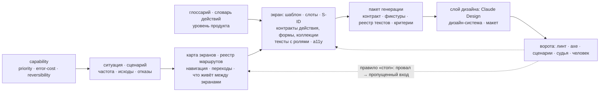

# UX-низ: дельта «как сейчас → что говорит база» (фаза 2)

Зона: interfaces (ситуации, зоны, блоки, субстраты), screens (слоты, дерево, состояния → контракт S01–S22), компоненты и
паттерны, обратная связь и ожидание, UX-тексты интерфейса, доступность, mobile, дефекты ИИ-генерации и контракт генерации
экранов, оценка (протокол, мастер-чек-лист, автопроверки, числа приёмки), граница с FSD. Бриф — `_skill-build/phase-2/BRIEF-ux.md`;
решения заказчика — `_skill-build/DECISIONS.md`; стык с верхом — `_skill-build/phase-2/ux/ux-верх.md` (§3.4, §3.6). Слой не
переписывается: ниже направления и гипотезы с доказательствами. Факты — с путями; собственные выводы — «(вывод)». Колонка
«направление», классы проверок и все предлагаемые id проверок (ST, RT, CP, TX, AX, MB, GC) — целиком вывод.

**Сокращения.** Ф1-0N — `_skill-build/phase-1/0N-*.md` (§ — раздел отчёта); UX-верх — отчёт соседнего агента (его id проверок:
CAP, MX, RL, GL, SC, IA, VS). Пути базы — от `ux-research/`: `06/01 §2` = `06-feedback-states-motion/01-state-matrix.md` §2
(номер папки / номер файла); `README` — корневой README базы (правила 1–60, реестр № 1–61); `YAML` —
`12-evaluation-checklists/master-checklist.yaml`. Пункты сводного чек-листа — `UX-<БЛОК>-<NN>`, автопроверки — `AC-<БЛОК>-<NN>`,
дефекты генерации — `F<N>.<M>` (`11/01`). Метки доказательности — легенда `README`.

**Классы проверок** (вывод): **скрипт** — детерминированно по артефактам слоя проекта (есть поле, значение из закрытого
словаря, счёт, граф, словарь слов); **модель** — чтение артефактов по рубрике; **макет** — только на собранном интерфейсе
(DOM, axe, сценарий, скриншот, судья): такая проверка уходит критерием приёмки в слой дизайна; **человек** — только человек на
живом продукте или устройстве.

---

## 0. Покрытие чтения

| файл | строк | прочитано | % |
|---|---|---|---|
| `_skill-build/phase-2/BRIEF-ux.md` | 71 | 1–71 | 100 |
| `_skill-build/DECISIONS.md` | 28 | 1–28 | 100 |
| Ф1-00 `00-summary.md` | 71 | 1–71 | 100 |
| Ф1-03 `03-current-rules.md` | 1659 | 1–120 (§0), 496–1659 (§2–§9; §7 — просмотр целиком) | 77 |
| Ф1-04 `04-quality.md` | 928 | 1–280 (Коротко, §1–§3), 440–928 (§6.2–§6.10, §7, §8) | 83 |
| Ф1-05 `05-gaps-and-insertion.md` | 489 | 1–145 (Коротко, §1 А–Г), 440–489 (§7) | 40 |
| UX-верх `ux-верх.md` | 438 | 1–62, 193–438 (§3.3–§8; обязательные §3.4, §3.6) | 70 |
| ux `README.md` | 872 | 1–120, 120–250, 250–450, 450–660, 660–872 (Read) | 100 |
| README папок 01–13 | 31 · 40 · 41 · 120 · 77 · 68 · 82 · 91 · 109 · 58 · 54 · 65 · 62 | целиком каждый | 100 |
| Реестр противоречий ux | `README` 666–775 | целиком | 100 |
| `06/01` state-matrix (контракт S01–S22) | 834 | 1–276 (выжимка, §1–§3), 300–313 (§4.3), 426–785 (§5–§8, ошибки, чек-лист, вопросы) | 78 |
| `11/04` constraints-prompts-and-checks (контракт генерации) | 799 | 1–250 (выжимка, §1–§2), 379–738 (§4–§7, чек-лист, вопросы) | 76 |
| `13/04` master-procedure | 1104 | 20–135 (выжимка, карта 30 шагов), 456–934 (шаги 14–30, §31) | 54 |
| `12/02` master-checklist | 1052 | 1–100, 717–836, 884–1023; все 434 пункта — через YAML | 34 (+100 % пунктов) |
| `YAML` master-checklist | 6205 | разобран скриптом целиком: id, текст, блок, серьёзность, способ | 100 |
| `12/03` automated-checks | 1127 | 1–382, 829–978; все 246 строк AC — скриптом (id, проверка, раздел, роль, «закрывает») | 47 (+100 % AC) |
| `12/01` expert-review-protocols | 1253 | 18–101 (выжимка), 498–567 (§6) | 12 |
| `12/04` metrics-and-user-testing | 1211 | 18–87 (выжимка), 422–449 (§4.5) | 8 |
| `11/01` failure-modes-catalog | 1038 | 1–165 (выжимка, §1–§2), оглавление F1.1–F13.4 | 16 |
| `11/02` research-and-benchmarks | 843 | 12–60 (выжимка, первые строки пунктов) | 6 |
| `11/03` tools-landscape | 584 | 15–80 (выжимка, §1), 252–290 (§2.5 Claude Design) | 18 |
| `03/01` page-anatomy-templates | 814 | 17–176 (выжимка, §1) | 20 |
| `03/04` placement-conventions | 609 | 17–49 (выжимка, первые строки пунктов) | 5 |
| `04/01`…`04/07` | 1088 · 883 · 1045 · 874 · 1252 · 1005 · 929 | выжимки целиком: 17–88 · 16–73 · 17–81 · 18–72 · 17–97 · 15–79 · 21–78; `04/05` §1.1–1.2 (115–154) | 6–10 |
| `04/08` · `04/09` · `04/10` | 763 · 982 · 796 | выжимки (первые строки пунктов): 19–67 · 26–81 · 21–79; `04/08` §2.2 (144–186); `04/10` §1.1–1.3 (80–135) | 7–15 |
| `05/02` task-flows | 1031 | 156–225 (§1.4 шаблон сценария), 752–820 (§9–§10) | 14 |
| `06/02` status-and-waiting | 1021 | 19–81 (выжимка) | 6 |
| `06/03` motion · `06/04` ethics | 801 · 1021 | выжимки (первые строки пунктов): 17–79 · 20–84 | 7 |
| `07/01` voice-and-tone | 1144 | 11–79 (выжимка, первые строки), 778–839 (§13) | 11 |
| `07/02` microcopy · `07/06` banned-words | 1126 · 729 | 11–67 (выжимка, первые строки) · 14–31 (выжимка), 487–501 (§7.2) | 5 · 4 |
| `08/01` wcag22-as-build-rules | 1333 | 25–106 (выжимка) | 6 |
| `08/02` · `08/03` · `08/04` | 1218 · 905 · 1082 | выжимки (первые строки пунктов): 20–80 · 19–70 · 23–83 | 5–6 |
| `09/01` responsive-strategy | 1047 | 20–111 (выжимка), 762–780 (§8 процедура) | 11 |
| `09/02` · `09/03` · `09/04` | 1174 · 1123 · 967 | выжимки (первые строки): 21–92 · 15–80; `09/04` — оглавление | 6 · 6 · 1 |
| `10/02` consistency-rules | 907 | 18–83 (выжимка, первые строки пунктов) | 7 |
| `01/03` frameworks-domain-to-screens | 885 | 351–450 (§8–§10), 576–630 (§11 шаги 6–7), оглавление | 18 |
| `00-glossary.md` | 398 | grep: зона, слот, субстрат, ситуация, регион | ≈ 2 |
| grep по базе (без `99-raw`, `91-videos`) | — | «субстрат/substrate» — 0 файлов; «FSD/Feature-Sliced» — 0; `not-found` в `06/01` — 0; «слот» — 8 файлов, термином нет; «тип зоны»; ссылки на соседние базы | доказательства «нет» |
| соседние базы (только пересечения) | — | листинги папок ui, site, text, creative; `ui/06-components-visual/07-states-matrix.md` 1–30; `ui/05-layout-grid/02-app-shells.md` 1–8; `text/06-anti-slop/lexicon/ux-07-06.yaml` 1–30 + счёт правил; `site/04-blocks/03-slots-and-page-plan.md` 1–24; корневые поля `site/04-blocks/*.schema.json`, `site/06-multipage-ia/site-map.schema.json`; grep ссылок на `ux-research` | — |

Шаблон репо заново не читался: всё «как сейчас» — по отчётам фазы 1.

---

## 1. Как сейчас (кратко)

- **interface** (Ф1-03 §3; Ф1-04 §6.2). Семь kind на поверхность; ситуация (17 колонок) — центр модели; субстрат — `type` из
  пяти (`команда · ввод · выбор · инфо · список`) плюс `name`; зона — «функционально-смысловая, не пространственная», без
  предела вложенности; блок — узел навигации и контейнер субстратов (`entrypoint`, переходы); `data-items` — без полей. У
  ситуации нет частоты, исходов кроме `exit-data`, ошибок, пустых, прав, ожидания, приоритета. Аудит — 25 правил: ссылки,
  зеркала, enum; «смысл» — списки слов; глобальной достижимости и «блока без выхода» нет, хотя аудит обещает «тупики навигации».
- **screens** (Ф1-03 §4; Ф1-04 §6.3). `flow · screen · block · shell`; дерево с префиксами `ui:`, `layout:`, `icon:`, `block:`,
  `data:` — псевдо-YAML, не парсится; словаря `ui:` и атрибутов нет (контракт снят в `1dd3a93`); 6 канон-состояний
  (`loading, empty, error, permission-denied, offline, not-found`) как delta-override слотов, для stable — все 6 или «не
  применимо» с пояснением; состояния в дереве блока запрещены; `route` — свободная строка, реестра и карты навигации нет
  («shell — не sitemap»); адаптив — `viewport: desktop / mobile / any`, `responsive` по `xs…xl` без ширин, структурный — через
  `flow`; тексты — дети дерева, формулирует аналитик; ассеты — референсы; 48 правил аудита; связь с capability — только
  state-заметка; макет — «wireframe и hi-fi автор макета собирает вручную».
- **Состояния по слоям** (Ф1-04 §2.9; Ф1-05 §1 А): screens — 6; mobile — 9 экранных, 5 виджетных, 4 оверлея; бот — `fallback`,
  `errors.backend-unavailable`, `errors.invalid-input`; FSD `shared-api` — `empty`, `populated`. Словари не согласованы.
- **Компоненты, ожидание, тексты** (Ф1-03 §4.4, §5, §7.1): контрактов действия, формы, коллекции, контейнера, сообщения для web
  нет; закрытый словарь элементов есть только у бота (6 виджетов, error); `shared-ui` FSD — «имя + семантика» без связи с
  `ui:`; длительностей и индикаторов ожидания нет; у текстов нет ролей, длин, реестра, тона; «формулировки скилл не подсказывает».
- **Доступность** — только термин (Ф1-04 §2.9). **mobile**: web — `flow`, `viewport`, `responsive`; нативный слой (12 kind, 54
  правила) строгий, но без композиции (Ф1-03 §6).
- **Генерация и оценка** (Ф1-03 §0.2, §9; Ф1-04 §2.2, §3, §7): контракта генерации, каталога дефектов, приёмки макета нет;
  скриптов нет — все проверки делает чтение LLM; тяжесть `error / warning / hint`; `last-report` перезаписывается.
- **FSD** (Ф1-03 §5): `pages.screen`, `widgets.block`, `features.situation`; `pages.guard` берёт `who` как роль доступа; `ui:` ↔
  `shared-ui` не сверяется; покрытия (экран без page, ситуация без feature) нет.

---

## 2. Дельта

| # | слой | как сейчас (Ф1) | что говорит база (путь §, метка) | разрыв | направление (вывод): правило · поле · проверка с критерием | прио |
|---|---|---|---|---|---|---|
| 1 | interface: ситуация | нет частоты, критичности, приоритета (Ф1-03 §3.4) | каталог задач с частотой и потребностью, «идеальный шторм» (`13/04` §7 `[практика]`); частота решает «на виду или в меню» (`04/10` §1.2 `[система]`) | нет | поле `frequency` (enum); обратимость наследуется от capability (UX-верх §3.4, CAP-10). Проверка: stable-ситуация без `frequency` — error; `команда` ежедневной ситуации спрятана в меню — warning | выс |
| 2 | interface: исходы | нет исходов кроме `exit-data`, ошибок, пустых, отказа в доступе, ожидания; состояние как ситуация запрещено (Ф1-03 §3.4) | happy path → ветвления → ошибки на каждом шаге → конечные состояния, до карты экранов; ревью сценарий почти не чинит (+0,03…0,12 из 5) (`05/02` §1.1, §1.4 `[консенсус]` / `[исследование]`) | нет | сценарий — UX-верх (гипотеза A, SC-01/02); у ситуации — список отказов (нет прав, лимит, отказ источника, блокировка) → вход для S13/S14/S18/S19/S21 экрана. Проверка: ситуация экрана без списка отказов или «нет» — warning@stable | выс |
| 3 | interface: зона | предела вложенности нет, только запрет цикла; «смыслом, не URL» (Ф1-03 §3.4) | ≤ 3 уровней, в сайдбаре ≤ 2; разделы — существительные; «Разное» — симптом (`README` правило 12 `[исследование]` / `[консенсус]`) | слабее | IA-01, IA-03 (UX-верх) на зонах + мост «корневая зона → пункт навигации» в screens (§3.3) | выс |
| 4 | interface: термин «зона» | зона — «группировка функционально-смысловая, не пространственная» (Ф1-03 §3.4) | «зона» — область экрана: «шапка страницы — обязательная зона»; «плотность едина внутри типа зоны» (`03/01` §2; `10/02` выжимка п.11; `README` правило 17) | противоречит (термин) | развести в глоссарии: смысловая зона interface ≠ регион экрана (слоты `shell`, `block-*`) | сред |
| 5 | interface: блок | R-SEM-005 локальна; нет достижимости от `entrypoint`, «хотя бы одного входа», «блока без выхода» (Ф1-03 §3.6; Ф1-04 §2.3) | каждый экран достижим из корня; тупиков нет, у конечных — «что дальше»; у перехода — обратный путь или пометка (`05/02` §9 `[практика]`; `01/03` §11 шаг 7 `[мнение]`; F1.1, F6.1 `[исследование]`) | слабее | графовые проверки на блоках (и RT-02/03 на экранах): все блоки достижимы от `entrypoint` своей роли; у не-конечного блока есть выход — error@stable | выс |
| 6 | interface: субстрат | `type` + `name`, «аналитика, не реализация»; связи с датумом нет (Ф1-03 §3.4) | у каждого семейства — контракт до генерации: действие — 7 полей (`04/10` §1.1 `[система]`), поле — 10 колонок (`04/05` §1.1 `[консенсус]`; 78 % против 42 % безошибочных отправок `[исследование]`), выбор — по числу вариантов × выборов (`04/06` §1 `[консенсус]`), коллекция — по объёму (`04/01` §2 `[система]`) | нет | типизированный контракт на субстрат (§3.4); CP-01…CP-07 | выс |
| 7 | interface: `data-items` | датум без полей; `data:<slug>.<field>` не определён; «один датум на двух поверхностях — две записи» (Ф1-03 §3.1, §3.4) | атрибуты с рангом, первые три идентифицируют; три числа на поле (мин, макс, среднее) до макета (`01/03` §5 `[мнение]`; `06/01` §6.3 `[практика]`) | нет | по DECISIONS 26.09 датум ссылается на объект продукта; `data:<объект>.<атрибут>` резолвится в глоссарий; у атрибута — длины → ширины и обрезка. Проверка: `data:` на несуществующий атрибут — error | выс |
| 8 | screens: словарь состояний | 6 канон-состояний на каждый экран; stable — все 6 или N/A (Ф1-03 §4.3) | закрытый список S01–S22; база 5 (S07, S01, S02, S04, S13) + по типу экрана (`06/01` §2, §3.1, §8.1 `[консенсус]`) | слабее + противоречит (обязательность) | §3.1; ST-01…ST-03 | выс |
| 9 | screens: уровень состояний | «❌ Inline-стейты (loading/empty) в дереве блока — это слой screen» (Ф1-03 §4.3) | у блока со своим источником — свои S07 и S13; отказ источника ломает один блок (`06/01` §5.3 `[практика]`; `README` правило 35); состояния — свойство компонента (`06/01` §7.1) | противоречит | `source: own` у блока ⇒ поле `states` блока (не inline) с S07/S13; S15 — на экране; ST-06 | выс |
| 10 | screens: содержание состояния | композиция + тексты-дети (Ф1-03 §4.3) | у состояния — что показать, что предложить, как проверить; тексты — заголовок, пояснение, подпись действия; пустое — причина + одно действие (`06/01` §2, §4, §8.1 `[консенсус]`) | слабее | роли текстов `title / explanation / action`; ST-04, ST-05 | выс |
| 11 | screens: объём и края данных | нет | три количества на блок, перечень крайних случаев, фикстуры (`06/01` §6; `11/04` §1.5 `[консенсус]`); объём задаёт инструменты: > 50 → пагинация и фильтр, > 8 колонок → управление колонками, ~1 000 → сервер (`04/01` §2 `[система]`; 200 / 1 000 / 10 000 — `[мнение]`) | нет | у коллекции `volume: {typical, max}`, число колонок; фикстуры на поверхность; CP-07, GC-02 | выс |
| 12 | screens: назначение экрана | `description`; `role` не enum (Ф1-03 §4.1) | строка карты экранов: объект, роли, тип шаблона (закрытый список из 11), главная задача, одно ключевое действие, плотность, точки входа, независимые блоки (`13/04` §14, §21 `[практика]`); одна primary на экран (`README` правило 16 `[система]`) | нет | поля `template` (enum), `main-task`, `key-action` (ссылка на действие), `density` (из постуры роли); RT-08, CP-02 | выс |
| 13 | screens: маршруты | `route` — строка, уникальность и формат не проверяются; `transitions` у flow обязательны в скилле и опциональны в форме (Ф1-03 §4.1, §4.6; Ф1-04 §2.5) | реестр маршрутов (маршрут, экран, параметры, доступ, состояние в URL, индексируется) + матрица переходов (из, в, чем вызван, что сохраняется, как вернуться); «маршруты вне списка — ошибка» (`13/04` §15; `05/02` §9; F1.1 `[исследование]`) | нет | реестр и матрица на поверхность; RT-01, RT-04, RT-06 | выс |
| 14 | screens: навигация | «❌ Не контракт навигации (sitemap)»; зоны в screens не доходят (Ф1-03 §4.3; Ф1-04 §6.3) | таблица навигации по ролям; один путь к разделу; в сайдбаре ≤ 2 уровней; активный раздел двумя признаками (`13/04` §16 `[практика]`; `README` правила 13–15 `[исследование]`) | нет | таблица навигации из корневых зон × ролей (§3.3); RT-05 | выс |
| 15 | screens: между экранами | нет | таблица «что переживает переход» (фильтры, сортировка, страница, прокрутка, выделение, черновик) + тест из 7 шагов; S3 = 0,0 у трёх из шести моделей (`05/05` §9; `13/04` §13 `[исследование]`) | нет | таблица на поверхность; RT-07; на макете — AC-SAV-01…07 | выс |
| 16 | screens: нотация | псевдо-YAML не парсится; `ui:` и атрибуты — свободные пометки; заявлена «детерминированная карта» (Ф1-03 §4.2; Ф1-04 §6.3) | инвентарь «один примитив на потребность» до генерации + правило заземления (`13/04` §18; `11/04` §1.3 `[система]`); закрытые списки убирают выдумки (F1.1 `[исследование]`); у сайта — `page-plan.schema.json` и валидатор (`site/04-blocks/03`) | противоречит (снятый контракт `@stit/ui`, Ф1-05 §1 Г) | валидный YAML или JSON Schema дерева; `ui:` ∈ инвентарь дизайн-системы (Claude Design, тип Design System — DECISIONS 26.09); проверка «дерево парсится» — error; CP-11 | выс |
| 17 | screens: облик в дереве | «атрибуты узлов (например, `variant=accent`) — свободные семантические пометки»; `gap=xs…lg`; «Tailwind-утилитами при ручной сборке» (Ф1-03 §4.2, §4.4) | уровни действия primary / secondary / tertiary (`03/03` §4 `[система]`); визуальные значения — `ui-research` (`README` «Что передано в ui») | противоречит (облик в слое проекта при «облик — в слое дизайна») | в дереве — `level: primary · secondary · tertiary · destructive` и группировка; `variant`, `size`, `gap` — слой дизайна; атрибут вне закрытого списка — warning | сред |
| 18 | screens: термин `flow` | `flow` — «viewport-вариативность», «❌ не situation»; в mobile `flows` — навигационный граф (Ф1-03 §4.3; Ф1-04 §2.1) | flow / сценарий — задача от входа до результата (`05/02` §1) | противоречит (термин) | переименовать screens `flow` (например, «адаптивная серия») или развести в глоссарии | низ |
| 19 | компоненты: действия | нет (только субстрат `команда`) | контракт действия; одна primary; частые — на виду, редкие и деструктивные — в «…»; недоступное — приглушить с причиной (`04/10` §1–§2 `[система]` / `[консенсус]`); отмена вместо подтверждения, лестница защиты (`05/03` §1, §7.2; `README` правила 7–9) | нет | CP-01…CP-03; связка с `error-cost` и `reversibility` capability (UX-верх CAP-10) | выс |
| 20 | компоненты: формы | нет | контракт формы; ≤ 6–7 полей на шаг; модалка ≤ 5 полей без прокрутки; кнопку не блокировать до нажатия; валидация по отправке, inline — где ответ неочевиден (`04/05` §1–§5; `README` правила 27–29; реестр № 5, 36); формы — слабейший компонент генерации (FullFront ≤ 0,60 `[исследование]`) | нет | контракт формы на `ввод` / `выбор`; CP-04…CP-06 | выс |
| 21 | компоненты: коллекции, фильтры, дашборды | нет | четыре задачи таблицы; пороги объёма; фильтры: ≤ 5 сверху, 6–8 с раскрытием, > 8 слева; чипы над результатами; состояние в URL; плитка без базы сравнения не показывается; дашборд — только по вопросам роли (`04/01`–`04/03`; `README` правила 22, 25, 26; реестр № 4, 43) | нет | `collection:` у блока (представление, объём, фильтры, сортировка по умолчанию, массовые действия); шаблон плитки; CP-07, CP-12 | сред |
| 22 | компоненты: оверлеи и сообщения | `route: modal:…`; слот `overlay` `accepts: block (modal/drawer)`; сообщений нет (Ф1-03 §4.1) | контейнер по семи критериям, модалка — не по умолчанию, строка таблицы — никогда в модалке; таблица «событие → форма» (15 строк); тост — не для ошибок; одно событие — одна форма (`04/07` §1–§2; `04/08` §2.2 `[консенсус]` / `[система]`; `README` правила 23, 32) | нет | колонка «контейнер» у действия (UX-верх: три колонки матрицы — UX-низ) + таблица «наши события → форма» на продукт; CP-08, CP-09 | сред |
| 23 | обратная связь и ожидание | только `loading` (Ф1-03 §4.3) | 0,1 / 1 / 10 с; индикатор по длительности и масштабу (скелетон — страница, спиннер — модуль, прогресс — процесс); > 30 с — в фон с пятью элементами; оптимистичное — только при редком отказе; свежесть данных видна (`06/02` `[исследование]` / `[консенсус]`; `README` правила 36–38) | нет | у действия `duration: < 1 с · 1–10 с · > 10 с · фон`; импликации `> 10 с ⇒ прогресс и «Прервать»`, `фон ⇒ S10`; CP-10 | сред |
| 24 | тексты: форма | тексты — дети дерева; ролей, длин, реестра, карты тона нет (Ф1-03 §4.4) | реестр текстов (ID, экран, элемент, тип, RU, EN, объект, действие, max-длина) (`13/04` §31); 31 роль узла — обязательный контекст линтера (`07/06` §7.2 `[система]`); длины по 23 типам (`07/01` §12); словари запретов (`07/06`); одно имя действия на поток (`07/01` §10 `[консенсус]`) | нет | у текстового узла `role` из закрытого списка; текст — в реестр, дерево держит ключ, намерение и класс длины (как `page-plan` сайта, `site/04-blocks/03` выжимка п.6); TX-01…TX-06 | выс |
| 25 | тексты: авторство | «Тексты доменных значений (label кнопки, route, описание блока) формулирует аналитик… формулировки скилл не подсказывает» (Ф1-03 §4.4) | «текст — такой же объект генерации, как раскладка», задаётся контрактом (`07/01` выжимка п.30); текст пишется до макета (`07/01` §13.1 `[консенсус]`) | противоречит (снимается DECISIONS 26.09 «допущение») | статус текста `допущение → утверждён`; TX-08 | выс |
| 26 | доступность | нет (Ф1-04 §2.9) | WCAG 2.2 AA — 55 критериев; соответствие — страница, процесс, каждый брейкпоинт и тема (`08/01` §1 `[стандарт]`); артефакт «доступность экрана» (`13/04` §23 `[консенсус]`); автоматика — 57 % дефектов и 32 % критериев (`08/04` `[исследование]`) | нет | цель — на уровне продукта (UX-верх VS-01); на экране — блок `a11y` (§3.5); AX-01…AX-07 | выс |
| 27 | mobile: web | `flow` desktop ↔ mobile; `viewport` без планшета; `responsive` по `xs…xl` без ширин; поведение `hidden` (Ф1-03 §4.1, §4.3) | мобильные сценарии — артефакт брифа; выбор реализации; диапазоны M3 — словарь правил, числа — в ui; пять вопросов M3 на шаблон; функциональность от ширины не меняется; master-detail на телефоне — две страницы (`09/01` §1–§4, §8; `09/02`; `README` правила 50–54) | слабее | §3.5; MB-01…MB-08 | сред |
| 28 | mobile: нативный слой | 9 экранных состояний, 5 виджетных; `states ⊇ {loading, error}` при сети (Ф1-03 §6.2) | S01–S22 (`06/01` §2); `update-required`, `maintenance` в списке нет, «плановые работы» — служебный экран (`13/04` §22 п.4) | слабее (словари расходятся) | общий словарь состояний web, mobile и бота (§3.1) | сред |
| 29 | дефекты ИИ | нет | каталог 52 дефектов F1.1–F13.4 с причиной, обнаружением, предотвращением (`11/01`); шаг процедуры помечен F, «шаг без F — кандидат на удаление» (`13/04` выжимка п.27 `[практика]`) | нет | у правила аудита — ссылка на предотвращаемые F; 34 из 52 закрываются входом (§3.2) | сред |
| 30 | контракт генерации | «screens → макет — звена нет» (Ф1-03 §2; Ф1-04 §3) | 9 блоков входа, шаблон, порядок, приёмка; «детальность входа — единственный фактор, улучшающий всё сразу» (`11/04` §1, §7.3 `[исследование]`); контракт собирается из артефактов (`13/04` §26) | нет | §3.2; GC-01, GC-02 | выс |
| 31 | оценка: реестр правил | правила с id у interface (25) и screens (48), у FSD — без id; «Без suppressions»; семантика — списки слов (Ф1-03 §3.6, §4.6; Ф1-04 §2.2) | 434 пункта `UX-*` (серьёзность B/S/D, способ, источник) и YAML; ворота против сигналов (`12/02` §1; `12/03` §1.2) | слабее | реестр аудита в формате YAML базы + способы `ART` / `MDL`; B/S/D ↔ error/warning/hint; трассировка на `UX-*` (§3.6) | сред |
| 32 | оценка: находка и отчёт | отчёт в чат + перезапись `last-report.md`; у `/cross-audit` — JSON с `evidence` и «пустой массив лучше натянутых находок» (Ф1-03 §3.6, §9) | находка из 6 полей (что, где, правило, доказательство, серьёзность, рекомендация); сильные стороны; ≤ 2 страниц, человеку — проблемы 3–4; серьёзность — отдельным проходом, среднее трёх; «ноль находок — неудавшийся прогон» (`12/01` §2.3, §3, §6.3–6.4, §10.1) | слабее (+ противоречит, §6 в) | у находки `rule-id` и доказательство; модельные проверки — ≥ 5 прогонов для сортировки, 11 для решения, с перестановкой (`12/03` §8.2) | сред |
| 33 | оценка: числа приёмки | нет; словарь целевых артефактов Ф1: «скриншоты 1440/768/390 → замечания ≤ 7 → стоп» (Ф1-05 §1 В) | ворота: 0 Critical/Serious, IR ≤ 0,15, Lighthouse ≥ 95, 0 заглушек, 0 чисел без источника, ветви состояний, проходы сценариев; CWV; ширины 320–1920 (`12/03` §10.1; UX-MOB-01) | нет | таблица чисел §3.6; ширины 320 и 360 обязательны (reflow 1.4.10) | сред |
| 34 | граница с FSD | `pages.screen` резолвится, покрытия нет; `guard` = `who`; `shared-ui` ↔ `ui:` не сверяется; `shared-api`: `empty`, `populated` (Ф1-03 §5) | о FSD — ничего (grep 0); даёт то, что FSD потребляет: реестр маршрутов с доступом, инвентарь компонентов, ветви состояний в коде (AC-LNT-15/16), режимы API | нет (граница) | §3.7 | сред |

---

## 3. Особо по зоне

### 3.1 Контракт S01–S22 против шести канон-состояний screens

**Сопоставление** (`06/01` §2, §3.1; Ф1-03 §4.3):

| канон screens | S-ID базы | обязательность в базе | разрыв |
|---|---|---|---|
| (неявно: `slot-fills` экрана) | «идеальное» — без S-ID, создаётся первым (`06/01` §1.1) | база | ок; у mobile — `populated` |
| `loading` | S07 `loading-initial` · S08 `loading-refresh` · S09 `loading-more` | S07 — база; S08 — база для списков и дашбордов; S09 — по типу | слабее: нет S08 «старые данные остаются видимыми» (UX-STA-07, F5.3) |
| `empty` | S01 `empty-first-run` · S02 `empty-filtered` · S03 `empty-cleared` | S01, S02 — база; S03 — по типу | слабее: три причины — три текста и три действия; S02 приоритетнее S01 |
| `error` | S13 `error-load` · S14 `error-action` · S15 `partial-failure` · S17 `timeout` | S13 — база; S14 — база для форм и действий; S15, S17 — по типу | слабее: «ввод сохранён» (S14), отказ одного блока (S15), «не утверждать провал» (S17) |
| `permission-denied` | S18 `no-permission` (+ S22 `read-only`) | S18 — база **для систем с ролями**; S22 — по типу | противоречит в обязательности (в репо — всем экранам); S22 нет |
| `offline` | S16 `offline` (+ S06 `stale`) | по типу: мобильные, полевые, длинные формы; S06 — живые данные | противоречит в обязательности; S06 нет |
| `not-found` | S-ID нет (grep); 404 — служебный экран маршрута (`13/04` §22 п.4; `05/04` §7 `[практика]`); «архивировано / удалено — не 404» = S20 | — | противоречит: в базе это не состояние экрана |
| — | S04 `partial-few` | **база** | нет: базового состояния нет |
| — | S05 `overflow-many` | по типу (коллекции) | нет |
| — | S10 `in-progress-background` · S11 `saving` · S12 `success` | S11 — база для форм и правки; S10, S12 — по типу | нет: группы «процесс» нет |
| — | S19 `locked` · S20 `archived-deleted` · S21 `limit-reached` | по типу | нет |

**Что требуется по типу экрана** (`06/01` §3.1: обязательные + в скобках по типу): список и таблица — S01, S02, S04, S05, S07,
S08, S13 (+ S03, S09, S15, S18, S21); карточка объекта — S07, S12, S13, S14 (+ S06, S18, S19, S20, S22); дашборд — S01, S04,
S07, S13, S15 (+ S06, S16, S18); форма — S07, S11, S12, S14 (+ S16, S18, S21, S22); поиск — S02, S07, S13 (+ S05, S09); лента
уведомлений — S01, S03, S07, S13 (+ S05, S09); файл — S07, S10, S11, S13, S14 (+ S16, S17, S21); настройки — S11, S12, S14
(+ S18, S21, S22); маршрут целиком — S07, S13, S18 (+ S16, S20); мастер — S07, S11, S14 (+ S10, S16, S17); экспорт и импорт —
S10, S12, S13 (+ S15, S17, S21). Типология `06/01` §3.1 (экраны и компоненты) не совпадает с закрытым списком шаблонов
`13/04` §14 — нужна таблица соответствия «шаблон → набор» (вывод).

**Что ещё есть в контракте базы и нет в репо.** Приоритет при конфликте: S18 > S16 > S13 > S07 > S02 > S01, S06 и S21
накладываются (`06/01` §2.5 `[мнение]`); у каждого состояния — «что показать · что предложить · как проверить» (`06/01` §2);
тексты состояния — заголовок, пояснение, подпись действия (`06/01` §8.1); состояния блока с собственным источником
(`06/01` §5.3 `[практика]`); 11 состояний интерактивного элемента (`06/01` §7.2); состояния среды — тема, reduced motion,
forced-colors, зум (`06/01` §7.3); крайние случаи данных как набор фикстур (`06/01` §6, §8.1). Доказательность: перечисление
поимённо — «единственный подтверждённый способ получить их от модели» (`06/01` выжимка п.2 `[консенсус]`), но сам эффект
перечисления не измерен (`11/04` открытые вопросы п.3; `README` «Что не покрыто»).

**Сильнее у репо** (Ф1-05 §1 А): явное «не применимо» с пояснением и ужесточение hint → error для stable. В контракте
состояний базы исключений нет — «отсутствие любой из пяти базовых ветвей — дефект, а не упрощение» (`06/01` §1.2); форма
«есть / не нужно, потому что…» у базы есть только для служебных экранов (`13/04` §22). Сохранить механизм репо (вывод).

**Направление (вывод).**
1. Ключи `states` — закрытый словарь S01–S22, идеальное — по умолчанию; у значения — `when` (условие, опционально),
   delta-override слотов (как сейчас), тексты с ролями `title / explanation / action` либо `N/A: причина`.
2. Обязательный набор экрана = база-5 (если есть данные) ∪ набор шаблона ∪ S18 (если доступ к маршруту ограничен в реестре) ∪
   S16 (если поверхность объявила офлайн) ∪ S06 (если данные живые). `not-found` — служебный экран в реестре маршрутов, не
   состояние.
3. Состояния блока — полем `states` у блока с `source: own` (S07, S13), не inline в дереве; S15 — на экране.
4. Правило приоритета — один раз в каноне слоя, не в каждом экране.
5. Один словарь для web, mobile и бота: S01–S22 плюс `update-required`, `maintenance` (mobile) как служебные. Бот: `fallback`
   ↔ S13 / S06, `errors.backend-unavailable` ↔ S13, `errors.invalid-input` ↔ S14, пустая коллекция ↔ S01 / S02, `paginated` ↔ S05.
6. 11 состояний элемента и состояния среды — дизайн-системе (слой дизайна); в проекте — только ссылка на компонент.

**Проверки** («скрипт» — при структурированном YAML):

| id | что | способ | тяжесть | основание |
|---|---|---|---|---|
| ST-01 | ключи `states` ∈ S01–S22 | скрипт | error | `06/01` §2 |
| ST-02 | экран с данными: `states ⊇ {S07, S01, S02, S04, S13}`; каждое — override или `N/A: причина` | скрипт | warning → error@stable | `06/01` §8.1; UX-STA-01 (B) |
| ST-03 | `states ⊇ набор(template)` по `06/01` §3.1 | скрипт | warning → error@stable | `06/01` §3.1 |
| ST-04 | тексты S01, S02, S03 попарно различны | скрипт | warning | UX-STA-02, UX-TXT-07 |
| ST-05 | в S01/S02 есть заголовок и ≤ 1 действия уровня primary; в S02 — `data:query` и сброс фильтров; override пустого снимает шапку таблицы | скрипт | error | UX-STA-03/04/06 |
| ST-06 | блок с `source: own` ⇒ у блока S07 и S13 | скрипт | error@stable | `06/01` §5.3 |
| ST-07 | маршрут с ограниченным доступом ⇒ S18 на экране, отличный от пустого и от 404 | скрипт | error | UX-STA-10; `06/01` §3.1 |
| ST-08 | коллекция с `volume.max` выше порога ⇒ S05 | скрипт | warning | `04/01` §2 |
| ST-09 | тексты S13/S14 проходят лексикон (нет «Произошла ошибка», «Что-то пошло не так») | скрипт | error | AC-TXT-04 |
| ST-10 | текст ошибки называет причину и следующий шаг | модель | warning | `06/01` §5.2; UX-STA-09 |

На макете то же проверяют AC-LNT-15/16, AC-SCF-09…13, AC-AXE-03…05 и три режима API «пусто / задержка 3 с / 500» (`06/01`
§8.3): колонка «как проверить» таблицы S-состояний — готовые критерии приёмки для слоя дизайна.

### 3.2 Контракт генерации экранов: чтобы цепочка дошла до макета

**Блоки контракта и их источники** (`11/04` §7.3; `13/04` §26):

| блок контракта | чем заполняется по базе | в репо сейчас | куда ляжет (гипотеза) | проверка |
|---|---|---|---|---|
| Контекст продукта: пользователи, задача экрана, ключевое действие, выводы как ограничения, плотность | шаги 1–4, 7 | vision (узкий), `user`, `who` без постуры; у экрана — `description` | роли и постуры, vision (UX-верх); карта экранов: задача, ключевое действие, плотность | UX-PRE-01/02/04 → скрипт (наличие); качество — модель |
| Объектная модель: сущности и поля, действия, права | шаги 5, 6, 8, 9 | `data-items` без полей; прав нет | глоссарий и словарь действий на уровне продукта (DECISIONS 26.09); матрица — вычисляемая (UX-верх) | UX-PRE-05 → скрипт |
| Карта экранов: маршруты, переходы, что живёт между экранами, запрет | шаги 13–15 | папки screens; `route` — строка; переходы опциональны | карта экранов, реестр маршрутов, матрица переходов, таблица переживания перехода — на поверхность | RT-01…RT-08; UX-PRE-06/07 |
| Дизайн-система: источник, токены, конвенции размещения, заземление | шаг 18 + токены из ui | облик запрещён; `ui:` свободны; FSD `shared-ui` | слой дизайна: Claude Design, тип Design System; в screens — ссылки на инвентарь; конвенции «одно на продукт» — развилка (§4) | CP-11; UX-PRE-09 → слой дизайна |
| Обязательные состояния по экрану | шаг 21 | 6 канон | S-ID по экрану и блоку (§3.1) | ST-01…ST-10; UX-PRE-08 |
| Данные: фикстуры с граничными случаями, запрет выдуманных чисел | шаг 12 | нет; FSD `shared-api`: `empty`, `populated` | фикстуры на поверхность (развилка: screens или FSD, §3.7) | GC-02; UX-PRE-10/14 |
| Тексты: глоссарий, правила, запрещённые слова | шаг 6 + `07/*` | тексты-дети без ролей | реестр текстов с ролями + глоссарий + лексикон | TX-01…TX-08; UX-PRE-11 |
| Запреты (коротко, только для сильной модели) | шаги 20–21, `06/04` §8.1 (22 пункта) | лексические R-SEM про облик | список из F11.1, F13.1 и этики; при «только Opus 5.5» включать (UX-PRE-13 снимается) | — |
| Примеры: эталонный экран кодом + описание взаимодействий текстом | — | ассеты-референсы (картинки) | эталон и стартер — слой дизайна; текст взаимодействий — из матрицы переходов и контракта действий (проект) | UX-PRE-12 |
| Критерии приёмки | шаги 29–30 | тест-критерий записи; аудит формы | артефактные проверки проекта + ворота слоя дизайна (§3.6) | UX-OUT-* |

**Цепочка (гипотеза):**

Порядок генерации базы: контекст → сценарии → карта экранов → каркас один раз → данные → экраны по одному → тексты →
состояния → проверки (`11/04` §2.1; `13/04` §26 `[консенсус]`, прямо не измерен). (вывод) Слой проекта отдаёт первые три
пункта плюс списки данных, текстов и состояний; слой дизайна исполняет каркас, экраны и проверки.

**Какие дефекты закрывает вход, а какие — исполнение** (вывод по `11/01` §3–§15 и колонке F карты `13/04` §1):

| закрывается входом — слой проекта (34) | закрывается исполнением — слой дизайна и кода (18) |
|---|---|
| F1.1–F1.4 маршруты и навигация; F2.2 приоритет (проект задаёт, дизайн исполняет); F3.1–F3.3 дашборды; F4.1–F4.5 формы, таблицы, кнопки, контролы, модалки; F5.1–F5.5 состояния; F6.1–F6.4 сценарии, переходы, защита деструктива; F7.1–F7.4 тексты; F8.1–F8.3 повторы и одно решение одной задачи; F9.4 hover-only (альтернативы объявлены); F10.1 трансформация (таблица шаблонов); F12.1–F12.3 данные и выдуманные функции | F2.1, F2.3–F2.5 раскладка; F8.4 правка ломает соседние экраны; F9.1–F9.3, F9.5 доступность исполнения; F10.2 цели нажатия; F11.1–F11.4 интерактив; F13.1–F13.4 слоп-эстетика |

**Правило «стоп» как обратная связь в слой проекта** (`12/03` §10.4 `[исследование]`: «если после k вариантов ни один не
прошёл ворота — проблема во входном контракте»):

| что массово провалилось в макете | пропущенный вход (база) | проверка слоя проекта |
|---|---|---|
| состояния (AC-LNT-15, AC-SCF-09…13) | UX-PRE-08 | ST-02, ST-03 |
| маршруты и тупики (AC-NAV-11/12) | UX-PRE-06 | RT-01…RT-03 |
| переживание перехода (AC-SAV-01…07) | UX-PRE-07 | RT-07 |
| тексты и числа (AC-TXT-01…03) | UX-PRE-10/11 | GC-02, TX-02 |
| компоненты вне системы (AC-BLD-06) | UX-PRE-09 | CP-11 |
| формы (AC-FRM-*, AC-SCF-01…08) | UX-PRE-15 | CP-04…CP-06 |
| доступность (`12/03` §5.4) | UX-PRE-18 | AX-01; VS-01 (UX-верх) |

**Claude Design и контракт.** Ни один из изученных инструментов, включая Claude Design, не проверяет наличие состояний,
проходимость сценариев, достижимость маршрутов, соответствие текстов словарю и реалистичность данных (`11/03` §1 «Чего нет
ни у кого» `[консенсус]`, выжимка п.16); DESIGN.md не покрывает UX — нет карты экранов, объектной модели, состояний
(`11/03` выжимка п.9). Claude Design строит дизайн-систему из кода и файлов дизайна, правка — комментарии и «ручки», передача —
handoff bundle в Claude Code (`11/03` §2.5 `[система]`, состояние на 17.04.2026). (вывод) Ворота по состояниям, сценариям,
маршрутам, текстам и данным могут жить только в слое проекта и в приёмке; контракт держать инструмент-нейтральным, как в
`11/04`, — по DECISIONS 26.09 правила типа Claude Design в скиллы не копируются.

**Проверки пакета:**

| id | что | способ | тяжесть | основание |
|---|---|---|---|---|
| GC-01 | контракт экрана собирается из stable-артефактов: каждый блок `11/04` §7.3 непуст или `N/A: причина` | скрипт | error для «готово к дизайну» | UX-PRC-13; `13/04` §26 |
| GC-02 | фикстуры есть у каждой коллекции: 0 / 1 / 500 / 5 000, длинная строка, отсутствующая связь, ноль, отрицательное, экзотическое имя, другой часовой пояс; нет «John Doe», «10k+», «lorem» | скрипт | error | `06/01` §8.1; `11/04` §1.5; AC-TXT-01/02 |

### 3.3 Связь ИА ↔ screens

| звено | база | в репо | мост (вывод) | проверка |
|---|---|---|---|---|
| разделы | ИА до навигации; ≤ 3 уровней, сайдбар ≤ 2; существительные; порядок по частоте (`README` правила 12, 15; `02` README п.1 `[консенсус]`) | `zone` + `parent-zone` без предела | корневая зона → пункт 1-го уровня; вложенная → 2-й; 3-й уровень — только вкладки объекта (2–7) | IA-01, IA-03 (UX-верх); RT-05 |
| навигация по ролям | таблица навигации (`13/04` §16); недоступное приглушено с причиной, скрыто — только то, чего у роли нет в принципе (`04/10` выжимка п.8; `04/09` п.18 `[консенсус]`) | `block.who`, `transition-from-zone`; `who` — «не ACL» | пункт виден роли, если в матрице есть действие над объектом раздела (UX-верх, MX) | RT-05; UX-NAV-02/03/05 |
| каркас | выбирается после ИА по числу пунктов: слева для приложений, сверху — когда пунктов мало (`README` правило 13) | `shell` — слоты, «не sitemap» | shell остаётся капсулой; навигация — отдельная таблица, пункты — в слот `side` | UX-NAV-06 (макет) |
| вход | главный экран роли — рабочая очередь или «что происходит / что дальше» (`README` правило 26; UX-ADM-03, UX-CLI-04) | `block.entrypoint` | блок с `entrypoint` → стартовый экран роли в реестре | RT-02 |
| переходы | матрица «из → в → чем → что сохраняется → как вернуться»; с карточки достижимы все связанные объекты (`13/04` §15; `01/03` §11 шаг 7) | `transition-to-block`; `transitions-to-screen` опц. | переходы блоков → строки матрицы; связи объектов → обязательные переходы | RT-03, RT-04 |
| адресуемость | реестр маршрутов; состояние списка в URL; крошки — от трёх уровней (`README` правила 11, 15) | `route` — строка | реестр маршрутов на поверхность | RT-01, RT-06 |

| id | что | способ | тяжесть | основание |
|---|---|---|---|---|
| RT-01 | у экрана маршрут из реестра; маршруты уникальны; цели переходов, `mobile-of`, ссылки — в реестре; `not-found` — служебный маршрут | скрипт | error | `13/04` §15; F1.1 `[исследование]` |
| RT-02 | каждый экран достижим от стартового экрана своей роли по таблице навигации и матрице переходов | скрипт | error@stable | `05/02` §9; UX-BLD-06 (B) |
| RT-03 | у экрана ≥ 1 исходящий переход либо `terminal` и ≥ 2 «что дальше» | скрипт | error | UX-BLD-12 (B); SC-02 (UX-верх) |
| RT-04 | у перехода есть обратный путь или пометка `irreversible` | скрипт | warning | `05/02` §9 |
| RT-05 | навигация: сайдбар ≤ 2 уровней; пункт не дублируется в двух панелях; состав и порядок не зависят от экрана | скрипт | error / warning | UX-NAV-02/03/05; `README` правило 15 |
| RT-06 | у маршрута списка заполнено «состояние в URL» (фильтры, сортировка, страница) | скрипт | warning | UX-DAT-13 (B) |
| RT-07 | таблица «что переживает переход» есть, у каждой строки — проверочный сценарий (включая «свернуть и вернуться») | скрипт | warning → error@stable | `05/05` §9; UX-PRE-07 (B) |
| RT-08 | `template` ∈ закрытый список; при ≥ 4 экранах шаблоны не все одинаковы; экран без объекта и роли — с обоснованием | скрипт | warning | `13/04` §14 |

(вывод) ИА держать в interface (зоны), навигацию и адресуемость — в screens: тогда мост «зона → раздел → маршрут»
проверяется по slug, как остальное звено interface → screens.

### 3.4 Компоненты и паттерны ↔ блоки и зоны

Понятий «субстрат» и «ситуация как сущность» в базе нет (grep «субстрат / substrate» — 0 файлов; «ситуация» — только в job
story, `01/03` §8.1). Но пять типов субстрата почти совпадают с семействами компонентов базы (вывод):

| `ux-substrate.type` | семейство базы | контракт базы (поля) | куда (гипотеза) | проверки |
|---|---|---|---|---|
| `команда` | действие (`04/10` §1) | имя из словаря · объект · кто может · уровень (primary / secondary / в меню / контекстное) · результат (форма сообщения) · состояния · обратимость; плюс контейнер (`04/07` §1) и защита (`05/03` §7.2) | interface: ссылка на действие словаря продукта; screens: уровень, контейнер, форма результата | CP-01…CP-03, CP-08, CP-09, TX-04 |
| `ввод` | поле формы (`04/05` §1.1) | поле · тип данных · контрол · обязательность · формат · мин–макс · валидация · текст ошибки · умолчание · `autocomplete` (+ `inputmode`, `enterkeyhint` — `09/03` п.12) | screens: контракт формы блока; тип и длины — из атрибута объекта | CP-04, CP-06 |
| `выбор` | контрол выбора (`04/06` §1) | число вариантов × число выборов; известно ли значение; нужен ли обзор; мгновенно ли; предвыбор (реестр № 35) | screens; число вариантов — из enum атрибута | CP-05 |
| `инфо` | представление объекта, статусы, плитка (`01/03` §2; `13/04` §10; `04/04` §5; `04/03` §4.3) | атрибуты по рангу, первые три неизменны; словарь статусов; шаблон плитки (вопрос, величина, база сравнения, направление «хорошо», пороги, период, куда ведёт, нет данных) | таблица представлений — рядом с глоссарием (гипотеза, §6 г); в screens — `data:<объект>` + контекст представления | CP-12; UX-CNS-07/08 |
| `список` | коллекция (`04/01`, `04/02`, `04/04`) | задача (найти, сравнить, одна запись, действовать) → таблица / список / карточки / master-detail; объём → инструменты; фильтры по числу; сортировка по умолчанию; массовые действия; состояния | screens: `collection:` у блока | CP-07, ST-08 |

**Шаблоны и слоты.** Каркас базы — полосы, рейки, панели; шапка страницы обязательна (путь назад, H1, статус, одна primary
справа); инспектор справа, навигация слева; ≤ 3 панелей; 11 закрытых шаблонов экранов (`03/01` §1–§12 `[система]` /
`[консенсус]`; `13/04` §14). В репо — `shell.slots` (`side`, `main`, `detail`, `overlay`) с `accepts` и `responsive` (Ф1-03 §4.1):
механика слотов сильнее базы (закрытый `accepts`, override состояний по слотам), но шаблона, шапки страницы и порядка
регионов нет. Композиций уровня страницы нет ни в одном из 95 каталогов (`10/01` §3.3 `[данные]`) — их состав задаёт проект
(`13/04` §18 (2)). (вывод) Шапка страницы, каркас приложения, список, карточка, master-detail — обязательные композиции
screens с закрытыми слотами.

**Представления объекта** (`README` «Практика и спорное»: `[мнение]`, но повторяется в пяти папках): выводятся один раз и
переиспользуются; порядок первых трёх атрибутов не меняется. По решению «модель объектов — на уровне продукта» — кандидат
жить рядом с глоссарием, а не в каждой поверхности (развилка с UX-верх, §6 г).

| id | что | способ | тяжесть | основание |
|---|---|---|---|---|
| CP-01 | `команда` ⇒ контракт действия полон: имя ∈ словарь; роли ⊆ матрица; уровень ∈ enum; результат ∈ таблица «событие → форма»; обратимость ∈ {undo, подтверждение, необратимо} | скрипт | error@stable | `04/10` §1.1; UX-ACT-01 |
| CP-02 | ≤ 1 primary на экран или независимую секцию; деструктивное — не primary и не умолчание | скрипт | error | UX-LAY-02; UX-ACT-06 (B) |
| CP-03 | `необратимо` ⇒ задана ступень защиты; частое обратимое — отмена, без подтверждения | скрипт | warning | `05/03` §1, §7.2; UX-ACT-07/11 |
| CP-04 | `ввод` ⇒ строка контракта формы полна | скрипт | error@stable | `04/05` §1.1; UX-PRE-15 (B) |
| CP-05 | контрол согласован с числом вариантов и выборов (≤ 5 — радио, 5–15 — селект, > 15 — комбобокс, несколько — чекбоксы; нет `select multiple`; булево — не в дропдауне) | скрипт | warning | `04/06` §1; UX-FRM-21/22 |
| CP-06 | ≤ 7 полей на шаг; форма в модалке ≤ 5 полей без вкладок и аккордеонов; согласия по умолчанию выключены | скрипт | warning / error | UX-FRM-19/20/24 |
| CP-07 | у коллекции объявлен объём; > 50 ⇒ пагинация и поиск или фильтр в дереве; > 8 колонок ⇒ управление колонками; ~1 000 ⇒ серверные операции | скрипт | error | `04/01` §2; UX-DAT-02/04/05 |
| CP-08 | модалка — только если инициатор человек, контекст не нужен, ≤ 5 полей, без прокрутки и вложенности; правка строки — не в модалке | скрипт | warning | `04/07` §1.3; UX-DAT-16; UX-OVL-05 |
| CP-09 | таблица «событие → форма»: ошибка — не тостом; одно событие — одна форма; тост с действием не исчезает сам | скрипт | error | `04/08` §2.2, §7.1; UX-OVL-13/17 |
| CP-10 | `duration` действия: > 10 с ⇒ прогресс и «Прервать»; фон ⇒ S10 с пятью элементами | скрипт | warning | `06/02` §2, §5.2 |
| CP-11 | `ui:` ∈ инвентарь дизайн-системы; одна потребность — один примитив | скрипт | error | `13/04` §18; UX-CNS-10 |
| CP-12 | плитка показателя ⇒ шаблон заполнен; в верхнем ряду 3–6 плиток | скрипт | warning | `04/03` §4.3; UX-DAT-17/18 |

**Тексты компонентов** (`07/01`, `07/02`, `07/06`):

| id | что | способ | тяжесть | основание |
|---|---|---|---|---|
| TX-01 | у текстового узла `role` из закрытого списка (31 роль) | скрипт | error@stable | `07/06` §7.2 |
| TX-02 | лексикон ux 07/06 по ролям; исполнимая копия уже есть — `text-research/06-anti-slop/lexicon/ux-07-06.yaml`, 318 правил с `appliesTo` | скрипт | error / warning | `07/06` §7; AC-TXT-11…16 |
| TX-03 | длины по роли: кнопка 1–3 слова (до 4 с объектом), вкладка 1–2, подпись поля 1–3, тост — одна строка | скрипт | warning | `07/01` §12; реестр № 47 |
| TX-04 | имя действия одно в кнопке, заголовке диалога, тосте, статусе | скрипт | error | `07/01` §10; UX-TXT-02 |
| TX-05 | запрещённые синонимы глоссария в текстах | скрипт | warning | UX-TXT-10; GL-02 (UX-верх) |
| TX-06 | подстановки `{…}` — из `data:`; нет склейки строк и подстановки после предлога косвенного падежа | скрипт | warning | UX-TXT-15/16 |
| TX-07 | тон, вина, юмор, формула ошибки «что — почему — что сделать» | модель | warning | UX-TXT-03/04/22 |
| TX-08 | stable-экран с текстом в статусе `допущение` | скрипт | error@stable | DECISIONS 26.09 |

### 3.5 Доступность и mobile как правила сборки

Позиция базы: «требования на входе → k вариантов → автопроверка → отбор по метрике → ручной проход»; починка отчётом
аудитора снижает IR 0,40 → 0,32 и вносит новые нарушения, отбор лучшего из восьми даёт 0,14 (`08/04` выжимка п.20, п.24;
`README` правило 49 `[исследование]`). Значит, в слое проекта — объявления и структура, в слое дизайна — исполнение и ворота
(вывод).

**Доступность:**

| что объявляет слой проекта | правило базы | проверка проекта | на макете |
|---|---|---|---|
| цель WCAG 2.2 AA; соответствие — страница, процесс, брейкпоинт, тема | `08/01` §1.1–1.2 `[стандарт]` | VS-01 (UX-верх) | UX-OUT-03/04: axe × 2 темы × 4 ширины; 0 Critical/Serious; IR ≤ 0,15 |
| карта лендмарков из слотов shell; один H1; иерархия заголовков; заголовок у маршрута | `08/02` п.9–10; `13/04` §23 | AX-01: ровно один узел H1; `main` — один; у маршрута есть заголовок | AC-DOM-01…06 |
| клавиатура: Tab — между компонентами, стрелки — внутри; составной `ui:` → паттерн APG | `08/02` п.14, §8 | AX-02: у составного компонента указан паттерн APG | AC-SCN-03 (только клавиатура) |
| управление фокусом: оверлей, удаление строки, смена маршрута, ошибка формы | `08/02` п.17–20 | AX-03: для оверлеев и форм объявлено | AC-A11-07; AC-SCF-16 |
| альтернативы: перетаскивание → один указатель и клавиатура; наведение → видимый путь | `08/01` п.9; `08/03` п.23 `[стандарт]` | AX-04: у каждого перетаскивания обе альтернативы | AC-A11-13; AC-LNT-07 |
| не только цвет | `08/01` п.13 | AX-05: статус в словаре — текст + иконка | UX-A11-13 (картинка) |
| помощь в одном месте (3.2.6) | `08/01` п.12 | AX-06: слот помощи один в shell | AC-A11-18 |
| повторный ввод (3.3.7), вставка в поля входа (3.3.8), лимит времени (≥ 20 с, продление ×10) | `08/01` п.10–11; `README` правило 11 | AX-07: сценарий не спрашивает поле дважды; служебный сценарий «истечение сессии» есть | AC-FLW-12; AC-A11-12; AC-FLW-14 |
| объявления: статус без перевода фокуса, живая область — последнее средство | `08/03` п.14–15 | для S02, S11, S12 указано, что объявляется | AC-A11-14/15 |
| шесть ручных проходов | `08/04` п.19 | — | человек |

**Mobile:**

| что объявляет слой проекта | правило базы | проверка |
|---|---|---|
| сценарии на телефоне по ролям или «нет» с обоснованием | `09/01` §1, §8 шаг 1 `[консенсус]` | VS-06 (UX-верх) |
| способ реализации (адаптив / m.site / PWA / нативное) с отвергнутыми вариантами; desktop-first для плотной админки, mobile-first для клиентского сервиса | `09/01` §2, §3.3, §8 шаги 2–3 | MB-01: у поверхности записано решение |
| трансформация каждого шаблона: пять вопросов M3 (reveal, divide, resize, reposition, swap) | `09/01` §8 шаг 5; `03/01` §13 | MB-02: у шаблона есть таблица трансформации |
| функциональность от ширины не меняется, перестройка обратима | `09/01` выжимка п.8–9 `[система]` | MB-03: `responsive: hidden` ⇒ функции слота доступны иначе |
| навигация: 3–5 разделов → нижняя панель с подписями; ≥ 6 → выдвижная панель или рейка | `09/02` п.1–7 | MB-04 |
| master-detail на телефоне — две страницы | `09/02` п.19 | MB-05: у `master-detail` есть мобильная серия из двух экранов |
| таблица: > 3–4 колонок или многословная колонка → карточки; пять способов по росту потерь | `09/03` п.1–4 | MB-06: у коллекции объявлен способ |
| модалка → полноэкранный диалог или нижняя шторка | `04/07` §1.4; `09/03` п.24 | MB-07: поведение `overlay` на узком — из закрытого списка |
| диапазоны M3 — словарь правил, числа — в ui | `09/01` §4.1 `[спорно]`; реестр № 27 | MB-08: класс medium (600–839) есть или `N/A` |
| состояние переживает сворачивание вкладки (мобильная сессия — 72 с) | `09/01` п.13, п.25 | RT-07 |

(вывод) Токены `xs…xl` без ширин в репо совпадают с позицией базы «числа — в ui»; не хватает сопоставления имён с диапазонами
(слой дизайна) и класса medium — планшета. Нативный слой `mobile` чек-лист базы не покрывает: все 24 пункта MOB — про
мобильный web (вьюпорт, зум, `svh`, safe area, hover-медиазапросы). Там остаются собственные 54 правила репо плюс общий
словарь состояний.

### 3.6 434 пункта и 246 автопроверок: что станет проверкой аудита

**Как размечено.** Каждый из 434 пунктов `YAML` отнесён к одному классу по формулировке (вывод, ручная разметка, один
проход): **скрипт** — требование проверяемо на артефактах слоя проекта, если они структурированы; **модель** — только
чтением артефактов; **макет** — только на собранном интерфейсе; **человек**. Скрипт на артефакте — это «двойник»: он
проверяет, что требование задано; исполнение проверяет макет.

| блок | всего | скрипт | модель | макет | человек | скрипт: номера пунктов |
|---|---|---|---|---|---|---|
| PRE | 18 | 14 | 1 (03) | 2 (09, 12) | — | 01–02, 04–08, 10–11, 14–18; 13 снят решением |
| BLD | 12 | 2 | — | 10 | — | 06, 12 |
| A11 | 22 | 5 | — | 17 | — | 06–07, 15, 18, 22 |
| STA | 18 | 9 | — | 9 | — | 01–04, 06, 10–11, 13, 16 |
| NAV | 15 | 7 | 2 (01, 15) | 6 | — | 02–03, 05, 07, 09, 13–14 |
| LAY | 18 | 6 | — | 12 | — | 02–03, 11, 14–16 |
| FRM | 28 | 10 | — | 18 | — | 10, 12, 16–17, 19–22, 24, 27 |
| DAT | 25 | 14 | 3 (01, 17, 24) | 8 | — | 02–06, 08, 12–13, 15–16, 18, 21–23 |
| OVL | 18 | 5 | 1 (03) | 12 | — | 01, 05, 09, 13, 17 |
| FLW | 20 | 8 | 1 (05) | 11 | — | 06, 09–12, 14, 16–17 |
| ACT | 18 | 10 | — | 8 | — | 01–07, 11–12, 15 |
| SET | 16 | 10 | — | 6 | — | 01–05, 07–08, 10, 12, 16 |
| FBK | 16 | 2 | 1 (05) | 13 | — | 06, 08 |
| ETH | 14 | 6 | — | 8 | — | 02–03, 07, 09, 13–14 |
| AIG | 14 | 2 | 1 (05) | 11 | — | 01, 03 |
| TXT | 23 | 16 | 4 (03–04, 11, 22) | 3 | — | 01–02, 05–10, 12–16, 18, 20–21 |
| MOB | 24 | 4 | — | 18 | 2 (22–23) | 06–07, 16, 24 |
| CNS | 29 | 10 | 1 (22) | 18 | — | 06–08, 10–12, 14, 16, 20, 25 |
| APP · ADM | 19 | 12 | 4 (02–03, 05, 18) | 3 | — | 01, 04, 06–08, 10–12, 14–16, 19 |
| APP · CLI | 19 | 15 | 2 (04, 08) | 2 | — | 01–03, 05–07, 09–10, 12–18 |
| APP · AIF | 19 | 9 | 1 (08) | 8 | 1 (19) | 01–03, 07, 09–11, 15–16 |
| APP · PRC | 15 | 13 | 1 (02) | 1 | — | 01, 03–14 |
| OUT | 14 | 2 | — | 10 | 2 (07, 13) | 12, 14 |
| **итого** | **434** | **191** | **23** | **214** | **5** | + 1 снят (UX-PRE-13) |

**Что это значит** (вывод):
- **191 пункт (44 %) — скрипт на артефактах**, из них 48 блокеров. У этих пунктов основной способ в базе — DOM 78, сценарий 49,
  человек 46, линтер или axe 15, картинка или судья 3: на макете они проверяют исполнение, на артефакте — что требование
  вообще задано. Скрипт
  возможен только при структурированных артефактах: карта экранов, реестр маршрутов, таблица навигации, S-ID, контракты
  действия и формы, `collection:`, реестр текстов с ролями, фикстуры, таблица «событие → форма».
- **23 пункта (5 %) — только модель**: смысл, а не форма (навигация выведена из задач, а не из шаблона — UX-NAV-01; поиск не
  подменяет навигацию — NAV-15; выбор представления обоснован — DAT-01; база сравнения осмысленна — DAT-17; главный экран
  роли — рабочая очередь — ADM-03; тон и формула ошибки — TXT-03/04/22). Нормы модельной проверки — ≥ 5 прогонов для
  сортировки, 11 для решения, перестановка, версия рубрики (`12/03` §8.2; `README` правило 58).
- **214 пунктов (49 %) — только макет, 5 — человек**: остаются критериями приёмки слоя дизайна; слой проекта держит их id в
  пакете генерации.
- **Из 81 пункта, которые база помечает только `HUM` / `JDG`, 44 на артефактах становятся скриптом и 19 — чтением модели**: в
  базе «человек» значит «на сгенерированном интерфейсе автоматом не проверить», а на артефакте проверяется наличие решения.
  Это расширяет наблюдение UX-верх §7 п.4 с блока PRE на все блоки.
- **UX-PRE-13 снимается решением** «только Claude Opus 5.5»: словарь запретов вреден только слабым моделям (`11/04` §1.7
  `[исследование]`).

**246 автопроверок** (`12/03`): все идут на коде или отрисовке. По уровням: 0 — сборка, линт кода и токенов — 29; 1 —
DOM-эвристики — 90; доступность — 29; 2 — сценарии — 77; 3 — визуальный регресс 5, судья 10, производительность 6. Колонка
«роль» есть у 119 проверок уровней 0–1: 81 — «ворота», 38 — «сигнал»; для остальных ворота заданы сводкой `12/03` §10.1.
Двойник на артефактах есть примерно у 64 (вывод):

| уровень | двойники на артефактах |
|---|---|
| 0 — линт | AC-LNT-15/16 (ветви состояний ← S-ID) — 2 |
| 1 — DOM | AC-DOM-08; AC-NAV-01, 02, 04, 05, 09–12; AC-FRM-10…14; AC-TBL-01, 02, 07, 11, 12; AC-TXT-01, 02, 04–07, 09, 11–17, 21; AC-CNS-04–06, 09; AC-LAY-06 — 39 |
| доступность | AC-A11-05, 06, 18 — 3 |
| 2 — сценарии | AC-FLW-01–03, 08, 10, 13; AC-SAV-10, 11; AC-SCF-09, 10, 13, 17–21; AC-ETH-04, 07, 08, 13 — 20 |
| 3 — регресс, судья, производительность | — |

Модельных двойников среди AC нет по построению; параметры судьи (AC-JDG-01…09) применимы и к модельным проверкам слоя
проекта, кроме AC-JDG-04 «судья другого семейства» (§6 в).

**Формат реестра** (вывод). У `YAML` базы уже есть нужные поля: `id`, `block`, `text`, `severity` (B / S / D), `check_method`
(7 кодов), `source_file`, `source_section`, `failure_modes`, `related_ids`, `evidence_level`; YAML генерируется из markdown
скриптом («правки вносить в Markdown и перегенерировать», заголовок `YAML`). Для узких аудитов interface и screens — тот же
формат с двумя новыми кодами способа: `ART` (скрипт по артефактам) и `MDL` (модель по артефактам); B / S / D ↔ error / warning /
hint; поле `ux-ids` — трассировка к пунктам базы; `failure_modes` — какие F правило предотвращает.

**Числа приёмки:**

| число | где в базе | доказательность | в репо сейчас |
|---|---|---|---|
| axe: 0 Critical, 0 Serious; IR ≤ 0,15; Lighthouse a11y ≥ 95 | `12/03` §5.4, §10.1; UX-OUT-04 | IR и Lighthouse — одно исследование (A11yn), «считать предварительными» (`12/02` вопросы п.6) | нет |
| axe на каждом маршруте × 2 темы × 4 ширины (360, 768, 1280, 1920) и внутри состояний | `12/03` §2, §5.1, §5.6 | `[стандарт]` (EN 301 549, 5.2.2) | нет |
| ширины скриншотов 320, 360, 390–430, 600, 768, 840, 1024–1280 и выше | UX-MOB-01 | 320 — `[стандарт]` (1.4.10) | словарь Ф1: 1440 / 768 / 390 (Ф1-05 §1 В) |
| CWV: LCP ≤ 2,5 с, INP ≤ 200 мс, CLS ≤ 0,1 (p75, отдельно мобильные) | `12/03` §9; `README` правило 38 | `[стандарт]` | нет |
| отклик ≤ 0,1 с; индикатор с 1 с; > 10 с — прогресс и «Прервать» | AC-PRF-04…06 | `[исследование]` (пороги) / `[практика]` (отложенный показ) | нет |
| 0 заглушек, 0 чисел без источника, 0 ссылок на незарегистрированные маршруты, 0 деструктивных без защиты | `12/03` §10.1 | `[исследование]` / `[консенсус]` | нет |
| серьёзность 0–4; несколько четвёрок — релиз запрещён; невыполненный B — стоп | `12/01` §3.1; `12/02` §1.4 | шкала — `[исследование]`; серьёзность пунктов назначена агентом, не измерена | error / warning / hint без шкалы |
| судья: 5 прогонов — черновая сортировка, 11 — решение; перестановка позиций; F1 ≥ 0,8 | `11/04` §5; `12/03` §8.2 | 11 — на текстовых задачах; F1 — `[мнение]` NN/g | нет |
| отчёт ≤ 2 страниц; человеку — проблемы уровня 3–4 и сводка; три худшие на сессию | `12/01` §6.4 | `[практика]` | «замечания ≤ 7 → стоп» (Ф1-05 §1 В) |
| «стоп»: ни один из k вариантов не прошёл ворота — править вход | `12/03` §10.4 | `[исследование]` | нет |
| ноль находок — неудавшийся прогон | `12/01` §10.1; UX-OUT-12 | `[мнение]` Нильсена | противоречит `/cross-audit` (§6 в) |
| тесты с людьми: 5 / 20 / 15 / 39 участников; SUS 68, ≥ 80,3 — верхние 10 %; SEQ 5,3–5,6; дизайн-KPI — 30–40 задач, 80–90 % | `12/04` выжимка | `[исследование]`; KPI — `[практика]` | нет |

### 3.7 Граница с FSD

О FSD база не знает ничего (grep «FSD / Feature-Sliced» по `ux-research` без `99-raw` — 0). Она даёт контракты, которые FSD
потребляет (вывод):

| артефакт UX-низа | куда в FSD (Ф1-03 §5) | правило (вывод) | проверка |
|---|---|---|---|
| реестр маршрутов (маршрут, экран, параметры, доступ, состояние в URL) | `pages.path`, `pages.screen`, `pages.guard` | `path` = маршрут реестра; `guard` — из колонки «доступ» (роли продукта), а не `who` как ACL | `path` ∉ реестр — error; экран реестра без page (кроме оверлея без URL) — warning; сейчас покрытия нет (Ф1-03 §5.3) |
| оверлей с URL — страница (`04/07` §8 `[практика]`); шаг мастера адресуем (UX-FLW-03) | `pages` («степ внутри экрана — не page, если не адресуем») | адресуемый шаг → параметр маршрута или отдельная page — решение FSD | — |
| инвентарь компонентов (потребность → один компонент → запрещённые альтернативы → источник → состояния) | `shared-ui` («имя + семантика») | источник — дизайн-система слоя дизайна; `shared-ui` ⊇ использованных `ui:` | `ui:` из screens ∉ `shared-ui` — error (сейчас не сверяется) |
| S-ID экранов и блоков | `pages`, `widgets`, `entities` | у page и widget с данными — список обязательных ветвей | на коде — AC-LNT-15/16 |
| фикстуры и режимы API (пусто, одна, 500, 5 000, ошибка 500, задержка 3 с, нет прав) | `shared-api`, «сценарии данных» (`empty`, `populated`) | расширить сценарии до набора `06/01` §8.1, §8.3 | `shared-api` без `error`, `slow`, `no-permission` — warning |
| реестр текстов, ICU, запрет склейки (`07/05`) | `shared-lib` (i18n) | ключи строк — из реестра текстов | — |
| таблица «что переживает переход» | `pages` (параметры URL), `entities` (кэш), `app` | — | на коде — AC-SAV-* |

(вывод) Граница: UX-низ решает, что и в каком состоянии пользователь видит и куда может перейти; FSD — каким слайсом кода это
реализовано. Сейчас FSD получает только `pages.screen` и `widgets.block`; без реестра маршрутов и S-ID он не может проверить
покрытие.

---

## 4. Граница со слоем дизайна

База сама уводит визуальные величины в `ui-research` («262 ссылки на `../ui-research/`», `README` «Что передано в ui») и
передаёт их брифом на визуальный слой (`13/04` §25 — «решение базы»). Граница ниже — вывод.

| знание зоны | слой проекта (поведение и структура) | слой дизайна (облик) | шов |
|---|---|---|---|
| Состояния экрана | какие S-ID на экране и блоке, условие, приоритет, тексты, что предложить, как проверить | вид состояния: цвет, скелетон как графика, иллюстрации пустоты; анимация перехода | «состояния, требующие визуального кода» в брифе (`13/04` §25); `ui/06-components-visual/07-states-matrix.md` |
| Состояния элемента (11) | disabled против read-only с причиной — поведение | визуальная дельта (светлота, альфа-слои, кольцо фокуса) | дизайн-система (Claude Design) |
| Раскладка | шаблон экрана, регионы и слоты, порядок блоков по частоте, шапка страницы, одна primary, инспектор справа, ≤ 3 панелей | сетка, отступы, ширины, плотность в числах, брейкпоинты в пикселях | «каркас и ширины», «плотность по зонам» в брифе; `ui/05-layout-grid/02-app-shells.md`, `03-page-anatomy.md` |
| Иерархия | главная задача и ключевое действие; уровни действия primary / secondary / tertiary / destructive | визуальный вес; варианты `accent`, `ghost`, `outline`; размеры | UX-LAY-01 («самое заметное — главная задача») проверяется на макете картинкой и судьёй |
| Компоненты | тип контрола по числу вариантов; контейнер по семи критериям; форма сообщения по событию; контракты формы и действия; пороги таблиц | вид компонентов, размеры контролов и модалок | `ui/06-components-visual/*`; дизайн-система |
| Обратная связь | класс длительности → тип индикатора; фоновые задачи; оптимистичность | вид индикатора, длительности и кривые анимаций | `ui/08-motion/*`; `06/03` (движение — почти целиком облик) |
| Тексты | формулировки, роли, длины, словарь, тон ситуаций; «типографика» текста — кавычки, тире, точки | кегли, начертания, интерлиньяж | `07/03` §6 (правила текста, не облик); `ui/02-typography` |
| Доступность | лендмарки, заголовки, порядок фокуса, клавиатурные контракты, альтернативы, объявления, сохранение ввода, цель WCAG | контраст, вид кольца фокуса, размеры целей в пикселях, forced-colors | `ui/01-color/03-contrast.md`, `ui/03-spacing-sizing`; при обновлении сверять с `08/01` §12.4 (`README`) |
| Mobile | сценарии на телефоне, способ реализации, трансформация шаблонов, навигация по числу разделов, что скрывается | числа брейкпоинтов, размеры | `ui/05-layout-grid/01-grids-breakpoints-containers.md` |
| Консистентность | одно действие — одно имя; представление объекта; конвенции размещения — одна на продукт | инвентарь стилей (кнопка × размер × радиус), токены | блок CNS; дизайн-система |
| Проверки | артефактные — скрипт и модель | картинка и судья: squint, grayscale, визуальный регресс, VLM | `ui/13-evaluation-checklists/*` |

**Где облик сейчас протекает в слой проекта** (Ф1-03 §4.2, §4.4): `variant=accent · ghost · outline` и `size=lg` в дереве —
облик под именем семантики; `gap=xs…lg` у `layout:` — группировка это структура, а размер отступа — облик; «Tailwind-утилитами
при ручной сборке» — технология сборки в каноне аналитики. Внутри самой базы визуальное тоже встречается в UX-артефактах:
«маркер типа: иконка, форма, цвет, пропорция» (`13/04` §10) — при переносе расщеплять (как в UX-верх §6 в п.2).

**Развилка** (вывод): конвенции размещения «одно на продукт» — порядок кнопок, угол тостов, место ошибки, пометка
обязательности, пустая ячейка, порог фильтров (реестр № 1, 2, 4, 11, 22, 34, 42) — это решения о поведении, но база кладёт их
в блок «Дизайн-система» контракта (`11/04` §1.3). Где их держать — в слое проекта или в дизайн-системе — вопрос структуры.

---

## 5. Связи с соседними базами (файловые пересечения, без синтеза)

| тема зоны | ux | ui | site | text | creative |
|---|---|---|---|---|---|
| состояния | `06/01`, `06/02` | `06-components-visual/07-states-matrix.md` | — | — | — |
| каркас и анатомия экрана | `03/01`, `02/02` | `05-layout-grid/02-app-shells.md`, `03-page-anatomy.md`; `14-recipes/06-app-shell-and-pages.md` | `03-page-structure/*` (страница сайта) | — | — |
| слоты и план | `13/04` §14, §18 | — | `04-blocks/03-slots-and-page-plan.md`, `page-plan.schema.json`, `blocks.schema.json`, `blocks.yaml` | `04-copy-by-block/copy-slots.yaml` | `09-ai-execution-evaluation/01-presentation-spec-and-block-treatments.md`, `block-treatments.yaml` |
| компоненты | `04/*` | `06-components-visual/01…06` | `04-blocks/01–02` (каталог секций сайта) | `04-copy-by-block/04-form-emails-notifications.md` | — |
| тексты | `07/*`, `before-after.tsv` | `02-typography` (визуальная) | — | `06-anti-slop/lexicon/ux-07-06.yaml` (318 правил, сгенерировано из `07/06`), `02-linter-spec-and-profiles.md`, `profiles.yaml`; `08-russian-legal-typography/typography-rules.yaml`; `05-voice-editorial/voice.schema.yaml` | — |
| доступность | `08/*` | `01-color/03-contrast.md`; `03-spacing-sizing` (цели) | `08-legal-trust-a11y/03-a11y-marketing-pages.md` | — | `05-motion/01-motion-principles-and-access.md` |
| mobile | `09/*` | `05-layout-grid/01-grids-breakpoints-containers.md`, `05-responsive-and-overlays.md` | `03-page-structure/03-first-screen-and-mobile.md` | — | — |
| движение | `06/03` | `08-motion/*` | — | — | `05-motion/*`; `README` реестр № 61 |
| дефекты ИИ и контракт | `11/*` | `12-ai-generated-ui/02-codegen-tools-and-default-look.md`, `04-steering-brief-prompts-pipeline.md` | `09-ai-generation-evaluation/01…` (`ai-landing-markers.yaml`) | `09-ai-generation-evaluation/02-generation-pipeline.md` | `08-uniqueness-anti-slop/cliche-registry.yaml`; `09-ai-execution-evaluation/03-verification-loop-and-gates.md`, `effect-gates.yaml` |
| оценка | `12/*`, `YAML` | `13-evaluation-checklists/01…03` | `09-ai-generation-evaluation/site-checklist.yaml`, `site-rubric.json`, `03-expert-review-and-judge.md` | `09-ai-generation-evaluation/copy-checklist.yaml`, `copy-rubric.yaml`, `03-evaluation.md` | `09-ai-execution-evaluation/04-effectiveness-rubric.md`, `effectiveness.rubric.json` |
| бриф на визуальный слой | `13/04` §25 | `14-recipes/09-design-brief.md`, `11-presets.md` | `10-playbooks-contracts/schemas/site-brief.schema.json` | — | `01-creative-direction/*` |
| тёмные паттерны | `06/04` | — | `08-legal-trust-a11y/02-proof-authenticity-dark-patterns.md` | `08-russian-legal-typography/01-advertising-law-claims.md` | — |
| машиночитаемые схемы | `YAML` | `14-recipes/08-tokens-export.md` | `*.schema.json` (page-plan, blocks, site-map, site-brief) | `voice.schema.yaml`, `copy-slots.yaml` | `art-direction.v1.schema.json`, `motion-spec.schema.json`, `treatment.schema.json` |

Плотность ссылок (grep, без `99-raw`, `91-videos`, `90-sources`): на `ux-research` ссылаются 29 файлов ui, 38 site, 30 text,
8 creative; из ux к соседям — 45 md-файлов, почти все в ui, один раз в creative (реестр № 61).

**Общий словарь — одни слова, разный смысл** (материал для карты знаний, без синтеза):

| слово | ux-research | репо (слой проекта) | соседние базы |
|---|---|---|---|
| зона | область экрана; «тип зоны» (таблица, форма, мастер) — для плотности и консистентности (`03/01` §2; `10/02` п.11) | смысловая группа блоков, «не пространственная» (interface) | ui — регионы каркаса (`05-layout-grid/02`) |
| слот | термином нет (8 файлов, бытовое; слоты шапки страницы Primer — `03/01` §2) | регион `shell` с `accepts` (screens) | site — место текста или медиа в секции с классом длины (`04-blocks/03`); text — `copy-slots.yaml` |
| блок | часть экрана, композиция | узел навигации (interface); дерево раскрытия (screens); `widgets.block` (FSD); окно бота реализует блок | site — секция из каталога (`04-blocks/blocks.yaml`) |
| flow · сценарий | задача от входа до результата (`05/02`) | `flow` — серия экранов по вьюпортам (screens); `flows` — навигационный граф (mobile) | — |
| состояние | S01–S22 экрана; 11 состояний элемента | 6 экранных (screens), 9 и 5 (mobile) | ui — визуальная дельта rest, hover, active, focus-visible, disabled, selected, invalid, readonly (`06-components-visual/07`) |
| ворота | автопроверка с порогом, блокирующая выдачу (`12/03` §1.2) | нет (у узких аудитов — error) | creative — `effect-gates.yaml` |

---

## 6. Противоречия

**а) Реестр ux — строки зоны** (позиция базы действует по умолчанию; `README` 666–736):
- размещение и раскладка: № 1 порядок кнопок в диалоге, 2 — в форме, 3 пагинация сверху, 29 расстояние между кнопками, 48
  пустое состояние и primary в шапке;
- компоненты: № 4 и 51 фильтры (порог; мгновенно или по кнопке), 5 и 36 момент валидации и блокировка отправки, 7, 37, 38, 39
  модалки (выбор контейнера, вложенность, начальный фокус, число действий), 8 и 53 плейсхолдер и подписи сверху, 13 тумблер, 32
  капча, 34 пометка обязательности, 35 предвыбор, 19, 30, 42, 43, 52 таблицы (горизонтальная прокрутка, раскрытие строки, пустая
  ячейка, пороги объёма, пагинация против «показать ещё»), 40 Yes/No против глаголов, 54 круговые диаграммы, 56 ховер-меню;
- обратная связь: № 9 порог индикатора, 10 подпись спиннера, 11–12 тосты, 26 спиннер в каждой плитке, 59 «осталось» против
  «прошло»;
- тексты: № 31 «мы», 41 юмор, 44–45 длина строки и кириллицы, 47 длина подписи действия, 58 код ошибки;
- доступность и mobile: № 15 гамбургер, 20 низ против центра, 21 44 против 28 pt, 22 ошибка над или под полем, 27 брейкпоинты,
  33 доля автоматизации, 57 паритет функций;
- оценка: № 16 экспертиза против теста, 25 когнитивный проход, 28 три против пяти участников; № 61 скролл-анимации — облик.

(вывод) Около десяти строк реестра (№ 1, 2, 4, 11, 18, 22, 27, 34, 42, 47) разрешаются формулой «одно правило на продукт».
Это одна запись «конвенции продукта» и одна скриптовая проверка: конвенция записана один раз и не переопределена на экране.

**б) Внутри базы, вне реестра** (вывод, с путями):
1. **Число состояний элемента**: 11 (`06/01` выжимка п.22 и §7.2 — «канонический список базы») против 9 (`06/01` §8.1 и
   чек-лист файла; UX-STA-14; `04/06` выжимка п.26 — другой набор из девяти) против 8 (`11/04` §1.4, §7.3). В ui — ещё один
   набор (`06-components-visual/07`).
2. **Виды пустоты**: S01, S02, S03 (`06/01` §2.1) против «четырёх причин» (`06/01` §4.3 — плюс «данные не отдаются» = S13 / S18 /
   S21; `07/02` §5) против UX-STA-02 — три вида без S03 «всё сделано».
3. **Форма в модалке**: «≤ 5 полей» (`README` правило 23, реестр № 7) против «менее пяти полей» (UX-FRM-20). Для скрипта нужен
   один порог.
4. **Порядок генерации**: состояния — предпоследним шагом (`11/04` §2.1; `13/04` §26) при «не откладывать состояния на конец»
   в тех же разделах и «загрузка — сразу после идеального» (`06/01` §8.2). Снимается так: состояния объявляются во входе,
   реализуются по экрану.
5. **README папки 12 устарел**: «339 пунктов», «девятнадцать блоков», «CNS неполон: папка 10 пуста» — против 434 пунктов в 20
   блоках и заполненного CNS (`12/02`; `YAML`).
6. **Сдвиг ссылок AC → UX**: AC-LNT-14 «Зум не заблокирован» закрывает UX-MOB-04, а в `YAML` MOB-04 — зоны целей, зум — MOB-02
   (сверена одна связь, остальные 245 по смыслу не проверялись).
7. **`not-found`**: `06/01` §3.1 различает «маршрут, которого нет» и «маршрут, куда нельзя», но S-ID первому не даёт.
8. **Ширины проверки**: «проверять на произвольных ширинах, числа устройств — не место в коде» (`13/04` §24) при фиксированных
   наборах в `12/03` §2 (360 / 768 / 1280 / 1920) и в UX-MOB-01 (от 320). Совместимо, если наборы — для регресса, но их два.
9. **Контракт действия** — «пятью полями» при семи в таблице (`04/10` §1.1; отмечено и в UX-верх §6 б п.5).

**в) С решениями заказчика и каноном репо:**
1. **«Только Claude Opus 5.5»** (DECISIONS 25.09) против «судья другого семейства» (AC-JDG-04; `11/04` §5.3; `README` правило
   58) и «для критики скриншота достаточно небольшой открытой VLM» (AC-JDG-10; `11/02` выжимка п.15). Компенсация —
   детерминированные проверки, ≥ 5 и 11 прогонов, перестановка позиций, версия рубрики. В обратную сторону решение снимает
   UX-PRE-13: Opus — сильная модель, словарь запретов включать.
2. **Claude Design как ориентир макета** (DECISIONS 26.09) против канона screens: «wireframe и hi-fi автор макета собирает
   вручную» (`CLAUDE.md` §3, Ф1-03 §0.1) и «Tailwind-утилитами при ручной сборке» (Ф1-03 §4.2 п.4).
3. **Облик — в слое дизайна** (бриф Ф2) против `variant=accent · ghost · outline`, `size`, `gap` в деревьях screens (Ф1-03 §4.2,
   §4.4) — §4.
4. **«Допущение»** (DECISIONS 26.09: агент предлагает содержимое на подтверждение) против правила screens и бота «формулировки
   скилл не подсказывает» (Ф1-03 §4.4, §7.2 п.12) — тексты интерфейса сейчас недоступны агенту даже как кандидаты.
5. **Модель объектов на уровне продукта** (DECISIONS 26.09) против `data-items` как поверхностного словаря («один датум на
   двух поверхностях — две записи», Ф1-03 §3.1) — не спор, а переход: `data:` связывает экран с атрибутом объекта продукта.
6. **Forward-only** (`CLAUDE.md` §1) и перезапись `last-report` против «хранение истории метрик; сравнение с предыдущим
   релизом как обязательный шаг» (`11/04` §5.5 `[мнение]` NN/g) и визуального регресса по базовой линии (AC-VIS-01…03).
7. **`/cross-audit`: «пустой массив лучше натянутых находок»** (Ф1-03 §9) против «ноль находок — неудавшийся прогон»
   (`12/01` §10.1; `12/03` §10.5; UX-OUT-12). Контексты разные (смысловой зазор артефактов против проверки интерфейса), но для
   будущего аудита макета нужна одна позиция.
8. **«Не фиксироваться на версии Claude Design»** (DECISIONS 26.09): `11/03` §2.5 описывает Claude Design на 17.04.2026
   (research preview на Opus 4.7) — переносить как факт с датой, не как правило.

**г) С отчётом UX-верха** (§3.4, §3.6) и решениями 26.09:
1. **Сценарий**: UX-верх (гипотеза A) кладёт `scenario` в `interface/<surface>/`. Шаблон базы (`05/02` §1.4) содержит и
   аналитику (цель, роль, шаги-ситуации, ветвления, ошибки, конечные состояния), и композицию (колонки «экран (маршрут)», «куда
   уходит фокус», «что сохраняется»). Уточнение (вывод): аналитическая часть — в interface, композиционная — в screens (матрица
   переходов, таблица переживания перехода, управление фокусом). Не противоречие, а разрез по слоям.
2. **Представления объекта**: UX-верх — «+ представления — UX-низ»; по решению «модель объектов — на уровне продукта» и
   правилу «представление определяется один раз» (`10/02` §2) им естественнее жить рядом с глоссарием, а screens ссылаться на
   контекст представления. Развилка для оркестратора.
3. **Согласовано**: capability `priority`, `error-cost`, `reversibility` → главная задача экрана, контейнер, защита
   (UX-верх §3.4); три колонки матрицы (контейнер, подтверждение, журнал) — в screens; реестр маршрутов и таблица навигации — в
   screens; IA-01…IA-05 на зонах. Добавлено здесь: частота ситуации → «на виду или в меню» (`04/10` §1.2).
4. **Роли и постуры раньше реестра поверхностей** (DECISIONS 26.09): у экрана плотность и ускорители выводятся из постуры
   роли — поле `density` карты экранов ссылается на роль, а не задаётся заново.

---

## 7. Неожиданное

1. **Слой проекта может закрыть почти половину чек-листа до всякого макета.** 191 из 434 пунктов (48 блокеров) проверяемы
   скриптом на артефактах, ещё 23 — чтением модели; из 81 пункта, которые база считает «только человек или судья», 63
   проверяемы на артефактах. Условие одно — структурированные артефакты низа (§3.6).
2. **Сам инструмент макета эти ворота не держит.** Ни один изученный инструмент, включая Claude Design, не проверяет
   состояния, сценарии, маршруты, словарь и данные; DESIGN.md не несёт UX (`11/03` §1, выжимка п.9, п.16). Значит, контракт
   генерации — единственное место, где цепочка «проект → макет» становится проверяемой (вывод).
3. **Шести канон-состояний одновременно слишком мало и слишком много.** Нет базового S04 и всей группы «процесс» (S10–S12), а
   `not-found` и `offline`, обязательные каждому экрану, в базе либо не состояние (404 — служебный экран), либо «по типу».
4. **Блокирующий запрет screens противоречит базе**: состояния в блоке запрещены, а база требует свои S07 и S13 у каждого блока
   с собственным источником — иначе отказ одного сервиса гасит весь экран (`06/01` §5.3).
5. **Линтер UX-текстов почти готов**: в text-research уже лежит исполнимая копия словаря ux 07/06 — 318 правил с `appliesTo`
   по ролям. Не хватает только ролей у текстовых узлов screens.
6. **У соседей есть прецедент машиночитаемого плана**: `site-research` держит `page-plan.schema.json`, `site-map.schema.json` и
   валидатор, а текст в плане не пишет — только намерение и класс длины; тексты — отдельным copy-deck. Тот же разрез решает
   «псевдо-YAML» screens и спор об авторстве текстов.
7. **Числа приёмки базы слабее, чем выглядят**: IR ≤ 0,15 и Lighthouse ≥ 95 — одно исследование; серьёзность 434 пунктов
   назначена агентом; связь пунктов с результатами тестов с людьми не измерена (`12/02` вопросы п.2, п.4, п.6). Для ворот слоя
   дизайна это «решения базы», их так и помечать.
8. **Терминология конфликтует на трёх уровнях сразу**: «зона», «слот», «блок» и «flow» значат разное в ux, в репо и в site
   (§5). Без общего словаря синтез «на лету» будет смешивать понятия.

---

## 8. Вопросы к заказчику

Вопросы размещения артефактов (где жить карте экранов, реестру маршрутов, фикстурам, таблице «событие → форма») — структура
слоя; по DECISIONS 26.09 их решает оркестратор по базе. Ниже — то, что требует позиции заказчика.

1. **Тексты интерфейса.** Пишет ли агент тексты экранов (кнопки, ошибки, пустые состояния) как «допущение» в реестр текстов,
   а утверждает владелец — аналитик или отдельный владелец текстов в таблице `CLAUDE.md` §3?
2. **Скрипты в репо.** Допустимы ли в шаблоне детерминированные валидаторы (схема дерева screens, графы достижимости,
   лексикон по ролям) для узких аудитов interface и screens? Сейчас «кода здесь нет» и «валидаторов нет».
3. **Инвентарь `ui:` из дизайн-системы Claude Design.** Связываем ли имена примитивов screens с дизайн-системой слоя дизайна —
   это возврат закрытого словаря, снятого в `1dd3a93`, — или screens остаётся со свободными именами, а сопоставление делает
   слой дизайна?
4. **История проверок макета.** Хранить ли историю метрик и базовую линию скриншотов (база требует сравнения с прошлым
   прогоном) при forward-only и перезаписи `last-report`?
5. **Судья при «только Opus 5.5».** Принимаем ли компенсацию — детерминированные проверки, ≥ 5 и 11 прогонов, перестановка
   позиций — вместо «судьи другого семейства» и «малой VLM для скриншотов»? И какие ширины обязательны для приёмки макета:
   словарь фазы 1 (1440 / 768 / 390) или набор базы с 320 и 360?
